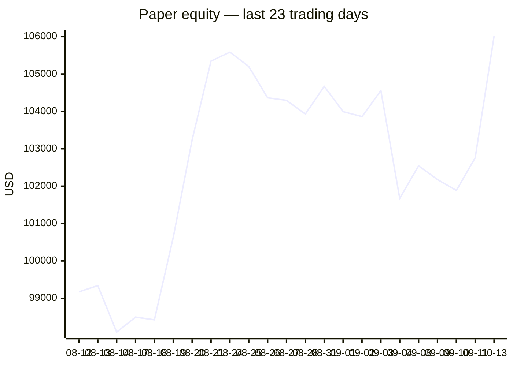
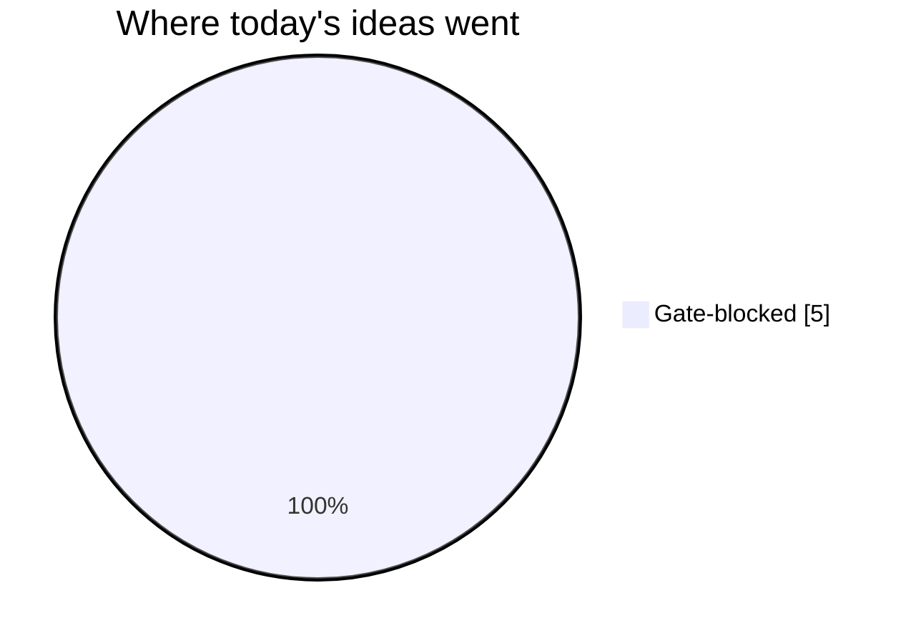
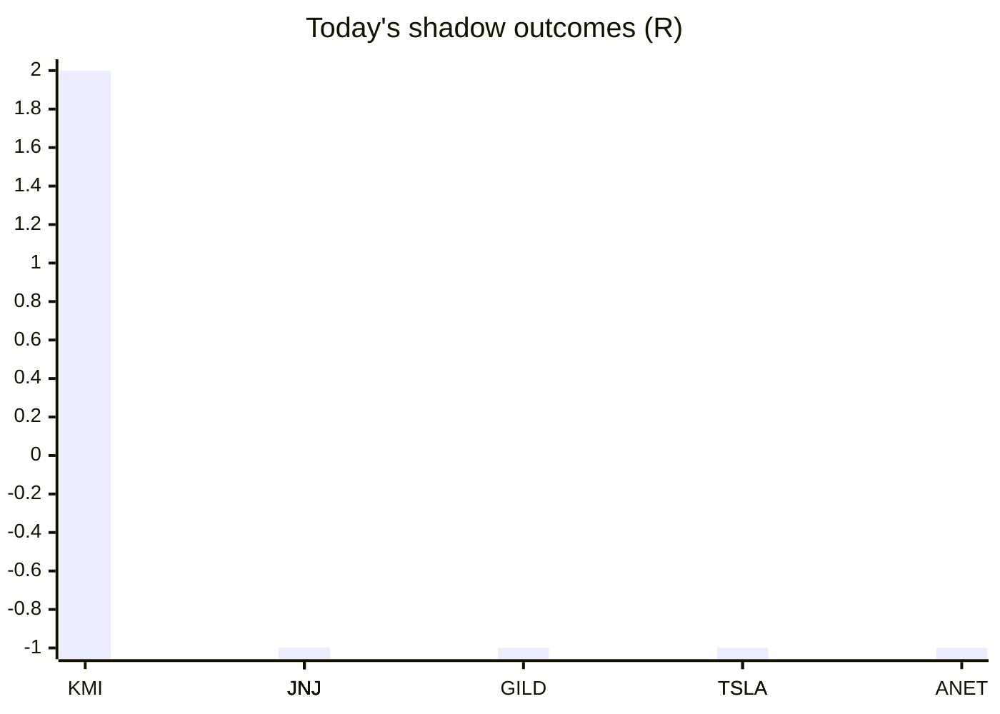

# Trading day 2026-10-13

Paper equity **$106,012** · day +0.85% · regime trending · config v4-seeded · VIX 15.21 (down)

## Charts

## Activity

- Theses formed: 3 (approved→orders: 0, human-rejected: 0, expired unapproved: 0)
- Risk gate blocked: 5
- Fills at the broker: 3

### Positions closed (real book)

- KO → **stopped** -1R · banked -385% of its +0.26R peak

Exit quality: banked **-385%** of peak open profit across 1 closed position(s) that had a real peak to protect. Persistently low = greed (holding through the give-back); high but with peaks barely above the exits = fear (selling winners too early).

### Execution quality (measured, today)

- equities: 1 fill(s) · avg slippage cost 0.207R (negative = better than intended) · 6.6 bps · worst 0.207R

### The day's ideas

- **KMI** (momentum-breakout) entry 33.28 stop 33.14 target 33.56 — Broke 20-bar high (33.28) with stock and SPY above their 20-day averages. Stop 2×ATR below, target 2R.
- **KO** (momentum-breakout) entry 90.36 stop 90.07 target 90.94 — Broke 20-bar high (90.35) with stock and SPY above their 20-day averages. Stop 2×ATR below, target 2R.
- **NTAP** (momentum-breakout) entry 237.07 stop 235 target 241.21 — Broke 20-bar high (236.96) with stock and SPY above their 20-day averages. Stop 2×ATR below, target 2R.

## Shadow ledger (what would have happened)

- KMI (momentum-breakout, gate-blocked) → **target** +2R
- JNJ (momentum-breakdown:filtered, filter-blocked) → **stopped** -1R
- JNJ (momentum-breakdown:filtered, filter-blocked) → **stopped** -1R
- JNJ (momentum-breakdown:filtered, filter-blocked) → **stopped** -1R
- GILD (momentum-breakdown:filtered, filter-blocked) → **stopped** -1R
- JNJ (momentum-breakdown:filtered, filter-blocked) → **stopped** -1R
- JNJ (momentum-breakdown:filtered, filter-blocked) → **stopped** -1R
- JNJ (momentum-breakdown:filtered, filter-blocked) → **stopped** -1R
- TSLA (momentum-breakdown:filtered, filter-blocked) → **stopped** -1R
- TSLA (momentum-breakdown:filtered, filter-blocked) → **stopped** -1R
- ANET (momentum-breakdown:filtered, filter-blocked) → **stopped** -1R

Day total: **-8R**

## Running shadow record

Resolved 1 ideas · win rate 100% · total +2R · avg 2R · still tracking 392

## Is the desk earning its keep?

Shadow-outcome R by the desk verdict each idea carried (vetoed/expired ideas only — executed trades don't resolve to an R-outcome yet):

| Verdict | Ideas | Win rate | Avg R |
|---|---|---|---|
| proceed | 0 | —% | — |
| caution | 0 | —% | — |
| avoid | 0 | —% | — |
| none | 1 | 100% | 2 |

*Only 0 scored ideas so far — a preview, not a verdict on the AI yet.*

## Incubation ward

- **pullback-trend** — incubating: 0/25 shadow outcomes
- **crypto-mean-reversion** — incubating: 0/25 shadow outcomes
- **cfd-mean-reversion** — incubating: 0/25 shadow outcomes
- **cfd-opening-range** — incubating: 0/25 shadow outcomes
- **equity-opening-range** — incubating: 0/25 shadow outcomes
- **cfd-pair-reversion** — incubating: 0/25 shadow outcomes
- **momentum-breakdown** — incubating: 0/25 shadow outcomes
- **mean-reversion-short** — incubating: 0/25 shadow outcomes
- **cfd-momentum-breakdown** — incubating: 0/25 shadow outcomes
- **cfd-mean-reversion-short** — incubating: 0/25 shadow outcomes

*Incubating strategies shadow-track every signal but never execute. Graduation is mechanical: 25+ outcomes, avg ≥ +0.10R, wins ≥ 40%.*

*Generated by code, no AI. Paper account only.*
