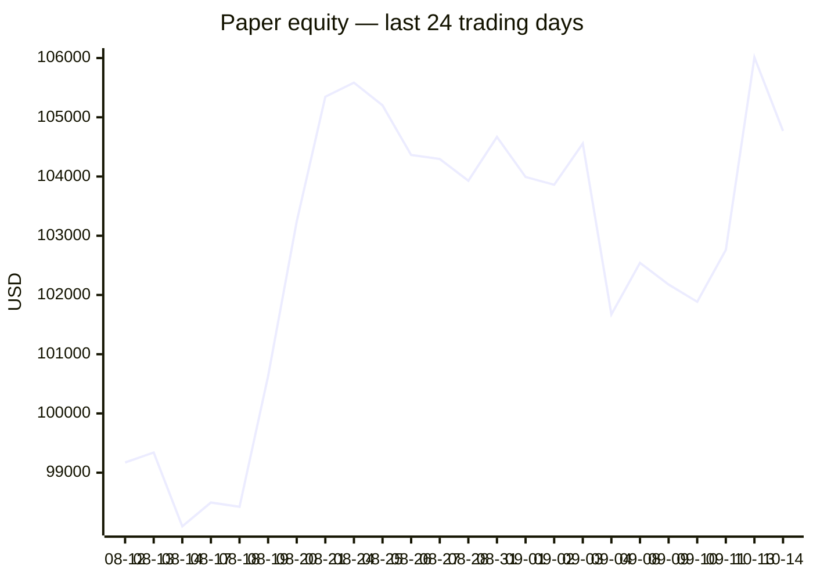

# Trading day 2026-10-14

Paper equity **$104,770** · day -1.22% · regime choppy · config v4-seeded · VIX 15.27 (up)

## Charts

```mermaid
xychart-beta
  title "Today's shadow outcomes (R)"
  x-axis ["XAG_USD", "BAC", "BAC", "BAC", "BAC", "BAC", "BAC", "JNJ", "JNJ", "JNJ", "COP", "WMT", "WMT", "WMT", "WMT", "WMT", "WMT", "WMT", "WMT", "WMT", "WMT", "WMT", "WMT", "WMT", "NTAP", "WMT", "WMT", "WMT", "WMT", "WMT", "WMT", "WMT", "WMT", "WMT", "WMT", "WMT", "WMT", "NFLX", "WMT", "V", "JPM", "WMT", "NFLX", "JPM", "WMT", "TSLA", "NFLX", "JPM", "WMT", "MSFT", "NFLX", "JPM", "WMT", "MA", "MSFT", "NFLX", "JPM", "WMT", "MSFT", "NFLX", "JPM", "WMT", "MSFT", "NFLX", "WMT", "COST", "COST", "COST", "COST", "COST", "COST", "COST", "COST", "COST", "COST", "COST", "COST", "COST", "COST", "COST", "COST", "COST", "COST", "COST", "COST", "COST", "COST", "COST", "COST", "PTC", "JNJ", "JNJ", "JNJ", "JNJ", "JNJ", "JNJ", "JNJ", "JNJ", "JNJ", "JNJ", "JNJ", "JNJ", "JNJ", "JNJ", "JNJ", "JNJ", "JNJ", "AMD", "BAC", "COST", "DVN", "KDP", "COP", "ADI", "AMZN", "DVN", "PSX", "KDP", "COP", "AMZN", "DVN", "PSX", "KDP", "COP", "AMZN", "PSX", "COP", "COP", "COP", "AMZN", "KO", "KDP", "COP", "KO", "KDP", "COP", "PG", "KO", "PEP", "KDP", "DIS", "DIS", "DIS", "DIS", "PEP", "KDP", "PSX", "PSX", "KDP", "PEP", "PSX", "PEP", "PG", "KDP", "KO", "PEP", "KO", "KO", "PGR", "KO", "KDP", "PG", "PG", "PEP", "NTAP", "ADI", "PG", "MCK", "MCK", "NTAP", "MCK", "NTAP", "NTAP", "ELV", "NTAP", "PGR", "PGR", "PTC", "PTC", "PTC", "PTC", "DHR", "DHR", "DHR", "DHR", "PFE", "TSLA", "ELV", "ELV", "PFE", "PFE", "PFE", "PFE", "PFE", "HCA", "HCA", "HCA", "HCA", "DHR", "DHR", "DHR", "CRM", "NTAP", "NTAP", "NTAP", "NTAP", "NTAP", "PEP", "PEP", "PEP", "HCA", "PEP", "HCA", "HCA", "HCA", "PFE", "PEP", "PFE", "PEP", "ELV", "ELV", "ELV", "ELV", "ELV", "ELV", "ELV", "PSX", "PSX", "PSX", "PSX", "PSX", "PSX", "PSX", "PSX", "JNJ", "JNJ", "JNJ", "JNJ", "MSFT", "ELV", "PSX", "PSX", "MSFT", "MSFT", "ELV", "ELV", "ELV", "UNH", "AAPL", "AAPL", "DHR", "AAPL", "AAPL", "DIS", "DIS", "WMB", "WMB", "WMB", "WMB", "DIS", "DIS", "DIS", "MSFT", "MSFT", "MSFT", "MSFT", "MSFT", "AMZN", "PTC", "DHR", "DHR", "MSFT", "MSFT", "AMZN", "DHR", "DHR", "DHR", "WMB", "WMB", "WMB", "WMB", "WMB", "WMB", "JNJ", "DHR", "DHR", "JNJ", "WMB", "WMB", "WMB", "WMB", "KDP", "DIS", "TSLA", "JNJ", "JNJ", "KDP", "KDP", "KDP", "UNH", "KDP", "KDP", "KDP", "KDP", "UNH", "PFE", "TSLA", "TSLA", "PGR", "PFE", "PFE", "TSLA", "TSLA", "TSLA", "TSLA", "PFE", "PFE", "PFE", "PFE", "PFE", "PFE", "MSFT", "PGR", "PGR", "PGR", "PGR", "PGR", "PGR", "PGR", "PGR", "PGR", "WMB", "WMB", "GBP_JPY", "PGR", "UNH", "UNH", "AMZN", "PGR", "JNJ", "PGR", "COST", "WMB", "COST", "COST", "COST", "COST", "COST", "COST", "COST", "COST", "COST", "COST", "COST", "COST", "COST", "PGR", "PGR", "PGR", "PGR", "COST", "BAC", "BAC", "PEP", "PEP", "PEP", "PEP", "PEP", "PEP", "PEP", "BAC", "BAC", "BAC", "BAC", "PEP", "PEP", "PEP", "JNJ", "PGR", "PGR", "BAC", "BAC", "BAC", "BAC", "BAC", "BAC", "BAC", "BAC", "BAC", "NTAP", "NTAP", "NTAP", "PEP", "PEP", "PEP", "PEP", "PEP", "PEP", "PEP", "PEP", "PEP", "PEP", "JPM", "BAC", "JNJ", "JNJ", "PGR", "KO", "COST", "COST", "COST", "COST", "COST", "JNJ", "KO", "PGR", "PGR", "BAC", "BAC", "BAC", "MSFT", "MSFT", "COST", "COST", "BAC", "BAC", "COST", "COST", "COST", "COST", "BAC", "COST", "COST", "BAC", "BAC", "BAC", "BAC", "COST", "COST", "COST", "COST", "COST", "COST", "PTC", "COST", "COST", "META", "PTC", "COST", "PTC", "PTC", "PTC", "COST", "COST", "PTC", "COST", "COST", "COST", "COST", "BAC", "BAC", "BAC", "META", "META", "META", "COST", "COST", "COST", "COST", "AAPL", "MSFT", "COST", "COST", "PTC", "PTC", "PTC", "PTC", "PTC", "PTC", "PTC", "PTC", "MA", "TSLA", "NTAP", "KO", "PFE", "PFE", "KO", "PFE", "PFE", "AMD", "CVX", "AMD", "CVX", "AMD", "AMD", "AMD", "AMD", "AMD", "AMD", "AMD", "AMD", "PGR", "KO", "BAC", "KO", "KO", "DHR", "KO", "KO", "CVX", "NFLX", "NFLX", "NFLX", "NFLX", "NFLX", "CVX", "CVX", "NFLX", "NFLX", "NFLX", "NFLX", "NFLX", "NFLX", "NFLX", "NFLX", "PTC", "CVX", "CVX", "PEP", "PEP", "NFLX", "NFLX", "CRM", "PEP", "PEP", "CVX", "CVX", "TSLA", "AAPL", "AAPL", "NTAP", "NTAP", "NTAP", "NTAP", "NTAP", "NTAP", "NTAP", "PFE", "PFE", "PFE", "PFE", "AAPL", "AAPL", "NTAP", "AAPL", "AAPL", "AAPL", "NTAP", "NTAP", "NTAP", "JNJ", "JNJ", "JNJ", "JNJ", "JNJ", "PFE", "PFE", "MSFT", "MSFT", "AMZN", "AMZN", "AMZN", "AMZN", "PFE", "PFE", "MSFT", "JNJ", "JNJ", "COST", "COST", "COST", "JNJ", "JNJ", "JNJ", "WMT", "WMT", "PFE", "COST", "HCA", "HCA", "PFE", "NFLX", "NFLX", "NFLX", "NFLX", "NFLX", "NFLX", "NFLX", "NFLX", "NVDA", "CRM", "CRM", "AMZN", "AMZN", "AMZN", "AMZN", "NVDA", "NVDA", "CRM", "CRM", "CRM", "CRM", "CRM", "CRM", "HCA", "HCA", "MA", "MA", "MA", "MA", "WMT", "HCA", "HCA", "HCA", "HCA", "MSFT", "MSFT", "MSFT", "MSFT", "HCA", "HCA", "HCA", "HCA", "HCA", "HCA", "HCA", "MA", "MA", "MA", "MSFT", "NFLX", "NFLX", "NFLX", "NFLX", "NVDA", "NVDA", "NVDA", "NVDA", "NFLX", "NFLX", "JNJ", "MA", "MA", "MA", "PG", "PG", "NFLX", "NFLX", "NFLX", "JNJ", "JNJ", "MA", "MA", "MA", "MA", "MSFT", "NVDA", "NVDA", "NVDA", "NVDA", "NVDA", "NVDA", "NVDA", "NVDA", "NVDA", "NVDA", "MSFT", "MSFT", "MSFT", "MSFT", "AMZN", "MSFT", "AMZN", "NVDA", "NVDA", "PG", "PG", "PG", "AMZN", "MSFT", "AMZN", "AMZN", "AMZN", "AMZN", "AMZN", "PFE", "PFE", "NVDA", "NVDA", "NVDA", "NVDA", "NVDA", "HCA", "HCA", "HCA", "HCA", "HCA", "HCA", "HCA", "HCA", "HCA", "HCA", "HCA", "HCA", "HCA", "HCA", "HCA", "HCA", "HCA", "HCA", "HCA", "HCA", "HCA", "HCA", "HCA", "HCA", "HCA", "HCA", "HCA", "HCA", "HCA", "HCA", "HCA", "HCA", "HCA", "HCA", "HCA", "HCA", "PG", "WMT", "PFE", "PFE", "PFE", "PFE", "PFE", "MSFT", "PFE", "ELV", "ELV", "ELV", "ADI", "WMT", "ADI", "ADI", "NVDA", "NVDA", "ADI", "ADI", "ADI", "NVDA", "NVDA", "NVDA", "NVDA", "ADI", "ADI", "ADI", "NFLX", "PFE", "TSLA", "NVDA", "NVDA", "NVDA", "PFE", "ADI", "ADI", "CVX", "WMT", "CVX", "CVX", "PFE", "PFE", "PFE", "PFE", "CVX", "CVX", "MCK", "MCK", "MCK", "MCK", "MCK", "MCK", "MCK", "MCK", "MCK", "MCK", "MCK", "MCK", "MCK", "MCK", "AMZN", "AMZN", "AMZN", "COST", "AAPL", "WMT", "WMT", "WMT", "COST", "COST", "AAPL", "AAPL", "AAPL", "AAPL", "AAPL", "AAPL", "AAPL", "AAPL", "AAPL", "AAPL", "WMT", "WMT", "WMT", "CRM", "WMT", "WMT", "PG", "NFLX", "NFLX", "NFLX", "COST", "COST", "COST", "COST", "COST", "COST", "COST", "COST", "COST", "COST", "BAC", "KDP", "DIS", "DIS", "DIS", "DIS", "DIS", "DIS", "WMT", "WMT", "BAC", "KDP", "KDP", "KDP", "KDP", "KDP", "KDP", "DIS", "BAC", "PFE", "DIS", "DIS", "DIS", "COST", "COST", "PFE", "PFE", "PFE", "PFE", "PFE", "HCA", "HCA", "DIS", "DIS", "PG", "PG", "COST", "COST", "BAC", "COST", "COST"]
  bar [2, 2, 2, 2, 2, 2, 2, -1, -1, -1, 2, -1, -1, -1, -1, -1, -1, -1, -1, -1, -1, -1, -1, -1, -1, -1, -1, -1, -1, -1, -1, -1, -1, -1, -1, -1, -1, -1, -1, -1, 2, -1, -1, 2, -1, -1, -1, 2, -1, -1, -1, 2, -1, -1, -1, -1, 2, -1, -1, -1, 2, -1, -1, -1, -1, -1, -1, -1, -1, -1, -1, -1, -1, -1, -1, -1, -1, -1, -1, -1, -1, -1, -1, -1, -1, -1, -1, -1, -1, -1, -1, -1, -1, -1, -1, -1, -1, -1, -1, -1, -1, -1, -1, -1, -1, -1, -1, -1, 2, -1, -1, -1, -1, -1, -1, -1, -1, -1, -1, -1, -1, -1, -1, -1, -1, -1, -1, -1, -1, -1, -1, -1, -1, -1, -1, -1, -1, -1, -1, -1, 2, 2, 2, 2, -1, -1, -1, -1, -1, -1, -1, -1, -1, -1, -1, -1, -1, -1, 2, -1, -1, -1, -1, -1, -1, -1, -1, -1, -1, -1, -1, -1, -1, -1, -1, 2, 2, 2, 2, 2, 2, -1, -1, -1, -1, 2, 2, -1, -1, 2, 2, 2, 2, 2, -1, -1, -1, -1, -1, -1, -1, -1, -1, -1, -1, -1, -1, -1, -1, -1, -1, -1, -1, -1, -1, 2, -1, 2, -1, -1, -1, -1, -1, -1, -1, -1, -1, -1, -1, -1, -1, -1, -1, -1, -1, -1, -1, -1, 2, -1, -1, -1, 2, 2, -1, -1, -1, -1, -1, -1, -1, -1, -1, -1, -1, -1, -1, -1, -1, -1, -1, -1, 2, 2, 2, 2, 2, 2, 2, -1, -1, 2, 2, 2, -1, -1, -1, -1, -1, -1, -1, -1, -1, -1, -1, -1, -1, -1, -1, -1, -1, -1, -1, -1, -1, -1, -1, -1, -1, -1, -1, -1, -1, -1, -1, -1, -1, -1, -1, -1, -1, -1, -1, -1, -1, -1, -1, -1, -1, -1, -1, 2, -1, -1, -1, -1, -1, -1, -1, -1, -1, -1, -1, -1, -1, -1, -1, 2, -1, -1, -1, 2, -1, 2, 2, 2, 2, 2, 2, 2, 2, 2, 2, 2, 2, 2, -1, -1, -1, -1, 2, -1, -1, 2, 2, 2, 2, 2, 2, 2, -1, -1, -1, -1, 2, 2, 2, -1, -1, -1, -1, -1, -1, -1, -1, -1, -1, -1, -1, -1, -1, -1, 2, 2, 2, 2, 2, 2, 2, 2, 2, 2, -1, -1, -1, -1, -1, 2, 2, 2, 2, 2, 2, -1, 2, -1, -1, -1, -1, -1, 2, 2, 2, 2, -1, -1, 1.5, 1.5, 1.5, 1.5, -1, 1.5, 1.5, -1, -1, -1, -1, 2, 2, 1.5, 1.5, 1.5, 1.5, -1, 2, 2, 2, -1, 1.5, -1, -1, -1, 1.5, 1.5, -1, 1.5, 1.5, 1.5, 2, -1, -1, -1, 2, 2, 2, 1.5, 1.5, 2, 2, -1, 2, 1.5, 1.5, -1, -1, -1, -1, -1, -1, -1, -1, 2, 2, 2, 2, 2, 2, 2, 2, 2, -1, 2, -1, 2, -1, -1, -1, -1, -1, -1, -1, -1, -1, 2, -1, 2, 2, -1, 2, 2, 2, -1, -1, -1, -1, -1, 2, 2, -1, -1, -1, -1, -1, -1, -1, -1, 2, 2, 2, 2, 2, -1, -1, -1, 2, 2, 2, 2, -1, -1, -1, 2, 2, 2, 2, 2, 2, 2, 2, 2, 2, 2, -1, -1, 2, -1, -1, -1, 2, 2, 2, -1, -1, -1, -1, -1, 2, 2, 2, 2, 2, 2, 2, 2, 2, 2, 2, -1, -1, 1.5, 1.5, 2, -1, -1, -1, 2, 2, 2, 2, 2, 2, 2, -1, -1, -1, -1, -1, -1, -1, -1, 2, -1, -1, 2, 2, 2, 2, 2, 2, -1, -1, -1, -1, -1, -1, 2, 2, -1, -1, -1, -1, 2, 2, 2, 2, 2, 2, 2, 2, 2, 2, 2, 2, 2, 2, 2, 2, -1, -1, -1, 2, -1, -1, -1, -1, 2, 2, 2, 2, -1, -1, -1, -1, -1, -1, 2, 2, -1, -1, -1, -1, -1, -1, -1, -1, -1, 2, -1, -1, -1, -1, -1, -1, -1, -1, -1, -1, 2, 2, 2, 2, 2, 2, 2, 2, 2, 2, 2, 2, 2, 2, 2, 2, 2, 2, 2, -1, -1, 2, 2, 2, 2, 2, 2, 2, 2, 2, 2, 2, 2, 2, 2, 2, 2, 2, 2, 2, 2, 2, 2, 2, 2, 2, 2, 2, 2, 2, 2, 2, 2, 2, 2, 2, 2, 2, 2, 2, 2, 2, 2, 2, -1, -1, -1, -1, -1, 2, -1, -1, -1, -1, -1, 2, -1, -1, -1, -1, -1, -1, -1, -1, -1, -1, -1, -1, -1, -1, -1, -1, -1, -1, -1, -1, -1, -1, -1, 2, 2, 2, 2, -1, -1, -1, -1, 2, 2, -1, -1, -1, -1, -1, -1, -1, -1, -1, -1, -1, -1, -1, -1, 2, 2, 2, 2, -1, 2, 2, 2, 2, 2, -1, -1, -1, -1, -1, -1, -1, -1, -1, -1, 2, 2, 2, -1, 2, 2, 2, -1, -1, -1, 2, 2, 2, 2, 2, 2, 2, 2, 2, 2, 0.79, -1, -1, -1, -1, -1, -1, -1, 2, 2, 0.62, -1, -1, -1, -1, -1, -1, -1, 0.78, -1, -1, -1, -1, 2, 2, -1, -1, -1, -1, -1, -1, -1, -1, -1, 2, 2, 2, 2, 0.8, 2, 2]
```

## Activity

- Theses formed: 0 (approved→orders: 0, human-rejected: 0, expired unapproved: 0)
- Risk gate blocked: 0
- Fills at the broker: 1

### Positions closed (real book)

- HD → **stopped** +0.35R · banked 14% of its +2.5R peak

Exit quality: banked **14%** of peak open profit across 1 closed position(s) that had a real peak to protect. Persistently low = greed (holding through the give-back); high but with peaks barely above the exits = fear (selling winners too early).

## Shadow ledger (what would have happened)

- XAG_USD (cfd-momentum-breakdown, incubation) → **target** +2R
- BAC (momentum-breakdown:filtered, filter-blocked) → **target** +2R
- BAC (momentum-breakdown:filtered, filter-blocked) → **target** +2R
- BAC (momentum-breakdown:filtered, filter-blocked) → **target** +2R
- BAC (momentum-breakdown:filtered, filter-blocked) → **target** +2R
- BAC (momentum-breakdown:filtered, filter-blocked) → **target** +2R
- BAC (momentum-breakdown:filtered, filter-blocked) → **target** +2R
- JNJ (momentum-breakdown:filtered, filter-blocked) → **stopped** -1R
- JNJ (momentum-breakdown:filtered, filter-blocked) → **stopped** -1R
- JNJ (momentum-breakdown:filtered, filter-blocked) → **stopped** -1R
- COP (momentum-breakout, gate-blocked) → **target** +2R
- WMT (momentum-breakdown:filtered, filter-blocked) → **stopped** -1R
- WMT (momentum-breakdown:filtered, filter-blocked) → **stopped** -1R
- WMT (momentum-breakdown:filtered, filter-blocked) → **stopped** -1R
- WMT (momentum-breakdown:filtered, filter-blocked) → **stopped** -1R
- WMT (momentum-breakdown:filtered, filter-blocked) → **stopped** -1R
- WMT (momentum-breakdown:filtered, filter-blocked) → **stopped** -1R
- WMT (momentum-breakdown:filtered, filter-blocked) → **stopped** -1R
- WMT (momentum-breakdown:filtered, filter-blocked) → **stopped** -1R
- WMT (momentum-breakdown:filtered, filter-blocked) → **stopped** -1R
- WMT (momentum-breakdown:filtered, filter-blocked) → **stopped** -1R
- WMT (momentum-breakdown:filtered, filter-blocked) → **stopped** -1R
- WMT (momentum-breakdown:filtered, filter-blocked) → **stopped** -1R
- WMT (momentum-breakdown:filtered, filter-blocked) → **stopped** -1R
- NTAP (momentum-breakout, gate-blocked) → **stopped** -1R
- WMT (momentum-breakdown:filtered, filter-blocked) → **stopped** -1R
- WMT (momentum-breakdown:filtered, filter-blocked) → **stopped** -1R
- WMT (momentum-breakdown:filtered, filter-blocked) → **stopped** -1R
- WMT (momentum-breakdown:filtered, filter-blocked) → **stopped** -1R
- WMT (momentum-breakdown:filtered, filter-blocked) → **stopped** -1R
- WMT (momentum-breakdown:filtered, filter-blocked) → **stopped** -1R
- WMT (momentum-breakdown:filtered, filter-blocked) → **stopped** -1R
- WMT (momentum-breakdown:filtered, filter-blocked) → **stopped** -1R
- WMT (momentum-breakdown:filtered, filter-blocked) → **stopped** -1R
- WMT (momentum-breakdown:filtered, filter-blocked) → **stopped** -1R
- WMT (momentum-breakdown:filtered, filter-blocked) → **stopped** -1R
- WMT (momentum-breakdown:filtered, filter-blocked) → **stopped** -1R
- NFLX (momentum-breakdown:filtered, filter-blocked) → **stopped** -1R
- WMT (momentum-breakdown:filtered, filter-blocked) → **stopped** -1R
- V (momentum-breakout, gate-blocked) → **stopped** -1R
- JPM (momentum-breakdown:filtered, filter-blocked) → **target** +2R
- WMT (momentum-breakdown:filtered, filter-blocked) → **stopped** -1R
- NFLX (momentum-breakdown:filtered, filter-blocked) → **stopped** -1R
- JPM (momentum-breakdown:filtered, filter-blocked) → **target** +2R
- WMT (momentum-breakdown:filtered, filter-blocked) → **stopped** -1R
- TSLA (momentum-breakout, gate-blocked) → **stopped** -1R
- NFLX (momentum-breakdown:filtered, filter-blocked) → **stopped** -1R
- JPM (momentum-breakdown:filtered, filter-blocked) → **target** +2R
- WMT (momentum-breakdown:filtered, filter-blocked) → **stopped** -1R
- MSFT (momentum-breakdown:filtered, filter-blocked) → **stopped** -1R
- NFLX (momentum-breakdown:filtered, filter-blocked) → **stopped** -1R
- JPM (momentum-breakdown:filtered, filter-blocked) → **target** +2R
- WMT (momentum-breakdown:filtered, filter-blocked) → **stopped** -1R
- MA (momentum-breakout, gate-blocked) → **stopped** -1R
- MSFT (momentum-breakdown:filtered, filter-blocked) → **stopped** -1R
- NFLX (momentum-breakdown:filtered, filter-blocked) → **stopped** -1R
- JPM (momentum-breakdown:filtered, filter-blocked) → **target** +2R
- WMT (momentum-breakdown:filtered, filter-blocked) → **stopped** -1R
- MSFT (momentum-breakdown:filtered, filter-blocked) → **stopped** -1R
- NFLX (momentum-breakdown:filtered, filter-blocked) → **stopped** -1R
- JPM (momentum-breakdown:filtered, filter-blocked) → **target** +2R
- WMT (momentum-breakdown:filtered, filter-blocked) → **stopped** -1R
- MSFT (momentum-breakdown:filtered, filter-blocked) → **stopped** -1R
- NFLX (momentum-breakdown:filtered, filter-blocked) → **stopped** -1R
- WMT (momentum-breakdown:filtered, filter-blocked) → **stopped** -1R
- COST (momentum-breakdown:filtered, filter-blocked) → **stopped** -1R
- COST (momentum-breakdown:filtered, filter-blocked) → **stopped** -1R
- COST (momentum-breakdown:filtered, filter-blocked) → **stopped** -1R
- COST (momentum-breakdown:filtered, filter-blocked) → **stopped** -1R
- COST (momentum-breakdown:filtered, filter-blocked) → **stopped** -1R
- COST (momentum-breakdown:filtered, filter-blocked) → **stopped** -1R
- COST (momentum-breakdown:filtered, filter-blocked) → **stopped** -1R
- COST (momentum-breakdown:filtered, filter-blocked) → **stopped** -1R
- COST (momentum-breakdown:filtered, filter-blocked) → **stopped** -1R
- COST (momentum-breakdown:filtered, filter-blocked) → **stopped** -1R
- COST (momentum-breakdown:filtered, filter-blocked) → **stopped** -1R
- COST (momentum-breakdown:filtered, filter-blocked) → **stopped** -1R
- COST (momentum-breakdown:filtered, filter-blocked) → **stopped** -1R
- COST (momentum-breakdown:filtered, filter-blocked) → **stopped** -1R
- COST (momentum-breakdown:filtered, filter-blocked) → **stopped** -1R
- COST (momentum-breakdown:filtered, filter-blocked) → **stopped** -1R
- COST (momentum-breakdown:filtered, filter-blocked) → **stopped** -1R
- COST (momentum-breakdown:filtered, filter-blocked) → **stopped** -1R
- COST (momentum-breakdown:filtered, filter-blocked) → **stopped** -1R
- COST (momentum-breakdown:filtered, filter-blocked) → **stopped** -1R
- COST (momentum-breakdown:filtered, filter-blocked) → **stopped** -1R
- COST (momentum-breakdown:filtered, filter-blocked) → **stopped** -1R
- COST (momentum-breakdown:filtered, filter-blocked) → **stopped** -1R
- COST (momentum-breakdown:filtered, filter-blocked) → **stopped** -1R
- PTC (momentum-breakdown:filtered, filter-blocked) → **stopped** -1R
- JNJ (momentum-breakdown:filtered, filter-blocked) → **stopped** -1R
- JNJ (momentum-breakdown:filtered, filter-blocked) → **stopped** -1R
- JNJ (momentum-breakdown:filtered, filter-blocked) → **stopped** -1R
- JNJ (momentum-breakdown:filtered, filter-blocked) → **stopped** -1R
- JNJ (momentum-breakdown:filtered, filter-blocked) → **stopped** -1R
- JNJ (momentum-breakdown:filtered, filter-blocked) → **stopped** -1R
- JNJ (momentum-breakdown:filtered, filter-blocked) → **stopped** -1R
- JNJ (momentum-breakdown:filtered, filter-blocked) → **stopped** -1R
- JNJ (momentum-breakdown:filtered, filter-blocked) → **stopped** -1R
- JNJ (momentum-breakdown:filtered, filter-blocked) → **stopped** -1R
- JNJ (momentum-breakdown:filtered, filter-blocked) → **stopped** -1R
- JNJ (momentum-breakdown:filtered, filter-blocked) → **stopped** -1R
- JNJ (momentum-breakdown:filtered, filter-blocked) → **stopped** -1R
- JNJ (momentum-breakdown:filtered, filter-blocked) → **stopped** -1R
- JNJ (momentum-breakdown:filtered, filter-blocked) → **stopped** -1R
- JNJ (momentum-breakdown:filtered, filter-blocked) → **stopped** -1R
- JNJ (momentum-breakdown:filtered, filter-blocked) → **stopped** -1R
- AMD (momentum-breakout:filtered, filter-blocked) → **stopped** -1R
- BAC (momentum-breakdown:filtered, filter-blocked) → **target** +2R
- COST (momentum-breakdown:filtered, filter-blocked) → **stopped** -1R
- DVN (momentum-breakout:filtered, filter-blocked) → **stopped** -1R
- KDP (momentum-breakout:filtered, filter-blocked) → **stopped** -1R
- COP (momentum-breakout:filtered, filter-blocked) → **stopped** -1R
- ADI (momentum-breakout:filtered, filter-blocked) → **stopped** -1R
- AMZN (momentum-breakdown:filtered, filter-blocked) → **stopped** -1R
- DVN (momentum-breakout:filtered, filter-blocked) → **stopped** -1R
- PSX (momentum-breakout:filtered, filter-blocked) → **stopped** -1R
- KDP (momentum-breakout:filtered, filter-blocked) → **stopped** -1R
- COP (momentum-breakout:filtered, filter-blocked) → **stopped** -1R
- AMZN (momentum-breakdown:filtered, filter-blocked) → **stopped** -1R
- DVN (momentum-breakout:filtered, filter-blocked) → **stopped** -1R
- PSX (momentum-breakout:filtered, filter-blocked) → **stopped** -1R
- KDP (momentum-breakout:filtered, filter-blocked) → **stopped** -1R
- COP (momentum-breakout:filtered, filter-blocked) → **stopped** -1R
- AMZN (momentum-breakdown:filtered, filter-blocked) → **stopped** -1R
- PSX (momentum-breakout:filtered, filter-blocked) → **stopped** -1R
- COP (momentum-breakout:filtered, filter-blocked) → **stopped** -1R
- COP (momentum-breakout:filtered, filter-blocked) → **stopped** -1R
- COP (momentum-breakout:filtered, filter-blocked) → **stopped** -1R
- AMZN (momentum-breakdown:filtered, filter-blocked) → **stopped** -1R
- KO (momentum-breakout:filtered, filter-blocked) → **stopped** -1R
- KDP (momentum-breakout:filtered, filter-blocked) → **stopped** -1R
- COP (momentum-breakout:filtered, filter-blocked) → **stopped** -1R
- KO (momentum-breakout:filtered, filter-blocked) → **stopped** -1R
- KDP (momentum-breakout:filtered, filter-blocked) → **stopped** -1R
- COP (momentum-breakout:filtered, filter-blocked) → **stopped** -1R
- PG (momentum-breakout:filtered, filter-blocked) → **stopped** -1R
- KO (momentum-breakout:filtered, filter-blocked) → **stopped** -1R
- PEP (momentum-breakout:filtered, filter-blocked) → **stopped** -1R
- KDP (momentum-breakout:filtered, filter-blocked) → **stopped** -1R
- DIS (momentum-breakdown:filtered, filter-blocked) → **target** +2R
- DIS (momentum-breakdown:filtered, filter-blocked) → **target** +2R
- DIS (momentum-breakdown:filtered, filter-blocked) → **target** +2R
- DIS (momentum-breakdown:filtered, filter-blocked) → **target** +2R
- PEP (momentum-breakout:filtered, filter-blocked) → **stopped** -1R
- KDP (momentum-breakout:filtered, filter-blocked) → **stopped** -1R
- PSX (momentum-breakout:filtered, filter-blocked) → **stopped** -1R
- PSX (momentum-breakout:filtered, filter-blocked) → **stopped** -1R
- KDP (momentum-breakout:filtered, filter-blocked) → **stopped** -1R
- PEP (momentum-breakout:filtered, filter-blocked) → **stopped** -1R
- PSX (momentum-breakout:filtered, filter-blocked) → **stopped** -1R
- PEP (momentum-breakout:filtered, filter-blocked) → **stopped** -1R
- PG (momentum-breakout:filtered, filter-blocked) → **stopped** -1R
- KDP (momentum-breakout:filtered, filter-blocked) → **stopped** -1R
- KO (momentum-breakout:filtered, filter-blocked) → **stopped** -1R
- PEP (momentum-breakout:filtered, filter-blocked) → **stopped** -1R
- KO (momentum-breakout:filtered, filter-blocked) → **stopped** -1R
- KO (momentum-breakout:filtered, filter-blocked) → **stopped** -1R
- PGR (momentum-breakdown:filtered, filter-blocked) → **target** +2R
- KO (momentum-breakout:filtered, filter-blocked) → **stopped** -1R
- KDP (momentum-breakout:filtered, filter-blocked) → **stopped** -1R
- PG (momentum-breakout:filtered, filter-blocked) → **stopped** -1R
- PG (momentum-breakout:filtered, filter-blocked) → **stopped** -1R
- PEP (momentum-breakout:filtered, filter-blocked) → **stopped** -1R
- NTAP (momentum-breakdown:filtered, filter-blocked) → **stopped** -1R
- ADI (momentum-breakdown:filtered, filter-blocked) → **stopped** -1R
- PG (momentum-breakout:filtered, filter-blocked) → **stopped** -1R
- MCK (momentum-breakout:filtered, filter-blocked) → **stopped** -1R
- MCK (momentum-breakout:filtered, filter-blocked) → **stopped** -1R
- NTAP (momentum-breakdown:filtered, filter-blocked) → **stopped** -1R
- MCK (momentum-breakout:filtered, filter-blocked) → **stopped** -1R
- NTAP (momentum-breakdown:filtered, filter-blocked) → **stopped** -1R
- NTAP (momentum-breakdown:filtered, filter-blocked) → **stopped** -1R
- ELV (momentum-breakout:filtered, filter-blocked) → **stopped** -1R
- NTAP (momentum-breakdown:filtered, filter-blocked) → **stopped** -1R
- PGR (momentum-breakdown:filtered, filter-blocked) → **target** +2R
- PGR (momentum-breakdown:filtered, filter-blocked) → **target** +2R
- PTC (momentum-breakdown:filtered, filter-blocked) → **target** +2R
- PTC (momentum-breakdown:filtered, filter-blocked) → **target** +2R
- PTC (momentum-breakdown:filtered, filter-blocked) → **target** +2R
- PTC (momentum-breakdown:filtered, filter-blocked) → **target** +2R
- DHR (momentum-breakout:filtered, filter-blocked) → **stopped** -1R
- DHR (momentum-breakout:filtered, filter-blocked) → **stopped** -1R
- DHR (momentum-breakout:filtered, filter-blocked) → **stopped** -1R
- DHR (momentum-breakout:filtered, filter-blocked) → **stopped** -1R
- PFE (momentum-breakout:filtered, filter-blocked) → **target** +2R
- TSLA (momentum-breakdown:filtered, filter-blocked) → **target** +2R
- ELV (momentum-breakout:filtered, filter-blocked) → **stopped** -1R
- ELV (momentum-breakout:filtered, filter-blocked) → **stopped** -1R
- PFE (momentum-breakout:filtered, filter-blocked) → **target** +2R
- PFE (momentum-breakout:filtered, filter-blocked) → **target** +2R
- PFE (momentum-breakout:filtered, filter-blocked) → **target** +2R
- PFE (momentum-breakout:filtered, filter-blocked) → **target** +2R
- PFE (momentum-breakout:filtered, filter-blocked) → **target** +2R
- HCA (momentum-breakout:filtered, filter-blocked) → **stopped** -1R
- HCA (momentum-breakout:filtered, filter-blocked) → **stopped** -1R
- HCA (momentum-breakout:filtered, filter-blocked) → **stopped** -1R
- HCA (momentum-breakout:filtered, filter-blocked) → **stopped** -1R
- DHR (momentum-breakout:filtered, filter-blocked) → **stopped** -1R
- DHR (momentum-breakout:filtered, filter-blocked) → **stopped** -1R
- DHR (momentum-breakout:filtered, filter-blocked) → **stopped** -1R
- CRM (momentum-breakout:filtered, filter-blocked) → **stopped** -1R
- NTAP (momentum-breakdown:filtered, filter-blocked) → **stopped** -1R
- NTAP (momentum-breakdown:filtered, filter-blocked) → **stopped** -1R
- NTAP (momentum-breakdown:filtered, filter-blocked) → **stopped** -1R
- NTAP (momentum-breakdown:filtered, filter-blocked) → **stopped** -1R
- NTAP (momentum-breakdown:filtered, filter-blocked) → **stopped** -1R
- PEP (momentum-breakout:filtered, filter-blocked) → **stopped** -1R
- PEP (momentum-breakout:filtered, filter-blocked) → **stopped** -1R
- PEP (momentum-breakout:filtered, filter-blocked) → **stopped** -1R
- HCA (momentum-breakout:filtered, filter-blocked) → **stopped** -1R
- PEP (momentum-breakout:filtered, filter-blocked) → **stopped** -1R
- HCA (momentum-breakout:filtered, filter-blocked) → **stopped** -1R
- HCA (momentum-breakout:filtered, filter-blocked) → **stopped** -1R
- HCA (momentum-breakout:filtered, filter-blocked) → **stopped** -1R
- PFE (momentum-breakout:filtered, filter-blocked) → **target** +2R
- PEP (momentum-breakout:filtered, filter-blocked) → **stopped** -1R
- PFE (momentum-breakout:filtered, filter-blocked) → **target** +2R
- PEP (momentum-breakout:filtered, filter-blocked) → **stopped** -1R
- ELV (momentum-breakout:filtered, filter-blocked) → **stopped** -1R
- ELV (momentum-breakout:filtered, filter-blocked) → **stopped** -1R
- ELV (momentum-breakout:filtered, filter-blocked) → **stopped** -1R
- ELV (momentum-breakout:filtered, filter-blocked) → **stopped** -1R
- ELV (momentum-breakout:filtered, filter-blocked) → **stopped** -1R
- ELV (momentum-breakout:filtered, filter-blocked) → **stopped** -1R
- ELV (momentum-breakout:filtered, filter-blocked) → **stopped** -1R
- PSX (momentum-breakout:filtered, filter-blocked) → **stopped** -1R
- PSX (momentum-breakout:filtered, filter-blocked) → **stopped** -1R
- PSX (momentum-breakout:filtered, filter-blocked) → **stopped** -1R
- PSX (momentum-breakout:filtered, filter-blocked) → **stopped** -1R
- PSX (momentum-breakout:filtered, filter-blocked) → **stopped** -1R
- PSX (momentum-breakout:filtered, filter-blocked) → **stopped** -1R
- PSX (momentum-breakout:filtered, filter-blocked) → **stopped** -1R
- PSX (momentum-breakout:filtered, filter-blocked) → **stopped** -1R
- JNJ (momentum-breakdown:filtered, filter-blocked) → **stopped** -1R
- JNJ (momentum-breakdown:filtered, filter-blocked) → **stopped** -1R
- JNJ (momentum-breakdown:filtered, filter-blocked) → **stopped** -1R
- JNJ (momentum-breakdown:filtered, filter-blocked) → **stopped** -1R
- MSFT (momentum-breakdown:filtered, filter-blocked) → **target** +2R
- ELV (momentum-breakout:filtered, filter-blocked) → **stopped** -1R
- PSX (momentum-breakout:filtered, filter-blocked) → **stopped** -1R
- PSX (momentum-breakout:filtered, filter-blocked) → **stopped** -1R
- MSFT (momentum-breakdown:filtered, filter-blocked) → **target** +2R
- MSFT (momentum-breakdown:filtered, filter-blocked) → **target** +2R
- ELV (momentum-breakout:filtered, filter-blocked) → **stopped** -1R
- ELV (momentum-breakout:filtered, filter-blocked) → **stopped** -1R
- ELV (momentum-breakout:filtered, filter-blocked) → **stopped** -1R
- UNH (momentum-breakout:filtered, filter-blocked) → **stopped** -1R
- AAPL (momentum-breakout:filtered, filter-blocked) → **stopped** -1R
- AAPL (momentum-breakout:filtered, filter-blocked) → **stopped** -1R
- DHR (momentum-breakout:filtered, filter-blocked) → **stopped** -1R
- AAPL (momentum-breakout:filtered, filter-blocked) → **stopped** -1R
- AAPL (momentum-breakout:filtered, filter-blocked) → **stopped** -1R
- DIS (momentum-breakdown:filtered, filter-blocked) → **stopped** -1R
- DIS (momentum-breakdown:filtered, filter-blocked) → **stopped** -1R
- WMB (momentum-breakdown:filtered, filter-blocked) → **stopped** -1R
- WMB (momentum-breakdown:filtered, filter-blocked) → **stopped** -1R
- WMB (momentum-breakdown:filtered, filter-blocked) → **stopped** -1R
- WMB (momentum-breakdown:filtered, filter-blocked) → **stopped** -1R
- DIS (momentum-breakdown:filtered, filter-blocked) → **stopped** -1R
- DIS (momentum-breakdown:filtered, filter-blocked) → **stopped** -1R
- DIS (momentum-breakdown:filtered, filter-blocked) → **stopped** -1R
- MSFT (momentum-breakdown:filtered, filter-blocked) → **target** +2R
- MSFT (momentum-breakdown:filtered, filter-blocked) → **target** +2R
- MSFT (momentum-breakdown:filtered, filter-blocked) → **target** +2R
- MSFT (momentum-breakdown:filtered, filter-blocked) → **target** +2R
- MSFT (momentum-breakdown:filtered, filter-blocked) → **target** +2R
- AMZN (momentum-breakdown:filtered, filter-blocked) → **target** +2R
- PTC (momentum-breakdown:filtered, filter-blocked) → **target** +2R
- DHR (momentum-breakout:filtered, filter-blocked) → **stopped** -1R
- DHR (momentum-breakout:filtered, filter-blocked) → **stopped** -1R
- MSFT (momentum-breakdown:filtered, filter-blocked) → **target** +2R
- MSFT (momentum-breakdown:filtered, filter-blocked) → **target** +2R
- AMZN (momentum-breakdown:filtered, filter-blocked) → **target** +2R
- DHR (momentum-breakout:filtered, filter-blocked) → **stopped** -1R
- DHR (momentum-breakout:filtered, filter-blocked) → **stopped** -1R
- DHR (momentum-breakout:filtered, filter-blocked) → **stopped** -1R
- WMB (momentum-breakdown:filtered, filter-blocked) → **stopped** -1R
- WMB (momentum-breakdown:filtered, filter-blocked) → **stopped** -1R
- WMB (momentum-breakdown:filtered, filter-blocked) → **stopped** -1R
- WMB (momentum-breakdown:filtered, filter-blocked) → **stopped** -1R
- WMB (momentum-breakdown:filtered, filter-blocked) → **stopped** -1R
- WMB (momentum-breakdown:filtered, filter-blocked) → **stopped** -1R
- JNJ (momentum-breakdown:filtered, filter-blocked) → **stopped** -1R
- DHR (momentum-breakout:filtered, filter-blocked) → **stopped** -1R
- DHR (momentum-breakout:filtered, filter-blocked) → **stopped** -1R
- JNJ (momentum-breakdown:filtered, filter-blocked) → **stopped** -1R
- WMB (momentum-breakdown:filtered, filter-blocked) → **stopped** -1R
- WMB (momentum-breakdown:filtered, filter-blocked) → **stopped** -1R
- WMB (momentum-breakdown:filtered, filter-blocked) → **stopped** -1R
- WMB (momentum-breakdown:filtered, filter-blocked) → **stopped** -1R
- KDP (momentum-breakdown:filtered, filter-blocked) → **stopped** -1R
- DIS (momentum-breakdown:filtered, filter-blocked) → **stopped** -1R
- TSLA (momentum-breakdown:filtered, filter-blocked) → **stopped** -1R
- JNJ (momentum-breakdown:filtered, filter-blocked) → **stopped** -1R
- JNJ (momentum-breakdown:filtered, filter-blocked) → **stopped** -1R
- KDP (momentum-breakdown:filtered, filter-blocked) → **stopped** -1R
- KDP (momentum-breakdown:filtered, filter-blocked) → **stopped** -1R
- KDP (momentum-breakdown:filtered, filter-blocked) → **stopped** -1R
- UNH (momentum-breakout:filtered, filter-blocked) → **stopped** -1R
- KDP (momentum-breakdown:filtered, filter-blocked) → **stopped** -1R
- KDP (momentum-breakdown:filtered, filter-blocked) → **stopped** -1R
- KDP (momentum-breakdown:filtered, filter-blocked) → **stopped** -1R
- KDP (momentum-breakdown:filtered, filter-blocked) → **stopped** -1R
- UNH (momentum-breakout:filtered, filter-blocked) → **stopped** -1R
- PFE (momentum-breakout:filtered, filter-blocked) → **stopped** -1R
- TSLA (momentum-breakdown:filtered, filter-blocked) → **stopped** -1R
- TSLA (momentum-breakdown:filtered, filter-blocked) → **stopped** -1R
- PGR (momentum-breakdown:filtered, filter-blocked) → **stopped** -1R
- PFE (momentum-breakout:filtered, filter-blocked) → **stopped** -1R
- PFE (momentum-breakout:filtered, filter-blocked) → **stopped** -1R
- TSLA (momentum-breakdown:filtered, filter-blocked) → **stopped** -1R
- TSLA (momentum-breakdown:filtered, filter-blocked) → **stopped** -1R
- TSLA (momentum-breakdown:filtered, filter-blocked) → **stopped** -1R
- TSLA (momentum-breakdown:filtered, filter-blocked) → **stopped** -1R
- PFE (momentum-breakout:filtered, filter-blocked) → **stopped** -1R
- PFE (momentum-breakout:filtered, filter-blocked) → **stopped** -1R
- PFE (momentum-breakout:filtered, filter-blocked) → **stopped** -1R
- PFE (momentum-breakout:filtered, filter-blocked) → **stopped** -1R
- PFE (momentum-breakout:filtered, filter-blocked) → **stopped** -1R
- PFE (momentum-breakout:filtered, filter-blocked) → **stopped** -1R
- MSFT (momentum-breakdown:filtered, filter-blocked) → **target** +2R
- PGR (momentum-breakdown:filtered, filter-blocked) → **stopped** -1R
- PGR (momentum-breakdown:filtered, filter-blocked) → **stopped** -1R
- PGR (momentum-breakdown:filtered, filter-blocked) → **stopped** -1R
- PGR (momentum-breakdown:filtered, filter-blocked) → **stopped** -1R
- PGR (momentum-breakdown:filtered, filter-blocked) → **stopped** -1R
- PGR (momentum-breakdown:filtered, filter-blocked) → **stopped** -1R
- PGR (momentum-breakdown:filtered, filter-blocked) → **stopped** -1R
- PGR (momentum-breakdown:filtered, filter-blocked) → **stopped** -1R
- PGR (momentum-breakdown:filtered, filter-blocked) → **stopped** -1R
- WMB (momentum-breakdown:filtered, filter-blocked) → **stopped** -1R
- WMB (momentum-breakdown:filtered, filter-blocked) → **stopped** -1R
- GBP_JPY (cfd-momentum-breakout, gate-blocked) → **stopped** -1R
- PGR (momentum-breakdown:filtered, filter-blocked) → **stopped** -1R
- UNH (momentum-breakout:filtered, filter-blocked) → **stopped** -1R
- UNH (momentum-breakout:filtered, filter-blocked) → **stopped** -1R
- AMZN (momentum-breakdown:filtered, filter-blocked) → **target** +2R
- PGR (momentum-breakdown:filtered, filter-blocked) → **stopped** -1R
- JNJ (momentum-breakdown:filtered, filter-blocked) → **stopped** -1R
- PGR (momentum-breakdown:filtered, filter-blocked) → **stopped** -1R
- COST (momentum-breakout:filtered, filter-blocked) → **target** +2R
- WMB (momentum-breakdown:filtered, filter-blocked) → **stopped** -1R
- COST (momentum-breakout:filtered, filter-blocked) → **target** +2R
- COST (momentum-breakout:filtered, filter-blocked) → **target** +2R
- COST (momentum-breakout:filtered, filter-blocked) → **target** +2R
- COST (momentum-breakout:filtered, filter-blocked) → **target** +2R
- COST (momentum-breakout:filtered, filter-blocked) → **target** +2R
- COST (momentum-breakout:filtered, filter-blocked) → **target** +2R
- COST (momentum-breakout:filtered, filter-blocked) → **target** +2R
- COST (momentum-breakout:filtered, filter-blocked) → **target** +2R
- COST (momentum-breakout:filtered, filter-blocked) → **target** +2R
- COST (momentum-breakout:filtered, filter-blocked) → **target** +2R
- COST (momentum-breakout:filtered, filter-blocked) → **target** +2R
- COST (momentum-breakout:filtered, filter-blocked) → **target** +2R
- COST (momentum-breakout:filtered, filter-blocked) → **target** +2R
- PGR (momentum-breakdown:filtered, filter-blocked) → **stopped** -1R
- PGR (momentum-breakdown:filtered, filter-blocked) → **stopped** -1R
- PGR (momentum-breakdown:filtered, filter-blocked) → **stopped** -1R
- PGR (momentum-breakdown:filtered, filter-blocked) → **stopped** -1R
- COST (momentum-breakout:filtered, filter-blocked) → **target** +2R
- BAC (momentum-breakdown:filtered, filter-blocked) → **stopped** -1R
- BAC (momentum-breakdown:filtered, filter-blocked) → **stopped** -1R
- PEP (momentum-breakout:filtered, filter-blocked) → **target** +2R
- PEP (momentum-breakout:filtered, filter-blocked) → **target** +2R
- PEP (momentum-breakout:filtered, filter-blocked) → **target** +2R
- PEP (momentum-breakout:filtered, filter-blocked) → **target** +2R
- PEP (momentum-breakout:filtered, filter-blocked) → **target** +2R
- PEP (momentum-breakout:filtered, filter-blocked) → **target** +2R
- PEP (momentum-breakout:filtered, filter-blocked) → **target** +2R
- BAC (momentum-breakdown:filtered, filter-blocked) → **stopped** -1R
- BAC (momentum-breakdown:filtered, filter-blocked) → **stopped** -1R
- BAC (momentum-breakdown:filtered, filter-blocked) → **stopped** -1R
- BAC (momentum-breakdown:filtered, filter-blocked) → **stopped** -1R
- PEP (momentum-breakout:filtered, filter-blocked) → **target** +2R
- PEP (momentum-breakout:filtered, filter-blocked) → **target** +2R
- PEP (momentum-breakout:filtered, filter-blocked) → **target** +2R
- JNJ (momentum-breakdown:filtered, filter-blocked) → **stopped** -1R
- PGR (momentum-breakdown:filtered, filter-blocked) → **stopped** -1R
- PGR (momentum-breakdown:filtered, filter-blocked) → **stopped** -1R
- BAC (momentum-breakdown:filtered, filter-blocked) → **stopped** -1R
- BAC (momentum-breakdown:filtered, filter-blocked) → **stopped** -1R
- BAC (momentum-breakdown:filtered, filter-blocked) → **stopped** -1R
- BAC (momentum-breakdown:filtered, filter-blocked) → **stopped** -1R
- BAC (momentum-breakdown:filtered, filter-blocked) → **stopped** -1R
- BAC (momentum-breakdown:filtered, filter-blocked) → **stopped** -1R
- BAC (momentum-breakdown:filtered, filter-blocked) → **stopped** -1R
- BAC (momentum-breakdown:filtered, filter-blocked) → **stopped** -1R
- BAC (momentum-breakdown:filtered, filter-blocked) → **stopped** -1R
- NTAP (equity-opening-range:filtered, filter-blocked) → **stopped** -1R
- NTAP (equity-opening-range:filtered, filter-blocked) → **stopped** -1R
- NTAP (equity-opening-range:filtered, filter-blocked) → **stopped** -1R
- PEP (momentum-breakout:filtered, filter-blocked) → **target** +2R
- PEP (momentum-breakout:filtered, filter-blocked) → **target** +2R
- PEP (momentum-breakout:filtered, filter-blocked) → **target** +2R
- PEP (momentum-breakout:filtered, filter-blocked) → **target** +2R
- PEP (momentum-breakout:filtered, filter-blocked) → **target** +2R
- PEP (momentum-breakout:filtered, filter-blocked) → **target** +2R
- PEP (momentum-breakout:filtered, filter-blocked) → **target** +2R
- PEP (momentum-breakout:filtered, filter-blocked) → **target** +2R
- PEP (momentum-breakout:filtered, filter-blocked) → **target** +2R
- PEP (momentum-breakout:filtered, filter-blocked) → **target** +2R
- JPM (momentum-breakdown:filtered, filter-blocked) → **stopped** -1R
- BAC (momentum-breakdown:filtered, filter-blocked) → **stopped** -1R
- JNJ (momentum-breakdown:filtered, filter-blocked) → **stopped** -1R
- JNJ (momentum-breakdown:filtered, filter-blocked) → **stopped** -1R
- PGR (momentum-breakdown:filtered, filter-blocked) → **stopped** -1R
- KO (momentum-breakout:filtered, filter-blocked) → **target** +2R
- COST (momentum-breakout:filtered, filter-blocked) → **target** +2R
- COST (momentum-breakout:filtered, filter-blocked) → **target** +2R
- COST (momentum-breakout:filtered, filter-blocked) → **target** +2R
- COST (momentum-breakout:filtered, filter-blocked) → **target** +2R
- COST (momentum-breakout:filtered, filter-blocked) → **target** +2R
- JNJ (momentum-breakdown:filtered, filter-blocked) → **stopped** -1R
- KO (momentum-breakout:filtered, filter-blocked) → **target** +2R
- PGR (momentum-breakdown:filtered, filter-blocked) → **stopped** -1R
- PGR (momentum-breakdown:filtered, filter-blocked) → **stopped** -1R
- BAC (momentum-breakdown:filtered, filter-blocked) → **stopped** -1R
- BAC (momentum-breakdown:filtered, filter-blocked) → **stopped** -1R
- BAC (momentum-breakdown:filtered, filter-blocked) → **stopped** -1R
- MSFT (momentum-breakdown:filtered, filter-blocked) → **target** +2R
- MSFT (momentum-breakdown:filtered, filter-blocked) → **target** +2R
- COST (momentum-breakout:filtered, filter-blocked) → **target** +2R
- COST (momentum-breakout:filtered, filter-blocked) → **target** +2R
- BAC (momentum-breakdown:filtered, filter-blocked) → **stopped** -1R
- BAC (momentum-breakdown:filtered, filter-blocked) → **stopped** -1R
- COST (equity-opening-range:filtered, filter-blocked) → **target** +1.5R
- COST (equity-opening-range:filtered, filter-blocked) → **target** +1.5R
- COST (equity-opening-range:filtered, filter-blocked) → **target** +1.5R
- COST (equity-opening-range:filtered, filter-blocked) → **target** +1.5R
- BAC (momentum-breakdown:filtered, filter-blocked) → **stopped** -1R
- COST (equity-opening-range:filtered, filter-blocked) → **target** +1.5R
- COST (equity-opening-range:filtered, filter-blocked) → **target** +1.5R
- BAC (momentum-breakdown:filtered, filter-blocked) → **stopped** -1R
- BAC (momentum-breakdown:filtered, filter-blocked) → **stopped** -1R
- BAC (momentum-breakdown:filtered, filter-blocked) → **stopped** -1R
- BAC (momentum-breakdown:filtered, filter-blocked) → **stopped** -1R
- COST (momentum-breakout:filtered, filter-blocked) → **target** +2R
- COST (momentum-breakout:filtered, filter-blocked) → **target** +2R
- COST (equity-opening-range:filtered, filter-blocked) → **target** +1.5R
- COST (equity-opening-range:filtered, filter-blocked) → **target** +1.5R
- COST (equity-opening-range:filtered, filter-blocked) → **target** +1.5R
- COST (equity-opening-range:filtered, filter-blocked) → **target** +1.5R
- PTC (momentum-breakdown:filtered, filter-blocked) → **stopped** -1R
- COST (momentum-breakout:filtered, filter-blocked) → **target** +2R
- COST (momentum-breakout:filtered, filter-blocked) → **target** +2R
- META (momentum-breakdown:filtered, filter-blocked) → **target** +2R
- PTC (momentum-breakdown:filtered, filter-blocked) → **stopped** -1R
- COST (equity-opening-range:filtered, filter-blocked) → **target** +1.5R
- PTC (momentum-breakdown:filtered, filter-blocked) → **stopped** -1R
- PTC (momentum-breakdown:filtered, filter-blocked) → **stopped** -1R
- PTC (momentum-breakdown:filtered, filter-blocked) → **stopped** -1R
- COST (equity-opening-range:filtered, filter-blocked) → **target** +1.5R
- COST (equity-opening-range:filtered, filter-blocked) → **target** +1.5R
- PTC (momentum-breakdown:filtered, filter-blocked) → **stopped** -1R
- COST (equity-opening-range:filtered, filter-blocked) → **target** +1.5R
- COST (equity-opening-range:filtered, filter-blocked) → **target** +1.5R
- COST (equity-opening-range:filtered, filter-blocked) → **target** +1.5R
- COST (momentum-breakout:filtered, filter-blocked) → **target** +2R
- BAC (momentum-breakdown:filtered, filter-blocked) → **stopped** -1R
- BAC (momentum-breakdown:filtered, filter-blocked) → **stopped** -1R
- BAC (momentum-breakdown:filtered, filter-blocked) → **stopped** -1R
- META (momentum-breakdown:filtered, filter-blocked) → **target** +2R
- META (momentum-breakdown:filtered, filter-blocked) → **target** +2R
- META (momentum-breakdown:filtered, filter-blocked) → **target** +2R
- COST (equity-opening-range:filtered, filter-blocked) → **target** +1.5R
- COST (equity-opening-range:filtered, filter-blocked) → **target** +1.5R
- COST (momentum-breakout:filtered, filter-blocked) → **target** +2R
- COST (momentum-breakout:filtered, filter-blocked) → **target** +2R
- AAPL (momentum-breakout:filtered, filter-blocked) → **stopped** -1R
- MSFT (momentum-breakdown:filtered, filter-blocked) → **target** +2R
- COST (equity-opening-range:filtered, filter-blocked) → **target** +1.5R
- COST (equity-opening-range:filtered, filter-blocked) → **target** +1.5R
- PTC (momentum-breakdown:filtered, filter-blocked) → **stopped** -1R
- PTC (momentum-breakdown:filtered, filter-blocked) → **stopped** -1R
- PTC (momentum-breakdown:filtered, filter-blocked) → **stopped** -1R
- PTC (momentum-breakdown:filtered, filter-blocked) → **stopped** -1R
- PTC (momentum-breakdown:filtered, filter-blocked) → **stopped** -1R
- PTC (momentum-breakdown:filtered, filter-blocked) → **stopped** -1R
- PTC (momentum-breakdown:filtered, filter-blocked) → **stopped** -1R
- PTC (momentum-breakdown:filtered, filter-blocked) → **stopped** -1R
- MA (momentum-breakout, gate-blocked) → **target** +2R
- TSLA (momentum-breakdown:filtered, filter-blocked) → **target** +2R
- NTAP (momentum-breakdown:filtered, filter-blocked) → **target** +2R
- KO (momentum-breakout:filtered, filter-blocked) → **target** +2R
- PFE (momentum-breakout:filtered, filter-blocked) → **target** +2R
- PFE (momentum-breakout:filtered, filter-blocked) → **target** +2R
- KO (momentum-breakout:filtered, filter-blocked) → **target** +2R
- PFE (momentum-breakout:filtered, filter-blocked) → **target** +2R
- PFE (momentum-breakout:filtered, filter-blocked) → **target** +2R
- AMD (pullback-trend:filtered, filter-blocked) → **stopped** -1R
- CVX (momentum-breakout:filtered, filter-blocked) → **target** +2R
- AMD (pullback-trend:filtered, filter-blocked) → **stopped** -1R
- CVX (momentum-breakout:filtered, filter-blocked) → **target** +2R
- AMD (pullback-trend:filtered, filter-blocked) → **stopped** -1R
- AMD (pullback-trend:filtered, filter-blocked) → **stopped** -1R
- AMD (pullback-trend:filtered, filter-blocked) → **stopped** -1R
- AMD (pullback-trend:filtered, filter-blocked) → **stopped** -1R
- AMD (pullback-trend:filtered, filter-blocked) → **stopped** -1R
- AMD (pullback-trend:filtered, filter-blocked) → **stopped** -1R
- AMD (pullback-trend:filtered, filter-blocked) → **stopped** -1R
- AMD (pullback-trend:filtered, filter-blocked) → **stopped** -1R
- PGR (momentum-breakdown:filtered, filter-blocked) → **stopped** -1R
- KO (momentum-breakout:filtered, filter-blocked) → **target** +2R
- BAC (momentum-breakdown:filtered, filter-blocked) → **stopped** -1R
- KO (momentum-breakout:filtered, filter-blocked) → **target** +2R
- KO (momentum-breakout:filtered, filter-blocked) → **target** +2R
- DHR (momentum-breakdown:filtered, filter-blocked) → **stopped** -1R
- KO (momentum-breakout:filtered, filter-blocked) → **target** +2R
- KO (momentum-breakout:filtered, filter-blocked) → **target** +2R
- CVX (momentum-breakout:filtered, filter-blocked) → **target** +2R
- NFLX (momentum-breakdown:filtered, filter-blocked) → **stopped** -1R
- NFLX (momentum-breakdown:filtered, filter-blocked) → **stopped** -1R
- NFLX (momentum-breakdown:filtered, filter-blocked) → **stopped** -1R
- NFLX (momentum-breakdown:filtered, filter-blocked) → **stopped** -1R
- NFLX (momentum-breakdown:filtered, filter-blocked) → **stopped** -1R
- CVX (momentum-breakout:filtered, filter-blocked) → **target** +2R
- CVX (momentum-breakout:filtered, filter-blocked) → **target** +2R
- NFLX (momentum-breakdown:filtered, filter-blocked) → **stopped** -1R
- NFLX (momentum-breakdown:filtered, filter-blocked) → **stopped** -1R
- NFLX (momentum-breakdown:filtered, filter-blocked) → **stopped** -1R
- NFLX (momentum-breakdown:filtered, filter-blocked) → **stopped** -1R
- NFLX (momentum-breakdown:filtered, filter-blocked) → **stopped** -1R
- NFLX (momentum-breakdown:filtered, filter-blocked) → **stopped** -1R
- NFLX (momentum-breakdown:filtered, filter-blocked) → **stopped** -1R
- NFLX (momentum-breakdown:filtered, filter-blocked) → **stopped** -1R
- PTC (momentum-breakdown:filtered, filter-blocked) → **target** +2R
- CVX (momentum-breakout:filtered, filter-blocked) → **target** +2R
- CVX (momentum-breakout:filtered, filter-blocked) → **target** +2R
- PEP (momentum-breakout:filtered, filter-blocked) → **target** +2R
- PEP (momentum-breakout:filtered, filter-blocked) → **target** +2R
- NFLX (momentum-breakdown:filtered, filter-blocked) → **stopped** -1R
- NFLX (momentum-breakdown:filtered, filter-blocked) → **stopped** -1R
- CRM (momentum-breakdown:filtered, filter-blocked) → **stopped** -1R
- PEP (momentum-breakout:filtered, filter-blocked) → **target** +2R
- PEP (momentum-breakout:filtered, filter-blocked) → **target** +2R
- CVX (momentum-breakout:filtered, filter-blocked) → **target** +2R
- CVX (momentum-breakout:filtered, filter-blocked) → **target** +2R
- TSLA (momentum-breakdown:filtered, filter-blocked) → **stopped** -1R
- AAPL (momentum-breakout:filtered, filter-blocked) → **stopped** -1R
- AAPL (momentum-breakout:filtered, filter-blocked) → **stopped** -1R
- NTAP (momentum-breakdown:filtered, filter-blocked) → **target** +2R
- NTAP (momentum-breakdown:filtered, filter-blocked) → **target** +2R
- NTAP (momentum-breakdown:filtered, filter-blocked) → **target** +2R
- NTAP (momentum-breakdown:filtered, filter-blocked) → **target** +2R
- NTAP (momentum-breakdown:filtered, filter-blocked) → **target** +2R
- NTAP (momentum-breakdown:filtered, filter-blocked) → **target** +2R
- NTAP (momentum-breakdown:filtered, filter-blocked) → **target** +2R
- PFE (momentum-breakout:filtered, filter-blocked) → **target** +2R
- PFE (momentum-breakout:filtered, filter-blocked) → **target** +2R
- PFE (momentum-breakout:filtered, filter-blocked) → **target** +2R
- PFE (momentum-breakout:filtered, filter-blocked) → **target** +2R
- AAPL (momentum-breakout:filtered, filter-blocked) → **stopped** -1R
- AAPL (momentum-breakout:filtered, filter-blocked) → **stopped** -1R
- NTAP (momentum-breakdown:filtered, filter-blocked) → **target** +2R
- AAPL (momentum-breakout:filtered, filter-blocked) → **stopped** -1R
- AAPL (momentum-breakout:filtered, filter-blocked) → **stopped** -1R
- AAPL (momentum-breakout:filtered, filter-blocked) → **stopped** -1R
- NTAP (momentum-breakdown:filtered, filter-blocked) → **target** +2R
- NTAP (momentum-breakdown:filtered, filter-blocked) → **target** +2R
- NTAP (momentum-breakdown:filtered, filter-blocked) → **target** +2R
- JNJ (momentum-breakdown:filtered, filter-blocked) → **stopped** -1R
- JNJ (momentum-breakdown:filtered, filter-blocked) → **stopped** -1R
- JNJ (momentum-breakdown:filtered, filter-blocked) → **stopped** -1R
- JNJ (momentum-breakdown:filtered, filter-blocked) → **stopped** -1R
- JNJ (momentum-breakdown:filtered, filter-blocked) → **stopped** -1R
- PFE (momentum-breakout:filtered, filter-blocked) → **target** +2R
- PFE (momentum-breakout:filtered, filter-blocked) → **target** +2R
- MSFT (momentum-breakdown:filtered, filter-blocked) → **target** +2R
- MSFT (momentum-breakdown:filtered, filter-blocked) → **target** +2R
- AMZN (momentum-breakdown:filtered, filter-blocked) → **target** +2R
- AMZN (momentum-breakdown:filtered, filter-blocked) → **target** +2R
- AMZN (momentum-breakdown:filtered, filter-blocked) → **target** +2R
- AMZN (momentum-breakdown:filtered, filter-blocked) → **target** +2R
- PFE (momentum-breakout:filtered, filter-blocked) → **target** +2R
- PFE (momentum-breakout:filtered, filter-blocked) → **target** +2R
- MSFT (momentum-breakdown:filtered, filter-blocked) → **target** +2R
- JNJ (momentum-breakdown:filtered, filter-blocked) → **stopped** -1R
- JNJ (momentum-breakdown:filtered, filter-blocked) → **stopped** -1R
- COST (equity-opening-range:filtered, filter-blocked) → **target** +1.5R
- COST (equity-opening-range:filtered, filter-blocked) → **target** +1.5R
- COST (momentum-breakout:filtered, filter-blocked) → **target** +2R
- JNJ (momentum-breakdown:filtered, filter-blocked) → **stopped** -1R
- JNJ (momentum-breakdown:filtered, filter-blocked) → **stopped** -1R
- JNJ (momentum-breakdown:filtered, filter-blocked) → **stopped** -1R
- WMT (momentum-breakout:filtered, filter-blocked) → **target** +2R
- WMT (momentum-breakout:filtered, filter-blocked) → **target** +2R
- PFE (momentum-breakout:filtered, filter-blocked) → **target** +2R
- COST (momentum-breakout:filtered, filter-blocked) → **target** +2R
- HCA (momentum-breakout:filtered, filter-blocked) → **target** +2R
- HCA (momentum-breakout:filtered, filter-blocked) → **target** +2R
- PFE (momentum-breakout:filtered, filter-blocked) → **target** +2R
- NFLX (momentum-breakdown:filtered, filter-blocked) → **stopped** -1R
- NFLX (momentum-breakdown:filtered, filter-blocked) → **stopped** -1R
- NFLX (momentum-breakdown:filtered, filter-blocked) → **stopped** -1R
- NFLX (momentum-breakdown:filtered, filter-blocked) → **stopped** -1R
- NFLX (momentum-breakdown:filtered, filter-blocked) → **stopped** -1R
- NFLX (momentum-breakdown:filtered, filter-blocked) → **stopped** -1R
- NFLX (momentum-breakdown:filtered, filter-blocked) → **stopped** -1R
- NFLX (momentum-breakdown:filtered, filter-blocked) → **stopped** -1R
- NVDA (momentum-breakdown:filtered, filter-blocked) → **target** +2R
- CRM (momentum-breakdown:filtered, filter-blocked) → **stopped** -1R
- CRM (momentum-breakdown:filtered, filter-blocked) → **stopped** -1R
- AMZN (momentum-breakdown:filtered, filter-blocked) → **target** +2R
- AMZN (momentum-breakdown:filtered, filter-blocked) → **target** +2R
- AMZN (momentum-breakdown:filtered, filter-blocked) → **target** +2R
- AMZN (momentum-breakdown:filtered, filter-blocked) → **target** +2R
- NVDA (momentum-breakdown:filtered, filter-blocked) → **target** +2R
- NVDA (momentum-breakdown:filtered, filter-blocked) → **target** +2R
- CRM (momentum-breakdown:filtered, filter-blocked) → **stopped** -1R
- CRM (momentum-breakdown:filtered, filter-blocked) → **stopped** -1R
- CRM (momentum-breakdown:filtered, filter-blocked) → **stopped** -1R
- CRM (momentum-breakdown:filtered, filter-blocked) → **stopped** -1R
- CRM (momentum-breakdown:filtered, filter-blocked) → **stopped** -1R
- CRM (momentum-breakdown:filtered, filter-blocked) → **stopped** -1R
- HCA (momentum-breakout:filtered, filter-blocked) → **target** +2R
- HCA (momentum-breakout:filtered, filter-blocked) → **target** +2R
- MA (momentum-breakout:filtered, filter-blocked) → **stopped** -1R
- MA (momentum-breakout:filtered, filter-blocked) → **stopped** -1R
- MA (momentum-breakout:filtered, filter-blocked) → **stopped** -1R
- MA (momentum-breakout:filtered, filter-blocked) → **stopped** -1R
- WMT (momentum-breakout:filtered, filter-blocked) → **target** +2R
- HCA (momentum-breakout:filtered, filter-blocked) → **target** +2R
- HCA (momentum-breakout:filtered, filter-blocked) → **target** +2R
- HCA (momentum-breakout:filtered, filter-blocked) → **target** +2R
- HCA (momentum-breakout:filtered, filter-blocked) → **target** +2R
- MSFT (momentum-breakdown:filtered, filter-blocked) → **target** +2R
- MSFT (momentum-breakdown:filtered, filter-blocked) → **target** +2R
- MSFT (momentum-breakdown:filtered, filter-blocked) → **target** +2R
- MSFT (momentum-breakdown:filtered, filter-blocked) → **target** +2R
- HCA (momentum-breakout:filtered, filter-blocked) → **target** +2R
- HCA (momentum-breakout:filtered, filter-blocked) → **target** +2R
- HCA (momentum-breakout:filtered, filter-blocked) → **target** +2R
- HCA (momentum-breakout:filtered, filter-blocked) → **target** +2R
- HCA (momentum-breakout:filtered, filter-blocked) → **target** +2R
- HCA (momentum-breakout:filtered, filter-blocked) → **target** +2R
- HCA (momentum-breakout:filtered, filter-blocked) → **target** +2R
- MA (momentum-breakout:filtered, filter-blocked) → **stopped** -1R
- MA (momentum-breakout:filtered, filter-blocked) → **stopped** -1R
- MA (momentum-breakout:filtered, filter-blocked) → **stopped** -1R
- MSFT (momentum-breakdown:filtered, filter-blocked) → **target** +2R
- NFLX (momentum-breakdown:filtered, filter-blocked) → **stopped** -1R
- NFLX (momentum-breakdown:filtered, filter-blocked) → **stopped** -1R
- NFLX (momentum-breakdown:filtered, filter-blocked) → **stopped** -1R
- NFLX (momentum-breakdown:filtered, filter-blocked) → **stopped** -1R
- NVDA (momentum-breakdown:filtered, filter-blocked) → **target** +2R
- NVDA (momentum-breakdown:filtered, filter-blocked) → **target** +2R
- NVDA (momentum-breakdown:filtered, filter-blocked) → **target** +2R
- NVDA (momentum-breakdown:filtered, filter-blocked) → **target** +2R
- NFLX (momentum-breakdown:filtered, filter-blocked) → **stopped** -1R
- NFLX (momentum-breakdown:filtered, filter-blocked) → **stopped** -1R
- JNJ (momentum-breakdown:filtered, filter-blocked) → **stopped** -1R
- MA (momentum-breakout:filtered, filter-blocked) → **stopped** -1R
- MA (momentum-breakout:filtered, filter-blocked) → **stopped** -1R
- MA (momentum-breakout:filtered, filter-blocked) → **stopped** -1R
- PG (momentum-breakout:filtered, filter-blocked) → **target** +2R
- PG (momentum-breakout:filtered, filter-blocked) → **target** +2R
- NFLX (momentum-breakdown:filtered, filter-blocked) → **stopped** -1R
- NFLX (momentum-breakdown:filtered, filter-blocked) → **stopped** -1R
- NFLX (momentum-breakdown:filtered, filter-blocked) → **stopped** -1R
- JNJ (momentum-breakdown:filtered, filter-blocked) → **stopped** -1R
- JNJ (momentum-breakdown:filtered, filter-blocked) → **stopped** -1R
- MA (momentum-breakout:filtered, filter-blocked) → **stopped** -1R
- MA (momentum-breakout:filtered, filter-blocked) → **stopped** -1R
- MA (momentum-breakout:filtered, filter-blocked) → **stopped** -1R
- MA (momentum-breakout:filtered, filter-blocked) → **stopped** -1R
- MSFT (momentum-breakdown:filtered, filter-blocked) → **target** +2R
- NVDA (pullback-trend:filtered, filter-blocked) → **stopped** -1R
- NVDA (pullback-trend:filtered, filter-blocked) → **stopped** -1R
- NVDA (pullback-trend:filtered, filter-blocked) → **stopped** -1R
- NVDA (pullback-trend:filtered, filter-blocked) → **stopped** -1R
- NVDA (pullback-trend:filtered, filter-blocked) → **stopped** -1R
- NVDA (pullback-trend:filtered, filter-blocked) → **stopped** -1R
- NVDA (pullback-trend:filtered, filter-blocked) → **stopped** -1R
- NVDA (pullback-trend:filtered, filter-blocked) → **stopped** -1R
- NVDA (pullback-trend:filtered, filter-blocked) → **stopped** -1R
- NVDA (pullback-trend:filtered, filter-blocked) → **stopped** -1R
- MSFT (momentum-breakdown:filtered, filter-blocked) → **target** +2R
- MSFT (momentum-breakdown:filtered, filter-blocked) → **target** +2R
- MSFT (momentum-breakdown:filtered, filter-blocked) → **target** +2R
- MSFT (momentum-breakdown:filtered, filter-blocked) → **target** +2R
- AMZN (momentum-breakdown:filtered, filter-blocked) → **target** +2R
- MSFT (momentum-breakdown:filtered, filter-blocked) → **target** +2R
- AMZN (momentum-breakdown:filtered, filter-blocked) → **target** +2R
- NVDA (momentum-breakdown:filtered, filter-blocked) → **target** +2R
- NVDA (momentum-breakdown:filtered, filter-blocked) → **target** +2R
- PG (momentum-breakout:filtered, filter-blocked) → **target** +2R
- PG (momentum-breakout:filtered, filter-blocked) → **target** +2R
- PG (momentum-breakout:filtered, filter-blocked) → **target** +2R
- AMZN (momentum-breakdown:filtered, filter-blocked) → **target** +2R
- MSFT (momentum-breakdown:filtered, filter-blocked) → **target** +2R
- AMZN (momentum-breakdown:filtered, filter-blocked) → **target** +2R
- AMZN (momentum-breakdown:filtered, filter-blocked) → **target** +2R
- AMZN (momentum-breakdown:filtered, filter-blocked) → **target** +2R
- AMZN (momentum-breakdown:filtered, filter-blocked) → **target** +2R
- AMZN (momentum-breakdown:filtered, filter-blocked) → **target** +2R
- PFE (momentum-breakout:filtered, filter-blocked) → **stopped** -1R
- PFE (momentum-breakout:filtered, filter-blocked) → **stopped** -1R
- NVDA (momentum-breakdown:filtered, filter-blocked) → **target** +2R
- NVDA (momentum-breakdown:filtered, filter-blocked) → **target** +2R
- NVDA (momentum-breakdown:filtered, filter-blocked) → **target** +2R
- NVDA (momentum-breakdown:filtered, filter-blocked) → **target** +2R
- NVDA (momentum-breakdown:filtered, filter-blocked) → **target** +2R
- HCA (momentum-breakout:filtered, filter-blocked) → **target** +2R
- HCA (momentum-breakout:filtered, filter-blocked) → **target** +2R
- HCA (momentum-breakout:filtered, filter-blocked) → **target** +2R
- HCA (momentum-breakout:filtered, filter-blocked) → **target** +2R
- HCA (momentum-breakout:filtered, filter-blocked) → **target** +2R
- HCA (momentum-breakout:filtered, filter-blocked) → **target** +2R
- HCA (momentum-breakout:filtered, filter-blocked) → **target** +2R
- HCA (momentum-breakout:filtered, filter-blocked) → **target** +2R
- HCA (momentum-breakout:filtered, filter-blocked) → **target** +2R
- HCA (momentum-breakout:filtered, filter-blocked) → **target** +2R
- HCA (momentum-breakout:filtered, filter-blocked) → **target** +2R
- HCA (momentum-breakout:filtered, filter-blocked) → **target** +2R
- HCA (momentum-breakout:filtered, filter-blocked) → **target** +2R
- HCA (momentum-breakout:filtered, filter-blocked) → **target** +2R
- HCA (momentum-breakout:filtered, filter-blocked) → **target** +2R
- HCA (momentum-breakout:filtered, filter-blocked) → **target** +2R
- HCA (momentum-breakout:filtered, filter-blocked) → **target** +2R
- HCA (momentum-breakout:filtered, filter-blocked) → **target** +2R
- HCA (momentum-breakout:filtered, filter-blocked) → **target** +2R
- HCA (momentum-breakout:filtered, filter-blocked) → **target** +2R
- HCA (momentum-breakout:filtered, filter-blocked) → **target** +2R
- HCA (momentum-breakout:filtered, filter-blocked) → **target** +2R
- HCA (momentum-breakout:filtered, filter-blocked) → **target** +2R
- HCA (momentum-breakout:filtered, filter-blocked) → **target** +2R
- HCA (momentum-breakout:filtered, filter-blocked) → **target** +2R
- HCA (momentum-breakout:filtered, filter-blocked) → **target** +2R
- HCA (momentum-breakout:filtered, filter-blocked) → **target** +2R
- HCA (momentum-breakout:filtered, filter-blocked) → **target** +2R
- HCA (momentum-breakout:filtered, filter-blocked) → **target** +2R
- HCA (momentum-breakout:filtered, filter-blocked) → **target** +2R
- HCA (momentum-breakout:filtered, filter-blocked) → **target** +2R
- HCA (momentum-breakout:filtered, filter-blocked) → **target** +2R
- HCA (momentum-breakout:filtered, filter-blocked) → **target** +2R
- HCA (momentum-breakout:filtered, filter-blocked) → **target** +2R
- HCA (momentum-breakout:filtered, filter-blocked) → **target** +2R
- HCA (momentum-breakout:filtered, filter-blocked) → **target** +2R
- PG (momentum-breakout:filtered, filter-blocked) → **target** +2R
- WMT (momentum-breakout:filtered, filter-blocked) → **target** +2R
- PFE (momentum-breakout:filtered, filter-blocked) → **stopped** -1R
- PFE (momentum-breakout:filtered, filter-blocked) → **stopped** -1R
- PFE (momentum-breakout:filtered, filter-blocked) → **stopped** -1R
- PFE (momentum-breakout:filtered, filter-blocked) → **stopped** -1R
- PFE (momentum-breakout:filtered, filter-blocked) → **stopped** -1R
- MSFT (momentum-breakdown:filtered, filter-blocked) → **target** +2R
- PFE (momentum-breakout:filtered, filter-blocked) → **stopped** -1R
- ELV (momentum-breakdown:filtered, filter-blocked) → **stopped** -1R
- ELV (momentum-breakdown:filtered, filter-blocked) → **stopped** -1R
- ELV (momentum-breakdown:filtered, filter-blocked) → **stopped** -1R
- ADI (momentum-breakdown:filtered, filter-blocked) → **stopped** -1R
- WMT (momentum-breakout:filtered, filter-blocked) → **target** +2R
- ADI (momentum-breakdown:filtered, filter-blocked) → **stopped** -1R
- ADI (momentum-breakdown:filtered, filter-blocked) → **stopped** -1R
- NVDA (momentum-breakdown:filtered, filter-blocked) → **stopped** -1R
- NVDA (momentum-breakdown:filtered, filter-blocked) → **stopped** -1R
- ADI (momentum-breakdown:filtered, filter-blocked) → **stopped** -1R
- ADI (momentum-breakdown:filtered, filter-blocked) → **stopped** -1R
- ADI (momentum-breakdown:filtered, filter-blocked) → **stopped** -1R
- NVDA (momentum-breakdown:filtered, filter-blocked) → **stopped** -1R
- NVDA (momentum-breakdown:filtered, filter-blocked) → **stopped** -1R
- NVDA (momentum-breakdown:filtered, filter-blocked) → **stopped** -1R
- NVDA (momentum-breakdown:filtered, filter-blocked) → **stopped** -1R
- ADI (momentum-breakdown:filtered, filter-blocked) → **stopped** -1R
- ADI (momentum-breakdown:filtered, filter-blocked) → **stopped** -1R
- ADI (momentum-breakdown:filtered, filter-blocked) → **stopped** -1R
- NFLX (momentum-breakdown:filtered, filter-blocked) → **stopped** -1R
- PFE (momentum-breakout:filtered, filter-blocked) → **stopped** -1R
- TSLA (momentum-breakdown:filtered, filter-blocked) → **stopped** -1R
- NVDA (momentum-breakdown:filtered, filter-blocked) → **stopped** -1R
- NVDA (momentum-breakdown:filtered, filter-blocked) → **stopped** -1R
- NVDA (momentum-breakdown:filtered, filter-blocked) → **stopped** -1R
- PFE (momentum-breakout:filtered, filter-blocked) → **stopped** -1R
- ADI (momentum-breakdown:filtered, filter-blocked) → **stopped** -1R
- ADI (momentum-breakdown:filtered, filter-blocked) → **stopped** -1R
- CVX (momentum-breakout:filtered, filter-blocked) → **target** +2R
- WMT (momentum-breakout:filtered, filter-blocked) → **target** +2R
- CVX (momentum-breakout:filtered, filter-blocked) → **target** +2R
- CVX (momentum-breakout:filtered, filter-blocked) → **target** +2R
- PFE (momentum-breakout:filtered, filter-blocked) → **stopped** -1R
- PFE (momentum-breakout:filtered, filter-blocked) → **stopped** -1R
- PFE (momentum-breakout:filtered, filter-blocked) → **stopped** -1R
- PFE (momentum-breakout:filtered, filter-blocked) → **stopped** -1R
- CVX (momentum-breakout:filtered, filter-blocked) → **target** +2R
- CVX (momentum-breakout:filtered, filter-blocked) → **target** +2R
- MCK (momentum-breakout:filtered, filter-blocked) → **stopped** -1R
- MCK (momentum-breakout:filtered, filter-blocked) → **stopped** -1R
- MCK (momentum-breakout:filtered, filter-blocked) → **stopped** -1R
- MCK (momentum-breakout:filtered, filter-blocked) → **stopped** -1R
- MCK (momentum-breakout:filtered, filter-blocked) → **stopped** -1R
- MCK (momentum-breakout:filtered, filter-blocked) → **stopped** -1R
- MCK (momentum-breakout:filtered, filter-blocked) → **stopped** -1R
- MCK (momentum-breakout:filtered, filter-blocked) → **stopped** -1R
- MCK (momentum-breakout:filtered, filter-blocked) → **stopped** -1R
- MCK (momentum-breakout:filtered, filter-blocked) → **stopped** -1R
- MCK (momentum-breakout:filtered, filter-blocked) → **stopped** -1R
- MCK (momentum-breakout:filtered, filter-blocked) → **stopped** -1R
- MCK (momentum-breakout:filtered, filter-blocked) → **stopped** -1R
- MCK (momentum-breakout:filtered, filter-blocked) → **stopped** -1R
- AMZN (momentum-breakdown:filtered, filter-blocked) → **target** +2R
- AMZN (momentum-breakdown:filtered, filter-blocked) → **target** +2R
- AMZN (momentum-breakdown:filtered, filter-blocked) → **target** +2R
- COST (momentum-breakout:filtered, filter-blocked) → **target** +2R
- AAPL (momentum-breakdown:filtered, filter-blocked) → **stopped** -1R
- WMT (momentum-breakout:filtered, filter-blocked) → **target** +2R
- WMT (momentum-breakout:filtered, filter-blocked) → **target** +2R
- WMT (momentum-breakout:filtered, filter-blocked) → **target** +2R
- COST (momentum-breakout:filtered, filter-blocked) → **target** +2R
- COST (momentum-breakout:filtered, filter-blocked) → **target** +2R
- AAPL (momentum-breakdown:filtered, filter-blocked) → **stopped** -1R
- AAPL (momentum-breakdown:filtered, filter-blocked) → **stopped** -1R
- AAPL (momentum-breakdown:filtered, filter-blocked) → **stopped** -1R
- AAPL (momentum-breakdown:filtered, filter-blocked) → **stopped** -1R
- AAPL (momentum-breakdown:filtered, filter-blocked) → **stopped** -1R
- AAPL (momentum-breakdown:filtered, filter-blocked) → **stopped** -1R
- AAPL (momentum-breakdown:filtered, filter-blocked) → **stopped** -1R
- AAPL (momentum-breakdown:filtered, filter-blocked) → **stopped** -1R
- AAPL (momentum-breakdown:filtered, filter-blocked) → **stopped** -1R
- AAPL (momentum-breakdown:filtered, filter-blocked) → **stopped** -1R
- WMT (momentum-breakout:filtered, filter-blocked) → **target** +2R
- WMT (momentum-breakout:filtered, filter-blocked) → **target** +2R
- WMT (momentum-breakout:filtered, filter-blocked) → **target** +2R
- CRM (momentum-breakdown:filtered, filter-blocked) → **stopped** -1R
- WMT (momentum-breakout:filtered, filter-blocked) → **target** +2R
- WMT (momentum-breakout:filtered, filter-blocked) → **target** +2R
- PG (momentum-breakout:filtered, filter-blocked) → **target** +2R
- NFLX (momentum-breakdown:filtered, filter-blocked) → **stopped** -1R
- NFLX (momentum-breakdown:filtered, filter-blocked) → **stopped** -1R
- NFLX (momentum-breakdown:filtered, filter-blocked) → **stopped** -1R
- COST (momentum-breakout:filtered, filter-blocked) → **target** +2R
- COST (momentum-breakout:filtered, filter-blocked) → **target** +2R
- COST (momentum-breakout:filtered, filter-blocked) → **target** +2R
- COST (momentum-breakout:filtered, filter-blocked) → **target** +2R
- COST (momentum-breakout:filtered, filter-blocked) → **target** +2R
- COST (momentum-breakout:filtered, filter-blocked) → **target** +2R
- COST (momentum-breakout:filtered, filter-blocked) → **target** +2R
- COST (momentum-breakout:filtered, filter-blocked) → **target** +2R
- COST (momentum-breakout:filtered, filter-blocked) → **target** +2R
- COST (momentum-breakout:filtered, filter-blocked) → **target** +2R
- BAC (equity-opening-range:filtered, filter-blocked) → **timeout** +0.79R
- KDP (momentum-breakout:filtered, filter-blocked) → **stopped** -1R
- DIS (momentum-breakdown:filtered, filter-blocked) → **stopped** -1R
- DIS (momentum-breakdown:filtered, filter-blocked) → **stopped** -1R
- DIS (momentum-breakdown:filtered, filter-blocked) → **stopped** -1R
- DIS (momentum-breakdown:filtered, filter-blocked) → **stopped** -1R
- DIS (momentum-breakdown:filtered, filter-blocked) → **stopped** -1R
- DIS (momentum-breakdown:filtered, filter-blocked) → **stopped** -1R
- WMT (momentum-breakout:filtered, filter-blocked) → **target** +2R
- WMT (momentum-breakout:filtered, filter-blocked) → **target** +2R
- BAC (equity-opening-range:filtered, filter-blocked) → **timeout** +0.62R
- KDP (momentum-breakout:filtered, filter-blocked) → **stopped** -1R
- KDP (momentum-breakout:filtered, filter-blocked) → **stopped** -1R
- KDP (momentum-breakout:filtered, filter-blocked) → **stopped** -1R
- KDP (momentum-breakout:filtered, filter-blocked) → **stopped** -1R
- KDP (momentum-breakout:filtered, filter-blocked) → **stopped** -1R
- KDP (momentum-breakout:filtered, filter-blocked) → **stopped** -1R
- DIS (momentum-breakdown:filtered, filter-blocked) → **stopped** -1R
- BAC (equity-opening-range:filtered, filter-blocked) → **timeout** +0.78R
- PFE (momentum-breakout:filtered, filter-blocked) → **stopped** -1R
- DIS (momentum-breakdown:filtered, filter-blocked) → **stopped** -1R
- DIS (momentum-breakdown:filtered, filter-blocked) → **stopped** -1R
- DIS (momentum-breakdown:filtered, filter-blocked) → **stopped** -1R
- COST (momentum-breakout:filtered, filter-blocked) → **target** +2R
- COST (momentum-breakout:filtered, filter-blocked) → **target** +2R
- PFE (momentum-breakout:filtered, filter-blocked) → **stopped** -1R
- PFE (momentum-breakout:filtered, filter-blocked) → **stopped** -1R
- PFE (momentum-breakout:filtered, filter-blocked) → **stopped** -1R
- PFE (momentum-breakout:filtered, filter-blocked) → **stopped** -1R
- PFE (momentum-breakout:filtered, filter-blocked) → **stopped** -1R
- HCA (momentum-breakout:filtered, filter-blocked) → **stopped** -1R
- HCA (momentum-breakout:filtered, filter-blocked) → **stopped** -1R
- DIS (momentum-breakdown:filtered, filter-blocked) → **stopped** -1R
- DIS (momentum-breakdown:filtered, filter-blocked) → **stopped** -1R
- PG (momentum-breakout:filtered, filter-blocked) → **target** +2R
- PG (momentum-breakout:filtered, filter-blocked) → **target** +2R
- COST (momentum-breakout:filtered, filter-blocked) → **target** +2R
- COST (momentum-breakout:filtered, filter-blocked) → **target** +2R
- BAC (equity-opening-range:filtered, filter-blocked) → **timeout** +0.8R
- COST (momentum-breakout:filtered, filter-blocked) → **target** +2R
- COST (momentum-breakout:filtered, filter-blocked) → **target** +2R

Day total: **+104.99R**

## Running shadow record

Resolved 2 ideas · win rate 50% · total +1R · avg 0.5R · still tracking 3354

## Is the desk earning its keep?

Shadow-outcome R by the desk verdict each idea carried (vetoed/expired ideas only — executed trades don't resolve to an R-outcome yet):

| Verdict | Ideas | Win rate | Avg R |
|---|---|---|---|
| proceed | 0 | —% | — |
| caution | 0 | —% | — |
| avoid | 0 | —% | — |
| none | 2 | 50% | 0.5 |

*Only 0 scored ideas so far — a preview, not a verdict on the AI yet.*

## Incubation ward

- **pullback-trend** — incubating: 0/25 shadow outcomes
- **crypto-mean-reversion** — incubating: 0/25 shadow outcomes
- **cfd-mean-reversion** — incubating: 0/25 shadow outcomes
- **cfd-opening-range** — incubating: 0/25 shadow outcomes
- **equity-opening-range** — incubating: 0/25 shadow outcomes
- **cfd-pair-reversion** — incubating: 0/25 shadow outcomes
- **momentum-breakdown** — incubating: 0/25 shadow outcomes
- **mean-reversion-short** — incubating: 0/25 shadow outcomes
- **cfd-momentum-breakdown** — incubating: 1/25 shadow outcomes
- **cfd-mean-reversion-short** — incubating: 0/25 shadow outcomes

*Incubating strategies shadow-track every signal but never execute. Graduation is mechanical: 25+ outcomes, avg ≥ +0.10R, wins ≥ 40%.*

*Generated by code, no AI. Paper account only.*
