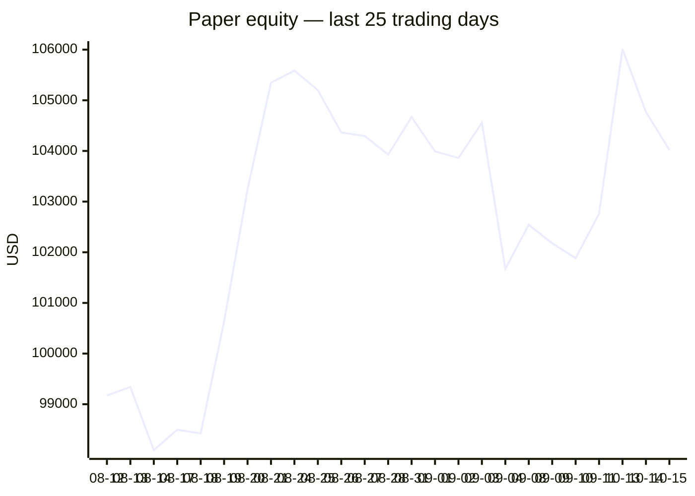
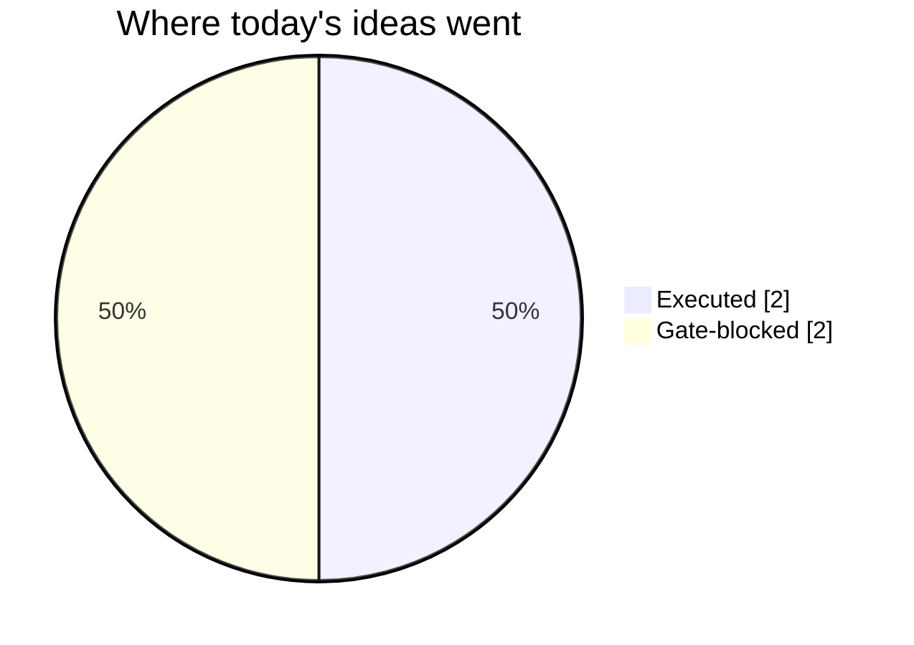

# Trading day 2026-10-15

Paper equity **$104,019** · day -0.52% · regime trending · config v4-seeded · VIX 16.87 (up)

## Charts

```mermaid
xychart-beta
  title "Today's shadow outcomes (R)"
  x-axis ["PM", "PM", "PM", "PM", "PM", "PM", "PM", "PM", "PM", "PM", "PM", "PM", "PM", "AMD", "NVDA", "NVDA", "AMD", "NVDA", "AMD", "DIS", "DIS", "DIS", "DIS", "DIS", "DIS", "DIS", "DIS", "DIS", "DIS", "DIS", "PM", "PM", "PM", "PM", "PM", "PM", "TSLA", "UNH", "JNJ", "MCK", "TSLA", "UNH", "JNJ", "MCK", "TSLA", "UNH", "JNJ", "MCK", "CVX", "JNJ", "MCK", "UNH", "MCK", "TSLA", "UNH", "MCK", "META", "TSLA", "AMD", "UNH", "JNJ", "META", "TSLA", "UNH", "JNJ", "META", "TSLA", "AMD", "JNJ", "META", "TSLA", "JNJ", "MCK", "META", "TSLA", "JNJ", "PG", "MCK", "META", "TSLA", "JNJ", "PG", "MCK", "META", "TSLA", "JNJ", "MCK", "META", "TSLA", "JNJ", "MCK", "META", "TSLA", "JNJ", "MCK", "META", "TSLA", "JNJ", "MCK", "PFE", "PFE", "TSLA", "PFE", "PFE", "PFE", "PFE", "NFLX", "PFE", "NFLX", "CRM", "NFLX", "CRM", "CRM", "NFLX", "CRM", "NFLX", "CRM", "NFLX", "CRM", "META", "NFLX", "JNJ", "CRM", "NFLX", "JNJ", "CRM", "META", "CRM", "CRM", "META", "CRM", "CRM", "META", "NFLX", "CRM", "META", "NFLX", "CRM", "AMZN", "JNJ", "AMZN", "JNJ", "JNJ", "CRM", "CRM", "CRM", "JNJ", "CRM", "MSFT", "MSFT", "MSFT", "MSFT", "MSFT", "MSFT", "MSFT", "MSFT", "AMZN", "MSFT", "AMZN", "AMZN", "AMZN", "AMZN", "AMD", "AMZN", "AMD", "KDP", "AMZN", "AMD", "KDP", "AMZN", "AMD", "KDP", "AMZN", "AMD", "KDP", "AMZN", "AMD", "JNJ", "KDP", "AMZN", "AMD", "JNJ", "WMT", "KDP", "AMZN", "AMD", "JNJ", "KDP", "AMZN", "AMD", "WMT", "KDP", "AMZN", "AMD", "WMT", "KDP", "WMT", "KDP", "NVDA", "WMT", "KDP", "NVDA", "WMT", "KDP", "NVDA", "WMT", "PEP", "KDP", "NVDA", "WMT", "PEP", "KDP", "NVDA", "WMT", "KDP", "NVDA", "WMT", "KDP", "NVDA", "KO", "WMT", "PEP", "KDP", "NVDA", "KO", "WMT", "PEP", "KDP", "NVDA", "KO", "WMT", "PEP", "KDP", "KO", "JNJ", "KO", "MSFT", "JNJ", "KO", "WMT", "MSFT", "AMD", "KO", "PEP", "MSFT", "AMD", "KO", "MSFT", "AMD", "KO", "PEP", "MSFT", "JNJ", "KO", "PEP", "MSFT", "NVDA", "AMD", "JNJ", "KO", "WMT", "PEP", "MSFT", "NVDA", "AMD", "JNJ", "KO", "WMT", "PEP", "NVDA", "AMD", "JNJ", "KO", "WMT", "PEP", "KDP", "MSFT", "NVDA", "AMD", "JNJ", "PG", "KO", "WMT", "PEP", "KDP", "NVDA", "AMD", "JNJ", "PG", "KO", "PEP", "KDP", "NVDA", "AMD", "JNJ", "KO", "PEP", "KDP", "MSFT", "NVDA", "AMD", "JNJ", "KO", "PEP", "KDP", "MSFT", "NVDA", "AMD", "JNJ", "KO", "PEP", "KDP", "MSFT", "MSFT", "MSFT", "MSFT", "MSFT", "AMD", "AMD", "MSFT", "AMD", "MSFT", "AMD", "AMD", "NVDA", "AMZN", "AMD", "NVDA", "AMZN", "AMD", "AMD", "AMD", "NVDA", "AMZN", "AMD", "NVDA", "AMZN", "AMD", "KO", "NVDA", "AMZN", "AMD", "NVDA", "AMZN", "AMD", "KO", "NVDA", "AMZN", "AMD", "KO", "NVDA", "AMD", "KO", "NVDA", "AMD", "KO", "NVDA", "AMZN", "AMD", "KO", "NVDA", "AMZN", "AMD", "KO", "KDP", "KO", "NVDA", "AMZN", "KO", "AMZN", "KO", "AMZN", "KO", "AMZN", "KO", "PEP", "AMZN", "KO", "KO", "AMZN", "AMZN", "PEP", "PEP", "PEP", "PEP", "PEP", "PEP", "PEP", "PG", "WMT", "PEP", "PG", "WMT", "PEP", "AMZN", "PG", "WMT", "PEP", "AMZN", "PG", "WMT", "PEP", "AMZN", "PG", "WMT", "PEP", "WMT", "PEP", "WMT", "WMT", "WMT", "WMT", "WMT", "PG", "PG", "AMZN", "PG", "AAPL", "PG", "PG", "AAPL", "AMZN", "PG", "AAPL", "AMZN", "PG", "AAPL", "PG", "WMT", "AAPL", "JNJ", "PG", "WMT", "AAPL", "JNJ", "PG", "WMT", "AAPL", "AMZN", "JNJ", "PG", "WMT", "AAPL", "AMZN", "JNJ", "PG", "WMT", "AAPL", "AMZN", "JNJ", "PG", "WMT", "AMZN", "JNJ", "PG", "WMT", "AMZN", "JNJ", "JNJ", "JNJ", "JNJ", "PG", "JNJ", "PG", "JNJ", "PG", "WMT", "JNJ", "PG", "WMT", "JNJ", "PG", "WMT", "JNJ", "WMT", "JNJ", "WMT", "JNJ", "WMT", "WMT", "WMT", "WMT", "NVDA", "NVDA", "NVDA", "WMT", "NVDA", "WMT", "NVDA", "WMT", "NVDA", "WMT", "NVDA", "WMT", "NVDA", "WMT", "NVDA", "NVDA", "AMZN", "WMT", "AMZN", "TSLA", "WMT", "AMZN", "TSLA", "WMT", "AMZN", "WMT", "WMT", "WMT", "WMT", "WMT", "WMT", "NVDA", "AMZN", "WMT", "NVDA", "AMZN", "WMT", "WMT", "WMT", "WMT", "JNJ", "JNJ", "JNJ", "MCK", "JNJ", "MCK", "JNJ", "JNJ", "JNJ", "JNJ", "MCK", "JNJ", "JNJ", "MCK", "JNJ", "MCK", "MCK", "PG", "MCK", "V", "MCK", "MCK", "MCK", "MCK", "PG", "MCK", "PG", "MCK", "PG", "MCK", "PG", "MCK", "NVDA", "PG", "NVDA", "PG", "NVDA", "PG", "PG", "NVDA", "JNJ", "PG", "JNJ", "PG", "PG", "WMT", "PG", "WMT", "JNJ", "PG", "WMT", "WMT", "V", "MA", "V", "MA", "V", "AMZN", "PG", "AMZN", "PG", "AMZN", "JNJ", "PG", "WMT", "AMZN", "JNJ", "PG", "WMT", "AMZN", "JNJ", "PG", "WMT", "AMZN", "PG", "WMT", "AMZN", "JNJ", "PG", "WMT", "AMZN", "JNJ", "PG", "WMT", "AMZN", "PG", "WMT", "AMZN", "PG", "WMT", "AMZN", "JNJ", "PG", "WMT", "NVDA", "AMZN", "UNH", "UNH", "UNH", "UNH", "UNH", "UNH", "UNH", "UNH", "UNH", "UNH", "V", "UNH", "MA", "V", "NFLX", "UNH", "WMT", "V", "NFLX", "UNH", "WMT", "CRM", "V", "UNH", "CRM", "MA", "V", "NFLX", "UNH", "WMT", "MA", "V", "UNH", "MA", "V", "UNH", "WMT", "HD", "V", "UNH", "WMT", "HD", "V", "UNH", "WMT", "HD", "V", "HD", "V", "WMT", "HD", "V", "WMT", "HD", "V", "WMT", "HD", "V", "WMT", "AMZN", "WMT", "WMT", "WMT", "HD", "CRM", "WMT", "HD", "WMT", "HD", "CRM", "WMT", "HD", "DIS", "CRM", "PEP", "PG", "WMT", "HD", "DIS", "PEP", "PG", "WMT", "HD", "DIS", "PEP", "NFLX", "PG", "WMT", "HD", "DIS", "PEP", "NFLX", "PG", "WMT", "HD", "DIS", "PEP", "PTC", "PTC", "PTC", "META", "META", "META", "META", "META", "META", "META", "META", "META", "META", "META", "META", "META", "META", "META", "META", "META", "META", "COST", "META", "COST", "META", "COST", "META", "COST", "META", "COST", "META", "META", "META", "META", "META", "META", "COST", "META", "META", "COST", "META", "COST", "META", "COST", "COST", "COST", "META", "COST", "META", "COST", "META", "COST", "META", "COST", "META", "META", "META", "COST", "META", "COST", "META", "COST", "META", "COST", "META", "COST", "META", "COST", "PFE", "PFE", "PFE", "PFE", "PFE", "PFE", "PFE", "PFE", "PFE", "PFE", "PFE", "PFE", "PFE", "PFE", "PFE", "PFE", "COST", "COST", "COST", "COST", "COST", "COST", "COST", "COST", "COST", "COST", "COST", "COST", "COST", "COST", "COST", "COST", "COST", "COST", "COST", "COST", "COST", "COST", "COST", "COST", "COST", "COST", "META", "META", "META", "META", "META", "META", "META", "META", "META", "META", "META", "META", "UNH", "PTC", "PTC", "PTC", "UNH", "UNH", "UNH", "UNH", "UNH", "UNH", "CVX", "CVX", "CVX", "CVX", "CVX", "MSFT", "MSFT", "MSFT", "MSFT", "MSFT", "MSFT", "MSFT", "MSFT", "MSFT", "MSFT", "MSFT", "MSFT", "MSFT", "MSFT", "MSFT", "MSFT", "MSFT", "MSFT", "MSFT", "MSFT", "MSFT", "MSFT", "MSFT", "MSFT", "MSFT", "MSFT", "MSFT", "MSFT", "MSFT", "MSFT", "MSFT", "DIS", "COST", "PTC", "MCK", "PM", "META", "PG", "DIS", "PEP", "PTC", "ISRG", "MCK", "PM", "DIS", "PTC", "ISRG", "MCK", "DIS", "PTC", "MCK", "DIS", "PTC", "ISRG", "MCK", "NFLX", "WMT", "DIS", "COST", "PTC", "ISRG", "MCK", "NFLX", "WMT", "DIS", "COST", "PTC", "MCK", "NFLX", "WMT", "DIS", "COST", "PEP", "PTC", "MCK", "NFLX", "WMT", "DIS", "COST", "PTC", "MSFT", "NFLX", "DIS", "COST", "NFLX", "NFLX", "NFLX", "HLT", "META", "META", "JNJ", "JNJ", "CRM", "UNH", "META", "UNH", "UNH", "META", "UNH", "META", "META", "CRM", "CVX", "CVX", "CVX", "CVX", "CVX", "CVX", "CVX", "CVX", "CVX", "CVX", "CVX", "CVX", "CVX", "PTC", "PEP", "AAPL", "PM", "PM", "PM", "PM", "BRK.B", "BRK.B", "PM", "BRK.B", "BRK.B", "BRK.B", "BRK.B", "AMZN", "AMZN", "PTC", "BRK.B", "PM", "PM", "ELV", "ELV", "BRK.B", "JPM", "JPM", "JPM", "JPM", "CRM", "CRM", "CRM", "CRM", "PM", "NVDA", "PM", "PM", "PM", "PM", "PM", "PM", "CRM", "CRM", "CRM", "CRM", "HLT", "MA", "MA", "HLT", "HLT", "ABBV", "ABBV", "ABBV", "HLT", "ABBV", "ABBV", "JPM", "COST", "COST", "COST", "COST", "COST", "COST", "COST", "KO", "PEP", "KO", "PEP", "KR", "COST", "KO", "MA", "KO", "PEP", "KO", "PEP", "WMT", "KR", "WMT", "KR", "WMT", "WMT", "WMT", "KR", "V", "KO", "V", "KO", "WMT", "WMT", "COST", "COST", "PEP", "PEP", "PEP", "PEP", "ABBV", "KO", "KO", "WMT", "NFLX", "BRK.B", "BRK.B", "KO", "KO", "V", "V", "MA", "BRK.B", "MA", "MRNA", "MRNA", "MRNA", "MRNA", "MRNA", "MA", "KR", "MA", "MA", "MA", "KO", "MA", "MA", "MA", "MA", "MA", "KDP", "KDP", "KDP", "MRNA", "JNJ", "KR", "ABBV", "KR", "ABBV", "PEP", "PEP", "JNJ", "PEP", "PEP", "PEP", "WMT", "KDP", "HLT", "HLT", "HLT", "HLT", "HLT", "HLT", "PEP", "PEP", "ABBV", "BRK.B", "BRK.B", "BRK.B", "KO", "KO", "PEP", "BRK.B", "BRK.B", "JNJ", "CRM", "KR", "KR", "KR", "KO", "TSLA", "KO", "ISRG", "CRM", "HLT", "HLT", "HLT", "HLT", "DAL", "MRNA", "KR", "KR", "KR", "MRNA", "MRNA", "MRNA", "KR", "AMD", "KR", "KR", "KO", "KDP", "KDP", "KDP", "KDP", "UNH", "PTC", "HD", "HD", "HD", "HD", "HD", "HD", "HD", "HD", "PEP", "PEP", "PEP", "KO", "KO", "KO", "HD", "HD", "HD", "KDP", "KDP", "HD", "PEP", "KDP", "KDP", "KDP", "HD", "PG", "PG", "JNJ", "PG", "KDP", "PEP", "HD", "HD", "AUD_JPY", "KDP", "KDP", "SPX500_USD", "NAS100_USD", "CVX", "CVX", "PG", "JNJ", "CVX", "CVX", "CVX", "HD", "JNJ", "JNJ", "JNJ", "PG", "PG", "CVX", "CVX", "CVX", "CVX", "CVX", "CVX", "CVX", "CVX", "JNJ", "JNJ", "JNJ", "CVX", "CVX", "CVX", "CVX", "CVX", "CVX", "CVX", "CVX", "JNJ", "KDP", "KDP", "KDP", "CVX", "CVX", "CVX", "CVX", "CVX", "CVX", "CVX", "CVX", "JNJ", "CVX", "CVX", "CVX", "JNJ", "V", "ABBV", "ABBV", "ABBV", "ABBV", "PG", "ABBV", "ABBV", "HLT", "HLT", "HLT", "HLT", "HLT", "HLT", "HLT", "HLT", "HLT", "HLT", "HLT", "HLT", "HLT", "HLT", "ISRG", "ISRG", "ISRG", "ISRG", "ISRG", "ABBV", "CVX", "CVX", "ABBV", "ABBV", "ABBV", "ABBV", "CVX", "CVX", "PG", "MA", "MA", "CVX", "CVX", "ABBV", "HLT", "HLT", "HLT", "PG", "PG", "HLT", "HLT", "HLT", "PG", "PG", "PG", "PG", "PG", "HLT", "HLT", "HLT", "HLT", "ISRG", "ISRG", "ISRG", "HLT", "HLT", "HLT", "HLT", "HLT", "CVX", "CVX", "PEP", "CVX", "PEP", "V", "V", "V", "V", "V", "V", "V", "DIS", "CVX", "CVX", "CVX", "CVX", "CVX", "CVX", "CVX", "CVX", "CVX", "CVX", "CVX", "CVX", "DIS", "DIS", "DIS", "DIS", "CVX", "CVX", "CVX", "CVX", "CVX", "CVX", "PFE", "STX", "DIS", "DIS", "CVX", "DIS", "CVX", "CVX", "MRNA", "MRNA", "MRNA", "MRNA", "MRNA", "MRNA", "MRNA", "MRNA", "MRNA", "V", "V", "V", "V"]
  bar [-1, -1, -1, -1, -1, -1, -1, -1, -1, -1, -1, -1, -1, -1, -1, -1, -1, -1, -1, -1, -1, -1, -1, -1, -1, -1, -1, -1, -1, -1, -1, -1, -1, -1, -1, -1, 2, 2, 2, 2, 2, 2, 2, 2, 2, 2, 2, 2, 2, 2, 2, 2, 2, 2, 2, 2, 2, 2, 2, 2, 2, 2, 2, 2, 2, 2, 2, 2, 2, 2, 2, 2, 2, 2, 2, 2, 2, 2, 2, 2, 2, 2, 2, 2, 2, 2, 2, 2, 2, 2, 2, 2, 2, 2, 2, 2, 2, 2, 2, 2, 2, 2, 2, 2, 2, 2, -1, 2, -1, -1, -1, -1, -1, -1, -1, -1, -1, -1, -1, 2, -1, 2, -1, -1, 2, -1, 2, -1, -1, 2, -1, -1, 2, -1, -1, 2, -1, -1, 2, 2, 2, 2, 2, -1, -1, -1, 2, -1, 2, 2, 2, 2, 2, 2, 2, 2, 2, 2, 2, 2, 2, 2, 2, 2, 2, 2, 2, 2, 2, 2, 2, 2, 2, 2, 2, 2, 2, 2, 2, 2, 2, 2, 2, 2, 2, 2, 2, 2, 2, 2, 2, 2, 2, 2, 2, 2, 2, 2, 2, 2, 2, 2, 2, 2, 2, 2, 2, 2, 2, 2, 2, 2, 2, 2, 2, 2, 2, 2, 2, 2, 2, 2, 2, 2, 2, 2, 2, 2, 2, 2, 2, 2, 2, 2, 2, 2, 2, 2, 2, 2, 2, 2, 2, 2, 2, 2, 2, 2, 2, 2, 2, 2, 2, 2, 2, 2, 2, 2, 2, 2, 2, 2, 2, 2, 2, 2, 2, 2, 2, 2, 2, 2, 2, 2, 2, 2, 2, 2, 2, 2, 2, 2, 2, 2, 2, 2, 2, 2, 2, 2, 2, 2, 2, 2, 2, 2, 2, 2, 2, 2, 2, 2, 2, 2, 2, 2, 2, 2, 2, 2, 2, 2, 2, 2, 2, 2, 2, 2, 2, 2, 2, 2, 2, 2, 2, 2, 2, 2, 2, 2, 2, 2, 2, 2, 2, 2, 2, 2, 2, 2, 2, 2, 2, 2, 2, 2, 2, 2, 2, 2, 2, 2, 2, 2, 2, 2, 2, 2, 2, 2, 2, 2, 2, 2, 2, 2, 2, 2, 2, 2, 2, 2, 2, 2, 2, 2, 2, 2, 2, 2, 2, 2, 2, 2, 2, 2, 2, 2, 2, 2, 2, 2, 2, 2, 2, 2, 2, 2, 2, 2, 2, 2, 2, 2, 2, 2, 2, 2, 2, 2, 2, 2, 2, 2, 2, 2, 2, -1, 2, 2, -1, 2, 2, -1, 2, 2, -1, 2, 2, -1, 2, 2, 2, -1, 2, 2, 2, -1, 2, 2, 2, 2, -1, 2, 2, 2, 2, -1, 2, 2, 2, 2, 2, 2, 2, 2, 2, 2, 2, 2, 2, 2, 2, 2, 2, 2, 2, 2, 2, 2, 2, 2, 2, 2, 2, 2, 2, 2, 2, 2, 2, 2, 2, 2, 2, 2, 2, 2, 2, 2, 2, 2, 2, 2, 2, 2, 2, 2, 2, 2, 2, -1, 2, 2, -1, 2, 2, 2, 2, 2, 2, 2, 2, 2, 2, 2, 2, 2, 2, 2, 2, 2, 2, 2, 2, 2, 2, 2, 2, 2, 2, 2, 2, 2, 2, 2, 2, 2, 2, 2, 2, -1, 2, 2, 2, 2, 2, 2, 2, 2, 2, 2, 2, 2, 2, 2, 2, 2, 2, 2, 2, 2, 2, 2, 2, 2, 2, 2, 2, 2, 2, 2, 2, 2, -1, -1, -1, -1, -1, 2, 2, 2, 2, 2, 2, 2, 2, 2, 2, 2, 2, 2, 2, 2, 2, 2, 2, 2, 2, 2, 2, 2, 2, 2, 2, 2, 2, 2, 2, 2, 2, 2, 2, 2, 2, 2, 2, 2, 2, 2, 2, 2, 2, 2, 2, 2, 2, 2, -1, 2, -1, -1, 2, 2, 2, -1, 2, 2, 2, 2, -1, 2, 2, -1, -1, 2, 2, 2, -1, -1, 2, -1, -1, 2, 2, 2, -1, 2, 2, 2, -1, 2, 2, 2, -1, 2, -1, 2, 2, -1, 2, 2, -1, 2, 2, -1, 2, 2, 2, 2, 2, 2, 2, 2, 2, 2, 2, 2, 2, 2, 2, 2, 2, 2, 2, 2, 2, 2, 2, 2, 2, 2, 2, 2, 2, 2, 2, 2, 2, 2, 2, 2, 2, 2, 2, 2, 2, 2, 2, 2, 2, 2, 2, 2, 2, 2, 2, 2, 2, 2, 2, 2, 2, 2, 2, 2, 2, 2, 2, 2, 2, 2, 2, 2, 2, 2, 2, 2, 2, 2, 2, 2, 2, 2, 2, 2, 2, 2, 2, 2, 2, 2, 2, 2, 2, 2, 2, 2, 2, 2, 2, 2, 2, 2, 2, 2, 2, 2, 2, 2, 2, 2, 2, 2, 2, 2, 2, 2, 2, 2, 2, 2, 2, 2, 2, 2, 2, 2, 2, 2, 2, 2, 2, 2, 2, 2, 2, 2, 2, 2, 2, 2, 2, 2, 2, 2, 2, 2, 2, 2, 2, 2, 2, 2, 2, -1, -1, -1, -1, -1, -1, -1, -1, -1, -1, -1, -1, 2, 2, 2, 2, 2, 2, 2, 2, 2, 2, -1, -1, -1, -1, -1, -1, -1, -1, -1, -1, -1, -1, -1, -1, -1, -1, -1, -1, -1, -1, -1, -1, -1, -1, -1, -1, -1, -1, -1, -1, -1, -1, -1, -1, -1, -1, -1, 2, -1, -1, -1, -1, -1, -1, -1, -1, -1, -1, -1, -1, -1, -1, -1, -1, -1, -1, -1, -1, -1, -1, -1, -1, -1, -1, -1, -1, -1, -1, -1, -1, -1, -1, -1, -1, -1, -1, -1, -1, -1, -1, -1, -1, -1, -1, -1, -1, -1, -1, -1, -1, -1, -1, -1, -1, -1, -1, -1, -1, 2, -1, 2, 2, -1, 2, -1, -1, -1, -1, -1, -1, -1, -1, -1, -1, -1, -1, -1, -1, -1, -1, -1, 2, -1, -1, -1, -1, -1, -1, -1, -1, -1, -1, -1, -1, -1, -1, -1, -1, -1, -1, -1, -1, -1, -1, -1, -1, -1, 2, 2, 2, 2, -1, -1, -1, -1, -1, -1, -1, -1, 2, 2, 2, 2, 2, -1, -1, 2, 2, -1, -1, -1, 2, -1, -1, -1, -1, -1, -1, -1, -1, -1, -1, -1, -1, -1, -1, -1, -1, -1, -1, -1, -1, -1, -1, -1, -1, -1, -1, -1, -1, -1, -1, -1, -1, -1, -1, -1, -1, -1, -1, -1, -1, -1, -1, -1, -1, -1, -1, 2, -1, -1, -1, -1, -1, -1, -1, -1, -1, 2, 2, 2, 2, 2, -1, -1, -1, -1, -1, -1, -1, -1, -1, -1, -1, -1, -1, -1, 2, -1, -1, -1, -1, -1, -1, -1, -1, -1, -1, -1, -1, -1, 2, 2, 2, 2, 2, 2, -1, -1, -1, -1, -1, -1, -1, -1, -1, -1, -1, -1, 2, -1, -1, -1, -1, -1, -1, 2, 2, 2, 2, 2, 2, -1, 2, -1, -1, -1, 2, 2, 2, -1, -1, -1, -1, -1, -1, -1, -1, -1, 2, -1, -1, -1, -1, -1, -1, -1, -1, -1, -1, -1, -1, -1, -1, -1, -1, -1, -1, -1, -1, -1, -1, -1, -1, -1, -1, -1, -1, -1, -1, -1, -1, -1, -1, -1, -1, -1, -1, -1, -1, -1, -1, -1, -1, -1, -1, -1, -1, -1, -1, -1, -1, -1, -1, -1, -1, -1, -1, -1, -1, -1, -1, -1, -1, -1, -1, -1, -1, -1, -1, -1, -1, -1, -1, -1, -1, -1, -1, -1, -1, -1, -1, -1, -1, -1, -1, -1, -1, 2, -1, -1, -1, -1, -1, -1, -1, 2, 2, 2, 2, 2, 2, 2, 2, 2, 2, 2, 2, 2, 2, 2, 2, 2, 2, 2, -1, -1, -1, -1, -1, -1, -1, -1, -1, -1, 2, 2, -1, -1, -1, 2, 2, 2, -1, -1, 2, 2, 2, -1, -1, -1, -1, -1, 2, 2, 2, 2, 2, 2, 2, 2, 2, 2, 2, 2, 2, 2, -1, 2, -1, -1, -1, -1, -1, -1, -1, -1, -1, -1, -1, -1, -1, -1, -1, -1, -1, -1, -1, -1, -1, -1, -1, -1, -1, -1, -1, -1, -1, -1, -1, -1, -1, -1, -1, -1, -1, -1, -1, -1, -1, -1, -1, -1, -1, -1, -1, -1, -1, -1, -1, -1]
```

## Activity

- Theses formed: 8 (approved→orders: 2, human-rejected: 0, expired unapproved: 0)
- Risk gate blocked: 2
- Fills at the broker: 6

### Positions closed (real book)

- V → **stopped** -1.04R · banked -610% of its +0.17R peak

Exit quality: banked **-610%** of peak open profit across 1 closed position(s) that had a real peak to protect. Persistently low = greed (holding through the give-back); high but with peaks barely above the exits = fear (selling winners too early).

### Execution quality (measured, today)

- cfd: 2 fill(s) · avg slippage cost -0.022R (negative = better than intended) · 3.4 bps · worst 0R
- equities: 5 fill(s) · avg slippage cost 0.141R (negative = better than intended) · 8.7 bps · worst 0.305R

### The day's ideas

- **UK100_GBP** (cfd-momentum-breakout) entry 10781.2 stop 10700.72 target 10901.92 — UK100_GBP broke its 20-hour high (10747.2) on 2.7× average volume, above its 20-day average. Stop 3×ATR below, target 1.5R.
- **WTICO_USD** (cfd-momentum-breakout) entry 97.52 stop 95.37 target 100.74 — WTICO_USD broke its 20-hour high (97.05) on 2.2× average volume, above its 20-day average. Stop 3×ATR below, target 1.5R.
- **MSFT** (momentum-breakout) entry 540.54 stop 537.57 target 546.48 — Broke 20-bar high (540.49) with stock and SPY above their 20-day averages. Stop 2×ATR below, target 2R.
- **V** (momentum-breakout) entry 402.7 stop 400.29 target 407.52 — Broke 20-bar high (402.69) with stock and SPY above their 20-day averages. Stop 2×ATR below, target 2R.
- **MA** (momentum-breakout) entry 618.76 stop 615.18 target 625.92 — Broke 20-bar high (618.72) with stock and SPY above their 20-day averages. Stop 2×ATR below, target 2R.
- **AMZN** (momentum-breakout) entry 254.56 stop 252.89 target 257.9 — Broke 20-bar high (254.53) with stock and SPY above their 20-day averages. Stop 2×ATR below, target 2R.
- **ISRG** (momentum-breakout) entry 427.85 stop 425.36 target 432.83 — Broke 20-bar high (427.67) with stock and SPY above their 20-day averages. Stop 2×ATR below, target 2R.
- **HLT** (momentum-breakout) entry 344.11 stop 341.87 target 348.59 — Broke 20-bar high (344.02) with stock and SPY above their 20-day averages. Stop 2×ATR below, target 2R.

## Shadow ledger (what would have happened)

- PM (momentum-breakdown:filtered, filter-blocked) → **stopped** -1R
- PM (momentum-breakdown:filtered, filter-blocked) → **stopped** -1R
- PM (momentum-breakdown:filtered, filter-blocked) → **stopped** -1R
- PM (momentum-breakdown:filtered, filter-blocked) → **stopped** -1R
- PM (momentum-breakdown:filtered, filter-blocked) → **stopped** -1R
- PM (momentum-breakdown:filtered, filter-blocked) → **stopped** -1R
- PM (momentum-breakdown:filtered, filter-blocked) → **stopped** -1R
- PM (momentum-breakdown:filtered, filter-blocked) → **stopped** -1R
- PM (momentum-breakdown:filtered, filter-blocked) → **stopped** -1R
- PM (momentum-breakdown:filtered, filter-blocked) → **stopped** -1R
- PM (momentum-breakdown:filtered, filter-blocked) → **stopped** -1R
- PM (momentum-breakdown:filtered, filter-blocked) → **stopped** -1R
- PM (momentum-breakdown:filtered, filter-blocked) → **stopped** -1R
- AMD (pullback-trend, incubation) → **stopped** -1R
- NVDA (pullback-trend, incubation) → **stopped** -1R
- NVDA (pullback-trend, incubation) → **stopped** -1R
- AMD (pullback-trend, incubation) → **stopped** -1R
- NVDA (pullback-trend, incubation) → **stopped** -1R
- AMD (pullback-trend, incubation) → **stopped** -1R
- DIS (momentum-breakdown:filtered, filter-blocked) → **stopped** -1R
- DIS (momentum-breakdown:filtered, filter-blocked) → **stopped** -1R
- DIS (momentum-breakdown:filtered, filter-blocked) → **stopped** -1R
- DIS (momentum-breakdown:filtered, filter-blocked) → **stopped** -1R
- DIS (momentum-breakdown:filtered, filter-blocked) → **stopped** -1R
- DIS (momentum-breakdown:filtered, filter-blocked) → **stopped** -1R
- DIS (momentum-breakdown:filtered, filter-blocked) → **stopped** -1R
- DIS (momentum-breakdown:filtered, filter-blocked) → **stopped** -1R
- DIS (momentum-breakdown:filtered, filter-blocked) → **stopped** -1R
- DIS (momentum-breakdown:filtered, filter-blocked) → **stopped** -1R
- DIS (momentum-breakdown:filtered, filter-blocked) → **stopped** -1R
- PM (momentum-breakdown:filtered, filter-blocked) → **stopped** -1R
- PM (momentum-breakdown:filtered, filter-blocked) → **stopped** -1R
- PM (momentum-breakdown:filtered, filter-blocked) → **stopped** -1R
- PM (momentum-breakdown:filtered, filter-blocked) → **stopped** -1R
- PM (momentum-breakdown:filtered, filter-blocked) → **stopped** -1R
- PM (momentum-breakdown:filtered, filter-blocked) → **stopped** -1R
- TSLA (momentum-breakdown:filtered, filter-blocked) → **target** +2R
- UNH (momentum-breakout:filtered, filter-blocked) → **target** +2R
- JNJ (momentum-breakout:filtered, filter-blocked) → **target** +2R
- MCK (momentum-breakout:filtered, filter-blocked) → **target** +2R
- TSLA (momentum-breakdown:filtered, filter-blocked) → **target** +2R
- UNH (momentum-breakout:filtered, filter-blocked) → **target** +2R
- JNJ (momentum-breakout:filtered, filter-blocked) → **target** +2R
- MCK (momentum-breakout:filtered, filter-blocked) → **target** +2R
- TSLA (momentum-breakdown:filtered, filter-blocked) → **target** +2R
- UNH (momentum-breakout:filtered, filter-blocked) → **target** +2R
- JNJ (momentum-breakout:filtered, filter-blocked) → **target** +2R
- MCK (momentum-breakout:filtered, filter-blocked) → **target** +2R
- CVX (momentum-breakout:filtered, filter-blocked) → **target** +2R
- JNJ (momentum-breakout:filtered, filter-blocked) → **target** +2R
- MCK (momentum-breakout:filtered, filter-blocked) → **target** +2R
- UNH (momentum-breakout:filtered, filter-blocked) → **target** +2R
- MCK (momentum-breakout:filtered, filter-blocked) → **target** +2R
- TSLA (momentum-breakdown:filtered, filter-blocked) → **target** +2R
- UNH (momentum-breakout:filtered, filter-blocked) → **target** +2R
- MCK (momentum-breakout:filtered, filter-blocked) → **target** +2R
- META (momentum-breakdown:filtered, filter-blocked) → **target** +2R
- TSLA (momentum-breakdown:filtered, filter-blocked) → **target** +2R
- AMD (momentum-breakdown:filtered, filter-blocked) → **target** +2R
- UNH (momentum-breakout:filtered, filter-blocked) → **target** +2R
- JNJ (momentum-breakout:filtered, filter-blocked) → **target** +2R
- META (momentum-breakdown:filtered, filter-blocked) → **target** +2R
- TSLA (momentum-breakdown:filtered, filter-blocked) → **target** +2R
- UNH (momentum-breakout:filtered, filter-blocked) → **target** +2R
- JNJ (momentum-breakout:filtered, filter-blocked) → **target** +2R
- META (momentum-breakdown:filtered, filter-blocked) → **target** +2R
- TSLA (momentum-breakdown:filtered, filter-blocked) → **target** +2R
- AMD (momentum-breakdown:filtered, filter-blocked) → **target** +2R
- JNJ (momentum-breakout:filtered, filter-blocked) → **target** +2R
- META (momentum-breakdown:filtered, filter-blocked) → **target** +2R
- TSLA (momentum-breakdown:filtered, filter-blocked) → **target** +2R
- JNJ (momentum-breakout:filtered, filter-blocked) → **target** +2R
- MCK (momentum-breakout:filtered, filter-blocked) → **target** +2R
- META (momentum-breakdown:filtered, filter-blocked) → **target** +2R
- TSLA (momentum-breakdown:filtered, filter-blocked) → **target** +2R
- JNJ (momentum-breakout:filtered, filter-blocked) → **target** +2R
- PG (momentum-breakout:filtered, filter-blocked) → **target** +2R
- MCK (momentum-breakout:filtered, filter-blocked) → **target** +2R
- META (momentum-breakdown:filtered, filter-blocked) → **target** +2R
- TSLA (momentum-breakdown:filtered, filter-blocked) → **target** +2R
- JNJ (momentum-breakout:filtered, filter-blocked) → **target** +2R
- PG (momentum-breakout:filtered, filter-blocked) → **target** +2R
- MCK (momentum-breakout:filtered, filter-blocked) → **target** +2R
- META (momentum-breakdown:filtered, filter-blocked) → **target** +2R
- TSLA (momentum-breakdown:filtered, filter-blocked) → **target** +2R
- JNJ (momentum-breakout:filtered, filter-blocked) → **target** +2R
- MCK (momentum-breakout:filtered, filter-blocked) → **target** +2R
- META (momentum-breakdown:filtered, filter-blocked) → **target** +2R
- TSLA (momentum-breakdown:filtered, filter-blocked) → **target** +2R
- JNJ (momentum-breakout:filtered, filter-blocked) → **target** +2R
- MCK (momentum-breakout:filtered, filter-blocked) → **target** +2R
- META (momentum-breakdown:filtered, filter-blocked) → **target** +2R
- TSLA (momentum-breakdown:filtered, filter-blocked) → **target** +2R
- JNJ (momentum-breakout:filtered, filter-blocked) → **target** +2R
- MCK (momentum-breakout:filtered, filter-blocked) → **target** +2R
- META (momentum-breakdown:filtered, filter-blocked) → **target** +2R
- TSLA (momentum-breakdown:filtered, filter-blocked) → **target** +2R
- JNJ (momentum-breakout:filtered, filter-blocked) → **target** +2R
- MCK (momentum-breakout:filtered, filter-blocked) → **target** +2R
- PFE (momentum-breakout:filtered, filter-blocked) → **target** +2R
- PFE (momentum-breakout:filtered, filter-blocked) → **target** +2R
- TSLA (momentum-breakdown:filtered, filter-blocked) → **target** +2R
- PFE (momentum-breakout:filtered, filter-blocked) → **target** +2R
- PFE (momentum-breakout:filtered, filter-blocked) → **target** +2R
- PFE (momentum-breakout:filtered, filter-blocked) → **target** +2R
- PFE (momentum-breakout:filtered, filter-blocked) → **target** +2R
- NFLX (momentum-breakdown:filtered, filter-blocked) → **stopped** -1R
- PFE (momentum-breakout:filtered, filter-blocked) → **target** +2R
- NFLX (momentum-breakdown:filtered, filter-blocked) → **stopped** -1R
- CRM (momentum-breakdown:filtered, filter-blocked) → **stopped** -1R
- NFLX (momentum-breakdown:filtered, filter-blocked) → **stopped** -1R
- CRM (momentum-breakdown:filtered, filter-blocked) → **stopped** -1R
- CRM (momentum-breakdown:filtered, filter-blocked) → **stopped** -1R
- NFLX (momentum-breakdown:filtered, filter-blocked) → **stopped** -1R
- CRM (momentum-breakdown:filtered, filter-blocked) → **stopped** -1R
- NFLX (momentum-breakdown:filtered, filter-blocked) → **stopped** -1R
- CRM (momentum-breakdown:filtered, filter-blocked) → **stopped** -1R
- NFLX (momentum-breakdown:filtered, filter-blocked) → **stopped** -1R
- CRM (momentum-breakdown:filtered, filter-blocked) → **stopped** -1R
- META (momentum-breakdown:filtered, filter-blocked) → **target** +2R
- NFLX (momentum-breakdown:filtered, filter-blocked) → **stopped** -1R
- JNJ (momentum-breakout:filtered, filter-blocked) → **target** +2R
- CRM (momentum-breakdown:filtered, filter-blocked) → **stopped** -1R
- NFLX (momentum-breakdown:filtered, filter-blocked) → **stopped** -1R
- JNJ (momentum-breakout:filtered, filter-blocked) → **target** +2R
- CRM (momentum-breakdown:filtered, filter-blocked) → **stopped** -1R
- META (momentum-breakdown:filtered, filter-blocked) → **target** +2R
- CRM (momentum-breakdown:filtered, filter-blocked) → **stopped** -1R
- CRM (momentum-breakdown:filtered, filter-blocked) → **stopped** -1R
- META (momentum-breakdown:filtered, filter-blocked) → **target** +2R
- CRM (momentum-breakdown:filtered, filter-blocked) → **stopped** -1R
- CRM (momentum-breakdown:filtered, filter-blocked) → **stopped** -1R
- META (momentum-breakdown:filtered, filter-blocked) → **target** +2R
- NFLX (momentum-breakdown:filtered, filter-blocked) → **stopped** -1R
- CRM (momentum-breakdown:filtered, filter-blocked) → **stopped** -1R
- META (momentum-breakdown:filtered, filter-blocked) → **target** +2R
- NFLX (momentum-breakdown:filtered, filter-blocked) → **stopped** -1R
- CRM (momentum-breakdown:filtered, filter-blocked) → **stopped** -1R
- AMZN (momentum-breakdown:filtered, filter-blocked) → **target** +2R
- JNJ (momentum-breakout:filtered, filter-blocked) → **target** +2R
- AMZN (momentum-breakdown:filtered, filter-blocked) → **target** +2R
- JNJ (momentum-breakout:filtered, filter-blocked) → **target** +2R
- JNJ (momentum-breakout:filtered, filter-blocked) → **target** +2R
- CRM (momentum-breakdown:filtered, filter-blocked) → **stopped** -1R
- CRM (momentum-breakdown:filtered, filter-blocked) → **stopped** -1R
- CRM (momentum-breakdown:filtered, filter-blocked) → **stopped** -1R
- JNJ (momentum-breakout:filtered, filter-blocked) → **target** +2R
- CRM (momentum-breakdown:filtered, filter-blocked) → **stopped** -1R
- MSFT (momentum-breakdown:filtered, filter-blocked) → **target** +2R
- MSFT (momentum-breakdown:filtered, filter-blocked) → **target** +2R
- MSFT (momentum-breakdown:filtered, filter-blocked) → **target** +2R
- MSFT (momentum-breakdown:filtered, filter-blocked) → **target** +2R
- MSFT (momentum-breakdown:filtered, filter-blocked) → **target** +2R
- MSFT (momentum-breakdown:filtered, filter-blocked) → **target** +2R
- MSFT (momentum-breakdown:filtered, filter-blocked) → **target** +2R
- MSFT (momentum-breakdown:filtered, filter-blocked) → **target** +2R
- AMZN (momentum-breakdown:filtered, filter-blocked) → **target** +2R
- MSFT (momentum-breakdown:filtered, filter-blocked) → **target** +2R
- AMZN (momentum-breakdown:filtered, filter-blocked) → **target** +2R
- AMZN (momentum-breakdown:filtered, filter-blocked) → **target** +2R
- AMZN (momentum-breakdown:filtered, filter-blocked) → **target** +2R
- AMZN (momentum-breakdown:filtered, filter-blocked) → **target** +2R
- AMD (momentum-breakdown:filtered, filter-blocked) → **target** +2R
- AMZN (momentum-breakdown:filtered, filter-blocked) → **target** +2R
- AMD (momentum-breakdown:filtered, filter-blocked) → **target** +2R
- KDP (momentum-breakout:filtered, filter-blocked) → **target** +2R
- AMZN (momentum-breakdown:filtered, filter-blocked) → **target** +2R
- AMD (momentum-breakdown:filtered, filter-blocked) → **target** +2R
- KDP (momentum-breakout:filtered, filter-blocked) → **target** +2R
- AMZN (momentum-breakdown:filtered, filter-blocked) → **target** +2R
- AMD (momentum-breakdown:filtered, filter-blocked) → **target** +2R
- KDP (momentum-breakout:filtered, filter-blocked) → **target** +2R
- AMZN (momentum-breakdown:filtered, filter-blocked) → **target** +2R
- AMD (momentum-breakdown:filtered, filter-blocked) → **target** +2R
- KDP (momentum-breakout:filtered, filter-blocked) → **target** +2R
- AMZN (momentum-breakdown:filtered, filter-blocked) → **target** +2R
- AMD (momentum-breakdown:filtered, filter-blocked) → **target** +2R
- JNJ (momentum-breakout:filtered, filter-blocked) → **target** +2R
- KDP (momentum-breakout:filtered, filter-blocked) → **target** +2R
- AMZN (momentum-breakdown:filtered, filter-blocked) → **target** +2R
- AMD (momentum-breakdown:filtered, filter-blocked) → **target** +2R
- JNJ (momentum-breakout:filtered, filter-blocked) → **target** +2R
- WMT (momentum-breakout:filtered, filter-blocked) → **target** +2R
- KDP (momentum-breakout:filtered, filter-blocked) → **target** +2R
- AMZN (momentum-breakdown:filtered, filter-blocked) → **target** +2R
- AMD (momentum-breakdown:filtered, filter-blocked) → **target** +2R
- JNJ (momentum-breakout:filtered, filter-blocked) → **target** +2R
- KDP (momentum-breakout:filtered, filter-blocked) → **target** +2R
- AMZN (momentum-breakdown:filtered, filter-blocked) → **target** +2R
- AMD (momentum-breakdown:filtered, filter-blocked) → **target** +2R
- WMT (momentum-breakout:filtered, filter-blocked) → **target** +2R
- KDP (momentum-breakout:filtered, filter-blocked) → **target** +2R
- AMZN (momentum-breakdown:filtered, filter-blocked) → **target** +2R
- AMD (momentum-breakdown:filtered, filter-blocked) → **target** +2R
- WMT (momentum-breakout:filtered, filter-blocked) → **target** +2R
- KDP (momentum-breakout:filtered, filter-blocked) → **target** +2R
- WMT (momentum-breakout:filtered, filter-blocked) → **target** +2R
- KDP (momentum-breakout:filtered, filter-blocked) → **target** +2R
- NVDA (momentum-breakdown:filtered, filter-blocked) → **target** +2R
- WMT (momentum-breakout:filtered, filter-blocked) → **target** +2R
- KDP (momentum-breakout:filtered, filter-blocked) → **target** +2R
- NVDA (momentum-breakdown:filtered, filter-blocked) → **target** +2R
- WMT (momentum-breakout:filtered, filter-blocked) → **target** +2R
- KDP (momentum-breakout:filtered, filter-blocked) → **target** +2R
- NVDA (momentum-breakdown:filtered, filter-blocked) → **target** +2R
- WMT (momentum-breakout:filtered, filter-blocked) → **target** +2R
- PEP (momentum-breakout:filtered, filter-blocked) → **target** +2R
- KDP (momentum-breakout:filtered, filter-blocked) → **target** +2R
- NVDA (momentum-breakdown:filtered, filter-blocked) → **target** +2R
- WMT (momentum-breakout:filtered, filter-blocked) → **target** +2R
- PEP (momentum-breakout:filtered, filter-blocked) → **target** +2R
- KDP (momentum-breakout:filtered, filter-blocked) → **target** +2R
- NVDA (momentum-breakdown:filtered, filter-blocked) → **target** +2R
- WMT (momentum-breakout:filtered, filter-blocked) → **target** +2R
- KDP (momentum-breakout:filtered, filter-blocked) → **target** +2R
- NVDA (momentum-breakdown:filtered, filter-blocked) → **target** +2R
- WMT (momentum-breakout:filtered, filter-blocked) → **target** +2R
- KDP (momentum-breakout:filtered, filter-blocked) → **target** +2R
- NVDA (momentum-breakdown:filtered, filter-blocked) → **target** +2R
- KO (momentum-breakout:filtered, filter-blocked) → **target** +2R
- WMT (momentum-breakout:filtered, filter-blocked) → **target** +2R
- PEP (momentum-breakout:filtered, filter-blocked) → **target** +2R
- KDP (momentum-breakout:filtered, filter-blocked) → **target** +2R
- NVDA (momentum-breakdown:filtered, filter-blocked) → **target** +2R
- KO (momentum-breakout:filtered, filter-blocked) → **target** +2R
- WMT (momentum-breakout:filtered, filter-blocked) → **target** +2R
- PEP (momentum-breakout:filtered, filter-blocked) → **target** +2R
- KDP (momentum-breakout:filtered, filter-blocked) → **target** +2R
- NVDA (momentum-breakdown:filtered, filter-blocked) → **target** +2R
- KO (momentum-breakout:filtered, filter-blocked) → **target** +2R
- WMT (momentum-breakout:filtered, filter-blocked) → **target** +2R
- PEP (momentum-breakout:filtered, filter-blocked) → **target** +2R
- KDP (momentum-breakout:filtered, filter-blocked) → **target** +2R
- KO (momentum-breakout:filtered, filter-blocked) → **target** +2R
- JNJ (momentum-breakout:filtered, filter-blocked) → **target** +2R
- KO (momentum-breakout:filtered, filter-blocked) → **target** +2R
- MSFT (momentum-breakdown:filtered, filter-blocked) → **target** +2R
- JNJ (momentum-breakout:filtered, filter-blocked) → **target** +2R
- KO (momentum-breakout:filtered, filter-blocked) → **target** +2R
- WMT (momentum-breakout:filtered, filter-blocked) → **target** +2R
- MSFT (momentum-breakdown:filtered, filter-blocked) → **target** +2R
- AMD (momentum-breakdown:filtered, filter-blocked) → **target** +2R
- KO (momentum-breakout:filtered, filter-blocked) → **target** +2R
- PEP (momentum-breakout:filtered, filter-blocked) → **target** +2R
- MSFT (momentum-breakdown:filtered, filter-blocked) → **target** +2R
- AMD (momentum-breakdown:filtered, filter-blocked) → **target** +2R
- KO (momentum-breakout:filtered, filter-blocked) → **target** +2R
- MSFT (momentum-breakdown:filtered, filter-blocked) → **target** +2R
- AMD (momentum-breakdown:filtered, filter-blocked) → **target** +2R
- KO (momentum-breakout:filtered, filter-blocked) → **target** +2R
- PEP (momentum-breakout:filtered, filter-blocked) → **target** +2R
- MSFT (momentum-breakdown:filtered, filter-blocked) → **target** +2R
- JNJ (momentum-breakout:filtered, filter-blocked) → **target** +2R
- KO (momentum-breakout:filtered, filter-blocked) → **target** +2R
- PEP (momentum-breakout:filtered, filter-blocked) → **target** +2R
- MSFT (momentum-breakdown:filtered, filter-blocked) → **target** +2R
- NVDA (momentum-breakdown:filtered, filter-blocked) → **target** +2R
- AMD (momentum-breakdown:filtered, filter-blocked) → **target** +2R
- JNJ (momentum-breakout:filtered, filter-blocked) → **target** +2R
- KO (momentum-breakout:filtered, filter-blocked) → **target** +2R
- WMT (momentum-breakout:filtered, filter-blocked) → **target** +2R
- PEP (momentum-breakout:filtered, filter-blocked) → **target** +2R
- MSFT (momentum-breakdown:filtered, filter-blocked) → **target** +2R
- NVDA (momentum-breakdown:filtered, filter-blocked) → **target** +2R
- AMD (momentum-breakdown:filtered, filter-blocked) → **target** +2R
- JNJ (momentum-breakout:filtered, filter-blocked) → **target** +2R
- KO (momentum-breakout:filtered, filter-blocked) → **target** +2R
- WMT (momentum-breakout:filtered, filter-blocked) → **target** +2R
- PEP (momentum-breakout:filtered, filter-blocked) → **target** +2R
- NVDA (momentum-breakdown:filtered, filter-blocked) → **target** +2R
- AMD (momentum-breakdown:filtered, filter-blocked) → **target** +2R
- JNJ (momentum-breakout:filtered, filter-blocked) → **target** +2R
- KO (momentum-breakout:filtered, filter-blocked) → **target** +2R
- WMT (momentum-breakout:filtered, filter-blocked) → **target** +2R
- PEP (momentum-breakout:filtered, filter-blocked) → **target** +2R
- KDP (momentum-breakout:filtered, filter-blocked) → **target** +2R
- MSFT (momentum-breakdown:filtered, filter-blocked) → **target** +2R
- NVDA (momentum-breakdown:filtered, filter-blocked) → **target** +2R
- AMD (momentum-breakdown:filtered, filter-blocked) → **target** +2R
- JNJ (momentum-breakout:filtered, filter-blocked) → **target** +2R
- PG (momentum-breakout:filtered, filter-blocked) → **target** +2R
- KO (momentum-breakout:filtered, filter-blocked) → **target** +2R
- WMT (momentum-breakout:filtered, filter-blocked) → **target** +2R
- PEP (momentum-breakout:filtered, filter-blocked) → **target** +2R
- KDP (momentum-breakout:filtered, filter-blocked) → **target** +2R
- NVDA (momentum-breakdown:filtered, filter-blocked) → **target** +2R
- AMD (momentum-breakdown:filtered, filter-blocked) → **target** +2R
- JNJ (momentum-breakout:filtered, filter-blocked) → **target** +2R
- PG (momentum-breakout:filtered, filter-blocked) → **target** +2R
- KO (momentum-breakout:filtered, filter-blocked) → **target** +2R
- PEP (momentum-breakout:filtered, filter-blocked) → **target** +2R
- KDP (momentum-breakout:filtered, filter-blocked) → **target** +2R
- NVDA (momentum-breakdown:filtered, filter-blocked) → **target** +2R
- AMD (momentum-breakdown:filtered, filter-blocked) → **target** +2R
- JNJ (momentum-breakout:filtered, filter-blocked) → **target** +2R
- KO (momentum-breakout:filtered, filter-blocked) → **target** +2R
- PEP (momentum-breakout:filtered, filter-blocked) → **target** +2R
- KDP (momentum-breakout:filtered, filter-blocked) → **target** +2R
- MSFT (momentum-breakdown:filtered, filter-blocked) → **target** +2R
- NVDA (momentum-breakdown:filtered, filter-blocked) → **target** +2R
- AMD (momentum-breakdown:filtered, filter-blocked) → **target** +2R
- JNJ (momentum-breakout:filtered, filter-blocked) → **target** +2R
- KO (momentum-breakout:filtered, filter-blocked) → **target** +2R
- PEP (momentum-breakout:filtered, filter-blocked) → **target** +2R
- KDP (momentum-breakout:filtered, filter-blocked) → **target** +2R
- MSFT (momentum-breakdown:filtered, filter-blocked) → **target** +2R
- NVDA (momentum-breakdown:filtered, filter-blocked) → **target** +2R
- AMD (momentum-breakdown:filtered, filter-blocked) → **target** +2R
- JNJ (momentum-breakout:filtered, filter-blocked) → **target** +2R
- KO (momentum-breakout:filtered, filter-blocked) → **target** +2R
- PEP (momentum-breakout:filtered, filter-blocked) → **target** +2R
- KDP (momentum-breakout:filtered, filter-blocked) → **target** +2R
- MSFT (momentum-breakdown:filtered, filter-blocked) → **target** +2R
- MSFT (momentum-breakdown:filtered, filter-blocked) → **target** +2R
- MSFT (momentum-breakdown:filtered, filter-blocked) → **target** +2R
- MSFT (momentum-breakdown:filtered, filter-blocked) → **target** +2R
- MSFT (momentum-breakdown:filtered, filter-blocked) → **target** +2R
- AMD (momentum-breakdown:filtered, filter-blocked) → **target** +2R
- AMD (momentum-breakdown:filtered, filter-blocked) → **target** +2R
- MSFT (momentum-breakdown:filtered, filter-blocked) → **target** +2R
- AMD (momentum-breakdown:filtered, filter-blocked) → **target** +2R
- MSFT (momentum-breakdown:filtered, filter-blocked) → **target** +2R
- AMD (momentum-breakdown:filtered, filter-blocked) → **target** +2R
- AMD (momentum-breakdown:filtered, filter-blocked) → **target** +2R
- NVDA (momentum-breakdown:filtered, filter-blocked) → **target** +2R
- AMZN (momentum-breakdown:filtered, filter-blocked) → **target** +2R
- AMD (momentum-breakdown:filtered, filter-blocked) → **target** +2R
- NVDA (momentum-breakdown:filtered, filter-blocked) → **target** +2R
- AMZN (momentum-breakdown:filtered, filter-blocked) → **target** +2R
- AMD (momentum-breakdown:filtered, filter-blocked) → **target** +2R
- AMD (momentum-breakdown:filtered, filter-blocked) → **target** +2R
- AMD (momentum-breakdown:filtered, filter-blocked) → **target** +2R
- NVDA (momentum-breakdown:filtered, filter-blocked) → **target** +2R
- AMZN (momentum-breakdown:filtered, filter-blocked) → **target** +2R
- AMD (momentum-breakdown:filtered, filter-blocked) → **target** +2R
- NVDA (momentum-breakdown:filtered, filter-blocked) → **target** +2R
- AMZN (momentum-breakdown:filtered, filter-blocked) → **target** +2R
- AMD (momentum-breakdown:filtered, filter-blocked) → **target** +2R
- KO (momentum-breakout:filtered, filter-blocked) → **target** +2R
- NVDA (momentum-breakdown:filtered, filter-blocked) → **target** +2R
- AMZN (momentum-breakdown:filtered, filter-blocked) → **target** +2R
- AMD (momentum-breakdown:filtered, filter-blocked) → **target** +2R
- NVDA (momentum-breakdown:filtered, filter-blocked) → **target** +2R
- AMZN (momentum-breakdown:filtered, filter-blocked) → **target** +2R
- AMD (momentum-breakdown:filtered, filter-blocked) → **target** +2R
- KO (momentum-breakout:filtered, filter-blocked) → **target** +2R
- NVDA (momentum-breakdown:filtered, filter-blocked) → **target** +2R
- AMZN (momentum-breakdown:filtered, filter-blocked) → **target** +2R
- AMD (momentum-breakdown:filtered, filter-blocked) → **target** +2R
- KO (momentum-breakout:filtered, filter-blocked) → **target** +2R
- NVDA (momentum-breakdown:filtered, filter-blocked) → **target** +2R
- AMD (momentum-breakdown:filtered, filter-blocked) → **target** +2R
- KO (momentum-breakout:filtered, filter-blocked) → **target** +2R
- NVDA (momentum-breakdown:filtered, filter-blocked) → **target** +2R
- AMD (momentum-breakdown:filtered, filter-blocked) → **target** +2R
- KO (momentum-breakout:filtered, filter-blocked) → **target** +2R
- NVDA (momentum-breakdown:filtered, filter-blocked) → **target** +2R
- AMZN (momentum-breakdown:filtered, filter-blocked) → **target** +2R
- AMD (momentum-breakdown:filtered, filter-blocked) → **target** +2R
- KO (momentum-breakout:filtered, filter-blocked) → **target** +2R
- NVDA (momentum-breakdown:filtered, filter-blocked) → **target** +2R
- AMZN (momentum-breakdown:filtered, filter-blocked) → **target** +2R
- AMD (momentum-breakdown:filtered, filter-blocked) → **target** +2R
- KO (momentum-breakout:filtered, filter-blocked) → **target** +2R
- KDP (momentum-breakout:filtered, filter-blocked) → **target** +2R
- KO (momentum-breakout:filtered, filter-blocked) → **target** +2R
- NVDA (momentum-breakdown:filtered, filter-blocked) → **target** +2R
- AMZN (momentum-breakdown:filtered, filter-blocked) → **target** +2R
- KO (momentum-breakout:filtered, filter-blocked) → **target** +2R
- AMZN (momentum-breakdown:filtered, filter-blocked) → **target** +2R
- KO (momentum-breakout:filtered, filter-blocked) → **target** +2R
- AMZN (momentum-breakdown:filtered, filter-blocked) → **target** +2R
- KO (momentum-breakout:filtered, filter-blocked) → **target** +2R
- AMZN (momentum-breakdown:filtered, filter-blocked) → **target** +2R
- KO (momentum-breakout:filtered, filter-blocked) → **target** +2R
- PEP (momentum-breakout:filtered, filter-blocked) → **target** +2R
- AMZN (momentum-breakdown:filtered, filter-blocked) → **target** +2R
- KO (momentum-breakout:filtered, filter-blocked) → **target** +2R
- KO (momentum-breakout:filtered, filter-blocked) → **target** +2R
- AMZN (momentum-breakdown:filtered, filter-blocked) → **target** +2R
- AMZN (momentum-breakdown:filtered, filter-blocked) → **target** +2R
- PEP (momentum-breakout:filtered, filter-blocked) → **target** +2R
- PEP (momentum-breakout:filtered, filter-blocked) → **target** +2R
- PEP (momentum-breakout:filtered, filter-blocked) → **target** +2R
- PEP (momentum-breakout:filtered, filter-blocked) → **target** +2R
- PEP (momentum-breakout:filtered, filter-blocked) → **target** +2R
- PEP (momentum-breakout:filtered, filter-blocked) → **target** +2R
- PEP (momentum-breakout:filtered, filter-blocked) → **target** +2R
- PG (momentum-breakout:filtered, filter-blocked) → **target** +2R
- WMT (momentum-breakout:filtered, filter-blocked) → **target** +2R
- PEP (momentum-breakout:filtered, filter-blocked) → **target** +2R
- PG (momentum-breakout:filtered, filter-blocked) → **target** +2R
- WMT (momentum-breakout:filtered, filter-blocked) → **target** +2R
- PEP (momentum-breakout:filtered, filter-blocked) → **target** +2R
- AMZN (momentum-breakdown:filtered, filter-blocked) → **target** +2R
- PG (momentum-breakout:filtered, filter-blocked) → **target** +2R
- WMT (momentum-breakout:filtered, filter-blocked) → **target** +2R
- PEP (momentum-breakout:filtered, filter-blocked) → **target** +2R
- AMZN (momentum-breakdown:filtered, filter-blocked) → **target** +2R
- PG (momentum-breakout:filtered, filter-blocked) → **target** +2R
- WMT (momentum-breakout:filtered, filter-blocked) → **target** +2R
- PEP (momentum-breakout:filtered, filter-blocked) → **target** +2R
- AMZN (momentum-breakdown:filtered, filter-blocked) → **target** +2R
- PG (momentum-breakout:filtered, filter-blocked) → **target** +2R
- WMT (momentum-breakout:filtered, filter-blocked) → **target** +2R
- PEP (momentum-breakout:filtered, filter-blocked) → **target** +2R
- WMT (momentum-breakout:filtered, filter-blocked) → **target** +2R
- PEP (momentum-breakout:filtered, filter-blocked) → **target** +2R
- WMT (momentum-breakout:filtered, filter-blocked) → **target** +2R
- WMT (momentum-breakout:filtered, filter-blocked) → **target** +2R
- WMT (momentum-breakout:filtered, filter-blocked) → **target** +2R
- WMT (momentum-breakout:filtered, filter-blocked) → **target** +2R
- WMT (momentum-breakout:filtered, filter-blocked) → **target** +2R
- PG (momentum-breakout:filtered, filter-blocked) → **target** +2R
- PG (momentum-breakout:filtered, filter-blocked) → **target** +2R
- AMZN (momentum-breakdown:filtered, filter-blocked) → **target** +2R
- PG (momentum-breakout:filtered, filter-blocked) → **target** +2R
- AAPL (momentum-breakdown:filtered, filter-blocked) → **stopped** -1R
- PG (momentum-breakout:filtered, filter-blocked) → **target** +2R
- PG (momentum-breakout:filtered, filter-blocked) → **target** +2R
- AAPL (momentum-breakdown:filtered, filter-blocked) → **stopped** -1R
- AMZN (momentum-breakdown:filtered, filter-blocked) → **target** +2R
- PG (momentum-breakout:filtered, filter-blocked) → **target** +2R
- AAPL (momentum-breakdown:filtered, filter-blocked) → **stopped** -1R
- AMZN (momentum-breakdown:filtered, filter-blocked) → **target** +2R
- PG (momentum-breakout:filtered, filter-blocked) → **target** +2R
- AAPL (momentum-breakdown:filtered, filter-blocked) → **stopped** -1R
- PG (momentum-breakout:filtered, filter-blocked) → **target** +2R
- WMT (momentum-breakout:filtered, filter-blocked) → **target** +2R
- AAPL (momentum-breakdown:filtered, filter-blocked) → **stopped** -1R
- JNJ (momentum-breakout:filtered, filter-blocked) → **target** +2R
- PG (momentum-breakout:filtered, filter-blocked) → **target** +2R
- WMT (momentum-breakout:filtered, filter-blocked) → **target** +2R
- AAPL (momentum-breakdown:filtered, filter-blocked) → **stopped** -1R
- JNJ (momentum-breakout:filtered, filter-blocked) → **target** +2R
- PG (momentum-breakout:filtered, filter-blocked) → **target** +2R
- WMT (momentum-breakout:filtered, filter-blocked) → **target** +2R
- AAPL (momentum-breakdown:filtered, filter-blocked) → **stopped** -1R
- AMZN (momentum-breakdown:filtered, filter-blocked) → **target** +2R
- JNJ (momentum-breakout:filtered, filter-blocked) → **target** +2R
- PG (momentum-breakout:filtered, filter-blocked) → **target** +2R
- WMT (momentum-breakout:filtered, filter-blocked) → **target** +2R
- AAPL (momentum-breakdown:filtered, filter-blocked) → **stopped** -1R
- AMZN (momentum-breakdown:filtered, filter-blocked) → **target** +2R
- JNJ (momentum-breakout:filtered, filter-blocked) → **target** +2R
- PG (momentum-breakout:filtered, filter-blocked) → **target** +2R
- WMT (momentum-breakout:filtered, filter-blocked) → **target** +2R
- AAPL (momentum-breakdown:filtered, filter-blocked) → **stopped** -1R
- AMZN (momentum-breakdown:filtered, filter-blocked) → **target** +2R
- JNJ (momentum-breakout:filtered, filter-blocked) → **target** +2R
- PG (momentum-breakout:filtered, filter-blocked) → **target** +2R
- WMT (momentum-breakout:filtered, filter-blocked) → **target** +2R
- AMZN (momentum-breakdown:filtered, filter-blocked) → **target** +2R
- JNJ (momentum-breakout:filtered, filter-blocked) → **target** +2R
- PG (momentum-breakout:filtered, filter-blocked) → **target** +2R
- WMT (momentum-breakout:filtered, filter-blocked) → **target** +2R
- AMZN (momentum-breakdown:filtered, filter-blocked) → **target** +2R
- JNJ (momentum-breakout:filtered, filter-blocked) → **target** +2R
- JNJ (momentum-breakout:filtered, filter-blocked) → **target** +2R
- JNJ (momentum-breakout:filtered, filter-blocked) → **target** +2R
- JNJ (momentum-breakout:filtered, filter-blocked) → **target** +2R
- PG (momentum-breakout:filtered, filter-blocked) → **target** +2R
- JNJ (momentum-breakout:filtered, filter-blocked) → **target** +2R
- PG (momentum-breakout:filtered, filter-blocked) → **target** +2R
- JNJ (momentum-breakout:filtered, filter-blocked) → **target** +2R
- PG (momentum-breakout:filtered, filter-blocked) → **target** +2R
- WMT (momentum-breakout:filtered, filter-blocked) → **target** +2R
- JNJ (momentum-breakout:filtered, filter-blocked) → **target** +2R
- PG (momentum-breakout:filtered, filter-blocked) → **target** +2R
- WMT (momentum-breakout:filtered, filter-blocked) → **target** +2R
- JNJ (momentum-breakout:filtered, filter-blocked) → **target** +2R
- PG (momentum-breakout:filtered, filter-blocked) → **target** +2R
- WMT (momentum-breakout:filtered, filter-blocked) → **target** +2R
- JNJ (momentum-breakout:filtered, filter-blocked) → **target** +2R
- WMT (momentum-breakout:filtered, filter-blocked) → **target** +2R
- JNJ (momentum-breakout:filtered, filter-blocked) → **target** +2R
- WMT (momentum-breakout:filtered, filter-blocked) → **target** +2R
- JNJ (momentum-breakout:filtered, filter-blocked) → **target** +2R
- WMT (momentum-breakout:filtered, filter-blocked) → **target** +2R
- WMT (momentum-breakout:filtered, filter-blocked) → **target** +2R
- WMT (momentum-breakout:filtered, filter-blocked) → **target** +2R
- WMT (momentum-breakout:filtered, filter-blocked) → **target** +2R
- NVDA (momentum-breakdown:filtered, filter-blocked) → **target** +2R
- NVDA (momentum-breakdown:filtered, filter-blocked) → **target** +2R
- NVDA (momentum-breakdown:filtered, filter-blocked) → **target** +2R
- WMT (momentum-breakout:filtered, filter-blocked) → **target** +2R
- NVDA (momentum-breakdown:filtered, filter-blocked) → **target** +2R
- WMT (momentum-breakout:filtered, filter-blocked) → **target** +2R
- NVDA (momentum-breakdown:filtered, filter-blocked) → **target** +2R
- WMT (momentum-breakout:filtered, filter-blocked) → **target** +2R
- NVDA (momentum-breakdown:filtered, filter-blocked) → **target** +2R
- WMT (momentum-breakout:filtered, filter-blocked) → **target** +2R
- NVDA (momentum-breakdown:filtered, filter-blocked) → **target** +2R
- WMT (momentum-breakout:filtered, filter-blocked) → **target** +2R
- NVDA (momentum-breakdown:filtered, filter-blocked) → **target** +2R
- WMT (momentum-breakout:filtered, filter-blocked) → **target** +2R
- NVDA (momentum-breakdown:filtered, filter-blocked) → **target** +2R
- NVDA (momentum-breakdown:filtered, filter-blocked) → **target** +2R
- AMZN (momentum-breakdown:filtered, filter-blocked) → **target** +2R
- WMT (momentum-breakout:filtered, filter-blocked) → **target** +2R
- AMZN (momentum-breakdown:filtered, filter-blocked) → **target** +2R
- TSLA (momentum-breakdown:filtered, filter-blocked) → **stopped** -1R
- WMT (momentum-breakout:filtered, filter-blocked) → **target** +2R
- AMZN (momentum-breakdown:filtered, filter-blocked) → **target** +2R
- TSLA (momentum-breakdown:filtered, filter-blocked) → **stopped** -1R
- WMT (momentum-breakout:filtered, filter-blocked) → **target** +2R
- AMZN (momentum-breakdown:filtered, filter-blocked) → **target** +2R
- WMT (momentum-breakout:filtered, filter-blocked) → **target** +2R
- WMT (momentum-breakout:filtered, filter-blocked) → **target** +2R
- WMT (momentum-breakout:filtered, filter-blocked) → **target** +2R
- WMT (momentum-breakout:filtered, filter-blocked) → **target** +2R
- WMT (momentum-breakout:filtered, filter-blocked) → **target** +2R
- WMT (momentum-breakout:filtered, filter-blocked) → **target** +2R
- NVDA (momentum-breakdown:filtered, filter-blocked) → **target** +2R
- AMZN (momentum-breakdown:filtered, filter-blocked) → **target** +2R
- WMT (momentum-breakout:filtered, filter-blocked) → **target** +2R
- NVDA (momentum-breakdown:filtered, filter-blocked) → **target** +2R
- AMZN (momentum-breakdown:filtered, filter-blocked) → **target** +2R
- WMT (momentum-breakout:filtered, filter-blocked) → **target** +2R
- WMT (momentum-breakout:filtered, filter-blocked) → **target** +2R
- WMT (momentum-breakout:filtered, filter-blocked) → **target** +2R
- WMT (momentum-breakout:filtered, filter-blocked) → **target** +2R
- JNJ (momentum-breakout:filtered, filter-blocked) → **target** +2R
- JNJ (momentum-breakout:filtered, filter-blocked) → **target** +2R
- JNJ (momentum-breakout:filtered, filter-blocked) → **target** +2R
- MCK (momentum-breakout:filtered, filter-blocked) → **target** +2R
- JNJ (momentum-breakout:filtered, filter-blocked) → **target** +2R
- MCK (momentum-breakout:filtered, filter-blocked) → **target** +2R
- JNJ (momentum-breakout:filtered, filter-blocked) → **target** +2R
- JNJ (momentum-breakout:filtered, filter-blocked) → **target** +2R
- JNJ (momentum-breakout:filtered, filter-blocked) → **target** +2R
- JNJ (momentum-breakout:filtered, filter-blocked) → **target** +2R
- MCK (momentum-breakout:filtered, filter-blocked) → **target** +2R
- JNJ (momentum-breakout:filtered, filter-blocked) → **target** +2R
- JNJ (momentum-breakout:filtered, filter-blocked) → **target** +2R
- MCK (momentum-breakout:filtered, filter-blocked) → **target** +2R
- JNJ (momentum-breakout:filtered, filter-blocked) → **target** +2R
- MCK (momentum-breakout:filtered, filter-blocked) → **target** +2R
- MCK (momentum-breakout:filtered, filter-blocked) → **target** +2R
- PG (momentum-breakout:filtered, filter-blocked) → **target** +2R
- MCK (momentum-breakout:filtered, filter-blocked) → **target** +2R
- V (momentum-breakdown:filtered, filter-blocked) → **stopped** -1R
- MCK (momentum-breakout:filtered, filter-blocked) → **target** +2R
- MCK (momentum-breakout:filtered, filter-blocked) → **target** +2R
- MCK (momentum-breakout:filtered, filter-blocked) → **target** +2R
- MCK (momentum-breakout:filtered, filter-blocked) → **target** +2R
- PG (momentum-breakout:filtered, filter-blocked) → **target** +2R
- MCK (momentum-breakout:filtered, filter-blocked) → **target** +2R
- PG (momentum-breakout:filtered, filter-blocked) → **target** +2R
- MCK (momentum-breakout:filtered, filter-blocked) → **target** +2R
- PG (momentum-breakout:filtered, filter-blocked) → **target** +2R
- MCK (momentum-breakout:filtered, filter-blocked) → **target** +2R
- PG (momentum-breakout:filtered, filter-blocked) → **target** +2R
- MCK (momentum-breakout:filtered, filter-blocked) → **target** +2R
- NVDA (momentum-breakdown:filtered, filter-blocked) → **target** +2R
- PG (momentum-breakout:filtered, filter-blocked) → **target** +2R
- NVDA (momentum-breakdown:filtered, filter-blocked) → **target** +2R
- PG (momentum-breakout:filtered, filter-blocked) → **target** +2R
- NVDA (momentum-breakdown:filtered, filter-blocked) → **target** +2R
- PG (momentum-breakout:filtered, filter-blocked) → **target** +2R
- PG (momentum-breakout:filtered, filter-blocked) → **target** +2R
- NVDA (momentum-breakdown:filtered, filter-blocked) → **target** +2R
- JNJ (momentum-breakout:filtered, filter-blocked) → **target** +2R
- PG (momentum-breakout:filtered, filter-blocked) → **target** +2R
- JNJ (momentum-breakout:filtered, filter-blocked) → **target** +2R
- PG (momentum-breakout:filtered, filter-blocked) → **target** +2R
- PG (momentum-breakout:filtered, filter-blocked) → **target** +2R
- WMT (momentum-breakout:filtered, filter-blocked) → **target** +2R
- PG (momentum-breakout:filtered, filter-blocked) → **target** +2R
- WMT (momentum-breakout:filtered, filter-blocked) → **target** +2R
- JNJ (momentum-breakout:filtered, filter-blocked) → **target** +2R
- PG (momentum-breakout:filtered, filter-blocked) → **target** +2R
- WMT (momentum-breakout:filtered, filter-blocked) → **target** +2R
- WMT (momentum-breakout:filtered, filter-blocked) → **target** +2R
- V (momentum-breakdown:filtered, filter-blocked) → **stopped** -1R
- MA (momentum-breakdown:filtered, filter-blocked) → **stopped** -1R
- V (momentum-breakdown:filtered, filter-blocked) → **stopped** -1R
- MA (momentum-breakdown:filtered, filter-blocked) → **stopped** -1R
- V (momentum-breakdown:filtered, filter-blocked) → **stopped** -1R
- AMZN (momentum-breakdown:filtered, filter-blocked) → **target** +2R
- PG (momentum-breakout:filtered, filter-blocked) → **target** +2R
- AMZN (momentum-breakdown:filtered, filter-blocked) → **target** +2R
- PG (momentum-breakout:filtered, filter-blocked) → **target** +2R
- AMZN (momentum-breakdown:filtered, filter-blocked) → **target** +2R
- JNJ (momentum-breakout:filtered, filter-blocked) → **target** +2R
- PG (momentum-breakout:filtered, filter-blocked) → **target** +2R
- WMT (momentum-breakout:filtered, filter-blocked) → **target** +2R
- AMZN (momentum-breakdown:filtered, filter-blocked) → **target** +2R
- JNJ (momentum-breakout:filtered, filter-blocked) → **target** +2R
- PG (momentum-breakout:filtered, filter-blocked) → **target** +2R
- WMT (momentum-breakout:filtered, filter-blocked) → **target** +2R
- AMZN (momentum-breakdown:filtered, filter-blocked) → **target** +2R
- JNJ (momentum-breakout:filtered, filter-blocked) → **target** +2R
- PG (momentum-breakout:filtered, filter-blocked) → **target** +2R
- WMT (momentum-breakout:filtered, filter-blocked) → **target** +2R
- AMZN (momentum-breakdown:filtered, filter-blocked) → **target** +2R
- PG (momentum-breakout:filtered, filter-blocked) → **target** +2R
- WMT (momentum-breakout:filtered, filter-blocked) → **target** +2R
- AMZN (momentum-breakdown:filtered, filter-blocked) → **target** +2R
- JNJ (momentum-breakout:filtered, filter-blocked) → **target** +2R
- PG (momentum-breakout:filtered, filter-blocked) → **target** +2R
- WMT (momentum-breakout:filtered, filter-blocked) → **target** +2R
- AMZN (momentum-breakdown:filtered, filter-blocked) → **target** +2R
- JNJ (momentum-breakout:filtered, filter-blocked) → **target** +2R
- PG (momentum-breakout:filtered, filter-blocked) → **target** +2R
- WMT (momentum-breakout:filtered, filter-blocked) → **target** +2R
- AMZN (momentum-breakdown:filtered, filter-blocked) → **target** +2R
- PG (momentum-breakout:filtered, filter-blocked) → **target** +2R
- WMT (momentum-breakout:filtered, filter-blocked) → **target** +2R
- AMZN (momentum-breakdown:filtered, filter-blocked) → **target** +2R
- PG (momentum-breakout:filtered, filter-blocked) → **target** +2R
- WMT (momentum-breakout:filtered, filter-blocked) → **target** +2R
- AMZN (momentum-breakdown:filtered, filter-blocked) → **target** +2R
- JNJ (momentum-breakout:filtered, filter-blocked) → **target** +2R
- PG (momentum-breakout:filtered, filter-blocked) → **target** +2R
- WMT (momentum-breakout:filtered, filter-blocked) → **target** +2R
- NVDA (momentum-breakdown:filtered, filter-blocked) → **target** +2R
- AMZN (momentum-breakdown:filtered, filter-blocked) → **target** +2R
- UNH (momentum-breakout:filtered, filter-blocked) → **target** +2R
- UNH (momentum-breakout:filtered, filter-blocked) → **target** +2R
- UNH (momentum-breakout:filtered, filter-blocked) → **target** +2R
- UNH (momentum-breakout:filtered, filter-blocked) → **target** +2R
- UNH (momentum-breakout:filtered, filter-blocked) → **target** +2R
- UNH (momentum-breakout:filtered, filter-blocked) → **target** +2R
- UNH (momentum-breakout:filtered, filter-blocked) → **target** +2R
- UNH (momentum-breakout:filtered, filter-blocked) → **target** +2R
- UNH (momentum-breakout:filtered, filter-blocked) → **target** +2R
- UNH (momentum-breakout:filtered, filter-blocked) → **target** +2R
- V (momentum-breakdown:filtered, filter-blocked) → **stopped** -1R
- UNH (momentum-breakout:filtered, filter-blocked) → **target** +2R
- MA (momentum-breakdown:filtered, filter-blocked) → **stopped** -1R
- V (momentum-breakdown:filtered, filter-blocked) → **stopped** -1R
- NFLX (momentum-breakout:filtered, filter-blocked) → **target** +2R
- UNH (momentum-breakout:filtered, filter-blocked) → **target** +2R
- WMT (momentum-breakout:filtered, filter-blocked) → **target** +2R
- V (momentum-breakdown:filtered, filter-blocked) → **stopped** -1R
- NFLX (momentum-breakout:filtered, filter-blocked) → **target** +2R
- UNH (momentum-breakout:filtered, filter-blocked) → **target** +2R
- WMT (momentum-breakout:filtered, filter-blocked) → **target** +2R
- CRM (momentum-breakout:filtered, filter-blocked) → **target** +2R
- V (momentum-breakdown:filtered, filter-blocked) → **stopped** -1R
- UNH (momentum-breakout:filtered, filter-blocked) → **target** +2R
- CRM (momentum-breakout:filtered, filter-blocked) → **target** +2R
- MA (momentum-breakdown:filtered, filter-blocked) → **stopped** -1R
- V (momentum-breakdown:filtered, filter-blocked) → **stopped** -1R
- NFLX (momentum-breakout:filtered, filter-blocked) → **target** +2R
- UNH (momentum-breakout:filtered, filter-blocked) → **target** +2R
- WMT (momentum-breakout:filtered, filter-blocked) → **target** +2R
- MA (momentum-breakdown:filtered, filter-blocked) → **stopped** -1R
- V (momentum-breakdown:filtered, filter-blocked) → **stopped** -1R
- UNH (momentum-breakout:filtered, filter-blocked) → **target** +2R
- MA (momentum-breakdown:filtered, filter-blocked) → **stopped** -1R
- V (momentum-breakdown:filtered, filter-blocked) → **stopped** -1R
- UNH (momentum-breakout:filtered, filter-blocked) → **target** +2R
- WMT (momentum-breakout:filtered, filter-blocked) → **target** +2R
- HD (momentum-breakout:filtered, filter-blocked) → **target** +2R
- V (momentum-breakdown:filtered, filter-blocked) → **stopped** -1R
- UNH (momentum-breakout:filtered, filter-blocked) → **target** +2R
- WMT (momentum-breakout:filtered, filter-blocked) → **target** +2R
- HD (momentum-breakout:filtered, filter-blocked) → **target** +2R
- V (momentum-breakdown:filtered, filter-blocked) → **stopped** -1R
- UNH (momentum-breakout:filtered, filter-blocked) → **target** +2R
- WMT (momentum-breakout:filtered, filter-blocked) → **target** +2R
- HD (momentum-breakout:filtered, filter-blocked) → **target** +2R
- V (momentum-breakdown:filtered, filter-blocked) → **stopped** -1R
- HD (momentum-breakout:filtered, filter-blocked) → **target** +2R
- V (momentum-breakdown:filtered, filter-blocked) → **stopped** -1R
- WMT (momentum-breakout:filtered, filter-blocked) → **target** +2R
- HD (momentum-breakout:filtered, filter-blocked) → **target** +2R
- V (momentum-breakdown:filtered, filter-blocked) → **stopped** -1R
- WMT (momentum-breakout:filtered, filter-blocked) → **target** +2R
- HD (momentum-breakout:filtered, filter-blocked) → **target** +2R
- V (momentum-breakdown:filtered, filter-blocked) → **stopped** -1R
- WMT (momentum-breakout:filtered, filter-blocked) → **target** +2R
- HD (momentum-breakout:filtered, filter-blocked) → **target** +2R
- V (momentum-breakdown:filtered, filter-blocked) → **stopped** -1R
- WMT (momentum-breakout:filtered, filter-blocked) → **target** +2R
- AMZN (momentum-breakdown:filtered, filter-blocked) → **target** +2R
- WMT (momentum-breakout:filtered, filter-blocked) → **target** +2R
- WMT (momentum-breakout:filtered, filter-blocked) → **target** +2R
- WMT (momentum-breakout:filtered, filter-blocked) → **target** +2R
- HD (momentum-breakout:filtered, filter-blocked) → **target** +2R
- CRM (momentum-breakout:filtered, filter-blocked) → **target** +2R
- WMT (momentum-breakout:filtered, filter-blocked) → **target** +2R
- HD (momentum-breakout:filtered, filter-blocked) → **target** +2R
- WMT (momentum-breakout:filtered, filter-blocked) → **target** +2R
- HD (momentum-breakout:filtered, filter-blocked) → **target** +2R
- CRM (momentum-breakout:filtered, filter-blocked) → **target** +2R
- WMT (momentum-breakout:filtered, filter-blocked) → **target** +2R
- HD (momentum-breakout:filtered, filter-blocked) → **target** +2R
- DIS (momentum-breakout:filtered, filter-blocked) → **target** +2R
- CRM (momentum-breakout:filtered, filter-blocked) → **target** +2R
- PEP (momentum-breakout:filtered, filter-blocked) → **target** +2R
- PG (momentum-breakout:filtered, filter-blocked) → **target** +2R
- WMT (momentum-breakout:filtered, filter-blocked) → **target** +2R
- HD (momentum-breakout:filtered, filter-blocked) → **target** +2R
- DIS (momentum-breakout:filtered, filter-blocked) → **target** +2R
- PEP (momentum-breakout:filtered, filter-blocked) → **target** +2R
- PG (momentum-breakout:filtered, filter-blocked) → **target** +2R
- WMT (momentum-breakout:filtered, filter-blocked) → **target** +2R
- HD (momentum-breakout:filtered, filter-blocked) → **target** +2R
- DIS (momentum-breakout:filtered, filter-blocked) → **target** +2R
- PEP (momentum-breakout:filtered, filter-blocked) → **target** +2R
- NFLX (momentum-breakout:filtered, filter-blocked) → **target** +2R
- PG (momentum-breakout:filtered, filter-blocked) → **target** +2R
- WMT (momentum-breakout:filtered, filter-blocked) → **target** +2R
- HD (momentum-breakout:filtered, filter-blocked) → **target** +2R
- DIS (momentum-breakout:filtered, filter-blocked) → **target** +2R
- PEP (momentum-breakout:filtered, filter-blocked) → **target** +2R
- NFLX (momentum-breakout:filtered, filter-blocked) → **target** +2R
- PG (momentum-breakout:filtered, filter-blocked) → **target** +2R
- WMT (momentum-breakout:filtered, filter-blocked) → **target** +2R
- HD (momentum-breakout:filtered, filter-blocked) → **target** +2R
- DIS (momentum-breakout:filtered, filter-blocked) → **target** +2R
- PEP (momentum-breakout:filtered, filter-blocked) → **target** +2R
- PTC (momentum-breakdown:filtered, filter-blocked) → **target** +2R
- PTC (momentum-breakdown:filtered, filter-blocked) → **target** +2R
- PTC (momentum-breakdown:filtered, filter-blocked) → **target** +2R
- META (momentum-breakdown:filtered, filter-blocked) → **target** +2R
- META (momentum-breakdown:filtered, filter-blocked) → **target** +2R
- META (momentum-breakdown:filtered, filter-blocked) → **target** +2R
- META (momentum-breakdown:filtered, filter-blocked) → **target** +2R
- META (momentum-breakdown:filtered, filter-blocked) → **target** +2R
- META (momentum-breakdown:filtered, filter-blocked) → **target** +2R
- META (momentum-breakdown:filtered, filter-blocked) → **target** +2R
- META (momentum-breakdown:filtered, filter-blocked) → **target** +2R
- META (momentum-breakdown:filtered, filter-blocked) → **target** +2R
- META (momentum-breakdown:filtered, filter-blocked) → **target** +2R
- META (momentum-breakdown:filtered, filter-blocked) → **target** +2R
- META (momentum-breakdown:filtered, filter-blocked) → **target** +2R
- META (momentum-breakdown:filtered, filter-blocked) → **target** +2R
- META (momentum-breakdown:filtered, filter-blocked) → **target** +2R
- META (momentum-breakdown:filtered, filter-blocked) → **target** +2R
- META (momentum-breakdown:filtered, filter-blocked) → **target** +2R
- META (momentum-breakdown:filtered, filter-blocked) → **target** +2R
- META (momentum-breakdown:filtered, filter-blocked) → **target** +2R
- COST (momentum-breakout:filtered, filter-blocked) → **target** +2R
- META (momentum-breakdown:filtered, filter-blocked) → **target** +2R
- COST (momentum-breakout:filtered, filter-blocked) → **target** +2R
- META (momentum-breakdown:filtered, filter-blocked) → **target** +2R
- COST (momentum-breakout:filtered, filter-blocked) → **target** +2R
- META (momentum-breakdown:filtered, filter-blocked) → **target** +2R
- COST (momentum-breakout:filtered, filter-blocked) → **target** +2R
- META (momentum-breakdown:filtered, filter-blocked) → **target** +2R
- COST (momentum-breakout:filtered, filter-blocked) → **target** +2R
- META (momentum-breakdown:filtered, filter-blocked) → **target** +2R
- META (momentum-breakdown:filtered, filter-blocked) → **target** +2R
- META (momentum-breakdown:filtered, filter-blocked) → **target** +2R
- META (momentum-breakdown:filtered, filter-blocked) → **target** +2R
- META (momentum-breakdown:filtered, filter-blocked) → **target** +2R
- META (momentum-breakdown:filtered, filter-blocked) → **target** +2R
- COST (momentum-breakout:filtered, filter-blocked) → **target** +2R
- META (momentum-breakdown:filtered, filter-blocked) → **target** +2R
- META (momentum-breakdown:filtered, filter-blocked) → **target** +2R
- COST (momentum-breakout:filtered, filter-blocked) → **target** +2R
- META (momentum-breakdown:filtered, filter-blocked) → **target** +2R
- COST (momentum-breakout:filtered, filter-blocked) → **target** +2R
- META (momentum-breakdown:filtered, filter-blocked) → **target** +2R
- COST (momentum-breakout:filtered, filter-blocked) → **target** +2R
- COST (momentum-breakout:filtered, filter-blocked) → **target** +2R
- COST (momentum-breakout:filtered, filter-blocked) → **target** +2R
- META (momentum-breakdown:filtered, filter-blocked) → **target** +2R
- COST (momentum-breakout:filtered, filter-blocked) → **target** +2R
- META (momentum-breakdown:filtered, filter-blocked) → **target** +2R
- COST (momentum-breakout:filtered, filter-blocked) → **target** +2R
- META (momentum-breakdown:filtered, filter-blocked) → **target** +2R
- COST (momentum-breakout:filtered, filter-blocked) → **target** +2R
- META (momentum-breakdown:filtered, filter-blocked) → **target** +2R
- COST (momentum-breakout:filtered, filter-blocked) → **target** +2R
- META (momentum-breakdown:filtered, filter-blocked) → **target** +2R
- META (momentum-breakdown:filtered, filter-blocked) → **target** +2R
- META (momentum-breakdown:filtered, filter-blocked) → **target** +2R
- COST (momentum-breakout:filtered, filter-blocked) → **target** +2R
- META (momentum-breakdown:filtered, filter-blocked) → **target** +2R
- COST (momentum-breakout:filtered, filter-blocked) → **target** +2R
- META (momentum-breakdown:filtered, filter-blocked) → **target** +2R
- COST (momentum-breakout:filtered, filter-blocked) → **target** +2R
- META (momentum-breakdown:filtered, filter-blocked) → **target** +2R
- COST (momentum-breakout:filtered, filter-blocked) → **target** +2R
- META (momentum-breakdown:filtered, filter-blocked) → **target** +2R
- COST (momentum-breakout:filtered, filter-blocked) → **target** +2R
- META (momentum-breakdown:filtered, filter-blocked) → **target** +2R
- COST (momentum-breakout:filtered, filter-blocked) → **target** +2R
- PFE (momentum-breakout:filtered, filter-blocked) → **target** +2R
- PFE (momentum-breakout:filtered, filter-blocked) → **target** +2R
- PFE (momentum-breakout:filtered, filter-blocked) → **target** +2R
- PFE (momentum-breakout:filtered, filter-blocked) → **target** +2R
- PFE (momentum-breakout:filtered, filter-blocked) → **target** +2R
- PFE (momentum-breakout:filtered, filter-blocked) → **target** +2R
- PFE (momentum-breakout:filtered, filter-blocked) → **target** +2R
- PFE (momentum-breakout:filtered, filter-blocked) → **target** +2R
- PFE (momentum-breakout:filtered, filter-blocked) → **target** +2R
- PFE (momentum-breakout:filtered, filter-blocked) → **target** +2R
- PFE (momentum-breakout:filtered, filter-blocked) → **target** +2R
- PFE (momentum-breakout:filtered, filter-blocked) → **target** +2R
- PFE (momentum-breakout:filtered, filter-blocked) → **target** +2R
- PFE (momentum-breakout:filtered, filter-blocked) → **target** +2R
- PFE (momentum-breakout:filtered, filter-blocked) → **target** +2R
- PFE (momentum-breakout:filtered, filter-blocked) → **target** +2R
- COST (momentum-breakout:filtered, filter-blocked) → **target** +2R
- COST (momentum-breakout:filtered, filter-blocked) → **target** +2R
- COST (momentum-breakout:filtered, filter-blocked) → **target** +2R
- COST (momentum-breakout:filtered, filter-blocked) → **target** +2R
- COST (momentum-breakout:filtered, filter-blocked) → **target** +2R
- COST (momentum-breakout:filtered, filter-blocked) → **target** +2R
- COST (momentum-breakout:filtered, filter-blocked) → **target** +2R
- COST (momentum-breakout:filtered, filter-blocked) → **target** +2R
- COST (momentum-breakout:filtered, filter-blocked) → **target** +2R
- COST (momentum-breakout:filtered, filter-blocked) → **target** +2R
- COST (momentum-breakout:filtered, filter-blocked) → **target** +2R
- COST (momentum-breakout:filtered, filter-blocked) → **target** +2R
- COST (momentum-breakout:filtered, filter-blocked) → **target** +2R
- COST (momentum-breakout:filtered, filter-blocked) → **target** +2R
- COST (momentum-breakout:filtered, filter-blocked) → **target** +2R
- COST (momentum-breakout:filtered, filter-blocked) → **target** +2R
- COST (momentum-breakout:filtered, filter-blocked) → **target** +2R
- COST (momentum-breakout:filtered, filter-blocked) → **target** +2R
- COST (momentum-breakout:filtered, filter-blocked) → **target** +2R
- COST (momentum-breakout:filtered, filter-blocked) → **target** +2R
- COST (momentum-breakout:filtered, filter-blocked) → **target** +2R
- COST (momentum-breakout:filtered, filter-blocked) → **target** +2R
- COST (momentum-breakout:filtered, filter-blocked) → **target** +2R
- COST (momentum-breakout:filtered, filter-blocked) → **target** +2R
- COST (momentum-breakout:filtered, filter-blocked) → **target** +2R
- COST (momentum-breakout:filtered, filter-blocked) → **target** +2R
- META (pullback-trend, incubation) → **stopped** -1R
- META (pullback-trend, incubation) → **stopped** -1R
- META (pullback-trend:filtered, filter-blocked) → **stopped** -1R
- META (pullback-trend:filtered, filter-blocked) → **stopped** -1R
- META (pullback-trend:filtered, filter-blocked) → **stopped** -1R
- META (pullback-trend:filtered, filter-blocked) → **stopped** -1R
- META (pullback-trend:filtered, filter-blocked) → **stopped** -1R
- META (pullback-trend:filtered, filter-blocked) → **stopped** -1R
- META (pullback-trend:filtered, filter-blocked) → **stopped** -1R
- META (pullback-trend:filtered, filter-blocked) → **stopped** -1R
- META (pullback-trend:filtered, filter-blocked) → **stopped** -1R
- META (pullback-trend:filtered, filter-blocked) → **stopped** -1R
- UNH (momentum-breakout:filtered, filter-blocked) → **target** +2R
- PTC (momentum-breakdown:filtered, filter-blocked) → **target** +2R
- PTC (momentum-breakdown:filtered, filter-blocked) → **target** +2R
- PTC (momentum-breakdown:filtered, filter-blocked) → **target** +2R
- UNH (momentum-breakout:filtered, filter-blocked) → **target** +2R
- UNH (momentum-breakout:filtered, filter-blocked) → **target** +2R
- UNH (momentum-breakout:filtered, filter-blocked) → **target** +2R
- UNH (momentum-breakout:filtered, filter-blocked) → **target** +2R
- UNH (momentum-breakout:filtered, filter-blocked) → **target** +2R
- UNH (momentum-breakout:filtered, filter-blocked) → **target** +2R
- CVX (momentum-breakout:filtered, filter-blocked) → **stopped** -1R
- CVX (momentum-breakout:filtered, filter-blocked) → **stopped** -1R
- CVX (momentum-breakout:filtered, filter-blocked) → **stopped** -1R
- CVX (momentum-breakout:filtered, filter-blocked) → **stopped** -1R
- CVX (momentum-breakout:filtered, filter-blocked) → **stopped** -1R
- MSFT (momentum-breakdown:filtered, filter-blocked) → **stopped** -1R
- MSFT (momentum-breakdown:filtered, filter-blocked) → **stopped** -1R
- MSFT (momentum-breakdown:filtered, filter-blocked) → **stopped** -1R
- MSFT (momentum-breakdown:filtered, filter-blocked) → **stopped** -1R
- MSFT (momentum-breakdown:filtered, filter-blocked) → **stopped** -1R
- MSFT (momentum-breakdown:filtered, filter-blocked) → **stopped** -1R
- MSFT (momentum-breakdown:filtered, filter-blocked) → **stopped** -1R
- MSFT (momentum-breakdown:filtered, filter-blocked) → **stopped** -1R
- MSFT (momentum-breakdown:filtered, filter-blocked) → **stopped** -1R
- MSFT (momentum-breakdown:filtered, filter-blocked) → **stopped** -1R
- MSFT (momentum-breakdown:filtered, filter-blocked) → **stopped** -1R
- MSFT (momentum-breakdown:filtered, filter-blocked) → **stopped** -1R
- MSFT (momentum-breakdown:filtered, filter-blocked) → **stopped** -1R
- MSFT (momentum-breakdown:filtered, filter-blocked) → **stopped** -1R
- MSFT (momentum-breakdown:filtered, filter-blocked) → **stopped** -1R
- MSFT (momentum-breakdown:filtered, filter-blocked) → **stopped** -1R
- MSFT (momentum-breakdown:filtered, filter-blocked) → **stopped** -1R
- MSFT (momentum-breakdown:filtered, filter-blocked) → **stopped** -1R
- MSFT (momentum-breakdown:filtered, filter-blocked) → **stopped** -1R
- MSFT (momentum-breakdown:filtered, filter-blocked) → **stopped** -1R
- MSFT (momentum-breakdown:filtered, filter-blocked) → **stopped** -1R
- MSFT (momentum-breakdown:filtered, filter-blocked) → **stopped** -1R
- MSFT (momentum-breakdown:filtered, filter-blocked) → **stopped** -1R
- MSFT (momentum-breakdown:filtered, filter-blocked) → **stopped** -1R
- MSFT (momentum-breakdown:filtered, filter-blocked) → **stopped** -1R
- MSFT (momentum-breakdown:filtered, filter-blocked) → **stopped** -1R
- MSFT (momentum-breakdown:filtered, filter-blocked) → **stopped** -1R
- MSFT (momentum-breakdown:filtered, filter-blocked) → **stopped** -1R
- MSFT (momentum-breakdown:filtered, filter-blocked) → **stopped** -1R
- MSFT (momentum-breakdown:filtered, filter-blocked) → **stopped** -1R
- MSFT (momentum-breakdown:filtered, filter-blocked) → **stopped** -1R
- DIS (momentum-breakout:filtered, filter-blocked) → **stopped** -1R
- COST (momentum-breakout:filtered, filter-blocked) → **target** +2R
- PTC (momentum-breakdown:filtered, filter-blocked) → **stopped** -1R
- MCK (momentum-breakout:filtered, filter-blocked) → **stopped** -1R
- PM (momentum-breakout:filtered, filter-blocked) → **stopped** -1R
- META (momentum-breakdown:filtered, filter-blocked) → **stopped** -1R
- PG (momentum-breakout:filtered, filter-blocked) → **stopped** -1R
- DIS (momentum-breakout:filtered, filter-blocked) → **stopped** -1R
- PEP (momentum-breakout:filtered, filter-blocked) → **stopped** -1R
- PTC (momentum-breakdown:filtered, filter-blocked) → **stopped** -1R
- ISRG (momentum-breakout:filtered, filter-blocked) → **stopped** -1R
- MCK (momentum-breakout:filtered, filter-blocked) → **stopped** -1R
- PM (momentum-breakout:filtered, filter-blocked) → **stopped** -1R
- DIS (momentum-breakout:filtered, filter-blocked) → **stopped** -1R
- PTC (momentum-breakdown:filtered, filter-blocked) → **stopped** -1R
- ISRG (momentum-breakout:filtered, filter-blocked) → **stopped** -1R
- MCK (momentum-breakout:filtered, filter-blocked) → **stopped** -1R
- DIS (momentum-breakout:filtered, filter-blocked) → **stopped** -1R
- PTC (momentum-breakdown:filtered, filter-blocked) → **stopped** -1R
- MCK (momentum-breakout:filtered, filter-blocked) → **stopped** -1R
- DIS (momentum-breakout:filtered, filter-blocked) → **stopped** -1R
- PTC (momentum-breakdown:filtered, filter-blocked) → **stopped** -1R
- ISRG (momentum-breakout:filtered, filter-blocked) → **stopped** -1R
- MCK (momentum-breakout:filtered, filter-blocked) → **stopped** -1R
- NFLX (momentum-breakout:filtered, filter-blocked) → **stopped** -1R
- WMT (momentum-breakout:filtered, filter-blocked) → **stopped** -1R
- DIS (momentum-breakout:filtered, filter-blocked) → **stopped** -1R
- COST (momentum-breakout:filtered, filter-blocked) → **stopped** -1R
- PTC (momentum-breakdown:filtered, filter-blocked) → **stopped** -1R
- ISRG (momentum-breakout:filtered, filter-blocked) → **stopped** -1R
- MCK (momentum-breakout:filtered, filter-blocked) → **stopped** -1R
- NFLX (momentum-breakout:filtered, filter-blocked) → **stopped** -1R
- WMT (momentum-breakout:filtered, filter-blocked) → **stopped** -1R
- DIS (momentum-breakout:filtered, filter-blocked) → **stopped** -1R
- COST (momentum-breakout:filtered, filter-blocked) → **stopped** -1R
- PTC (momentum-breakdown:filtered, filter-blocked) → **stopped** -1R
- MCK (momentum-breakout:filtered, filter-blocked) → **stopped** -1R
- NFLX (momentum-breakout:filtered, filter-blocked) → **stopped** -1R
- WMT (momentum-breakout:filtered, filter-blocked) → **stopped** -1R
- DIS (momentum-breakout:filtered, filter-blocked) → **stopped** -1R
- COST (momentum-breakout:filtered, filter-blocked) → **stopped** -1R
- PEP (momentum-breakout:filtered, filter-blocked) → **stopped** -1R
- PTC (momentum-breakdown:filtered, filter-blocked) → **stopped** -1R
- MCK (momentum-breakout:filtered, filter-blocked) → **stopped** -1R
- NFLX (momentum-breakout:filtered, filter-blocked) → **stopped** -1R
- WMT (momentum-breakout:filtered, filter-blocked) → **stopped** -1R
- DIS (momentum-breakout:filtered, filter-blocked) → **stopped** -1R
- COST (momentum-breakout:filtered, filter-blocked) → **stopped** -1R
- PTC (momentum-breakdown:filtered, filter-blocked) → **stopped** -1R
- MSFT (momentum-breakout:filtered, filter-blocked) → **stopped** -1R
- NFLX (momentum-breakout:filtered, filter-blocked) → **stopped** -1R
- DIS (momentum-breakout:filtered, filter-blocked) → **stopped** -1R
- COST (momentum-breakout:filtered, filter-blocked) → **stopped** -1R
- NFLX (momentum-breakout:filtered, filter-blocked) → **stopped** -1R
- NFLX (momentum-breakout:filtered, filter-blocked) → **stopped** -1R
- NFLX (momentum-breakout:filtered, filter-blocked) → **stopped** -1R
- HLT (momentum-breakout:filtered, filter-blocked) → **stopped** -1R
- META (momentum-breakdown:filtered, filter-blocked) → **stopped** -1R
- META (momentum-breakdown:filtered, filter-blocked) → **stopped** -1R
- JNJ (momentum-breakout:filtered, filter-blocked) → **stopped** -1R
- JNJ (momentum-breakout:filtered, filter-blocked) → **stopped** -1R
- CRM (momentum-breakout:filtered, filter-blocked) → **stopped** -1R
- UNH (momentum-breakout:filtered, filter-blocked) → **target** +2R
- META (momentum-breakdown:filtered, filter-blocked) → **stopped** -1R
- UNH (momentum-breakout:filtered, filter-blocked) → **target** +2R
- UNH (momentum-breakout:filtered, filter-blocked) → **target** +2R
- META (momentum-breakdown:filtered, filter-blocked) → **stopped** -1R
- UNH (momentum-breakout:filtered, filter-blocked) → **target** +2R
- META (momentum-breakdown:filtered, filter-blocked) → **stopped** -1R
- META (momentum-breakdown:filtered, filter-blocked) → **stopped** -1R
- CRM (momentum-breakout:filtered, filter-blocked) → **stopped** -1R
- CVX (momentum-breakout:filtered, filter-blocked) → **stopped** -1R
- CVX (momentum-breakout:filtered, filter-blocked) → **stopped** -1R
- CVX (momentum-breakout:filtered, filter-blocked) → **stopped** -1R
- CVX (momentum-breakout:filtered, filter-blocked) → **stopped** -1R
- CVX (momentum-breakout:filtered, filter-blocked) → **stopped** -1R
- CVX (momentum-breakout:filtered, filter-blocked) → **stopped** -1R
- CVX (momentum-breakout:filtered, filter-blocked) → **stopped** -1R
- CVX (momentum-breakout:filtered, filter-blocked) → **stopped** -1R
- CVX (momentum-breakout:filtered, filter-blocked) → **stopped** -1R
- CVX (momentum-breakout:filtered, filter-blocked) → **stopped** -1R
- CVX (momentum-breakout:filtered, filter-blocked) → **stopped** -1R
- CVX (momentum-breakout:filtered, filter-blocked) → **stopped** -1R
- CVX (momentum-breakout:filtered, filter-blocked) → **stopped** -1R
- PTC (momentum-breakdown:filtered, filter-blocked) → **stopped** -1R
- PEP (momentum-breakout:filtered, filter-blocked) → **target** +2R
- AAPL (momentum-breakout:filtered, filter-blocked) → **stopped** -1R
- PM (momentum-breakout:filtered, filter-blocked) → **stopped** -1R
- PM (momentum-breakout:filtered, filter-blocked) → **stopped** -1R
- PM (momentum-breakout:filtered, filter-blocked) → **stopped** -1R
- PM (momentum-breakout:filtered, filter-blocked) → **stopped** -1R
- BRK.B (momentum-breakout:filtered, filter-blocked) → **stopped** -1R
- BRK.B (momentum-breakout:filtered, filter-blocked) → **stopped** -1R
- PM (momentum-breakout:filtered, filter-blocked) → **stopped** -1R
- BRK.B (momentum-breakout:filtered, filter-blocked) → **stopped** -1R
- BRK.B (momentum-breakout:filtered, filter-blocked) → **stopped** -1R
- BRK.B (momentum-breakout:filtered, filter-blocked) → **stopped** -1R
- BRK.B (momentum-breakout:filtered, filter-blocked) → **stopped** -1R
- AMZN (momentum-breakdown:filtered, filter-blocked) → **stopped** -1R
- AMZN (momentum-breakdown:filtered, filter-blocked) → **stopped** -1R
- PTC (momentum-breakdown:filtered, filter-blocked) → **stopped** -1R
- BRK.B (momentum-breakout:filtered, filter-blocked) → **stopped** -1R
- PM (momentum-breakout:filtered, filter-blocked) → **stopped** -1R
- PM (momentum-breakout:filtered, filter-blocked) → **stopped** -1R
- ELV (momentum-breakout:filtered, filter-blocked) → **stopped** -1R
- ELV (momentum-breakout:filtered, filter-blocked) → **stopped** -1R
- BRK.B (momentum-breakout:filtered, filter-blocked) → **stopped** -1R
- JPM (momentum-breakout:filtered, filter-blocked) → **stopped** -1R
- JPM (momentum-breakout:filtered, filter-blocked) → **stopped** -1R
- JPM (momentum-breakout:filtered, filter-blocked) → **stopped** -1R
- JPM (momentum-breakout:filtered, filter-blocked) → **stopped** -1R
- CRM (momentum-breakout:filtered, filter-blocked) → **target** +2R
- CRM (momentum-breakout:filtered, filter-blocked) → **target** +2R
- CRM (momentum-breakout:filtered, filter-blocked) → **target** +2R
- CRM (momentum-breakout:filtered, filter-blocked) → **target** +2R
- PM (momentum-breakout:filtered, filter-blocked) → **stopped** -1R
- NVDA (momentum-breakdown, incubation) → **stopped** -1R
- PM (momentum-breakout:filtered, filter-blocked) → **stopped** -1R
- PM (momentum-breakout:filtered, filter-blocked) → **stopped** -1R
- PM (momentum-breakout:filtered, filter-blocked) → **stopped** -1R
- PM (momentum-breakout:filtered, filter-blocked) → **stopped** -1R
- PM (momentum-breakout:filtered, filter-blocked) → **stopped** -1R
- PM (momentum-breakout:filtered, filter-blocked) → **stopped** -1R
- CRM (momentum-breakout:filtered, filter-blocked) → **target** +2R
- CRM (momentum-breakout:filtered, filter-blocked) → **target** +2R
- CRM (momentum-breakout:filtered, filter-blocked) → **target** +2R
- CRM (momentum-breakout:filtered, filter-blocked) → **target** +2R
- HLT (momentum-breakout:filtered, filter-blocked) → **target** +2R
- MA (momentum-breakout:filtered, filter-blocked) → **stopped** -1R
- MA (momentum-breakout:filtered, filter-blocked) → **stopped** -1R
- HLT (momentum-breakout:filtered, filter-blocked) → **target** +2R
- HLT (momentum-breakout:filtered, filter-blocked) → **target** +2R
- ABBV (momentum-breakout:filtered, filter-blocked) → **stopped** -1R
- ABBV (momentum-breakout:filtered, filter-blocked) → **stopped** -1R
- ABBV (momentum-breakout:filtered, filter-blocked) → **stopped** -1R
- HLT (momentum-breakout:filtered, filter-blocked) → **target** +2R
- ABBV (momentum-breakout:filtered, filter-blocked) → **stopped** -1R
- ABBV (momentum-breakout:filtered, filter-blocked) → **stopped** -1R
- JPM (momentum-breakdown, incubation) → **stopped** -1R
- COST (momentum-breakout:filtered, filter-blocked) → **stopped** -1R
- COST (momentum-breakout:filtered, filter-blocked) → **stopped** -1R
- COST (momentum-breakout:filtered, filter-blocked) → **stopped** -1R
- COST (momentum-breakout:filtered, filter-blocked) → **stopped** -1R
- COST (momentum-breakout:filtered, filter-blocked) → **stopped** -1R
- COST (momentum-breakout:filtered, filter-blocked) → **stopped** -1R
- COST (momentum-breakout:filtered, filter-blocked) → **stopped** -1R
- KO (momentum-breakout:filtered, filter-blocked) → **stopped** -1R
- PEP (momentum-breakout:filtered, filter-blocked) → **stopped** -1R
- KO (momentum-breakout:filtered, filter-blocked) → **stopped** -1R
- PEP (momentum-breakout:filtered, filter-blocked) → **stopped** -1R
- KR (momentum-breakout:filtered, filter-blocked) → **stopped** -1R
- COST (momentum-breakout:filtered, filter-blocked) → **stopped** -1R
- KO (momentum-breakout:filtered, filter-blocked) → **stopped** -1R
- MA (momentum-breakout:filtered, filter-blocked) → **stopped** -1R
- KO (momentum-breakout:filtered, filter-blocked) → **stopped** -1R
- PEP (momentum-breakout:filtered, filter-blocked) → **stopped** -1R
- KO (momentum-breakout:filtered, filter-blocked) → **stopped** -1R
- PEP (momentum-breakout:filtered, filter-blocked) → **stopped** -1R
- WMT (momentum-breakout:filtered, filter-blocked) → **stopped** -1R
- KR (momentum-breakout:filtered, filter-blocked) → **stopped** -1R
- WMT (momentum-breakout:filtered, filter-blocked) → **stopped** -1R
- KR (momentum-breakout:filtered, filter-blocked) → **stopped** -1R
- WMT (momentum-breakout:filtered, filter-blocked) → **stopped** -1R
- WMT (momentum-breakout:filtered, filter-blocked) → **stopped** -1R
- WMT (momentum-breakout:filtered, filter-blocked) → **stopped** -1R
- KR (momentum-breakout:filtered, filter-blocked) → **stopped** -1R
- V (momentum-breakout:filtered, filter-blocked) → **stopped** -1R
- KO (momentum-breakout:filtered, filter-blocked) → **stopped** -1R
- V (momentum-breakout:filtered, filter-blocked) → **stopped** -1R
- KO (momentum-breakout:filtered, filter-blocked) → **stopped** -1R
- WMT (momentum-breakout:filtered, filter-blocked) → **stopped** -1R
- WMT (momentum-breakout:filtered, filter-blocked) → **stopped** -1R
- COST (momentum-breakout:filtered, filter-blocked) → **stopped** -1R
- COST (momentum-breakout:filtered, filter-blocked) → **stopped** -1R
- PEP (momentum-breakout:filtered, filter-blocked) → **stopped** -1R
- PEP (momentum-breakout:filtered, filter-blocked) → **stopped** -1R
- PEP (momentum-breakout:filtered, filter-blocked) → **stopped** -1R
- PEP (momentum-breakout:filtered, filter-blocked) → **stopped** -1R
- ABBV (momentum-breakout:filtered, filter-blocked) → **stopped** -1R
- KO (momentum-breakout:filtered, filter-blocked) → **stopped** -1R
- KO (momentum-breakout:filtered, filter-blocked) → **stopped** -1R
- WMT (momentum-breakout:filtered, filter-blocked) → **stopped** -1R
- NFLX (momentum-breakout:filtered, filter-blocked) → **target** +2R
- BRK.B (momentum-breakout:filtered, filter-blocked) → **stopped** -1R
- BRK.B (momentum-breakout:filtered, filter-blocked) → **stopped** -1R
- KO (momentum-breakout:filtered, filter-blocked) → **stopped** -1R
- KO (momentum-breakout:filtered, filter-blocked) → **stopped** -1R
- V (momentum-breakout:filtered, filter-blocked) → **stopped** -1R
- V (momentum-breakout:filtered, filter-blocked) → **stopped** -1R
- MA (momentum-breakout:filtered, filter-blocked) → **stopped** -1R
- BRK.B (momentum-breakout:filtered, filter-blocked) → **stopped** -1R
- MA (momentum-breakout:filtered, filter-blocked) → **stopped** -1R
- MRNA (momentum-breakout:filtered, filter-blocked) → **target** +2R
- MRNA (momentum-breakout:filtered, filter-blocked) → **target** +2R
- MRNA (momentum-breakout:filtered, filter-blocked) → **target** +2R
- MRNA (momentum-breakout:filtered, filter-blocked) → **target** +2R
- MRNA (momentum-breakout:filtered, filter-blocked) → **target** +2R
- MA (momentum-breakout:filtered, filter-blocked) → **stopped** -1R
- KR (momentum-breakout:filtered, filter-blocked) → **stopped** -1R
- MA (momentum-breakout:filtered, filter-blocked) → **stopped** -1R
- MA (momentum-breakout:filtered, filter-blocked) → **stopped** -1R
- MA (momentum-breakout:filtered, filter-blocked) → **stopped** -1R
- KO (momentum-breakout:filtered, filter-blocked) → **stopped** -1R
- MA (momentum-breakout:filtered, filter-blocked) → **stopped** -1R
- MA (momentum-breakout:filtered, filter-blocked) → **stopped** -1R
- MA (momentum-breakout:filtered, filter-blocked) → **stopped** -1R
- MA (momentum-breakout:filtered, filter-blocked) → **stopped** -1R
- MA (momentum-breakout:filtered, filter-blocked) → **stopped** -1R
- KDP (momentum-breakout:filtered, filter-blocked) → **stopped** -1R
- KDP (momentum-breakout:filtered, filter-blocked) → **stopped** -1R
- KDP (momentum-breakout:filtered, filter-blocked) → **stopped** -1R
- MRNA (momentum-breakout:filtered, filter-blocked) → **target** +2R
- JNJ (momentum-breakout:filtered, filter-blocked) → **stopped** -1R
- KR (momentum-breakout:filtered, filter-blocked) → **stopped** -1R
- ABBV (momentum-breakout:filtered, filter-blocked) → **stopped** -1R
- KR (momentum-breakout:filtered, filter-blocked) → **stopped** -1R
- ABBV (momentum-breakout:filtered, filter-blocked) → **stopped** -1R
- PEP (momentum-breakout:filtered, filter-blocked) → **stopped** -1R
- PEP (momentum-breakout:filtered, filter-blocked) → **stopped** -1R
- JNJ (momentum-breakout:filtered, filter-blocked) → **stopped** -1R
- PEP (momentum-breakout:filtered, filter-blocked) → **stopped** -1R
- PEP (momentum-breakout:filtered, filter-blocked) → **stopped** -1R
- PEP (momentum-breakout:filtered, filter-blocked) → **stopped** -1R
- WMT (momentum-breakout:filtered, filter-blocked) → **stopped** -1R
- KDP (momentum-breakout:filtered, filter-blocked) → **stopped** -1R
- HLT (momentum-breakout:filtered, filter-blocked) → **target** +2R
- HLT (momentum-breakout:filtered, filter-blocked) → **target** +2R
- HLT (momentum-breakout:filtered, filter-blocked) → **target** +2R
- HLT (momentum-breakout:filtered, filter-blocked) → **target** +2R
- HLT (momentum-breakout:filtered, filter-blocked) → **target** +2R
- HLT (momentum-breakout:filtered, filter-blocked) → **target** +2R
- PEP (momentum-breakout:filtered, filter-blocked) → **stopped** -1R
- PEP (momentum-breakout:filtered, filter-blocked) → **stopped** -1R
- ABBV (momentum-breakout:filtered, filter-blocked) → **stopped** -1R
- BRK.B (momentum-breakout:filtered, filter-blocked) → **stopped** -1R
- BRK.B (momentum-breakout:filtered, filter-blocked) → **stopped** -1R
- BRK.B (momentum-breakout:filtered, filter-blocked) → **stopped** -1R
- KO (momentum-breakout:filtered, filter-blocked) → **stopped** -1R
- KO (momentum-breakout:filtered, filter-blocked) → **stopped** -1R
- PEP (momentum-breakout:filtered, filter-blocked) → **stopped** -1R
- BRK.B (momentum-breakout:filtered, filter-blocked) → **stopped** -1R
- BRK.B (momentum-breakout:filtered, filter-blocked) → **stopped** -1R
- JNJ (momentum-breakout:filtered, filter-blocked) → **stopped** -1R
- CRM (momentum-breakout:filtered, filter-blocked) → **target** +2R
- KR (momentum-breakout:filtered, filter-blocked) → **stopped** -1R
- KR (momentum-breakout:filtered, filter-blocked) → **stopped** -1R
- KR (momentum-breakout:filtered, filter-blocked) → **stopped** -1R
- KO (momentum-breakout:filtered, filter-blocked) → **stopped** -1R
- TSLA (momentum-breakdown, incubation) → **stopped** -1R
- KO (momentum-breakout:filtered, filter-blocked) → **stopped** -1R
- ISRG (momentum-breakout:filtered, filter-blocked) → **target** +2R
- CRM (momentum-breakout:filtered, filter-blocked) → **target** +2R
- HLT (momentum-breakout:filtered, filter-blocked) → **target** +2R
- HLT (momentum-breakout:filtered, filter-blocked) → **target** +2R
- HLT (momentum-breakout:filtered, filter-blocked) → **target** +2R
- HLT (momentum-breakout:filtered, filter-blocked) → **target** +2R
- DAL (momentum-breakdown, incubation) → **stopped** -1R
- MRNA (momentum-breakout:filtered, filter-blocked) → **target** +2R
- KR (momentum-breakout:filtered, filter-blocked) → **stopped** -1R
- KR (momentum-breakout:filtered, filter-blocked) → **stopped** -1R
- KR (momentum-breakout:filtered, filter-blocked) → **stopped** -1R
- MRNA (momentum-breakout:filtered, filter-blocked) → **target** +2R
- MRNA (momentum-breakout:filtered, filter-blocked) → **target** +2R
- MRNA (momentum-breakout:filtered, filter-blocked) → **target** +2R
- KR (momentum-breakout:filtered, filter-blocked) → **stopped** -1R
- AMD (momentum-breakdown, incubation) → **stopped** -1R
- KR (momentum-breakout:filtered, filter-blocked) → **stopped** -1R
- KR (momentum-breakout:filtered, filter-blocked) → **stopped** -1R
- KO (momentum-breakout:filtered, filter-blocked) → **stopped** -1R
- KDP (momentum-breakout:filtered, filter-blocked) → **stopped** -1R
- KDP (momentum-breakout:filtered, filter-blocked) → **stopped** -1R
- KDP (momentum-breakout:filtered, filter-blocked) → **stopped** -1R
- KDP (momentum-breakout:filtered, filter-blocked) → **stopped** -1R
- UNH (momentum-breakout:filtered, filter-blocked) → **target** +2R
- PTC (momentum-breakdown:filtered, filter-blocked) → **stopped** -1R
- HD (momentum-breakout:filtered, filter-blocked) → **stopped** -1R
- HD (momentum-breakout:filtered, filter-blocked) → **stopped** -1R
- HD (momentum-breakout:filtered, filter-blocked) → **stopped** -1R
- HD (momentum-breakout:filtered, filter-blocked) → **stopped** -1R
- HD (momentum-breakout:filtered, filter-blocked) → **stopped** -1R
- HD (momentum-breakout:filtered, filter-blocked) → **stopped** -1R
- HD (momentum-breakout:filtered, filter-blocked) → **stopped** -1R
- HD (momentum-breakout:filtered, filter-blocked) → **stopped** -1R
- PEP (momentum-breakout:filtered, filter-blocked) → **stopped** -1R
- PEP (momentum-breakout:filtered, filter-blocked) → **stopped** -1R
- PEP (momentum-breakout:filtered, filter-blocked) → **stopped** -1R
- KO (momentum-breakout:filtered, filter-blocked) → **stopped** -1R
- KO (momentum-breakout:filtered, filter-blocked) → **stopped** -1R
- KO (momentum-breakout:filtered, filter-blocked) → **stopped** -1R
- HD (momentum-breakout:filtered, filter-blocked) → **stopped** -1R
- HD (momentum-breakout:filtered, filter-blocked) → **stopped** -1R
- HD (momentum-breakout:filtered, filter-blocked) → **stopped** -1R
- KDP (momentum-breakout:filtered, filter-blocked) → **stopped** -1R
- KDP (momentum-breakout:filtered, filter-blocked) → **stopped** -1R
- HD (momentum-breakout:filtered, filter-blocked) → **stopped** -1R
- PEP (momentum-breakout:filtered, filter-blocked) → **stopped** -1R
- KDP (momentum-breakout:filtered, filter-blocked) → **stopped** -1R
- KDP (momentum-breakout:filtered, filter-blocked) → **stopped** -1R
- KDP (momentum-breakout:filtered, filter-blocked) → **stopped** -1R
- HD (momentum-breakout:filtered, filter-blocked) → **stopped** -1R
- PG (momentum-breakout:filtered, filter-blocked) → **stopped** -1R
- PG (momentum-breakout:filtered, filter-blocked) → **stopped** -1R
- JNJ (momentum-breakout:filtered, filter-blocked) → **stopped** -1R
- PG (momentum-breakout:filtered, filter-blocked) → **stopped** -1R
- KDP (momentum-breakout:filtered, filter-blocked) → **stopped** -1R
- PEP (momentum-breakout:filtered, filter-blocked) → **stopped** -1R
- HD (momentum-breakout:filtered, filter-blocked) → **stopped** -1R
- HD (momentum-breakout:filtered, filter-blocked) → **stopped** -1R
- AUD_JPY (cfd-momentum-breakdown, incubation) → **stopped** -1R
- KDP (momentum-breakout:filtered, filter-blocked) → **stopped** -1R
- KDP (momentum-breakout:filtered, filter-blocked) → **stopped** -1R
- SPX500_USD (cfd-momentum-breakdown, incubation) → **stopped** -1R
- NAS100_USD (cfd-momentum-breakdown, incubation) → **stopped** -1R
- CVX (momentum-breakout:filtered, filter-blocked) → **stopped** -1R
- CVX (momentum-breakout:filtered, filter-blocked) → **stopped** -1R
- PG (momentum-breakout:filtered, filter-blocked) → **stopped** -1R
- JNJ (momentum-breakout:filtered, filter-blocked) → **stopped** -1R
- CVX (momentum-breakout:filtered, filter-blocked) → **stopped** -1R
- CVX (momentum-breakout:filtered, filter-blocked) → **stopped** -1R
- CVX (momentum-breakout:filtered, filter-blocked) → **stopped** -1R
- HD (momentum-breakout:filtered, filter-blocked) → **stopped** -1R
- JNJ (momentum-breakout:filtered, filter-blocked) → **stopped** -1R
- JNJ (momentum-breakout:filtered, filter-blocked) → **stopped** -1R
- JNJ (momentum-breakout:filtered, filter-blocked) → **stopped** -1R
- PG (momentum-breakout:filtered, filter-blocked) → **stopped** -1R
- PG (momentum-breakout:filtered, filter-blocked) → **stopped** -1R
- CVX (momentum-breakout:filtered, filter-blocked) → **stopped** -1R
- CVX (momentum-breakout:filtered, filter-blocked) → **stopped** -1R
- CVX (momentum-breakout:filtered, filter-blocked) → **stopped** -1R
- CVX (momentum-breakout:filtered, filter-blocked) → **stopped** -1R
- CVX (momentum-breakout:filtered, filter-blocked) → **stopped** -1R
- CVX (momentum-breakout:filtered, filter-blocked) → **stopped** -1R
- CVX (momentum-breakout:filtered, filter-blocked) → **stopped** -1R
- CVX (momentum-breakout:filtered, filter-blocked) → **stopped** -1R
- JNJ (momentum-breakout:filtered, filter-blocked) → **stopped** -1R
- JNJ (momentum-breakout:filtered, filter-blocked) → **stopped** -1R
- JNJ (momentum-breakout:filtered, filter-blocked) → **stopped** -1R
- CVX (momentum-breakout:filtered, filter-blocked) → **stopped** -1R
- CVX (momentum-breakout:filtered, filter-blocked) → **stopped** -1R
- CVX (momentum-breakout:filtered, filter-blocked) → **stopped** -1R
- CVX (momentum-breakout:filtered, filter-blocked) → **stopped** -1R
- CVX (momentum-breakout:filtered, filter-blocked) → **stopped** -1R
- CVX (momentum-breakout:filtered, filter-blocked) → **stopped** -1R
- CVX (momentum-breakout:filtered, filter-blocked) → **stopped** -1R
- CVX (momentum-breakout:filtered, filter-blocked) → **stopped** -1R
- JNJ (momentum-breakout:filtered, filter-blocked) → **stopped** -1R
- KDP (momentum-breakout:filtered, filter-blocked) → **stopped** -1R
- KDP (momentum-breakout:filtered, filter-blocked) → **stopped** -1R
- KDP (momentum-breakout:filtered, filter-blocked) → **stopped** -1R
- CVX (momentum-breakout:filtered, filter-blocked) → **stopped** -1R
- CVX (momentum-breakout:filtered, filter-blocked) → **stopped** -1R
- CVX (momentum-breakout:filtered, filter-blocked) → **stopped** -1R
- CVX (momentum-breakout:filtered, filter-blocked) → **stopped** -1R
- CVX (momentum-breakout:filtered, filter-blocked) → **stopped** -1R
- CVX (momentum-breakout:filtered, filter-blocked) → **stopped** -1R
- CVX (momentum-breakout:filtered, filter-blocked) → **stopped** -1R
- CVX (momentum-breakout:filtered, filter-blocked) → **stopped** -1R
- JNJ (momentum-breakout:filtered, filter-blocked) → **stopped** -1R
- CVX (momentum-breakout:filtered, filter-blocked) → **stopped** -1R
- CVX (momentum-breakout:filtered, filter-blocked) → **stopped** -1R
- CVX (momentum-breakout:filtered, filter-blocked) → **stopped** -1R
- JNJ (momentum-breakout:filtered, filter-blocked) → **stopped** -1R
- V (momentum-breakout:filtered, filter-blocked) → **target** +2R
- ABBV (momentum-breakout:filtered, filter-blocked) → **stopped** -1R
- ABBV (momentum-breakout:filtered, filter-blocked) → **stopped** -1R
- ABBV (momentum-breakout:filtered, filter-blocked) → **stopped** -1R
- ABBV (momentum-breakout:filtered, filter-blocked) → **stopped** -1R
- PG (momentum-breakout:filtered, filter-blocked) → **stopped** -1R
- ABBV (momentum-breakout:filtered, filter-blocked) → **stopped** -1R
- ABBV (momentum-breakout:filtered, filter-blocked) → **stopped** -1R
- HLT (momentum-breakout:filtered, filter-blocked) → **target** +2R
- HLT (momentum-breakout:filtered, filter-blocked) → **target** +2R
- HLT (momentum-breakout:filtered, filter-blocked) → **target** +2R
- HLT (momentum-breakout:filtered, filter-blocked) → **target** +2R
- HLT (momentum-breakout:filtered, filter-blocked) → **target** +2R
- HLT (momentum-breakout:filtered, filter-blocked) → **target** +2R
- HLT (momentum-breakout:filtered, filter-blocked) → **target** +2R
- HLT (momentum-breakout:filtered, filter-blocked) → **target** +2R
- HLT (momentum-breakout:filtered, filter-blocked) → **target** +2R
- HLT (momentum-breakout:filtered, filter-blocked) → **target** +2R
- HLT (momentum-breakout:filtered, filter-blocked) → **target** +2R
- HLT (momentum-breakout:filtered, filter-blocked) → **target** +2R
- HLT (momentum-breakout:filtered, filter-blocked) → **target** +2R
- HLT (momentum-breakout:filtered, filter-blocked) → **target** +2R
- ISRG (momentum-breakout:filtered, filter-blocked) → **target** +2R
- ISRG (momentum-breakout:filtered, filter-blocked) → **target** +2R
- ISRG (momentum-breakout:filtered, filter-blocked) → **target** +2R
- ISRG (momentum-breakout:filtered, filter-blocked) → **target** +2R
- ISRG (momentum-breakout:filtered, filter-blocked) → **target** +2R
- ABBV (momentum-breakout:filtered, filter-blocked) → **stopped** -1R
- CVX (momentum-breakout:filtered, filter-blocked) → **stopped** -1R
- CVX (momentum-breakout:filtered, filter-blocked) → **stopped** -1R
- ABBV (momentum-breakout:filtered, filter-blocked) → **stopped** -1R
- ABBV (momentum-breakout:filtered, filter-blocked) → **stopped** -1R
- ABBV (momentum-breakout:filtered, filter-blocked) → **stopped** -1R
- ABBV (momentum-breakout:filtered, filter-blocked) → **stopped** -1R
- CVX (momentum-breakout:filtered, filter-blocked) → **stopped** -1R
- CVX (momentum-breakout:filtered, filter-blocked) → **stopped** -1R
- PG (momentum-breakout:filtered, filter-blocked) → **stopped** -1R
- MA (momentum-breakout:filtered, filter-blocked) → **target** +2R
- MA (momentum-breakout:filtered, filter-blocked) → **target** +2R
- CVX (momentum-breakout:filtered, filter-blocked) → **stopped** -1R
- CVX (momentum-breakout:filtered, filter-blocked) → **stopped** -1R
- ABBV (momentum-breakout:filtered, filter-blocked) → **stopped** -1R
- HLT (momentum-breakout:filtered, filter-blocked) → **target** +2R
- HLT (momentum-breakout:filtered, filter-blocked) → **target** +2R
- HLT (momentum-breakout:filtered, filter-blocked) → **target** +2R
- PG (momentum-breakout:filtered, filter-blocked) → **stopped** -1R
- PG (momentum-breakout:filtered, filter-blocked) → **stopped** -1R
- HLT (momentum-breakout:filtered, filter-blocked) → **target** +2R
- HLT (momentum-breakout:filtered, filter-blocked) → **target** +2R
- HLT (momentum-breakout:filtered, filter-blocked) → **target** +2R
- PG (momentum-breakout:filtered, filter-blocked) → **stopped** -1R
- PG (momentum-breakout:filtered, filter-blocked) → **stopped** -1R
- PG (momentum-breakout:filtered, filter-blocked) → **stopped** -1R
- PG (momentum-breakout:filtered, filter-blocked) → **stopped** -1R
- PG (momentum-breakout:filtered, filter-blocked) → **stopped** -1R
- HLT (momentum-breakout:filtered, filter-blocked) → **target** +2R
- HLT (momentum-breakout:filtered, filter-blocked) → **target** +2R
- HLT (momentum-breakout:filtered, filter-blocked) → **target** +2R
- HLT (momentum-breakout:filtered, filter-blocked) → **target** +2R
- ISRG (momentum-breakout:filtered, filter-blocked) → **target** +2R
- ISRG (momentum-breakout:filtered, filter-blocked) → **target** +2R
- ISRG (momentum-breakout:filtered, filter-blocked) → **target** +2R
- HLT (momentum-breakout:filtered, filter-blocked) → **target** +2R
- HLT (momentum-breakout:filtered, filter-blocked) → **target** +2R
- HLT (momentum-breakout:filtered, filter-blocked) → **target** +2R
- HLT (momentum-breakout:filtered, filter-blocked) → **target** +2R
- HLT (momentum-breakout:filtered, filter-blocked) → **target** +2R
- CVX (momentum-breakdown:filtered, filter-blocked) → **target** +2R
- CVX (momentum-breakdown:filtered, filter-blocked) → **target** +2R
- PEP (momentum-breakdown:filtered, filter-blocked) → **stopped** -1R
- CVX (momentum-breakdown:filtered, filter-blocked) → **target** +2R
- PEP (momentum-breakdown:filtered, filter-blocked) → **stopped** -1R
- V (momentum-breakout:filtered, filter-blocked) → **stopped** -1R
- V (momentum-breakout:filtered, filter-blocked) → **stopped** -1R
- V (momentum-breakout:filtered, filter-blocked) → **stopped** -1R
- V (momentum-breakout:filtered, filter-blocked) → **stopped** -1R
- V (momentum-breakout:filtered, filter-blocked) → **stopped** -1R
- V (momentum-breakout:filtered, filter-blocked) → **stopped** -1R
- V (momentum-breakout:filtered, filter-blocked) → **stopped** -1R
- DIS (momentum-breakout:filtered, filter-blocked) → **stopped** -1R
- CVX (momentum-breakdown:filtered, filter-blocked) → **stopped** -1R
- CVX (momentum-breakdown:filtered, filter-blocked) → **stopped** -1R
- CVX (momentum-breakdown:filtered, filter-blocked) → **stopped** -1R
- CVX (momentum-breakdown:filtered, filter-blocked) → **stopped** -1R
- CVX (momentum-breakdown:filtered, filter-blocked) → **stopped** -1R
- CVX (momentum-breakdown:filtered, filter-blocked) → **stopped** -1R
- CVX (momentum-breakdown:filtered, filter-blocked) → **stopped** -1R
- CVX (momentum-breakdown:filtered, filter-blocked) → **stopped** -1R
- CVX (momentum-breakdown:filtered, filter-blocked) → **stopped** -1R
- CVX (momentum-breakdown:filtered, filter-blocked) → **stopped** -1R
- CVX (momentum-breakdown:filtered, filter-blocked) → **stopped** -1R
- CVX (momentum-breakdown:filtered, filter-blocked) → **stopped** -1R
- DIS (momentum-breakout:filtered, filter-blocked) → **stopped** -1R
- DIS (momentum-breakout:filtered, filter-blocked) → **stopped** -1R
- DIS (momentum-breakout:filtered, filter-blocked) → **stopped** -1R
- DIS (momentum-breakout:filtered, filter-blocked) → **stopped** -1R
- CVX (momentum-breakdown:filtered, filter-blocked) → **stopped** -1R
- CVX (momentum-breakdown:filtered, filter-blocked) → **stopped** -1R
- CVX (momentum-breakdown:filtered, filter-blocked) → **stopped** -1R
- CVX (momentum-breakdown:filtered, filter-blocked) → **stopped** -1R
- CVX (momentum-breakdown:filtered, filter-blocked) → **stopped** -1R
- CVX (momentum-breakdown:filtered, filter-blocked) → **stopped** -1R
- PFE (momentum-breakout:filtered, filter-blocked) → **stopped** -1R
- STX (momentum-breakdown, incubation) → **stopped** -1R
- DIS (momentum-breakout:filtered, filter-blocked) → **stopped** -1R
- DIS (momentum-breakout:filtered, filter-blocked) → **stopped** -1R
- CVX (momentum-breakdown:filtered, filter-blocked) → **stopped** -1R
- DIS (momentum-breakout:filtered, filter-blocked) → **stopped** -1R
- CVX (momentum-breakdown:filtered, filter-blocked) → **stopped** -1R
- CVX (momentum-breakdown:filtered, filter-blocked) → **stopped** -1R
- MRNA (momentum-breakout:filtered, filter-blocked) → **stopped** -1R
- MRNA (momentum-breakout:filtered, filter-blocked) → **stopped** -1R
- MRNA (momentum-breakout:filtered, filter-blocked) → **stopped** -1R
- MRNA (momentum-breakout:filtered, filter-blocked) → **stopped** -1R
- MRNA (momentum-breakout:filtered, filter-blocked) → **stopped** -1R
- MRNA (momentum-breakout:filtered, filter-blocked) → **stopped** -1R
- MRNA (momentum-breakout:filtered, filter-blocked) → **stopped** -1R
- MRNA (momentum-breakout:filtered, filter-blocked) → **stopped** -1R
- MRNA (momentum-breakout:filtered, filter-blocked) → **stopped** -1R
- V (momentum-breakout:filtered, filter-blocked) → **stopped** -1R
- V (momentum-breakout:filtered, filter-blocked) → **stopped** -1R
- V (momentum-breakout:filtered, filter-blocked) → **stopped** -1R
- V (momentum-breakout:filtered, filter-blocked) → **stopped** -1R

Day total: **+1098R**

## Running shadow record

Resolved 17 ideas · win rate 0% · total -17R · avg -1R · still tracking 3549

## Is the desk earning its keep?

Shadow-outcome R by the desk verdict each idea carried (vetoed/expired ideas only — executed trades don't resolve to an R-outcome yet):

| Verdict | Ideas | Win rate | Avg R |
|---|---|---|---|
| proceed | 0 | —% | — |
| caution | 0 | —% | — |
| avoid | 0 | —% | — |
| none | 17 | 0% | -1 |

*Only 0 scored ideas so far — a preview, not a verdict on the AI yet.*

## Incubation ward

- **pullback-trend** — incubating: 8/25 shadow outcomes
- **crypto-mean-reversion** — incubating: 0/25 shadow outcomes
- **cfd-mean-reversion** — incubating: 0/25 shadow outcomes
- **cfd-opening-range** — incubating: 0/25 shadow outcomes
- **equity-opening-range** — incubating: 0/25 shadow outcomes
- **cfd-pair-reversion** — incubating: 0/25 shadow outcomes
- **momentum-breakdown** — incubating: 6/25 shadow outcomes
- **mean-reversion-short** — incubating: 0/25 shadow outcomes
- **cfd-momentum-breakdown** — incubating: 3/25 shadow outcomes
- **cfd-mean-reversion-short** — incubating: 0/25 shadow outcomes

*Incubating strategies shadow-track every signal but never execute. Graduation is mechanical: 25+ outcomes, avg ≥ +0.10R, wins ≥ 40%.*

*Generated by code, no AI. Paper account only.*
