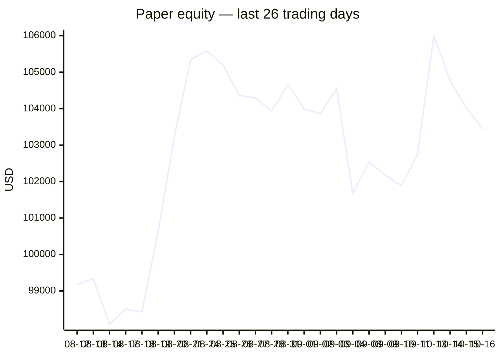
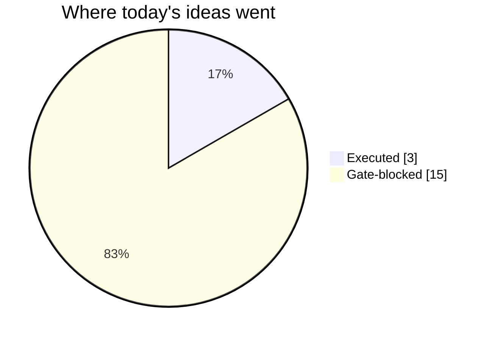

# Trading day 2026-10-16

Paper equity **$103,442** · day -0.44% · regime choppy · config v4-seeded · VIX 16.46 (up)

## Charts

```mermaid
xychart-beta
  title "Today's shadow outcomes (R)"
  x-axis ["GILD", "GILD", "GILD", "GILD", "GILD", "GILD", "GILD", "GILD", "GILD", "GILD", "GILD", "GILD", "GILD", "GILD", "GILD", "GILD", "GILD", "GILD", "GILD", "GILD", "GILD", "GILD", "GILD", "GILD", "GILD", "GILD", "GILD", "GILD", "GILD", "GILD", "GILD", "GILD", "GILD", "GILD", "GILD", "GILD", "GILD", "GILD", "GILD", "GILD", "GILD", "GILD", "GILD", "COP", "COP", "COP", "HCA", "HCA", "HCA", "HCA", "HCA", "HCA", "HCA", "HCA", "HCA", "HCA", "HCA", "HCA", "HCA", "HCA", "HCA", "HCA", "HCA", "HCA", "HCA", "HCA", "HCA", "HCA", "HCA", "HCA", "HCA", "HCA", "HCA", "HCA", "HCA", "HCA", "HCA", "HCA", "HCA", "HCA", "HCA", "HCA", "HCA", "HCA", "HCA", "HCA", "HCA", "HCA", "HCA", "HCA", "HCA", "HCA", "HCA", "HCA", "HCA", "COP", "COP", "COP", "COP", "HCA", "HCA", "HCA", "HCA", "HCA", "HCA", "HCA", "HCA", "HCA", "HCA", "HCA", "HCA", "HCA", "HCA", "HCA", "HCA", "HCA", "HCA", "HCA", "HCA", "HCA", "HCA", "HCA", "HCA", "HCA", "HCA", "HCA", "HCA", "HCA", "HCA", "HCA", "HCA", "HCA", "HCA", "HCA", "HCA", "HCA", "HCA", "HCA", "ELV", "ELV", "ELV", "ELV", "ELV", "NFLX", "NFLX", "NFLX", "NFLX", "KDP", "NFLX", "KDP", "NFLX", "DIS", "NFLX", "DIS", "DIS", "NFLX", "NFLX", "NFLX", "NFLX", "NFLX", "NFLX", "NFLX", "NFLX", "NFLX", "NFLX", "NFLX", "NFLX", "NFLX", "CVX", "CVX", "CVX", "CVX", "CVX", "CVX", "CVX", "CVX", "CVX", "CVX", "CVX", "CVX", "CVX", "CVX", "CVX", "CVX", "CVX", "CVX", "CVX", "CVX", "CVX", "CVX", "CVX", "CVX", "CVX", "CVX", "CVX", "CVX", "CVX", "CVX", "CVX", "CVX", "CVX", "CVX", "CVX", "CVX", "CVX", "CVX", "CVX", "CVX", "CVX", "CVX", "CVX", "CVX", "CVX", "CVX", "CVX", "CVX", "CVX", "CVX", "CVX", "CVX", "CVX", "CVX", "CVX", "CVX", "CVX", "CVX", "CVX", "CVX", "CVX", "CVX", "CVX", "CVX", "CVX", "CVX", "CVX", "CVX", "CVX", "CVX", "CVX", "CVX", "CVX", "CVX", "CVX", "CVX", "CVX", "CVX", "CVX", "CVX", "CVX", "CVX", "CVX", "CVX", "CVX", "CVX", "CVX", "CVX", "CVX", "CVX", "CVX", "CVX", "CVX", "CVX", "V", "V", "V", "CVX", "CVX", "CVX", "V", "CVX", "CVX", "CVX", "CVX", "CVX", "CVX", "CVX", "CVX", "CVX", "CVX", "CVX", "CVX", "CVX", "CVX", "CVX", "CVX", "KO", "KO", "CVX", "KO", "KO", "KO", "KO", "KO", "KO", "CVX", "CVX", "KO", "CVX", "KO", "KO", "KO", "CVX", "KO", "CVX", "KO", "WMT", "CVX", "KO", "PEP", "PEP", "PEP", "KO", "PEP", "KO", "KO", "KO", "PEP", "PEP", "PEP", "PEP", "PEP", "KO", "PEP", "KO", "PEP", "KO", "WMT", "WMT", "WMT", "WMT", "WMT", "WMT", "WMT", "KO", "WMT", "WMT", "WMT", "WMT", "CVX", "CVX", "KO", "KO", "KO", "KO", "KO", "WMT", "COST", "V", "V", "V", "V", "META", "V", "V", "V", "HLT", "HLT", "HLT", "MRNA", "MRNA", "MRNA", "MRNA", "MRNA", "HLT", "MRNA", "HLT", "MRNA", "HLT", "MRNA", "HLT", "MRNA", "HLT", "HLT", "HLT", "MRNA", "HLT", "HLT", "MRNA", "HLT", "HLT", "HLT", "HLT", "HLT", "HLT", "HLT", "HLT", "COP", "COP", "COP", "V", "V", "V", "MRNA", "WMT", "WMT", "WMT", "WMT", "WMT", "WMT", "WMT", "WMT", "JPM", "JPM", "MRNA", "MRNA", "MRNA", "MRNA", "MRNA", "HLT", "HLT", "HLT", "HLT", "HLT", "HLT", "HLT", "HLT", "WMT", "WMT", "WMT", "HLT", "WMT", "HLT", "WMT", "HLT", "WMT", "HLT", "WMT", "HLT", "WMT", "HLT", "HLT", "HLT", "HLT", "HLT", "HLT", "HLT", "HLT", "HLT", "HLT", "COST", "COST", "COST", "COST", "COST", "KDP", "KDP", "KDP", "KDP", "HD", "HD", "MSFT", "MSFT", "MSFT", "MSFT", "MSFT", "MSFT", "MSFT", "MSFT", "HD", "HD", "HD", "HD", "MRNA", "MRNA", "MRNA", "MRNA", "MRNA", "MRNA", "MRNA", "MRNA", "MRNA", "NOW", "MRNA", "ELV", "CRM", "HD", "HD", "HD", "HD", "HD", "HD", "HD", "HD", "MRNA", "MRNA", "MRNA", "HD", "HD", "MRNA", "COST", "COST", "COST", "ACN", "COST", "COST", "COST", "COST", "COST", "HD", "HD", "DIS", "HD", "HD", "HD", "HD", "HD", "HD", "HD", "HD", "HD", "HD", "HD", "HD", "MRNA", "MRNA", "MRNA", "MRNA", "MRNA", "ABBV", "ABBV", "ABBV", "ABBV", "ABBV", "ABBV", "ABBV", "BAC", "BAC", "BAC", "ABBV", "CVX", "BAC", "BAC", "BAC", "BAC", "BAC", "BAC", "BAC", "BAC", "BAC", "COST", "BAC", "BAC", "BAC", "BAC", "BAC", "BAC", "BAC", "DIS", "DIS", "JPM", "ABBV", "ABBV", "NVDA", "NVDA", "BAC", "BAC", "BAC", "BAC", "BAC", "AMZN", "BAC", "BAC", "BAC", "BAC", "BAC", "JNJ", "JNJ", "JNJ", "JNJ", "BAC", "BAC", "AMZN", "AMZN", "BAC", "BAC", "COP", "PG", "JPM", "JPM", "JPM", "JPM", "JPM", "JPM", "BAC", "BAC", "BAC", "BAC", "BAC", "BAC", "BAC", "BAC", "BAC", "DIS", "BAC", "META", "JPM", "BAC", "META", "MA", "MA", "MA", "MA", "MA", "MA", "MA", "MA", "MA", "MA", "MA", "MA", "HLT", "MA", "MA", "MA", "MA", "MA", "MA", "MA", "DIS", "HCA", "HCA", "HCA", "META", "MA", "BAC", "BAC", "BAC", "DIS", "KO", "KO", "KO", "KO", "KO", "KO", "DIS", "DIS", "DIS", "DIS", "HCA", "HCA", "DIS", "KO", "KO", "KO", "KO", "V", "MA", "MA", "MA", "MA", "HCA", "HCA", "HCA", "HCA", "META", "HCA", "HCA", "HCA", "HCA", "HCA", "HCA", "HCA", "HCA", "HCA", "HCA", "HCA", "HCA", "HCA", "HCA", "HCA", "HCA", "HCA", "HCA", "HCA", "HCA", "HCA", "HCA", "HCA", "HCA", "HCA", "HCA", "HCA", "HCA", "HCA", "HCA", "HCA", "HCA", "HCA", "HCA", "HCA", "HCA", "HCA", "HCA", "AAPL", "AAPL", "AAPL", "AAPL", "AAPL", "AAPL", "AAPL", "AAPL", "AAPL", "COST", "COST", "COST", "COST", "COST", "COST", "COST", "COST", "COST", "COST", "COST", "COST", "AAPL", "AAPL", "AAPL", "AAPL", "AAPL", "MA", "COST", "COST", "COST", "COST", "COST", "COST", "COST", "COST", "COST", "HCA", "HCA", "HCA", "MA", "MA", "MA", "MA", "MA", "HCA", "HCA", "HCA", "NAS100_USD"]
  bar [-1, -1, -1, -1, -1, -1, -1, -1, -1, -1, -1, -1, -1, -1, -1, -1, -1, -1, -1, -1, -1, -1, -1, -1, -1, -1, -1, -1, -1, -1, -1, -1, -1, -1, -1, -1, -1, -1, -1, -1, -1, -1, -1, 2, 2, 2, 2, 2, 2, 2, 2, 2, 2, 2, 2, 2, 2, 2, 2, 2, 2, 2, 2, 2, 2, 2, 2, 2, 2, 2, 2, 2, 2, 2, 2, 2, 2, 2, 2, 2, 2, 2, 2, 2, 2, 2, 2, 2, 2, 2, 2, 2, 2, 2, 2, -1, -1, -1, -1, 2, 2, 2, 2, 2, 2, 2, 2, 2, 2, 2, 2, 2, 2, 2, 2, 2, 2, 2, 2, 2, 2, 2, 2, 2, 2, 2, 2, 2, 2, 2, -1, -1, -1, -1, -1, -1, -1, 2, 2, 2, 2, 2, 2, -1, -1, -1, -1, 2, -1, 2, -1, 2, -1, 2, 2, -1, -1, -1, -1, -1, -1, -1, -1, -1, -1, -1, -1, -1, -1, -1, -1, -1, -1, -1, -1, -1, -1, -1, -1, -1, -1, -1, -1, -1, -1, -1, -1, -1, -1, -1, -1, -1, -1, -1, -1, -1, -1, -1, -1, -1, -1, -1, -1, -1, -1, -1, -1, -1, -1, -1, -1, -1, -1, -1, -1, -1, -1, -1, -1, -1, -1, -1, -1, -1, -1, -1, -1, -1, -1, -1, -1, -1, -1, -1, -1, -1, -1, -1, -1, -1, -1, -1, -1, -1, -1, -1, -1, -1, -1, -1, -1, -1, -1, -1, -1, -1, -1, -1, -1, -1, -1, -1, -1, -1, -1, -1, -1, -1, -1, -1, -1, -1, -1, -1, -1, -1, -1, -1, -1, -1, -1, -1, -1, -1, -1, -1, -1, -1, -1, -1, -1, -1, -1, -1, -1, -1, -1, -1, -1, -1, -1, -1, -1, -1, -1, -1, -1, -1, -1, -1, -1, -1, -1, -1, -1, -1, -1, -1, -1, -1, -1, -1, -1, -1, -1, -1, -1, -1, -1, -1, -1, -1, -1, -1, -1, -1, -1, -1, -1, -1, -1, -1, -1, -1, -1, -1, -1, 2, 2, 2, 2, -1, 2, 2, 2, 2, 2, 2, -1, -1, -1, -1, -1, 2, -1, 2, -1, 2, -1, 2, -1, 2, 2, 2, -1, 2, 2, -1, 2, 2, 2, 2, 2, 2, 2, 2, 2, 2, 2, 2, 2, 2, -1, -1, -1, -1, -1, -1, -1, -1, -1, 2, 2, -1, -1, -1, -1, -1, 2, 2, 2, 2, 2, 2, 2, 2, -1, -1, -1, 2, -1, 2, -1, 2, -1, 2, -1, 2, -1, 2, 2, 2, 2, 2, 2, 2, 2, 2, 2, -1, -1, -1, -1, -1, 2, 2, 2, 2, 2, 2, -1, -1, -1, -1, -1, -1, -1, -1, 2, 2, 2, 2, -1, -1, -1, -1, -1, -1, -1, -1, -1, -1, -1, -1, -1, 2, 2, 2, 2, 2, 2, 2, 2, -1, -1, -1, 2, 2, -1, -1, -1, -1, -1, -1, -1, -1, -1, -1, 2, 2, 2, 2, 2, 2, 2, 2, 2, 2, 2, 2, 2, 2, 2, 2, 2, 2, 2, 2, -1, -1, -1, -1, -1, -1, -1, 2, 2, 2, -1, -1, 2, 2, 2, 2, 2, 2, 2, 2, 2, -1, 2, 2, 2, 2, 2, 2, 2, 2, 2, 2, -1, -1, -1, -1, -1, -1, -1, -1, -1, -1, -1, -1, -1, -1, -1, -1, -1, -1, -1, -1, -1, -1, -1, -1, -1, 2, -1, -1, -1, -1, -1, -1, -1, -1, -1, -1, -1, -1, -1, -1, -1, -1, -1, -1, 2, -1, -1, 2, -1, -1, -1, -1, -1, -1, -1, -1, -1, -1, -1, -1, -1, -1, -1, -1, -1, -1, -1, -1, -1, 2, 2, 2, -1, -1, -1, -1, -1, -1, -1, -1, -1, -1, -1, -1, -1, -1, -1, -1, 2, 2, -1, -1, -1, -1, -1, -1, -1, -1, -1, -1, 2, 2, 2, 2, -1, 2, 2, 2, 2, 2, 2, 2, 2, 2, 2, 2, 2, 2, 2, 2, 2, 2, 2, 2, 2, 2, 2, 2, 2, 2, 2, 2, 2, 2, 2, 2, 2, 2, 2, 2, 2, 2, 2, -1, -1, -1, -1, -1, -1, -1, -1, -1, -1, -1, -1, -1, -1, -1, -1, -1, -1, -1, -1, -1, -1, -1, -1, -1, -1, -1, -1, -1, -1, -1, -1, -1, -1, -1, -1, -1, -1, -1, -1, -1, -1, -1, -1, -1, -1, -1, 2]
```

## Activity

- Theses formed: 4 (approved→orders: 3, human-rejected: 0, expired unapproved: 0)
- Risk gate blocked: 15
- Fills at the broker: 2

### Positions closed (real book)

- UK100_GBP → **target** +1.56R · banked 101% of its +1.54R peak
- ISRG → **stopped-or-closed** +0.48R · banked 30% of its +1.59R peak
- MA → **stopped** +0.01R · banked 1% of its +1.03R peak
- WTICO_USD → **target** +1.56R · banked 104% of its +1.49R peak

Exit quality: banked **59%** of peak open profit across 4 closed position(s) that had a real peak to protect. Persistently low = greed (holding through the give-back); high but with peaks barely above the exits = fear (selling winners too early).

### Execution quality (measured, today)

- cfd: 5 fill(s) · avg slippage cost -0.003R (negative = better than intended) · 7.3 bps · worst 0.141R

### The day's ideas

- **UK100_GBP** (cfd-momentum-breakout) entry 10886.1 stop 10806.98 target 11004.78 — UK100_GBP broke its 20-hour high (10881.9) on 2.0× average volume, above its 20-day average. Stop 3×ATR below, target 1.5R.
- **BCO_USD** (cfd-momentum-breakout) entry 109.22 stop 107.04 target 112.49 — BCO_USD broke its 20-hour high (108.71) on 3.0× average volume, above its 20-day average. Stop 3×ATR below, target 1.5R.
- **WTICO_USD** (cfd-momentum-breakout) entry 99 stop 97.04 target 101.94 — WTICO_USD broke its 20-hour high (98.97) on 2.9× average volume, above its 20-day average. Stop 3×ATR below, target 1.5R.
- **USD_JPY** (cfd-momentum-breakout) entry 158.25 stop 157.64 target 159.17 — USD_JPY broke its 20-hour high (158.19) on 1.4× average volume, above its 20-day average. Stop 3×ATR below, target 1.5R.

## Shadow ledger (what would have happened)

- GILD (momentum-breakdown:filtered, filter-blocked) → **stopped** -1R
- GILD (momentum-breakdown:filtered, filter-blocked) → **stopped** -1R
- GILD (momentum-breakdown:filtered, filter-blocked) → **stopped** -1R
- GILD (momentum-breakdown:filtered, filter-blocked) → **stopped** -1R
- GILD (momentum-breakdown:filtered, filter-blocked) → **stopped** -1R
- GILD (momentum-breakdown:filtered, filter-blocked) → **stopped** -1R
- GILD (momentum-breakdown:filtered, filter-blocked) → **stopped** -1R
- GILD (momentum-breakdown:filtered, filter-blocked) → **stopped** -1R
- GILD (momentum-breakdown:filtered, filter-blocked) → **stopped** -1R
- GILD (momentum-breakdown:filtered, filter-blocked) → **stopped** -1R
- GILD (momentum-breakdown:filtered, filter-blocked) → **stopped** -1R
- GILD (momentum-breakdown:filtered, filter-blocked) → **stopped** -1R
- GILD (momentum-breakdown:filtered, filter-blocked) → **stopped** -1R
- GILD (momentum-breakdown:filtered, filter-blocked) → **stopped** -1R
- GILD (momentum-breakdown:filtered, filter-blocked) → **stopped** -1R
- GILD (momentum-breakdown:filtered, filter-blocked) → **stopped** -1R
- GILD (momentum-breakdown:filtered, filter-blocked) → **stopped** -1R
- GILD (momentum-breakdown:filtered, filter-blocked) → **stopped** -1R
- GILD (momentum-breakdown:filtered, filter-blocked) → **stopped** -1R
- GILD (momentum-breakdown:filtered, filter-blocked) → **stopped** -1R
- GILD (momentum-breakdown:filtered, filter-blocked) → **stopped** -1R
- GILD (momentum-breakdown:filtered, filter-blocked) → **stopped** -1R
- GILD (momentum-breakdown:filtered, filter-blocked) → **stopped** -1R
- GILD (momentum-breakdown:filtered, filter-blocked) → **stopped** -1R
- GILD (momentum-breakdown:filtered, filter-blocked) → **stopped** -1R
- GILD (momentum-breakdown:filtered, filter-blocked) → **stopped** -1R
- GILD (momentum-breakdown:filtered, filter-blocked) → **stopped** -1R
- GILD (momentum-breakdown:filtered, filter-blocked) → **stopped** -1R
- GILD (momentum-breakdown:filtered, filter-blocked) → **stopped** -1R
- GILD (momentum-breakdown:filtered, filter-blocked) → **stopped** -1R
- GILD (momentum-breakdown:filtered, filter-blocked) → **stopped** -1R
- GILD (momentum-breakdown:filtered, filter-blocked) → **stopped** -1R
- GILD (momentum-breakdown:filtered, filter-blocked) → **stopped** -1R
- GILD (momentum-breakdown:filtered, filter-blocked) → **stopped** -1R
- GILD (momentum-breakdown:filtered, filter-blocked) → **stopped** -1R
- GILD (momentum-breakdown:filtered, filter-blocked) → **stopped** -1R
- GILD (momentum-breakdown:filtered, filter-blocked) → **stopped** -1R
- GILD (momentum-breakdown:filtered, filter-blocked) → **stopped** -1R
- GILD (momentum-breakdown:filtered, filter-blocked) → **stopped** -1R
- GILD (momentum-breakdown:filtered, filter-blocked) → **stopped** -1R
- GILD (momentum-breakdown:filtered, filter-blocked) → **stopped** -1R
- GILD (momentum-breakdown:filtered, filter-blocked) → **stopped** -1R
- GILD (momentum-breakdown:filtered, filter-blocked) → **stopped** -1R
- COP (momentum-breakout:filtered, filter-blocked) → **target** +2R
- COP (momentum-breakout:filtered, filter-blocked) → **target** +2R
- COP (momentum-breakout:filtered, filter-blocked) → **target** +2R
- HCA (momentum-breakout:filtered, filter-blocked) → **target** +2R
- HCA (momentum-breakout:filtered, filter-blocked) → **target** +2R
- HCA (momentum-breakout:filtered, filter-blocked) → **target** +2R
- HCA (momentum-breakout:filtered, filter-blocked) → **target** +2R
- HCA (momentum-breakout:filtered, filter-blocked) → **target** +2R
- HCA (momentum-breakout:filtered, filter-blocked) → **target** +2R
- HCA (momentum-breakout:filtered, filter-blocked) → **target** +2R
- HCA (momentum-breakout:filtered, filter-blocked) → **target** +2R
- HCA (momentum-breakout:filtered, filter-blocked) → **target** +2R
- HCA (momentum-breakout:filtered, filter-blocked) → **target** +2R
- HCA (momentum-breakout:filtered, filter-blocked) → **target** +2R
- HCA (momentum-breakout:filtered, filter-blocked) → **target** +2R
- HCA (momentum-breakout:filtered, filter-blocked) → **target** +2R
- HCA (momentum-breakout:filtered, filter-blocked) → **target** +2R
- HCA (momentum-breakout:filtered, filter-blocked) → **target** +2R
- HCA (momentum-breakout:filtered, filter-blocked) → **target** +2R
- HCA (momentum-breakout:filtered, filter-blocked) → **target** +2R
- HCA (momentum-breakout:filtered, filter-blocked) → **target** +2R
- HCA (momentum-breakout:filtered, filter-blocked) → **target** +2R
- HCA (momentum-breakout:filtered, filter-blocked) → **target** +2R
- HCA (momentum-breakout:filtered, filter-blocked) → **target** +2R
- HCA (momentum-breakout:filtered, filter-blocked) → **target** +2R
- HCA (momentum-breakout:filtered, filter-blocked) → **target** +2R
- HCA (momentum-breakout:filtered, filter-blocked) → **target** +2R
- HCA (momentum-breakout:filtered, filter-blocked) → **target** +2R
- HCA (momentum-breakout:filtered, filter-blocked) → **target** +2R
- HCA (momentum-breakout:filtered, filter-blocked) → **target** +2R
- HCA (momentum-breakout:filtered, filter-blocked) → **target** +2R
- HCA (momentum-breakout:filtered, filter-blocked) → **target** +2R
- HCA (momentum-breakout:filtered, filter-blocked) → **target** +2R
- HCA (momentum-breakout:filtered, filter-blocked) → **target** +2R
- HCA (momentum-breakout:filtered, filter-blocked) → **target** +2R
- HCA (momentum-breakout:filtered, filter-blocked) → **target** +2R
- HCA (momentum-breakout:filtered, filter-blocked) → **target** +2R
- HCA (momentum-breakout:filtered, filter-blocked) → **target** +2R
- HCA (momentum-breakout:filtered, filter-blocked) → **target** +2R
- HCA (momentum-breakout:filtered, filter-blocked) → **target** +2R
- HCA (momentum-breakout:filtered, filter-blocked) → **target** +2R
- HCA (momentum-breakout:filtered, filter-blocked) → **target** +2R
- HCA (momentum-breakout:filtered, filter-blocked) → **target** +2R
- HCA (momentum-breakout:filtered, filter-blocked) → **target** +2R
- HCA (momentum-breakout:filtered, filter-blocked) → **target** +2R
- HCA (momentum-breakout:filtered, filter-blocked) → **target** +2R
- HCA (momentum-breakout:filtered, filter-blocked) → **target** +2R
- HCA (momentum-breakout:filtered, filter-blocked) → **target** +2R
- HCA (momentum-breakout:filtered, filter-blocked) → **target** +2R
- HCA (momentum-breakout:filtered, filter-blocked) → **target** +2R
- HCA (momentum-breakout:filtered, filter-blocked) → **target** +2R
- HCA (momentum-breakout:filtered, filter-blocked) → **target** +2R
- COP (momentum-breakout:filtered, filter-blocked) → **stopped** -1R
- COP (momentum-breakout:filtered, filter-blocked) → **stopped** -1R
- COP (momentum-breakout:filtered, filter-blocked) → **stopped** -1R
- COP (momentum-breakout:filtered, filter-blocked) → **stopped** -1R
- HCA (momentum-breakout:filtered, filter-blocked) → **target** +2R
- HCA (momentum-breakout:filtered, filter-blocked) → **target** +2R
- HCA (momentum-breakout:filtered, filter-blocked) → **target** +2R
- HCA (momentum-breakout:filtered, filter-blocked) → **target** +2R
- HCA (momentum-breakout:filtered, filter-blocked) → **target** +2R
- HCA (momentum-breakout:filtered, filter-blocked) → **target** +2R
- HCA (momentum-breakout:filtered, filter-blocked) → **target** +2R
- HCA (momentum-breakout:filtered, filter-blocked) → **target** +2R
- HCA (momentum-breakout:filtered, filter-blocked) → **target** +2R
- HCA (momentum-breakout:filtered, filter-blocked) → **target** +2R
- HCA (momentum-breakout:filtered, filter-blocked) → **target** +2R
- HCA (momentum-breakout:filtered, filter-blocked) → **target** +2R
- HCA (momentum-breakout:filtered, filter-blocked) → **target** +2R
- HCA (momentum-breakout:filtered, filter-blocked) → **target** +2R
- HCA (momentum-breakout:filtered, filter-blocked) → **target** +2R
- HCA (momentum-breakout:filtered, filter-blocked) → **target** +2R
- HCA (momentum-breakout:filtered, filter-blocked) → **target** +2R
- HCA (momentum-breakout:filtered, filter-blocked) → **target** +2R
- HCA (momentum-breakout:filtered, filter-blocked) → **target** +2R
- HCA (momentum-breakout:filtered, filter-blocked) → **target** +2R
- HCA (momentum-breakout:filtered, filter-blocked) → **target** +2R
- HCA (momentum-breakout:filtered, filter-blocked) → **target** +2R
- HCA (momentum-breakout:filtered, filter-blocked) → **target** +2R
- HCA (momentum-breakout:filtered, filter-blocked) → **target** +2R
- HCA (momentum-breakout:filtered, filter-blocked) → **target** +2R
- HCA (momentum-breakout:filtered, filter-blocked) → **target** +2R
- HCA (momentum-breakout:filtered, filter-blocked) → **target** +2R
- HCA (momentum-breakout:filtered, filter-blocked) → **target** +2R
- HCA (momentum-breakout:filtered, filter-blocked) → **target** +2R
- HCA (momentum-breakout:filtered, filter-blocked) → **target** +2R
- HCA (momentum-breakout:filtered, filter-blocked) → **target** +2R
- HCA (momentum-breakout:filtered, filter-blocked) → **stopped** -1R
- HCA (momentum-breakout:filtered, filter-blocked) → **stopped** -1R
- HCA (momentum-breakout:filtered, filter-blocked) → **stopped** -1R
- HCA (momentum-breakout:filtered, filter-blocked) → **stopped** -1R
- HCA (momentum-breakout:filtered, filter-blocked) → **stopped** -1R
- HCA (momentum-breakout:filtered, filter-blocked) → **stopped** -1R
- HCA (momentum-breakout:filtered, filter-blocked) → **stopped** -1R
- HCA (momentum-breakout:filtered, filter-blocked) → **target** +2R
- ELV (momentum-breakout:filtered, filter-blocked) → **target** +2R
- ELV (momentum-breakout:filtered, filter-blocked) → **target** +2R
- ELV (momentum-breakout:filtered, filter-blocked) → **target** +2R
- ELV (momentum-breakout:filtered, filter-blocked) → **target** +2R
- ELV (momentum-breakout:filtered, filter-blocked) → **target** +2R
- NFLX (momentum-breakout:filtered, filter-blocked) → **stopped** -1R
- NFLX (momentum-breakout:filtered, filter-blocked) → **stopped** -1R
- NFLX (momentum-breakout:filtered, filter-blocked) → **stopped** -1R
- NFLX (momentum-breakout:filtered, filter-blocked) → **stopped** -1R
- KDP (momentum-breakout:filtered, filter-blocked) → **target** +2R
- NFLX (momentum-breakout:filtered, filter-blocked) → **stopped** -1R
- KDP (momentum-breakout:filtered, filter-blocked) → **target** +2R
- NFLX (momentum-breakout:filtered, filter-blocked) → **stopped** -1R
- DIS (momentum-breakout:filtered, filter-blocked) → **target** +2R
- NFLX (momentum-breakout:filtered, filter-blocked) → **stopped** -1R
- DIS (momentum-breakout:filtered, filter-blocked) → **target** +2R
- DIS (momentum-breakout:filtered, filter-blocked) → **target** +2R
- NFLX (momentum-breakout:filtered, filter-blocked) → **stopped** -1R
- NFLX (momentum-breakout:filtered, filter-blocked) → **stopped** -1R
- NFLX (momentum-breakout:filtered, filter-blocked) → **stopped** -1R
- NFLX (momentum-breakout:filtered, filter-blocked) → **stopped** -1R
- NFLX (momentum-breakout:filtered, filter-blocked) → **stopped** -1R
- NFLX (momentum-breakout:filtered, filter-blocked) → **stopped** -1R
- NFLX (momentum-breakout:filtered, filter-blocked) → **stopped** -1R
- NFLX (momentum-breakout:filtered, filter-blocked) → **stopped** -1R
- NFLX (momentum-breakout:filtered, filter-blocked) → **stopped** -1R
- NFLX (momentum-breakout:filtered, filter-blocked) → **stopped** -1R
- NFLX (momentum-breakout:filtered, filter-blocked) → **stopped** -1R
- NFLX (momentum-breakout:filtered, filter-blocked) → **stopped** -1R
- NFLX (momentum-breakout:filtered, filter-blocked) → **stopped** -1R
- CVX (momentum-breakdown:filtered, filter-blocked) → **stopped** -1R
- CVX (momentum-breakdown:filtered, filter-blocked) → **stopped** -1R
- CVX (momentum-breakdown:filtered, filter-blocked) → **stopped** -1R
- CVX (momentum-breakdown:filtered, filter-blocked) → **stopped** -1R
- CVX (momentum-breakdown:filtered, filter-blocked) → **stopped** -1R
- CVX (momentum-breakdown:filtered, filter-blocked) → **stopped** -1R
- CVX (momentum-breakdown:filtered, filter-blocked) → **stopped** -1R
- CVX (momentum-breakdown:filtered, filter-blocked) → **stopped** -1R
- CVX (momentum-breakdown:filtered, filter-blocked) → **stopped** -1R
- CVX (momentum-breakdown:filtered, filter-blocked) → **stopped** -1R
- CVX (momentum-breakdown:filtered, filter-blocked) → **stopped** -1R
- CVX (momentum-breakdown:filtered, filter-blocked) → **stopped** -1R
- CVX (momentum-breakdown:filtered, filter-blocked) → **stopped** -1R
- CVX (momentum-breakdown:filtered, filter-blocked) → **stopped** -1R
- CVX (momentum-breakdown:filtered, filter-blocked) → **stopped** -1R
- CVX (momentum-breakdown:filtered, filter-blocked) → **stopped** -1R
- CVX (momentum-breakdown:filtered, filter-blocked) → **stopped** -1R
- CVX (momentum-breakdown:filtered, filter-blocked) → **stopped** -1R
- CVX (momentum-breakdown:filtered, filter-blocked) → **stopped** -1R
- CVX (momentum-breakdown:filtered, filter-blocked) → **stopped** -1R
- CVX (momentum-breakdown:filtered, filter-blocked) → **stopped** -1R
- CVX (momentum-breakdown:filtered, filter-blocked) → **stopped** -1R
- CVX (momentum-breakdown:filtered, filter-blocked) → **stopped** -1R
- CVX (momentum-breakdown:filtered, filter-blocked) → **stopped** -1R
- CVX (momentum-breakdown:filtered, filter-blocked) → **stopped** -1R
- CVX (momentum-breakdown:filtered, filter-blocked) → **stopped** -1R
- CVX (momentum-breakdown:filtered, filter-blocked) → **stopped** -1R
- CVX (momentum-breakdown:filtered, filter-blocked) → **stopped** -1R
- CVX (momentum-breakdown:filtered, filter-blocked) → **stopped** -1R
- CVX (momentum-breakdown:filtered, filter-blocked) → **stopped** -1R
- CVX (momentum-breakdown:filtered, filter-blocked) → **stopped** -1R
- CVX (momentum-breakdown:filtered, filter-blocked) → **stopped** -1R
- CVX (momentum-breakdown:filtered, filter-blocked) → **stopped** -1R
- CVX (momentum-breakdown:filtered, filter-blocked) → **stopped** -1R
- CVX (momentum-breakdown:filtered, filter-blocked) → **stopped** -1R
- CVX (momentum-breakdown:filtered, filter-blocked) → **stopped** -1R
- CVX (momentum-breakdown:filtered, filter-blocked) → **stopped** -1R
- CVX (momentum-breakdown:filtered, filter-blocked) → **stopped** -1R
- CVX (momentum-breakdown:filtered, filter-blocked) → **stopped** -1R
- CVX (momentum-breakdown:filtered, filter-blocked) → **stopped** -1R
- CVX (momentum-breakdown:filtered, filter-blocked) → **stopped** -1R
- CVX (momentum-breakdown:filtered, filter-blocked) → **stopped** -1R
- CVX (momentum-breakdown:filtered, filter-blocked) → **stopped** -1R
- CVX (momentum-breakdown:filtered, filter-blocked) → **stopped** -1R
- CVX (momentum-breakdown:filtered, filter-blocked) → **stopped** -1R
- CVX (momentum-breakdown:filtered, filter-blocked) → **stopped** -1R
- CVX (momentum-breakdown:filtered, filter-blocked) → **stopped** -1R
- CVX (momentum-breakdown:filtered, filter-blocked) → **stopped** -1R
- CVX (momentum-breakdown:filtered, filter-blocked) → **stopped** -1R
- CVX (momentum-breakdown:filtered, filter-blocked) → **stopped** -1R
- CVX (momentum-breakdown:filtered, filter-blocked) → **stopped** -1R
- CVX (momentum-breakdown:filtered, filter-blocked) → **stopped** -1R
- CVX (momentum-breakdown:filtered, filter-blocked) → **stopped** -1R
- CVX (momentum-breakdown:filtered, filter-blocked) → **stopped** -1R
- CVX (momentum-breakdown:filtered, filter-blocked) → **stopped** -1R
- CVX (momentum-breakdown:filtered, filter-blocked) → **stopped** -1R
- CVX (momentum-breakdown:filtered, filter-blocked) → **stopped** -1R
- CVX (momentum-breakdown:filtered, filter-blocked) → **stopped** -1R
- CVX (momentum-breakdown:filtered, filter-blocked) → **stopped** -1R
- CVX (momentum-breakdown:filtered, filter-blocked) → **stopped** -1R
- CVX (momentum-breakdown:filtered, filter-blocked) → **stopped** -1R
- CVX (momentum-breakdown:filtered, filter-blocked) → **stopped** -1R
- CVX (momentum-breakdown:filtered, filter-blocked) → **stopped** -1R
- CVX (momentum-breakdown:filtered, filter-blocked) → **stopped** -1R
- CVX (momentum-breakdown:filtered, filter-blocked) → **stopped** -1R
- CVX (momentum-breakdown:filtered, filter-blocked) → **stopped** -1R
- CVX (momentum-breakdown:filtered, filter-blocked) → **stopped** -1R
- CVX (momentum-breakdown:filtered, filter-blocked) → **stopped** -1R
- CVX (momentum-breakdown:filtered, filter-blocked) → **stopped** -1R
- CVX (momentum-breakdown:filtered, filter-blocked) → **stopped** -1R
- CVX (momentum-breakdown:filtered, filter-blocked) → **stopped** -1R
- CVX (momentum-breakdown:filtered, filter-blocked) → **stopped** -1R
- CVX (momentum-breakdown:filtered, filter-blocked) → **stopped** -1R
- CVX (momentum-breakdown:filtered, filter-blocked) → **stopped** -1R
- CVX (momentum-breakdown:filtered, filter-blocked) → **stopped** -1R
- CVX (momentum-breakdown:filtered, filter-blocked) → **stopped** -1R
- CVX (momentum-breakdown:filtered, filter-blocked) → **stopped** -1R
- CVX (momentum-breakdown:filtered, filter-blocked) → **stopped** -1R
- CVX (momentum-breakdown:filtered, filter-blocked) → **stopped** -1R
- CVX (momentum-breakdown:filtered, filter-blocked) → **stopped** -1R
- CVX (momentum-breakdown:filtered, filter-blocked) → **stopped** -1R
- CVX (momentum-breakdown:filtered, filter-blocked) → **stopped** -1R
- CVX (momentum-breakdown:filtered, filter-blocked) → **stopped** -1R
- CVX (momentum-breakdown:filtered, filter-blocked) → **stopped** -1R
- CVX (momentum-breakdown:filtered, filter-blocked) → **stopped** -1R
- CVX (momentum-breakdown:filtered, filter-blocked) → **stopped** -1R
- CVX (momentum-breakdown:filtered, filter-blocked) → **stopped** -1R
- CVX (momentum-breakdown:filtered, filter-blocked) → **stopped** -1R
- CVX (momentum-breakdown:filtered, filter-blocked) → **stopped** -1R
- CVX (momentum-breakdown:filtered, filter-blocked) → **stopped** -1R
- CVX (momentum-breakdown:filtered, filter-blocked) → **stopped** -1R
- CVX (momentum-breakdown:filtered, filter-blocked) → **stopped** -1R
- CVX (momentum-breakdown:filtered, filter-blocked) → **stopped** -1R
- CVX (momentum-breakdown:filtered, filter-blocked) → **stopped** -1R
- V (momentum-breakout:filtered, filter-blocked) → **stopped** -1R
- V (momentum-breakout:filtered, filter-blocked) → **stopped** -1R
- V (momentum-breakout:filtered, filter-blocked) → **stopped** -1R
- CVX (momentum-breakdown:filtered, filter-blocked) → **stopped** -1R
- CVX (momentum-breakdown:filtered, filter-blocked) → **stopped** -1R
- CVX (momentum-breakdown:filtered, filter-blocked) → **stopped** -1R
- V (momentum-breakout:filtered, filter-blocked) → **stopped** -1R
- CVX (momentum-breakdown:filtered, filter-blocked) → **stopped** -1R
- CVX (momentum-breakdown:filtered, filter-blocked) → **stopped** -1R
- CVX (momentum-breakdown:filtered, filter-blocked) → **stopped** -1R
- CVX (momentum-breakdown:filtered, filter-blocked) → **stopped** -1R
- CVX (momentum-breakdown:filtered, filter-blocked) → **stopped** -1R
- CVX (momentum-breakdown:filtered, filter-blocked) → **stopped** -1R
- CVX (momentum-breakdown:filtered, filter-blocked) → **stopped** -1R
- CVX (momentum-breakdown:filtered, filter-blocked) → **stopped** -1R
- CVX (momentum-breakdown:filtered, filter-blocked) → **stopped** -1R
- CVX (momentum-breakdown:filtered, filter-blocked) → **stopped** -1R
- CVX (momentum-breakdown:filtered, filter-blocked) → **stopped** -1R
- CVX (momentum-breakdown:filtered, filter-blocked) → **stopped** -1R
- CVX (momentum-breakdown:filtered, filter-blocked) → **stopped** -1R
- CVX (momentum-breakdown:filtered, filter-blocked) → **stopped** -1R
- CVX (momentum-breakdown:filtered, filter-blocked) → **stopped** -1R
- CVX (momentum-breakdown:filtered, filter-blocked) → **stopped** -1R
- KO (momentum-breakdown:filtered, filter-blocked) → **stopped** -1R
- KO (momentum-breakdown:filtered, filter-blocked) → **stopped** -1R
- CVX (momentum-breakdown:filtered, filter-blocked) → **stopped** -1R
- KO (momentum-breakdown:filtered, filter-blocked) → **stopped** -1R
- KO (momentum-breakdown:filtered, filter-blocked) → **stopped** -1R
- KO (momentum-breakdown:filtered, filter-blocked) → **stopped** -1R
- KO (momentum-breakdown:filtered, filter-blocked) → **stopped** -1R
- KO (momentum-breakdown:filtered, filter-blocked) → **stopped** -1R
- KO (momentum-breakdown:filtered, filter-blocked) → **stopped** -1R
- CVX (momentum-breakdown:filtered, filter-blocked) → **stopped** -1R
- CVX (momentum-breakdown:filtered, filter-blocked) → **stopped** -1R
- KO (momentum-breakdown:filtered, filter-blocked) → **stopped** -1R
- CVX (momentum-breakdown:filtered, filter-blocked) → **stopped** -1R
- KO (momentum-breakdown:filtered, filter-blocked) → **stopped** -1R
- KO (momentum-breakdown:filtered, filter-blocked) → **stopped** -1R
- KO (momentum-breakdown:filtered, filter-blocked) → **stopped** -1R
- CVX (momentum-breakdown:filtered, filter-blocked) → **stopped** -1R
- KO (momentum-breakdown:filtered, filter-blocked) → **stopped** -1R
- CVX (momentum-breakdown:filtered, filter-blocked) → **stopped** -1R
- KO (momentum-breakdown:filtered, filter-blocked) → **stopped** -1R
- WMT (momentum-breakdown:filtered, filter-blocked) → **stopped** -1R
- CVX (momentum-breakdown:filtered, filter-blocked) → **stopped** -1R
- KO (momentum-breakdown:filtered, filter-blocked) → **stopped** -1R
- PEP (momentum-breakdown:filtered, filter-blocked) → **stopped** -1R
- PEP (momentum-breakdown:filtered, filter-blocked) → **stopped** -1R
- PEP (momentum-breakdown:filtered, filter-blocked) → **stopped** -1R
- KO (momentum-breakdown:filtered, filter-blocked) → **stopped** -1R
- PEP (momentum-breakdown:filtered, filter-blocked) → **stopped** -1R
- KO (momentum-breakdown:filtered, filter-blocked) → **stopped** -1R
- KO (momentum-breakdown:filtered, filter-blocked) → **stopped** -1R
- KO (momentum-breakdown:filtered, filter-blocked) → **stopped** -1R
- PEP (momentum-breakdown:filtered, filter-blocked) → **stopped** -1R
- PEP (momentum-breakdown:filtered, filter-blocked) → **stopped** -1R
- PEP (momentum-breakdown:filtered, filter-blocked) → **stopped** -1R
- PEP (momentum-breakdown:filtered, filter-blocked) → **stopped** -1R
- PEP (momentum-breakdown:filtered, filter-blocked) → **stopped** -1R
- KO (momentum-breakdown:filtered, filter-blocked) → **stopped** -1R
- PEP (momentum-breakdown:filtered, filter-blocked) → **stopped** -1R
- KO (momentum-breakdown:filtered, filter-blocked) → **stopped** -1R
- PEP (momentum-breakdown:filtered, filter-blocked) → **stopped** -1R
- KO (momentum-breakdown:filtered, filter-blocked) → **stopped** -1R
- WMT (momentum-breakdown:filtered, filter-blocked) → **stopped** -1R
- WMT (momentum-breakdown:filtered, filter-blocked) → **stopped** -1R
- WMT (momentum-breakdown:filtered, filter-blocked) → **stopped** -1R
- WMT (momentum-breakdown:filtered, filter-blocked) → **stopped** -1R
- WMT (momentum-breakdown:filtered, filter-blocked) → **stopped** -1R
- WMT (momentum-breakdown:filtered, filter-blocked) → **stopped** -1R
- WMT (momentum-breakdown:filtered, filter-blocked) → **stopped** -1R
- KO (momentum-breakdown:filtered, filter-blocked) → **stopped** -1R
- WMT (momentum-breakdown:filtered, filter-blocked) → **stopped** -1R
- WMT (momentum-breakdown:filtered, filter-blocked) → **stopped** -1R
- WMT (momentum-breakdown:filtered, filter-blocked) → **stopped** -1R
- WMT (momentum-breakdown:filtered, filter-blocked) → **stopped** -1R
- CVX (momentum-breakdown:filtered, filter-blocked) → **stopped** -1R
- CVX (momentum-breakdown:filtered, filter-blocked) → **stopped** -1R
- KO (momentum-breakdown:filtered, filter-blocked) → **stopped** -1R
- KO (momentum-breakdown:filtered, filter-blocked) → **stopped** -1R
- KO (momentum-breakdown:filtered, filter-blocked) → **stopped** -1R
- KO (momentum-breakdown:filtered, filter-blocked) → **stopped** -1R
- KO (momentum-breakdown:filtered, filter-blocked) → **stopped** -1R
- WMT (momentum-breakdown:filtered, filter-blocked) → **stopped** -1R
- COST (momentum-breakdown:filtered, filter-blocked) → **stopped** -1R
- V (momentum-breakout:filtered, filter-blocked) → **target** +2R
- V (momentum-breakout:filtered, filter-blocked) → **target** +2R
- V (momentum-breakout:filtered, filter-blocked) → **target** +2R
- V (momentum-breakout:filtered, filter-blocked) → **target** +2R
- META (momentum-breakout:filtered, filter-blocked) → **stopped** -1R
- V (momentum-breakout:filtered, filter-blocked) → **target** +2R
- V (momentum-breakout:filtered, filter-blocked) → **target** +2R
- V (momentum-breakout:filtered, filter-blocked) → **target** +2R
- HLT (momentum-breakout:filtered, filter-blocked) → **target** +2R
- HLT (momentum-breakout:filtered, filter-blocked) → **target** +2R
- HLT (momentum-breakout:filtered, filter-blocked) → **target** +2R
- MRNA (momentum-breakout:filtered, filter-blocked) → **stopped** -1R
- MRNA (momentum-breakout:filtered, filter-blocked) → **stopped** -1R
- MRNA (momentum-breakout:filtered, filter-blocked) → **stopped** -1R
- MRNA (momentum-breakout:filtered, filter-blocked) → **stopped** -1R
- MRNA (momentum-breakout:filtered, filter-blocked) → **stopped** -1R
- HLT (momentum-breakout:filtered, filter-blocked) → **target** +2R
- MRNA (momentum-breakout:filtered, filter-blocked) → **stopped** -1R
- HLT (momentum-breakout:filtered, filter-blocked) → **target** +2R
- MRNA (momentum-breakout:filtered, filter-blocked) → **stopped** -1R
- HLT (momentum-breakout:filtered, filter-blocked) → **target** +2R
- MRNA (momentum-breakout:filtered, filter-blocked) → **stopped** -1R
- HLT (momentum-breakout:filtered, filter-blocked) → **target** +2R
- MRNA (momentum-breakout:filtered, filter-blocked) → **stopped** -1R
- HLT (momentum-breakout:filtered, filter-blocked) → **target** +2R
- HLT (momentum-breakout:filtered, filter-blocked) → **target** +2R
- HLT (momentum-breakout:filtered, filter-blocked) → **target** +2R
- MRNA (momentum-breakout:filtered, filter-blocked) → **stopped** -1R
- HLT (momentum-breakout:filtered, filter-blocked) → **target** +2R
- HLT (momentum-breakout:filtered, filter-blocked) → **target** +2R
- MRNA (momentum-breakout:filtered, filter-blocked) → **stopped** -1R
- HLT (momentum-breakout:filtered, filter-blocked) → **target** +2R
- HLT (momentum-breakout:filtered, filter-blocked) → **target** +2R
- HLT (momentum-breakout:filtered, filter-blocked) → **target** +2R
- HLT (momentum-breakout:filtered, filter-blocked) → **target** +2R
- HLT (momentum-breakout:filtered, filter-blocked) → **target** +2R
- HLT (momentum-breakout:filtered, filter-blocked) → **target** +2R
- HLT (momentum-breakout:filtered, filter-blocked) → **target** +2R
- HLT (momentum-breakout:filtered, filter-blocked) → **target** +2R
- COP (momentum-breakout:filtered, filter-blocked) → **target** +2R
- COP (momentum-breakout:filtered, filter-blocked) → **target** +2R
- COP (momentum-breakout:filtered, filter-blocked) → **target** +2R
- V (momentum-breakout:filtered, filter-blocked) → **target** +2R
- V (momentum-breakout:filtered, filter-blocked) → **target** +2R
- V (momentum-breakout:filtered, filter-blocked) → **target** +2R
- MRNA (momentum-breakout:filtered, filter-blocked) → **stopped** -1R
- WMT (momentum-breakdown:filtered, filter-blocked) → **stopped** -1R
- WMT (momentum-breakdown:filtered, filter-blocked) → **stopped** -1R
- WMT (momentum-breakdown:filtered, filter-blocked) → **stopped** -1R
- WMT (momentum-breakdown:filtered, filter-blocked) → **stopped** -1R
- WMT (momentum-breakdown:filtered, filter-blocked) → **stopped** -1R
- WMT (momentum-breakdown:filtered, filter-blocked) → **stopped** -1R
- WMT (momentum-breakdown:filtered, filter-blocked) → **stopped** -1R
- WMT (momentum-breakdown:filtered, filter-blocked) → **stopped** -1R
- JPM (momentum-breakout:filtered, filter-blocked) → **target** +2R
- JPM (momentum-breakout:filtered, filter-blocked) → **target** +2R
- MRNA (momentum-breakout:filtered, filter-blocked) → **stopped** -1R
- MRNA (momentum-breakout:filtered, filter-blocked) → **stopped** -1R
- MRNA (momentum-breakout:filtered, filter-blocked) → **stopped** -1R
- MRNA (momentum-breakout:filtered, filter-blocked) → **stopped** -1R
- MRNA (momentum-breakout:filtered, filter-blocked) → **stopped** -1R
- HLT (momentum-breakout:filtered, filter-blocked) → **target** +2R
- HLT (momentum-breakout:filtered, filter-blocked) → **target** +2R
- HLT (momentum-breakout:filtered, filter-blocked) → **target** +2R
- HLT (momentum-breakout:filtered, filter-blocked) → **target** +2R
- HLT (momentum-breakout:filtered, filter-blocked) → **target** +2R
- HLT (momentum-breakout:filtered, filter-blocked) → **target** +2R
- HLT (momentum-breakout:filtered, filter-blocked) → **target** +2R
- HLT (momentum-breakout:filtered, filter-blocked) → **target** +2R
- WMT (momentum-breakdown:filtered, filter-blocked) → **stopped** -1R
- WMT (momentum-breakdown:filtered, filter-blocked) → **stopped** -1R
- WMT (momentum-breakdown:filtered, filter-blocked) → **stopped** -1R
- HLT (momentum-breakout:filtered, filter-blocked) → **target** +2R
- WMT (momentum-breakdown:filtered, filter-blocked) → **stopped** -1R
- HLT (momentum-breakout:filtered, filter-blocked) → **target** +2R
- WMT (momentum-breakdown:filtered, filter-blocked) → **stopped** -1R
- HLT (momentum-breakout:filtered, filter-blocked) → **target** +2R
- WMT (momentum-breakdown:filtered, filter-blocked) → **stopped** -1R
- HLT (momentum-breakout:filtered, filter-blocked) → **target** +2R
- WMT (momentum-breakdown:filtered, filter-blocked) → **stopped** -1R
- HLT (momentum-breakout:filtered, filter-blocked) → **target** +2R
- WMT (momentum-breakdown:filtered, filter-blocked) → **stopped** -1R
- HLT (momentum-breakout:filtered, filter-blocked) → **target** +2R
- HLT (momentum-breakout:filtered, filter-blocked) → **target** +2R
- HLT (momentum-breakout:filtered, filter-blocked) → **target** +2R
- HLT (momentum-breakout:filtered, filter-blocked) → **target** +2R
- HLT (momentum-breakout:filtered, filter-blocked) → **target** +2R
- HLT (momentum-breakout:filtered, filter-blocked) → **target** +2R
- HLT (momentum-breakout:filtered, filter-blocked) → **target** +2R
- HLT (momentum-breakout:filtered, filter-blocked) → **target** +2R
- HLT (momentum-breakout:filtered, filter-blocked) → **target** +2R
- HLT (momentum-breakout, gate-blocked) → **target** +2R
- COST (momentum-breakdown:filtered, filter-blocked) → **stopped** -1R
- COST (momentum-breakdown:filtered, filter-blocked) → **stopped** -1R
- COST (momentum-breakdown:filtered, filter-blocked) → **stopped** -1R
- COST (momentum-breakdown:filtered, filter-blocked) → **stopped** -1R
- COST (momentum-breakdown:filtered, filter-blocked) → **stopped** -1R
- KDP (momentum-breakout:filtered, filter-blocked) → **target** +2R
- KDP (momentum-breakout:filtered, filter-blocked) → **target** +2R
- KDP (momentum-breakout:filtered, filter-blocked) → **target** +2R
- KDP (momentum-breakout:filtered, filter-blocked) → **target** +2R
- HD (momentum-breakout:filtered, filter-blocked) → **target** +2R
- HD (momentum-breakout:filtered, filter-blocked) → **target** +2R
- MSFT (momentum-breakout:filtered, filter-blocked) → **stopped** -1R
- MSFT (momentum-breakout:filtered, filter-blocked) → **stopped** -1R
- MSFT (momentum-breakout:filtered, filter-blocked) → **stopped** -1R
- MSFT (momentum-breakout:filtered, filter-blocked) → **stopped** -1R
- MSFT (momentum-breakout:filtered, filter-blocked) → **stopped** -1R
- MSFT (momentum-breakout:filtered, filter-blocked) → **stopped** -1R
- MSFT (momentum-breakout:filtered, filter-blocked) → **stopped** -1R
- MSFT (momentum-breakout:filtered, filter-blocked) → **stopped** -1R
- HD (momentum-breakout:filtered, filter-blocked) → **target** +2R
- HD (momentum-breakout:filtered, filter-blocked) → **target** +2R
- HD (momentum-breakout:filtered, filter-blocked) → **target** +2R
- HD (momentum-breakout:filtered, filter-blocked) → **target** +2R
- MRNA (momentum-breakout:filtered, filter-blocked) → **stopped** -1R
- MRNA (momentum-breakout:filtered, filter-blocked) → **stopped** -1R
- MRNA (momentum-breakout:filtered, filter-blocked) → **stopped** -1R
- MRNA (momentum-breakout:filtered, filter-blocked) → **stopped** -1R
- MRNA (momentum-breakout:filtered, filter-blocked) → **stopped** -1R
- MRNA (momentum-breakout:filtered, filter-blocked) → **stopped** -1R
- MRNA (momentum-breakout:filtered, filter-blocked) → **stopped** -1R
- MRNA (momentum-breakout:filtered, filter-blocked) → **stopped** -1R
- MRNA (momentum-breakout:filtered, filter-blocked) → **stopped** -1R
- NOW (momentum-breakout, gate-blocked) → **stopped** -1R
- MRNA (momentum-breakout:filtered, filter-blocked) → **stopped** -1R
- ELV (momentum-breakout, gate-blocked) → **stopped** -1R
- CRM (momentum-breakout, gate-blocked) → **stopped** -1R
- HD (momentum-breakout:filtered, filter-blocked) → **target** +2R
- HD (momentum-breakout:filtered, filter-blocked) → **target** +2R
- HD (momentum-breakout:filtered, filter-blocked) → **target** +2R
- HD (momentum-breakout:filtered, filter-blocked) → **target** +2R
- HD (momentum-breakout:filtered, filter-blocked) → **target** +2R
- HD (momentum-breakout:filtered, filter-blocked) → **target** +2R
- HD (momentum-breakout:filtered, filter-blocked) → **target** +2R
- HD (momentum-breakout:filtered, filter-blocked) → **target** +2R
- MRNA (momentum-breakout:filtered, filter-blocked) → **stopped** -1R
- MRNA (momentum-breakout:filtered, filter-blocked) → **stopped** -1R
- MRNA (momentum-breakout:filtered, filter-blocked) → **stopped** -1R
- HD (momentum-breakout:filtered, filter-blocked) → **target** +2R
- HD (momentum-breakout:filtered, filter-blocked) → **target** +2R
- MRNA (momentum-breakout:filtered, filter-blocked) → **stopped** -1R
- COST (momentum-breakdown:filtered, filter-blocked) → **stopped** -1R
- COST (momentum-breakdown:filtered, filter-blocked) → **stopped** -1R
- COST (momentum-breakdown:filtered, filter-blocked) → **stopped** -1R
- ACN (momentum-breakout, gate-blocked) → **stopped** -1R
- COST (momentum-breakdown:filtered, filter-blocked) → **stopped** -1R
- COST (momentum-breakdown:filtered, filter-blocked) → **stopped** -1R
- COST (momentum-breakdown:filtered, filter-blocked) → **stopped** -1R
- COST (momentum-breakdown:filtered, filter-blocked) → **stopped** -1R
- COST (momentum-breakdown:filtered, filter-blocked) → **stopped** -1R
- HD (momentum-breakout:filtered, filter-blocked) → **target** +2R
- HD (momentum-breakout:filtered, filter-blocked) → **target** +2R
- DIS (momentum-breakout:filtered, filter-blocked) → **target** +2R
- HD (momentum-breakout:filtered, filter-blocked) → **target** +2R
- HD (momentum-breakout:filtered, filter-blocked) → **target** +2R
- HD (momentum-breakout:filtered, filter-blocked) → **target** +2R
- HD (momentum-breakout:filtered, filter-blocked) → **target** +2R
- HD (momentum-breakout:filtered, filter-blocked) → **target** +2R
- HD (momentum-breakout:filtered, filter-blocked) → **target** +2R
- HD (momentum-breakout:filtered, filter-blocked) → **target** +2R
- HD (momentum-breakout:filtered, filter-blocked) → **target** +2R
- HD (momentum-breakout:filtered, filter-blocked) → **target** +2R
- HD (momentum-breakout:filtered, filter-blocked) → **target** +2R
- HD (momentum-breakout:filtered, filter-blocked) → **target** +2R
- HD (momentum-breakout:filtered, filter-blocked) → **target** +2R
- MRNA (momentum-breakdown:filtered, filter-blocked) → **target** +2R
- MRNA (momentum-breakdown:filtered, filter-blocked) → **target** +2R
- MRNA (momentum-breakdown:filtered, filter-blocked) → **target** +2R
- MRNA (momentum-breakdown:filtered, filter-blocked) → **target** +2R
- MRNA (momentum-breakdown:filtered, filter-blocked) → **target** +2R
- ABBV (momentum-breakdown:filtered, filter-blocked) → **stopped** -1R
- ABBV (momentum-breakdown:filtered, filter-blocked) → **stopped** -1R
- ABBV (momentum-breakdown:filtered, filter-blocked) → **stopped** -1R
- ABBV (momentum-breakdown:filtered, filter-blocked) → **stopped** -1R
- ABBV (momentum-breakdown:filtered, filter-blocked) → **stopped** -1R
- ABBV (momentum-breakdown:filtered, filter-blocked) → **stopped** -1R
- ABBV (momentum-breakdown:filtered, filter-blocked) → **stopped** -1R
- BAC (momentum-breakout:filtered, filter-blocked) → **target** +2R
- BAC (momentum-breakout:filtered, filter-blocked) → **target** +2R
- BAC (momentum-breakout:filtered, filter-blocked) → **target** +2R
- ABBV (momentum-breakdown:filtered, filter-blocked) → **stopped** -1R
- CVX (momentum-breakout, gate-blocked) → **stopped** -1R
- BAC (momentum-breakout:filtered, filter-blocked) → **target** +2R
- BAC (momentum-breakout:filtered, filter-blocked) → **target** +2R
- BAC (momentum-breakout:filtered, filter-blocked) → **target** +2R
- BAC (momentum-breakout:filtered, filter-blocked) → **target** +2R
- BAC (momentum-breakout:filtered, filter-blocked) → **target** +2R
- BAC (momentum-breakout:filtered, filter-blocked) → **target** +2R
- BAC (momentum-breakout:filtered, filter-blocked) → **target** +2R
- BAC (momentum-breakout:filtered, filter-blocked) → **target** +2R
- BAC (momentum-breakout:filtered, filter-blocked) → **target** +2R
- COST (momentum-breakdown:filtered, filter-blocked) → **stopped** -1R
- BAC (momentum-breakout:filtered, filter-blocked) → **target** +2R
- BAC (momentum-breakout:filtered, filter-blocked) → **target** +2R
- BAC (momentum-breakout:filtered, filter-blocked) → **target** +2R
- BAC (momentum-breakout:filtered, filter-blocked) → **target** +2R
- BAC (momentum-breakout:filtered, filter-blocked) → **target** +2R
- BAC (momentum-breakout:filtered, filter-blocked) → **target** +2R
- BAC (momentum-breakout:filtered, filter-blocked) → **target** +2R
- DIS (momentum-breakout:filtered, filter-blocked) → **target** +2R
- DIS (momentum-breakout:filtered, filter-blocked) → **target** +2R
- JPM (momentum-breakout:filtered, filter-blocked) → **target** +2R
- ABBV (momentum-breakdown:filtered, filter-blocked) → **stopped** -1R
- ABBV (momentum-breakdown:filtered, filter-blocked) → **stopped** -1R
- NVDA (momentum-breakout:filtered, filter-blocked) → **stopped** -1R
- NVDA (momentum-breakout:filtered, filter-blocked) → **stopped** -1R
- BAC (momentum-breakout:filtered, filter-blocked) → **stopped** -1R
- BAC (momentum-breakout:filtered, filter-blocked) → **stopped** -1R
- BAC (momentum-breakout:filtered, filter-blocked) → **stopped** -1R
- BAC (momentum-breakout:filtered, filter-blocked) → **stopped** -1R
- BAC (momentum-breakout:filtered, filter-blocked) → **stopped** -1R
- AMZN (momentum-breakout:filtered, filter-blocked) → **stopped** -1R
- BAC (momentum-breakout:filtered, filter-blocked) → **stopped** -1R
- BAC (momentum-breakout:filtered, filter-blocked) → **stopped** -1R
- BAC (momentum-breakout:filtered, filter-blocked) → **stopped** -1R
- BAC (momentum-breakout:filtered, filter-blocked) → **stopped** -1R
- BAC (momentum-breakout:filtered, filter-blocked) → **stopped** -1R
- JNJ (momentum-breakout:filtered, filter-blocked) → **stopped** -1R
- JNJ (momentum-breakout:filtered, filter-blocked) → **stopped** -1R
- JNJ (momentum-breakout:filtered, filter-blocked) → **stopped** -1R
- JNJ (momentum-breakout:filtered, filter-blocked) → **stopped** -1R
- BAC (momentum-breakout:filtered, filter-blocked) → **stopped** -1R
- BAC (momentum-breakout:filtered, filter-blocked) → **stopped** -1R
- AMZN (momentum-breakout:filtered, filter-blocked) → **stopped** -1R
- AMZN (momentum-breakout:filtered, filter-blocked) → **stopped** -1R
- BAC (momentum-breakout:filtered, filter-blocked) → **stopped** -1R
- BAC (momentum-breakout:filtered, filter-blocked) → **stopped** -1R
- COP (momentum-breakout, gate-blocked) → **target** +2R
- PG (momentum-breakout, gate-blocked) → **stopped** -1R
- JPM (momentum-breakout:filtered, filter-blocked) → **stopped** -1R
- JPM (momentum-breakout:filtered, filter-blocked) → **stopped** -1R
- JPM (momentum-breakout:filtered, filter-blocked) → **stopped** -1R
- JPM (momentum-breakout:filtered, filter-blocked) → **stopped** -1R
- JPM (momentum-breakout:filtered, filter-blocked) → **stopped** -1R
- JPM (momentum-breakout, gate-blocked) → **stopped** -1R
- BAC (momentum-breakout:filtered, filter-blocked) → **stopped** -1R
- BAC (momentum-breakout:filtered, filter-blocked) → **stopped** -1R
- BAC (momentum-breakout:filtered, filter-blocked) → **stopped** -1R
- BAC (momentum-breakout:filtered, filter-blocked) → **stopped** -1R
- BAC (momentum-breakout:filtered, filter-blocked) → **stopped** -1R
- BAC (momentum-breakout:filtered, filter-blocked) → **stopped** -1R
- BAC (momentum-breakout:filtered, filter-blocked) → **stopped** -1R
- BAC (momentum-breakout:filtered, filter-blocked) → **stopped** -1R
- BAC (momentum-breakout:filtered, filter-blocked) → **stopped** -1R
- DIS (momentum-breakout, gate-blocked) → **stopped** -1R
- BAC (momentum-breakout:filtered, filter-blocked) → **stopped** -1R
- META (momentum-breakdown:filtered, filter-blocked) → **target** +2R
- JPM (momentum-breakout:filtered, filter-blocked) → **stopped** -1R
- BAC (momentum-breakout:filtered, filter-blocked) → **stopped** -1R
- META (momentum-breakdown, incubation) → **target** +2R
- MA (momentum-breakout:filtered, filter-blocked) → **stopped** -1R
- MA (momentum-breakout:filtered, filter-blocked) → **stopped** -1R
- MA (momentum-breakout:filtered, filter-blocked) → **stopped** -1R
- MA (momentum-breakout:filtered, filter-blocked) → **stopped** -1R
- MA (momentum-breakout:filtered, filter-blocked) → **stopped** -1R
- MA (momentum-breakout:filtered, filter-blocked) → **stopped** -1R
- MA (momentum-breakout:filtered, filter-blocked) → **stopped** -1R
- MA (momentum-breakout:filtered, filter-blocked) → **stopped** -1R
- MA (momentum-breakout:filtered, filter-blocked) → **stopped** -1R
- MA (momentum-breakout:filtered, filter-blocked) → **stopped** -1R
- MA (momentum-breakout:filtered, filter-blocked) → **stopped** -1R
- MA (momentum-breakout:filtered, filter-blocked) → **stopped** -1R
- HLT (momentum-breakout, gate-blocked) → **stopped** -1R
- MA (momentum-breakout:filtered, filter-blocked) → **stopped** -1R
- MA (momentum-breakout:filtered, filter-blocked) → **stopped** -1R
- MA (momentum-breakout:filtered, filter-blocked) → **stopped** -1R
- MA (momentum-breakout:filtered, filter-blocked) → **stopped** -1R
- MA (momentum-breakout:filtered, filter-blocked) → **stopped** -1R
- MA (momentum-breakout:filtered, filter-blocked) → **stopped** -1R
- MA (momentum-breakout:filtered, filter-blocked) → **stopped** -1R
- DIS (momentum-breakout:filtered, filter-blocked) → **stopped** -1R
- HCA (momentum-breakdown:filtered, filter-blocked) → **target** +2R
- HCA (momentum-breakdown:filtered, filter-blocked) → **target** +2R
- HCA (momentum-breakdown:filtered, filter-blocked) → **target** +2R
- META (pullback-trend, incubation) → **stopped** -1R
- MA (momentum-breakout:filtered, filter-blocked) → **stopped** -1R
- BAC (momentum-breakout:filtered, filter-blocked) → **stopped** -1R
- BAC (momentum-breakout:filtered, filter-blocked) → **stopped** -1R
- BAC (momentum-breakout:filtered, filter-blocked) → **stopped** -1R
- DIS (momentum-breakout:filtered, filter-blocked) → **stopped** -1R
- KO (momentum-breakout:filtered, filter-blocked) → **stopped** -1R
- KO (momentum-breakout:filtered, filter-blocked) → **stopped** -1R
- KO (momentum-breakout:filtered, filter-blocked) → **stopped** -1R
- KO (momentum-breakout:filtered, filter-blocked) → **stopped** -1R
- KO (momentum-breakout:filtered, filter-blocked) → **stopped** -1R
- KO (momentum-breakout:filtered, filter-blocked) → **stopped** -1R
- DIS (momentum-breakout:filtered, filter-blocked) → **stopped** -1R
- DIS (momentum-breakout:filtered, filter-blocked) → **stopped** -1R
- DIS (momentum-breakout:filtered, filter-blocked) → **stopped** -1R
- DIS (momentum-breakout:filtered, filter-blocked) → **stopped** -1R
- HCA (momentum-breakdown:filtered, filter-blocked) → **target** +2R
- HCA (momentum-breakdown:filtered, filter-blocked) → **target** +2R
- DIS (momentum-breakout:filtered, filter-blocked) → **stopped** -1R
- KO (momentum-breakout:filtered, filter-blocked) → **stopped** -1R
- KO (momentum-breakout:filtered, filter-blocked) → **stopped** -1R
- KO (momentum-breakout:filtered, filter-blocked) → **stopped** -1R
- KO (momentum-breakout:filtered, filter-blocked) → **stopped** -1R
- V (momentum-breakout, gate-blocked) → **stopped** -1R
- MA (momentum-breakout:filtered, filter-blocked) → **stopped** -1R
- MA (momentum-breakout:filtered, filter-blocked) → **stopped** -1R
- MA (momentum-breakout:filtered, filter-blocked) → **stopped** -1R
- MA (momentum-breakout:filtered, filter-blocked) → **stopped** -1R
- HCA (momentum-breakdown:filtered, filter-blocked) → **target** +2R
- HCA (momentum-breakdown:filtered, filter-blocked) → **target** +2R
- HCA (momentum-breakdown:filtered, filter-blocked) → **target** +2R
- HCA (momentum-breakdown:filtered, filter-blocked) → **target** +2R
- META (pullback-trend, incubation) → **stopped** -1R
- HCA (momentum-breakdown:filtered, filter-blocked) → **target** +2R
- HCA (momentum-breakdown:filtered, filter-blocked) → **target** +2R
- HCA (momentum-breakdown:filtered, filter-blocked) → **target** +2R
- HCA (momentum-breakdown:filtered, filter-blocked) → **target** +2R
- HCA (momentum-breakdown:filtered, filter-blocked) → **target** +2R
- HCA (momentum-breakdown:filtered, filter-blocked) → **target** +2R
- HCA (momentum-breakdown:filtered, filter-blocked) → **target** +2R
- HCA (momentum-breakdown:filtered, filter-blocked) → **target** +2R
- HCA (momentum-breakdown:filtered, filter-blocked) → **target** +2R
- HCA (momentum-breakdown:filtered, filter-blocked) → **target** +2R
- HCA (momentum-breakdown:filtered, filter-blocked) → **target** +2R
- HCA (momentum-breakdown:filtered, filter-blocked) → **target** +2R
- HCA (momentum-breakdown:filtered, filter-blocked) → **target** +2R
- HCA (momentum-breakdown:filtered, filter-blocked) → **target** +2R
- HCA (momentum-breakdown:filtered, filter-blocked) → **target** +2R
- HCA (momentum-breakdown:filtered, filter-blocked) → **target** +2R
- HCA (momentum-breakdown:filtered, filter-blocked) → **target** +2R
- HCA (momentum-breakdown:filtered, filter-blocked) → **target** +2R
- HCA (momentum-breakdown:filtered, filter-blocked) → **target** +2R
- HCA (momentum-breakdown:filtered, filter-blocked) → **target** +2R
- HCA (momentum-breakdown:filtered, filter-blocked) → **target** +2R
- HCA (momentum-breakdown:filtered, filter-blocked) → **target** +2R
- HCA (momentum-breakdown:filtered, filter-blocked) → **target** +2R
- HCA (momentum-breakdown:filtered, filter-blocked) → **target** +2R
- HCA (momentum-breakdown:filtered, filter-blocked) → **target** +2R
- HCA (momentum-breakdown:filtered, filter-blocked) → **target** +2R
- HCA (momentum-breakdown:filtered, filter-blocked) → **target** +2R
- HCA (momentum-breakdown:filtered, filter-blocked) → **target** +2R
- HCA (momentum-breakdown:filtered, filter-blocked) → **target** +2R
- HCA (momentum-breakdown:filtered, filter-blocked) → **target** +2R
- HCA (momentum-breakdown:filtered, filter-blocked) → **target** +2R
- HCA (momentum-breakdown:filtered, filter-blocked) → **target** +2R
- HCA (momentum-breakdown:filtered, filter-blocked) → **target** +2R
- HCA (momentum-breakdown:filtered, filter-blocked) → **target** +2R
- HCA (momentum-breakdown:filtered, filter-blocked) → **target** +2R
- HCA (momentum-breakdown:filtered, filter-blocked) → **target** +2R
- HCA (momentum-breakdown:filtered, filter-blocked) → **target** +2R
- HCA (momentum-breakdown:filtered, filter-blocked) → **target** +2R
- AAPL (momentum-breakdown:filtered, filter-blocked) → **stopped** -1R
- AAPL (momentum-breakdown:filtered, filter-blocked) → **stopped** -1R
- AAPL (momentum-breakdown:filtered, filter-blocked) → **stopped** -1R
- AAPL (momentum-breakdown:filtered, filter-blocked) → **stopped** -1R
- AAPL (momentum-breakdown:filtered, filter-blocked) → **stopped** -1R
- AAPL (momentum-breakdown:filtered, filter-blocked) → **stopped** -1R
- AAPL (momentum-breakdown:filtered, filter-blocked) → **stopped** -1R
- AAPL (momentum-breakdown:filtered, filter-blocked) → **stopped** -1R
- AAPL (momentum-breakdown:filtered, filter-blocked) → **stopped** -1R
- COST (momentum-breakout:filtered, filter-blocked) → **stopped** -1R
- COST (momentum-breakout:filtered, filter-blocked) → **stopped** -1R
- COST (momentum-breakout:filtered, filter-blocked) → **stopped** -1R
- COST (momentum-breakout:filtered, filter-blocked) → **stopped** -1R
- COST (momentum-breakout:filtered, filter-blocked) → **stopped** -1R
- COST (momentum-breakout:filtered, filter-blocked) → **stopped** -1R
- COST (momentum-breakout:filtered, filter-blocked) → **stopped** -1R
- COST (momentum-breakout:filtered, filter-blocked) → **stopped** -1R
- COST (momentum-breakout:filtered, filter-blocked) → **stopped** -1R
- COST (momentum-breakout:filtered, filter-blocked) → **stopped** -1R
- COST (momentum-breakout:filtered, filter-blocked) → **stopped** -1R
- COST (momentum-breakout:filtered, filter-blocked) → **stopped** -1R
- AAPL (momentum-breakdown:filtered, filter-blocked) → **stopped** -1R
- AAPL (momentum-breakdown:filtered, filter-blocked) → **stopped** -1R
- AAPL (momentum-breakdown:filtered, filter-blocked) → **stopped** -1R
- AAPL (momentum-breakdown:filtered, filter-blocked) → **stopped** -1R
- AAPL (momentum-breakdown:filtered, filter-blocked) → **stopped** -1R
- MA (momentum-breakdown:filtered, filter-blocked) → **stopped** -1R
- COST (momentum-breakout:filtered, filter-blocked) → **stopped** -1R
- COST (momentum-breakout:filtered, filter-blocked) → **stopped** -1R
- COST (momentum-breakout:filtered, filter-blocked) → **stopped** -1R
- COST (momentum-breakout:filtered, filter-blocked) → **stopped** -1R
- COST (momentum-breakout:filtered, filter-blocked) → **stopped** -1R
- COST (momentum-breakout:filtered, filter-blocked) → **stopped** -1R
- COST (momentum-breakout:filtered, filter-blocked) → **stopped** -1R
- COST (momentum-breakout:filtered, filter-blocked) → **stopped** -1R
- COST (momentum-breakout:filtered, filter-blocked) → **stopped** -1R
- HCA (momentum-breakdown:filtered, filter-blocked) → **stopped** -1R
- HCA (momentum-breakdown:filtered, filter-blocked) → **stopped** -1R
- HCA (momentum-breakdown:filtered, filter-blocked) → **stopped** -1R
- MA (momentum-breakdown:filtered, filter-blocked) → **stopped** -1R
- MA (momentum-breakdown:filtered, filter-blocked) → **stopped** -1R
- MA (momentum-breakdown:filtered, filter-blocked) → **stopped** -1R
- MA (momentum-breakdown:filtered, filter-blocked) → **stopped** -1R
- MA (momentum-breakdown:filtered, filter-blocked) → **stopped** -1R
- HCA (momentum-breakdown:filtered, filter-blocked) → **stopped** -1R
- HCA (momentum-breakdown:filtered, filter-blocked) → **stopped** -1R
- HCA (momentum-breakdown:filtered, filter-blocked) → **stopped** -1R
- NAS100_USD (cfd-momentum-breakdown, incubation) → **target** +2R

Day total: **+54R**

## Running shadow record

Resolved 17 ideas · win rate 24% · total -5R · avg -0.29R · still tracking 3303

## Is the desk earning its keep?

Shadow-outcome R by the desk verdict each idea carried (vetoed/expired ideas only — executed trades don't resolve to an R-outcome yet):

| Verdict | Ideas | Win rate | Avg R |
|---|---|---|---|
| proceed | 0 | —% | — |
| caution | 0 | —% | — |
| avoid | 0 | —% | — |
| none | 17 | 24% | -0.29 |

*Only 0 scored ideas so far — a preview, not a verdict on the AI yet.*

## Incubation ward

- **pullback-trend** — incubating: 10/25 shadow outcomes
- **crypto-mean-reversion** — incubating: 0/25 shadow outcomes
- **cfd-mean-reversion** — incubating: 0/25 shadow outcomes
- **cfd-opening-range** — incubating: 0/25 shadow outcomes
- **equity-opening-range** — incubating: 0/25 shadow outcomes
- **cfd-pair-reversion** — incubating: 0/25 shadow outcomes
- **momentum-breakdown** — incubating: 7/25 shadow outcomes
- **mean-reversion-short** — incubating: 0/25 shadow outcomes
- **cfd-momentum-breakdown** — incubating: 4/25 shadow outcomes
- **cfd-mean-reversion-short** — incubating: 0/25 shadow outcomes

*Incubating strategies shadow-track every signal but never execute. Graduation is mechanical: 25+ outcomes, avg ≥ +0.10R, wins ≥ 40%.*

*Generated by code, no AI. Paper account only.*
