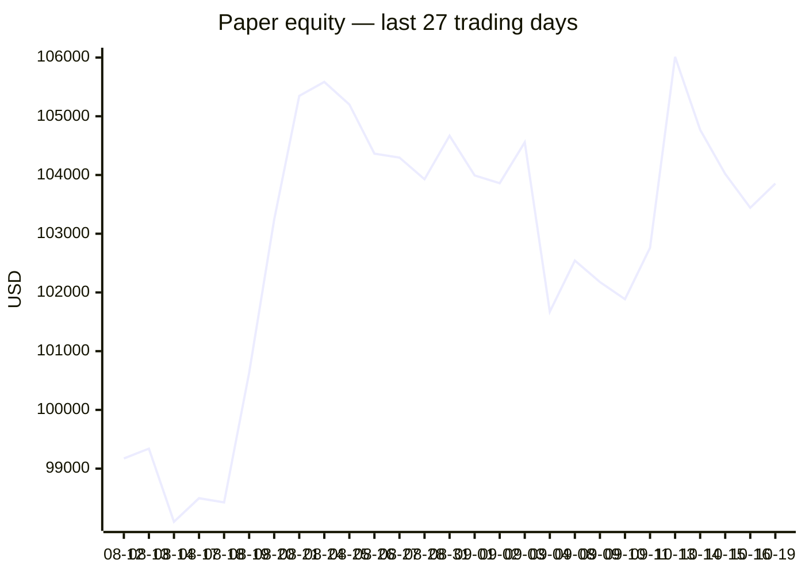
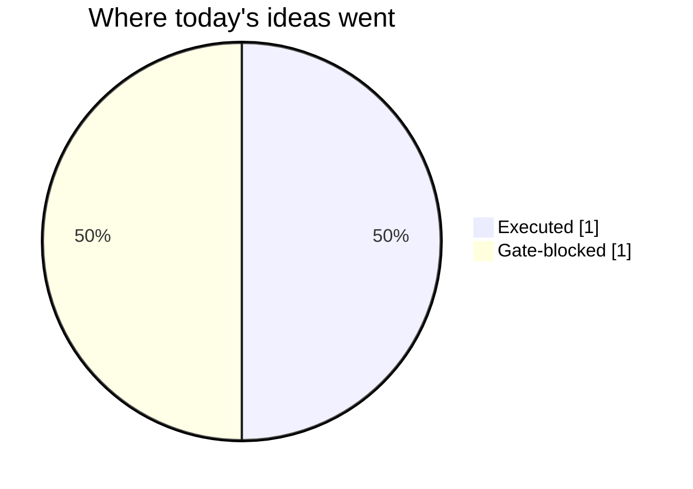

# Trading day 2026-10-19

Paper equity **$103,854** · day +0.43% · regime choppy · config v4-seeded · VIX 19.99 (up)

## Charts

```mermaid
xychart-beta
  title "Today's shadow outcomes (R)"
  x-axis ["ANET", "ANET", "ANET", "ANET", "ANET", "ANET", "ANET", "ANET", "ANET", "ANET", "ANET", "ANET", "ANET", "ANET", "ANET", "ANET", "ANET", "ANET", "ANET", "ANET", "ANET", "ANET", "ANET", "ANET", "ANET", "ANET", "PTC", "PTC", "PTC", "PTC", "PTC", "PTC", "PTC", "PTC", "PTC", "DVN", "PTC", "PTC", "PTC", "PM", "PM", "PM", "PM", "PM", "PM", "PM", "PM", "PM", "PM", "PM", "PM", "PM", "PM", "PM", "PM", "PM", "PM", "PM", "PM", "PM", "PM", "PM", "PM", "PM", "PM", "PM", "PM", "PM", "PM", "PM", "PM", "PM", "PM", "PM", "PM", "PM", "PM", "PM", "PM", "PM", "PM", "PM", "PM", "PM", "PM", "PM", "PM", "PM", "PM", "PM", "PM", "PM", "PM", "PM", "PM", "PM", "PM", "PM", "PM", "PM", "PM", "PM", "PM", "PM", "PM", "PM", "PM", "PM", "PM", "PM", "PM", "PM", "PM", "PM", "PM", "PM", "PM", "PM", "PM", "PM", "PM", "PM", "PM", "PM", "PM", "PM", "PM", "PM", "PM", "PM", "PM", "PM", "ISRG", "PM", "ISRG", "ISRG", "ISRG", "ISRG", "ISRG", "ISRG", "PM", "PM", "PM", "PM", "PM", "PM", "PM", "PM", "PM", "PM", "ISRG", "ISRG", "ISRG", "ISRG", "PM", "PM", "PM", "PM", "PM", "PM", "PM", "PM", "PM", "PM", "PM", "PM", "PM", "PM", "KO", "KO", "KO", "KO", "KO", "KO", "KO", "NVDA", "BAC", "BAC", "BAC", "V", "V", "V", "HD", "PEP", "PEP", "PEP", "PEP", "PEP", "PEP", "PEP", "PEP", "JPM", "JPM", "JPM", "COST", "COST", "COST", "COST", "COST", "COST", "COST", "AAPL", "AAPL", "AAPL", "AAPL", "AAPL", "AAPL", "AMD", "NVDA", "KO", "CL", "MO", "CL", "V", "COST", "WMT", "MO", "WMT", "COST", "MO", "ABBV", "TMO", "TMO", "TMO", "TMO", "TMO", "TMO", "TMO", "TMO", "ABBV", "GILD", "ABBV", "LLY", "MO", "LLY", "LLY", "LLY", "LLY", "INTC", "INTC", "DELL", "DVN", "DVN", "AMD", "AMD", "MU", "MU", "INTC", "INTC", "INTC", "DVN", "DVN", "GILD", "DVN", "LLY", "LLY", "LLY", "COP", "COP", "AMD", "DVN", "COP", "COP", "DVN", "DVN", "DVN", "COP", "DVN", "DVN", "DVN", "DVN", "DVN", "DVN", "CVX", "CVX", "TSLA", "CVX", "CVX", "CVX", "CVX", "CVX", "CVX", "PTC", "PTC", "PTC", "PTC", "MO", "MO", "MO", "MO", "MO", "AMZN", "AMZN", "AMZN", "CVX", "CVX", "AMZN", "AMZN", "AMZN", "AMZN", "AMZN", "AMZN", "META", "META", "META", "META", "META", "META", "META", "META", "META", "META", "OXY", "AMZN", "MO", "MO", "META", "OXY", "OXY", "OXY", "OXY", "OXY", "OXY", "META", "META", "META", "OXY", "OXY", "OXY", "OXY", "OXY", "OXY", "AMZN", "HD", "HD", "HD", "DIS", "META", "META", "AMZN", "HD", "HD", "HD", "CRM", "META", "META", "META", "META", "META", "META", "META", "META", "META", "GILD", "HD", "HD", "HD", "HD", "TSLA", "HD", "HD", "TSLA", "TSLA", "DIS", "HD", "HD", "BAC", "BAC", "MU", "MU", "MU", "MU", "MU", "MU", "MU", "TSLA", "TSLA", "TSLA", "MU", "MU", "MU", "MU", "MU", "INTC", "MU", "ACN", "TSLA", "AMD", "INTC", "AMD", "AMD", "AMD", "INTC", "INTC", "AMD", "AMD", "AMD", "CAD_JPY", "COP", "COP", "COP", "COP", "INTC", "INTC", "INTC", "INTC", "INTC", "INTC", "DELL", "DELL", "PG", "PG", "PG", "PG", "PG", "PG", "PG", "PG", "PG", "NVDA", "NVDA", "INTC", "AMD", "DELL", "DELL", "DELL", "ANET", "ANET", "ANET", "AMD", "NVDA", "ANET", "ANET", "ANET", "ANET", "ANET", "ANET", "ANET", "ANET", "ANET", "ANET", "ANET", "ANET", "ACN", "DELL", "ACN", "DELL", "ACN", "MO", "MO", "PEP", "AMD", "HD", "HD", "HD", "NVDA", "ANET", "ANET", "PG", "PG", "PG", "PG", "PG", "PG", "PG", "PG", "AMD", "AMD", "ABBV", "ABBV", "COP", "COP", "PG", "PG", "COP", "COP", "COP", "COP", "BAC", "BAC", "BAC", "BAC", "BAC", "BAC", "BAC", "BAC", "BAC", "BAC", "BAC", "BAC", "MO", "MO", "BAC", "BAC", "BAC", "BAC", "BAC", "BAC", "BAC", "BAC", "BAC", "BAC", "BAC", "MO", "ACN", "ABBV", "ABBV", "ABBV", "ABBV", "ABBV", "KDP", "DELL", "DELL", "DELL", "DELL", "DELL", "DELL", "AMD", "PG", "ACN", "ACN", "ACN", "AMD", "AMD", "DELL", "PG", "PG", "COP", "COP", "COP", "COP", "PEP", "PEP", "PEP", "META", "ACN", "PG", "PG", "PG", "PG", "PG", "PG", "PG", "BAC", "BAC", "BAC", "BAC", "BAC", "BAC", "BAC", "BAC", "BAC", "BAC", "BAC", "WMT", "BAC", "BAC", "BAC", "BAC", "BAC", "BAC", "BAC", "BAC", "BAC", "BAC", "AMZN", "KDP", "KDP", "KDP", "KDP", "HD", "HD", "HD", "KDP", "KDP", "KDP", "HD", "AMZN", "AMZN", "BAC", "BAC", "BAC", "BAC", "BAC", "BAC", "BAC", "BAC", "BAC", "BAC", "BAC", "BAC", "BAC", "BAC", "BAC", "BAC", "BAC", "BAC", "BAC", "BAC", "BAC", "BAC", "KDP", "KDP", "KDP", "KDP", "WMT", "WMT", "WMT", "WMT", "PEP", "PEP", "COST", "PEP", "PEP", "PEP", "PEP", "PEP", "PEP", "PEP", "PEP", "PEP", "PEP", "PEP", "PEP", "PEP", "PEP", "PEP", "NFLX", "PEP", "PEP", "PEP", "PEP", "PEP", "ACN", "ACN", "ACN", "ACN", "ACN", "ACN", "ACN", "ACN", "ACN", "ACN", "ACN", "ACN", "PTC", "PTC", "ACN", "ACN", "ACN", "ACN", "ACN", "ACN", "ACN", "ACN", "ACN", "ACN", "ACN", "ACN", "ACN", "ACN", "ACN", "ACN", "ACN", "ACN", "ACN", "HD", "HD", "ACN", "ACN", "ACN", "ACN", "ACN", "PTC", "ACN", "ACN", "ACN"]
  bar [2, 2, 2, 2, 2, -1, -1, -1, -1, -1, -1, -1, -1, -1, -1, -1, -1, -1, -1, -1, -1, -1, -1, -1, -1, -1, -1, -1, -1, -1, -1, -1, -1, -1, -1, 2, -1, -1, -1, -1, -1, -1, -1, -1, -1, -1, -1, -1, -1, -1, -1, -1, -1, -1, -1, -1, -1, -1, -1, -1, -1, -1, -1, -1, -1, -1, -1, -1, -1, -1, -1, -1, -1, -1, -1, -1, -1, -1, -1, -1, -1, -1, -1, -1, -1, -1, -1, -1, -1, -1, -1, -1, -1, -1, -1, -1, -1, -1, -1, -1, -1, -1, -1, -1, -1, -1, -1, -1, -1, -1, -1, -1, -1, -1, -1, -1, -1, -1, -1, -1, -1, -1, -1, -1, -1, -1, -1, -1, -1, -1, -1, -1, 2, -1, 2, 2, 2, 2, 2, 2, -1, -1, -1, -1, -1, -1, -1, -1, -1, -1, 2, 2, 2, 2, -1, -1, -1, -1, -1, -1, -1, -1, -1, -1, -1, -1, -1, -1, -1, -1, -1, -1, -1, -1, -1, -1, -1, -1, -1, -1, -1, -1, -1, -1, -1, -1, -1, -1, -1, -1, -1, -1, -1, -1, -1, -1, -1, -1, -1, -1, -1, -1, -1, -1, -1, -1, -1, -1, -1, -1, -1, -1, -1, -1, -1, -1, -1, -1, -1, -1, -1, -1, -1, -1, -1, -1, -1, -1, -1, -1, -1, -1, -1, -1, -1, -1, -1, -1, -1, -1, -1, -1, -1, -1, -1, -1, -1, -1, -1, -1, -1, -1, -1, -1, -1, -1, -1, -1, -1, -1, -1, -1, -1, -1, -1, -1, -1, -1, -1, -1, -1, -1, -1, -1, -1, -1, -1, -1, -1, -1, -1, -1, -1, -1, -1, -1, -1, -1, -1, -1, -1, 2, 2, 2, -1, -1, 2, 2, 2, 2, 2, 2, -1, -1, -1, -1, -1, -1, -1, -1, -1, -1, -1, 2, -1, -1, -1, -1, -1, -1, -1, -1, -1, -1, -1, -1, -1, -1, -1, -1, -1, -1, 2, -1, -1, -1, -1, -1, -1, 2, -1, -1, -1, -1, -1, -1, -1, -1, -1, -1, -1, -1, -1, 2, -1, -1, -1, -1, 2, -1, -1, 2, 2, -1, -1, -1, -1, 2, -1, -1, -1, -1, -1, -1, -1, 2, 2, 2, -1, -1, -1, -1, -1, -1, -1, 2, 2, -1, -1, -1, -1, -1, -1, -1, -1, -1, -1, 1.5, -1, -1, -1, -1, -1, -1, -1, -1, -1, -1, -1, -1, -1, -1, -1, -1, -1, -1, -1, -1, -1, -1, -1, -1, -1, -1, -1, -1, -1, -1, -1, -1, -1, -1, -1, -1, -1, -1, -1, -1, -1, -1, -1, -1, -1, 2, -1, 2, -1, 2, -1, -1, 2, -1, -1, -1, -1, -1, -1, -1, -1, -1, -1, -1, -1, -1, -1, -1, -1, -1, -1, -1, -1, -1, -1, -1, -1, -1, -1, -1, -1, -1, -1, -1, -1, -1, -1, -1, -1, -1, -1, 2, -1, -1, -1, -1, -1, -1, -1, -1, -1, -1, -1, -1, -1, -1, 2, -1, -1, -1, -1, -1, 2, -1, -1, -1, -1, -1, -1, -1, -1, 2, 2, 2, -1, -1, -1, -1, -1, -1, -1, -1, -1, 2, 2, 2, -1, 2, -1, -1, -1, -1, -1, -1, -1, -1, -1, -1, -1, -1, -1, -1, -1, -1, -1, -1, -1, -1, -1, -1, -1, -1, -1, -1, -1, -1, -1, 2, -1, -1, -1, -1, -1, -1, -1, -1, -1, -1, -1, 2, 2, -1, -1, -1, -1, -1, -1, -1, -1, -1, -1, -1, -1, -1, -1, -1, -1, -1, -1, -1, -1, -1, -1, -1, -1, -1, -1, -1, -1, -1, -1, 2, 2, -1, 2, 2, 2, 2, 2, 2, 2, 2, 2, 2, 2, 2, 2, 2, 2, -1, 2, 2, 2, 2, 2, 2, 2, 2, 2, 2, 2, 2, 2, 2, 2, 2, 2, -1, -1, 2, 2, 2, 2, 2, 2, 2, 2, 2, 2, 2, 2, 2, 2, 2, 2, 2, 2, 2, -1, -1, 2, 2, 2, 2, 2, -1, 2, 2, 2]
```

## Activity

- Theses formed: 1 (approved→orders: 1, human-rejected: 0, expired unapproved: 0)
- Risk gate blocked: 1
- Fills at the broker: 1

### Positions closed (real book)

- UK100_GBP → **stopped** -1.01R · banked -387% of its +0.26R peak
- AMZN → **stopped** +0.83R · banked 56% of its +1.48R peak

Exit quality: banked **-165%** of peak open profit across 2 closed position(s) that had a real peak to protect. Persistently low = greed (holding through the give-back); high but with peaks barely above the exits = fear (selling winners too early).

### Execution quality (measured, today)

- cfd: 2 fill(s) · avg slippage cost -0.028R (negative = better than intended) · 6.8 bps · worst 0.005R

### The day's ideas

- **WTICO_USD** (cfd-momentum-breakout) entry 101.37 stop 99.22 target 104.6 — WTICO_USD broke its 20-hour high (101.31) on 1.7× average volume, above its 20-day average. Stop 3×ATR below, target 1.5R.

## Shadow ledger (what would have happened)

- ANET (momentum-breakdown:filtered, filter-blocked) → **target** +2R
- ANET (momentum-breakdown:filtered, filter-blocked) → **target** +2R
- ANET (momentum-breakdown:filtered, filter-blocked) → **target** +2R
- ANET (momentum-breakdown:filtered, filter-blocked) → **target** +2R
- ANET (momentum-breakdown:filtered, filter-blocked) → **target** +2R
- ANET (momentum-breakout:filtered, filter-blocked) → **stopped** -1R
- ANET (momentum-breakout:filtered, filter-blocked) → **stopped** -1R
- ANET (momentum-breakout:filtered, filter-blocked) → **stopped** -1R
- ANET (momentum-breakout:filtered, filter-blocked) → **stopped** -1R
- ANET (momentum-breakout:filtered, filter-blocked) → **stopped** -1R
- ANET (momentum-breakout:filtered, filter-blocked) → **stopped** -1R
- ANET (momentum-breakout:filtered, filter-blocked) → **stopped** -1R
- ANET (momentum-breakout:filtered, filter-blocked) → **stopped** -1R
- ANET (momentum-breakout:filtered, filter-blocked) → **stopped** -1R
- ANET (momentum-breakout:filtered, filter-blocked) → **stopped** -1R
- ANET (momentum-breakout:filtered, filter-blocked) → **stopped** -1R
- ANET (momentum-breakout:filtered, filter-blocked) → **stopped** -1R
- ANET (momentum-breakout:filtered, filter-blocked) → **stopped** -1R
- ANET (momentum-breakout:filtered, filter-blocked) → **stopped** -1R
- ANET (momentum-breakout:filtered, filter-blocked) → **stopped** -1R
- ANET (momentum-breakout:filtered, filter-blocked) → **stopped** -1R
- ANET (momentum-breakout:filtered, filter-blocked) → **stopped** -1R
- ANET (momentum-breakout:filtered, filter-blocked) → **stopped** -1R
- ANET (momentum-breakout:filtered, filter-blocked) → **stopped** -1R
- ANET (momentum-breakout:filtered, filter-blocked) → **stopped** -1R
- ANET (momentum-breakout:filtered, filter-blocked) → **stopped** -1R
- PTC (momentum-breakdown:filtered, filter-blocked) → **stopped** -1R
- PTC (momentum-breakdown:filtered, filter-blocked) → **stopped** -1R
- PTC (momentum-breakdown:filtered, filter-blocked) → **stopped** -1R
- PTC (momentum-breakdown:filtered, filter-blocked) → **stopped** -1R
- PTC (momentum-breakdown:filtered, filter-blocked) → **stopped** -1R
- PTC (momentum-breakdown:filtered, filter-blocked) → **stopped** -1R
- PTC (momentum-breakdown:filtered, filter-blocked) → **stopped** -1R
- PTC (momentum-breakdown:filtered, filter-blocked) → **stopped** -1R
- PTC (momentum-breakdown:filtered, filter-blocked) → **stopped** -1R
- DVN (momentum-breakdown:filtered, filter-blocked) → **target** +2R
- PTC (momentum-breakdown:filtered, filter-blocked) → **stopped** -1R
- PTC (momentum-breakdown:filtered, filter-blocked) → **stopped** -1R
- PTC (momentum-breakdown:filtered, filter-blocked) → **stopped** -1R
- PM (momentum-breakdown:filtered, filter-blocked) → **stopped** -1R
- PM (momentum-breakdown:filtered, filter-blocked) → **stopped** -1R
- PM (momentum-breakdown:filtered, filter-blocked) → **stopped** -1R
- PM (momentum-breakdown:filtered, filter-blocked) → **stopped** -1R
- PM (momentum-breakdown:filtered, filter-blocked) → **stopped** -1R
- PM (momentum-breakdown:filtered, filter-blocked) → **stopped** -1R
- PM (momentum-breakdown:filtered, filter-blocked) → **stopped** -1R
- PM (momentum-breakdown:filtered, filter-blocked) → **stopped** -1R
- PM (momentum-breakdown:filtered, filter-blocked) → **stopped** -1R
- PM (momentum-breakdown:filtered, filter-blocked) → **stopped** -1R
- PM (momentum-breakdown:filtered, filter-blocked) → **stopped** -1R
- PM (momentum-breakdown:filtered, filter-blocked) → **stopped** -1R
- PM (momentum-breakdown:filtered, filter-blocked) → **stopped** -1R
- PM (momentum-breakdown:filtered, filter-blocked) → **stopped** -1R
- PM (momentum-breakdown:filtered, filter-blocked) → **stopped** -1R
- PM (momentum-breakdown:filtered, filter-blocked) → **stopped** -1R
- PM (momentum-breakdown:filtered, filter-blocked) → **stopped** -1R
- PM (momentum-breakdown:filtered, filter-blocked) → **stopped** -1R
- PM (momentum-breakdown:filtered, filter-blocked) → **stopped** -1R
- PM (momentum-breakdown:filtered, filter-blocked) → **stopped** -1R
- PM (momentum-breakdown:filtered, filter-blocked) → **stopped** -1R
- PM (momentum-breakdown:filtered, filter-blocked) → **stopped** -1R
- PM (momentum-breakdown:filtered, filter-blocked) → **stopped** -1R
- PM (momentum-breakdown:filtered, filter-blocked) → **stopped** -1R
- PM (momentum-breakdown:filtered, filter-blocked) → **stopped** -1R
- PM (momentum-breakdown:filtered, filter-blocked) → **stopped** -1R
- PM (momentum-breakdown:filtered, filter-blocked) → **stopped** -1R
- PM (momentum-breakdown:filtered, filter-blocked) → **stopped** -1R
- PM (momentum-breakdown:filtered, filter-blocked) → **stopped** -1R
- PM (momentum-breakdown:filtered, filter-blocked) → **stopped** -1R
- PM (momentum-breakdown:filtered, filter-blocked) → **stopped** -1R
- PM (momentum-breakdown:filtered, filter-blocked) → **stopped** -1R
- PM (momentum-breakdown:filtered, filter-blocked) → **stopped** -1R
- PM (momentum-breakdown:filtered, filter-blocked) → **stopped** -1R
- PM (momentum-breakdown:filtered, filter-blocked) → **stopped** -1R
- PM (momentum-breakdown:filtered, filter-blocked) → **stopped** -1R
- PM (momentum-breakdown:filtered, filter-blocked) → **stopped** -1R
- PM (momentum-breakdown:filtered, filter-blocked) → **stopped** -1R
- PM (momentum-breakdown:filtered, filter-blocked) → **stopped** -1R
- PM (momentum-breakdown:filtered, filter-blocked) → **stopped** -1R
- PM (momentum-breakdown:filtered, filter-blocked) → **stopped** -1R
- PM (momentum-breakdown:filtered, filter-blocked) → **stopped** -1R
- PM (momentum-breakdown:filtered, filter-blocked) → **stopped** -1R
- PM (momentum-breakdown:filtered, filter-blocked) → **stopped** -1R
- PM (momentum-breakdown:filtered, filter-blocked) → **stopped** -1R
- PM (momentum-breakdown:filtered, filter-blocked) → **stopped** -1R
- PM (momentum-breakdown:filtered, filter-blocked) → **stopped** -1R
- PM (momentum-breakdown:filtered, filter-blocked) → **stopped** -1R
- PM (momentum-breakdown:filtered, filter-blocked) → **stopped** -1R
- PM (momentum-breakdown:filtered, filter-blocked) → **stopped** -1R
- PM (momentum-breakdown:filtered, filter-blocked) → **stopped** -1R
- PM (momentum-breakdown:filtered, filter-blocked) → **stopped** -1R
- PM (momentum-breakdown:filtered, filter-blocked) → **stopped** -1R
- PM (momentum-breakdown:filtered, filter-blocked) → **stopped** -1R
- PM (momentum-breakdown:filtered, filter-blocked) → **stopped** -1R
- PM (momentum-breakdown:filtered, filter-blocked) → **stopped** -1R
- PM (momentum-breakdown:filtered, filter-blocked) → **stopped** -1R
- PM (momentum-breakdown:filtered, filter-blocked) → **stopped** -1R
- PM (momentum-breakdown:filtered, filter-blocked) → **stopped** -1R
- PM (momentum-breakdown:filtered, filter-blocked) → **stopped** -1R
- PM (momentum-breakdown:filtered, filter-blocked) → **stopped** -1R
- PM (momentum-breakdown:filtered, filter-blocked) → **stopped** -1R
- PM (momentum-breakdown:filtered, filter-blocked) → **stopped** -1R
- PM (momentum-breakdown:filtered, filter-blocked) → **stopped** -1R
- PM (momentum-breakdown:filtered, filter-blocked) → **stopped** -1R
- PM (momentum-breakdown:filtered, filter-blocked) → **stopped** -1R
- PM (momentum-breakdown:filtered, filter-blocked) → **stopped** -1R
- PM (momentum-breakdown:filtered, filter-blocked) → **stopped** -1R
- PM (momentum-breakdown:filtered, filter-blocked) → **stopped** -1R
- PM (momentum-breakdown:filtered, filter-blocked) → **stopped** -1R
- PM (momentum-breakdown:filtered, filter-blocked) → **stopped** -1R
- PM (momentum-breakdown:filtered, filter-blocked) → **stopped** -1R
- PM (momentum-breakdown:filtered, filter-blocked) → **stopped** -1R
- PM (momentum-breakdown:filtered, filter-blocked) → **stopped** -1R
- PM (momentum-breakdown:filtered, filter-blocked) → **stopped** -1R
- PM (momentum-breakdown:filtered, filter-blocked) → **stopped** -1R
- PM (momentum-breakdown:filtered, filter-blocked) → **stopped** -1R
- PM (momentum-breakdown:filtered, filter-blocked) → **stopped** -1R
- PM (momentum-breakdown:filtered, filter-blocked) → **stopped** -1R
- PM (momentum-breakdown:filtered, filter-blocked) → **stopped** -1R
- PM (momentum-breakdown:filtered, filter-blocked) → **stopped** -1R
- PM (momentum-breakdown:filtered, filter-blocked) → **stopped** -1R
- PM (momentum-breakdown:filtered, filter-blocked) → **stopped** -1R
- PM (momentum-breakdown:filtered, filter-blocked) → **stopped** -1R
- PM (momentum-breakdown:filtered, filter-blocked) → **stopped** -1R
- PM (momentum-breakdown:filtered, filter-blocked) → **stopped** -1R
- PM (momentum-breakdown:filtered, filter-blocked) → **stopped** -1R
- PM (momentum-breakdown:filtered, filter-blocked) → **stopped** -1R
- PM (momentum-breakdown:filtered, filter-blocked) → **stopped** -1R
- PM (momentum-breakdown:filtered, filter-blocked) → **stopped** -1R
- PM (momentum-breakdown:filtered, filter-blocked) → **stopped** -1R
- PM (momentum-breakdown:filtered, filter-blocked) → **stopped** -1R
- PM (momentum-breakdown:filtered, filter-blocked) → **stopped** -1R
- ISRG (momentum-breakout:filtered, filter-blocked) → **target** +2R
- PM (momentum-breakdown:filtered, filter-blocked) → **stopped** -1R
- ISRG (momentum-breakout:filtered, filter-blocked) → **target** +2R
- ISRG (momentum-breakout:filtered, filter-blocked) → **target** +2R
- ISRG (momentum-breakout:filtered, filter-blocked) → **target** +2R
- ISRG (momentum-breakout:filtered, filter-blocked) → **target** +2R
- ISRG (momentum-breakout:filtered, filter-blocked) → **target** +2R
- ISRG (momentum-breakout:filtered, filter-blocked) → **target** +2R
- PM (momentum-breakdown:filtered, filter-blocked) → **stopped** -1R
- PM (momentum-breakdown:filtered, filter-blocked) → **stopped** -1R
- PM (momentum-breakdown:filtered, filter-blocked) → **stopped** -1R
- PM (momentum-breakdown:filtered, filter-blocked) → **stopped** -1R
- PM (momentum-breakdown:filtered, filter-blocked) → **stopped** -1R
- PM (momentum-breakdown:filtered, filter-blocked) → **stopped** -1R
- PM (momentum-breakdown:filtered, filter-blocked) → **stopped** -1R
- PM (momentum-breakdown:filtered, filter-blocked) → **stopped** -1R
- PM (momentum-breakdown:filtered, filter-blocked) → **stopped** -1R
- PM (momentum-breakdown:filtered, filter-blocked) → **stopped** -1R
- ISRG (momentum-breakout:filtered, filter-blocked) → **target** +2R
- ISRG (momentum-breakout:filtered, filter-blocked) → **target** +2R
- ISRG (momentum-breakout:filtered, filter-blocked) → **target** +2R
- ISRG (momentum-breakout:filtered, filter-blocked) → **target** +2R
- PM (momentum-breakdown:filtered, filter-blocked) → **stopped** -1R
- PM (momentum-breakdown:filtered, filter-blocked) → **stopped** -1R
- PM (momentum-breakdown:filtered, filter-blocked) → **stopped** -1R
- PM (momentum-breakdown:filtered, filter-blocked) → **stopped** -1R
- PM (momentum-breakdown:filtered, filter-blocked) → **stopped** -1R
- PM (momentum-breakdown:filtered, filter-blocked) → **stopped** -1R
- PM (momentum-breakdown:filtered, filter-blocked) → **stopped** -1R
- PM (momentum-breakdown:filtered, filter-blocked) → **stopped** -1R
- PM (momentum-breakdown:filtered, filter-blocked) → **stopped** -1R
- PM (momentum-breakdown:filtered, filter-blocked) → **stopped** -1R
- PM (momentum-breakdown:filtered, filter-blocked) → **stopped** -1R
- PM (momentum-breakdown:filtered, filter-blocked) → **stopped** -1R
- PM (momentum-breakdown:filtered, filter-blocked) → **stopped** -1R
- PM (momentum-breakdown:filtered, filter-blocked) → **stopped** -1R
- KO (momentum-breakout:filtered, filter-blocked) → **stopped** -1R
- KO (momentum-breakout:filtered, filter-blocked) → **stopped** -1R
- KO (momentum-breakout:filtered, filter-blocked) → **stopped** -1R
- KO (momentum-breakout:filtered, filter-blocked) → **stopped** -1R
- KO (momentum-breakout:filtered, filter-blocked) → **stopped** -1R
- KO (momentum-breakout:filtered, filter-blocked) → **stopped** -1R
- KO (momentum-breakout:filtered, filter-blocked) → **stopped** -1R
- NVDA (momentum-breakdown, incubation) → **stopped** -1R
- BAC (momentum-breakout:filtered, filter-blocked) → **stopped** -1R
- BAC (momentum-breakout:filtered, filter-blocked) → **stopped** -1R
- BAC (momentum-breakout:filtered, filter-blocked) → **stopped** -1R
- V (momentum-breakout:filtered, filter-blocked) → **stopped** -1R
- V (momentum-breakout:filtered, filter-blocked) → **stopped** -1R
- V (momentum-breakout:filtered, filter-blocked) → **stopped** -1R
- HD (momentum-breakout, gate-blocked) → **stopped** -1R
- PEP (momentum-breakout:filtered, filter-blocked) → **stopped** -1R
- PEP (momentum-breakout:filtered, filter-blocked) → **stopped** -1R
- PEP (momentum-breakout:filtered, filter-blocked) → **stopped** -1R
- PEP (momentum-breakout:filtered, filter-blocked) → **stopped** -1R
- PEP (momentum-breakout:filtered, filter-blocked) → **stopped** -1R
- PEP (momentum-breakout:filtered, filter-blocked) → **stopped** -1R
- PEP (momentum-breakout:filtered, filter-blocked) → **stopped** -1R
- PEP (momentum-breakout:filtered, filter-blocked) → **stopped** -1R
- JPM (momentum-breakout:filtered, filter-blocked) → **stopped** -1R
- JPM (momentum-breakout:filtered, filter-blocked) → **stopped** -1R
- JPM (momentum-breakout:filtered, filter-blocked) → **stopped** -1R
- COST (momentum-breakout:filtered, filter-blocked) → **stopped** -1R
- COST (momentum-breakout:filtered, filter-blocked) → **stopped** -1R
- COST (momentum-breakout:filtered, filter-blocked) → **stopped** -1R
- COST (momentum-breakout:filtered, filter-blocked) → **stopped** -1R
- COST (momentum-breakout:filtered, filter-blocked) → **stopped** -1R
- COST (momentum-breakout:filtered, filter-blocked) → **stopped** -1R
- COST (momentum-breakout:filtered, filter-blocked) → **stopped** -1R
- AAPL (momentum-breakdown:filtered, filter-blocked) → **stopped** -1R
- AAPL (momentum-breakdown:filtered, filter-blocked) → **stopped** -1R
- AAPL (momentum-breakdown:filtered, filter-blocked) → **stopped** -1R
- AAPL (momentum-breakdown:filtered, filter-blocked) → **stopped** -1R
- AAPL (momentum-breakdown:filtered, filter-blocked) → **stopped** -1R
- AAPL (momentum-breakdown:filtered, filter-blocked) → **stopped** -1R
- AMD (momentum-breakdown, incubation) → **stopped** -1R
- NVDA (momentum-breakout:filtered, filter-blocked) → **stopped** -1R
- KO (momentum-breakdown:filtered, filter-blocked) → **stopped** -1R
- CL (momentum-breakout:filtered, filter-blocked) → **stopped** -1R
- MO (momentum-breakout:filtered, filter-blocked) → **stopped** -1R
- CL (momentum-breakout:filtered, filter-blocked) → **stopped** -1R
- V (momentum-breakdown:filtered, filter-blocked) → **stopped** -1R
- COST (momentum-breakdown:filtered, filter-blocked) → **stopped** -1R
- WMT (momentum-breakdown:filtered, filter-blocked) → **stopped** -1R
- MO (momentum-breakdown:filtered, filter-blocked) → **stopped** -1R
- WMT (momentum-breakdown:filtered, filter-blocked) → **stopped** -1R
- COST (momentum-breakdown:filtered, filter-blocked) → **stopped** -1R
- MO (momentum-breakdown:filtered, filter-blocked) → **stopped** -1R
- ABBV (momentum-breakout:filtered, filter-blocked) → **stopped** -1R
- TMO (momentum-breakout:filtered, filter-blocked) → **stopped** -1R
- TMO (momentum-breakout:filtered, filter-blocked) → **stopped** -1R
- TMO (momentum-breakout:filtered, filter-blocked) → **stopped** -1R
- TMO (momentum-breakout:filtered, filter-blocked) → **stopped** -1R
- TMO (momentum-breakout:filtered, filter-blocked) → **stopped** -1R
- TMO (momentum-breakout:filtered, filter-blocked) → **stopped** -1R
- TMO (momentum-breakout:filtered, filter-blocked) → **stopped** -1R
- TMO (momentum-breakout:filtered, filter-blocked) → **stopped** -1R
- ABBV (momentum-breakout:filtered, filter-blocked) → **stopped** -1R
- GILD (momentum-breakout:filtered, filter-blocked) → **stopped** -1R
- ABBV (momentum-breakout:filtered, filter-blocked) → **stopped** -1R
- LLY (momentum-breakdown:filtered, filter-blocked) → **stopped** -1R
- MO (momentum-breakdown:filtered, filter-blocked) → **stopped** -1R
- LLY (momentum-breakdown:filtered, filter-blocked) → **stopped** -1R
- LLY (momentum-breakdown:filtered, filter-blocked) → **stopped** -1R
- LLY (momentum-breakdown:filtered, filter-blocked) → **stopped** -1R
- LLY (momentum-breakdown:filtered, filter-blocked) → **stopped** -1R
- INTC (momentum-breakout:filtered, filter-blocked) → **stopped** -1R
- INTC (momentum-breakout:filtered, filter-blocked) → **stopped** -1R
- DELL (momentum-breakout:filtered, filter-blocked) → **stopped** -1R
- DVN (momentum-breakout:filtered, filter-blocked) → **stopped** -1R
- DVN (momentum-breakout:filtered, filter-blocked) → **stopped** -1R
- AMD (momentum-breakout:filtered, filter-blocked) → **stopped** -1R
- AMD (momentum-breakout:filtered, filter-blocked) → **stopped** -1R
- MU (momentum-breakout:filtered, filter-blocked) → **stopped** -1R
- MU (momentum-breakout:filtered, filter-blocked) → **stopped** -1R
- INTC (momentum-breakout:filtered, filter-blocked) → **stopped** -1R
- INTC (momentum-breakout:filtered, filter-blocked) → **stopped** -1R
- INTC (momentum-breakout:filtered, filter-blocked) → **stopped** -1R
- DVN (momentum-breakout:filtered, filter-blocked) → **stopped** -1R
- DVN (momentum-breakout:filtered, filter-blocked) → **stopped** -1R
- GILD (momentum-breakdown:filtered, filter-blocked) → **stopped** -1R
- DVN (momentum-breakout:filtered, filter-blocked) → **stopped** -1R
- LLY (momentum-breakdown:filtered, filter-blocked) → **stopped** -1R
- LLY (momentum-breakdown:filtered, filter-blocked) → **stopped** -1R
- LLY (momentum-breakdown:filtered, filter-blocked) → **stopped** -1R
- COP (momentum-breakout:filtered, filter-blocked) → **stopped** -1R
- COP (momentum-breakout:filtered, filter-blocked) → **stopped** -1R
- AMD (momentum-breakout:filtered, filter-blocked) → **stopped** -1R
- DVN (momentum-breakout:filtered, filter-blocked) → **stopped** -1R
- COP (momentum-breakout:filtered, filter-blocked) → **stopped** -1R
- COP (momentum-breakout:filtered, filter-blocked) → **stopped** -1R
- DVN (momentum-breakout:filtered, filter-blocked) → **stopped** -1R
- DVN (momentum-breakout:filtered, filter-blocked) → **stopped** -1R
- DVN (momentum-breakout:filtered, filter-blocked) → **stopped** -1R
- COP (momentum-breakout:filtered, filter-blocked) → **stopped** -1R
- DVN (momentum-breakout:filtered, filter-blocked) → **stopped** -1R
- DVN (momentum-breakout:filtered, filter-blocked) → **stopped** -1R
- DVN (momentum-breakout:filtered, filter-blocked) → **stopped** -1R
- DVN (momentum-breakout:filtered, filter-blocked) → **stopped** -1R
- DVN (momentum-breakout:filtered, filter-blocked) → **stopped** -1R
- DVN (momentum-breakout:filtered, filter-blocked) → **stopped** -1R
- CVX (momentum-breakout:filtered, filter-blocked) → **stopped** -1R
- CVX (momentum-breakout:filtered, filter-blocked) → **stopped** -1R
- TSLA (momentum-breakdown, incubation) → **stopped** -1R
- CVX (momentum-breakout:filtered, filter-blocked) → **stopped** -1R
- CVX (momentum-breakout:filtered, filter-blocked) → **stopped** -1R
- CVX (momentum-breakout:filtered, filter-blocked) → **stopped** -1R
- CVX (momentum-breakout:filtered, filter-blocked) → **stopped** -1R
- CVX (momentum-breakout:filtered, filter-blocked) → **stopped** -1R
- CVX (momentum-breakout:filtered, filter-blocked) → **stopped** -1R
- PTC (momentum-breakout:filtered, filter-blocked) → **stopped** -1R
- PTC (momentum-breakout:filtered, filter-blocked) → **stopped** -1R
- PTC (momentum-breakout:filtered, filter-blocked) → **stopped** -1R
- PTC (momentum-breakout:filtered, filter-blocked) → **stopped** -1R
- MO (momentum-breakdown:filtered, filter-blocked) → **stopped** -1R
- MO (momentum-breakdown:filtered, filter-blocked) → **stopped** -1R
- MO (momentum-breakdown:filtered, filter-blocked) → **stopped** -1R
- MO (momentum-breakdown:filtered, filter-blocked) → **stopped** -1R
- MO (momentum-breakdown:filtered, filter-blocked) → **stopped** -1R
- AMZN (momentum-breakout:filtered, filter-blocked) → **target** +2R
- AMZN (momentum-breakout:filtered, filter-blocked) → **target** +2R
- AMZN (momentum-breakout:filtered, filter-blocked) → **target** +2R
- CVX (momentum-breakout:filtered, filter-blocked) → **stopped** -1R
- CVX (momentum-breakout:filtered, filter-blocked) → **stopped** -1R
- AMZN (momentum-breakout:filtered, filter-blocked) → **target** +2R
- AMZN (momentum-breakout:filtered, filter-blocked) → **target** +2R
- AMZN (momentum-breakout:filtered, filter-blocked) → **target** +2R
- AMZN (momentum-breakout:filtered, filter-blocked) → **target** +2R
- AMZN (momentum-breakout:filtered, filter-blocked) → **target** +2R
- AMZN (momentum-breakout:filtered, filter-blocked) → **target** +2R
- META (momentum-breakdown:filtered, filter-blocked) → **stopped** -1R
- META (momentum-breakdown:filtered, filter-blocked) → **stopped** -1R
- META (momentum-breakdown:filtered, filter-blocked) → **stopped** -1R
- META (momentum-breakdown:filtered, filter-blocked) → **stopped** -1R
- META (momentum-breakdown:filtered, filter-blocked) → **stopped** -1R
- META (momentum-breakdown:filtered, filter-blocked) → **stopped** -1R
- META (momentum-breakdown:filtered, filter-blocked) → **stopped** -1R
- META (momentum-breakdown:filtered, filter-blocked) → **stopped** -1R
- META (momentum-breakdown:filtered, filter-blocked) → **stopped** -1R
- META (momentum-breakdown:filtered, filter-blocked) → **stopped** -1R
- OXY (momentum-breakout:filtered, filter-blocked) → **stopped** -1R
- AMZN (momentum-breakout:filtered, filter-blocked) → **target** +2R
- MO (momentum-breakdown:filtered, filter-blocked) → **stopped** -1R
- MO (momentum-breakdown:filtered, filter-blocked) → **stopped** -1R
- META (momentum-breakdown:filtered, filter-blocked) → **stopped** -1R
- OXY (momentum-breakout:filtered, filter-blocked) → **stopped** -1R
- OXY (momentum-breakout:filtered, filter-blocked) → **stopped** -1R
- OXY (momentum-breakout:filtered, filter-blocked) → **stopped** -1R
- OXY (momentum-breakout:filtered, filter-blocked) → **stopped** -1R
- OXY (momentum-breakout:filtered, filter-blocked) → **stopped** -1R
- OXY (momentum-breakout:filtered, filter-blocked) → **stopped** -1R
- META (momentum-breakdown:filtered, filter-blocked) → **stopped** -1R
- META (momentum-breakdown:filtered, filter-blocked) → **stopped** -1R
- META (momentum-breakdown:filtered, filter-blocked) → **stopped** -1R
- OXY (momentum-breakout:filtered, filter-blocked) → **stopped** -1R
- OXY (momentum-breakout:filtered, filter-blocked) → **stopped** -1R
- OXY (momentum-breakout:filtered, filter-blocked) → **stopped** -1R
- OXY (momentum-breakout:filtered, filter-blocked) → **stopped** -1R
- OXY (momentum-breakout:filtered, filter-blocked) → **stopped** -1R
- OXY (momentum-breakout:filtered, filter-blocked) → **stopped** -1R
- AMZN (momentum-breakout:filtered, filter-blocked) → **target** +2R
- HD (momentum-breakdown:filtered, filter-blocked) → **stopped** -1R
- HD (momentum-breakdown:filtered, filter-blocked) → **stopped** -1R
- HD (momentum-breakdown:filtered, filter-blocked) → **stopped** -1R
- DIS (momentum-breakdown:filtered, filter-blocked) → **stopped** -1R
- META (momentum-breakdown:filtered, filter-blocked) → **stopped** -1R
- META (momentum-breakdown:filtered, filter-blocked) → **stopped** -1R
- AMZN (momentum-breakout:filtered, filter-blocked) → **target** +2R
- HD (momentum-breakdown:filtered, filter-blocked) → **stopped** -1R
- HD (momentum-breakdown:filtered, filter-blocked) → **stopped** -1R
- HD (momentum-breakdown:filtered, filter-blocked) → **stopped** -1R
- CRM (momentum-breakdown:filtered, filter-blocked) → **stopped** -1R
- META (momentum-breakdown:filtered, filter-blocked) → **stopped** -1R
- META (momentum-breakdown:filtered, filter-blocked) → **stopped** -1R
- META (momentum-breakdown:filtered, filter-blocked) → **stopped** -1R
- META (momentum-breakdown:filtered, filter-blocked) → **stopped** -1R
- META (momentum-breakdown:filtered, filter-blocked) → **stopped** -1R
- META (momentum-breakdown:filtered, filter-blocked) → **stopped** -1R
- META (momentum-breakdown:filtered, filter-blocked) → **stopped** -1R
- META (momentum-breakdown:filtered, filter-blocked) → **stopped** -1R
- META (momentum-breakdown:filtered, filter-blocked) → **stopped** -1R
- GILD (momentum-breakdown:filtered, filter-blocked) → **target** +2R
- HD (momentum-breakdown:filtered, filter-blocked) → **stopped** -1R
- HD (momentum-breakdown:filtered, filter-blocked) → **stopped** -1R
- HD (momentum-breakdown:filtered, filter-blocked) → **stopped** -1R
- HD (momentum-breakdown:filtered, filter-blocked) → **stopped** -1R
- TSLA (momentum-breakout:filtered, filter-blocked) → **target** +2R
- HD (momentum-breakdown:filtered, filter-blocked) → **stopped** -1R
- HD (momentum-breakdown:filtered, filter-blocked) → **stopped** -1R
- TSLA (momentum-breakout:filtered, filter-blocked) → **target** +2R
- TSLA (momentum-breakout:filtered, filter-blocked) → **target** +2R
- DIS (momentum-breakdown:filtered, filter-blocked) → **stopped** -1R
- HD (momentum-breakdown:filtered, filter-blocked) → **stopped** -1R
- HD (momentum-breakdown:filtered, filter-blocked) → **stopped** -1R
- BAC (momentum-breakout:filtered, filter-blocked) → **stopped** -1R
- BAC (momentum-breakdown, incubation) → **target** +2R
- MU (momentum-breakout:filtered, filter-blocked) → **stopped** -1R
- MU (momentum-breakout:filtered, filter-blocked) → **stopped** -1R
- MU (momentum-breakout:filtered, filter-blocked) → **stopped** -1R
- MU (momentum-breakout:filtered, filter-blocked) → **stopped** -1R
- MU (momentum-breakout:filtered, filter-blocked) → **stopped** -1R
- MU (momentum-breakout:filtered, filter-blocked) → **stopped** -1R
- MU (momentum-breakout:filtered, filter-blocked) → **stopped** -1R
- TSLA (momentum-breakout:filtered, filter-blocked) → **target** +2R
- TSLA (momentum-breakout:filtered, filter-blocked) → **target** +2R
- TSLA (momentum-breakout:filtered, filter-blocked) → **target** +2R
- MU (momentum-breakout:filtered, filter-blocked) → **stopped** -1R
- MU (momentum-breakout:filtered, filter-blocked) → **stopped** -1R
- MU (momentum-breakout:filtered, filter-blocked) → **stopped** -1R
- MU (momentum-breakout:filtered, filter-blocked) → **stopped** -1R
- MU (momentum-breakout:filtered, filter-blocked) → **stopped** -1R
- INTC (momentum-breakout:filtered, filter-blocked) → **stopped** -1R
- MU (momentum-breakout:filtered, filter-blocked) → **stopped** -1R
- ACN (momentum-breakout:filtered, filter-blocked) → **target** +2R
- TSLA (momentum-breakout:filtered, filter-blocked) → **target** +2R
- AMD (momentum-breakout:filtered, filter-blocked) → **stopped** -1R
- INTC (momentum-breakout:filtered, filter-blocked) → **stopped** -1R
- AMD (momentum-breakout:filtered, filter-blocked) → **stopped** -1R
- AMD (momentum-breakout:filtered, filter-blocked) → **stopped** -1R
- AMD (momentum-breakout:filtered, filter-blocked) → **stopped** -1R
- INTC (momentum-breakout:filtered, filter-blocked) → **stopped** -1R
- INTC (momentum-breakout:filtered, filter-blocked) → **stopped** -1R
- AMD (momentum-breakout:filtered, filter-blocked) → **stopped** -1R
- AMD (momentum-breakout:filtered, filter-blocked) → **stopped** -1R
- AMD (momentum-breakout:filtered, filter-blocked) → **stopped** -1R
- CAD_JPY (cfd-momentum-breakout, gate-blocked) → **target** +1.5R
- COP (momentum-breakdown:filtered, filter-blocked) → **stopped** -1R
- COP (momentum-breakdown:filtered, filter-blocked) → **stopped** -1R
- COP (momentum-breakdown:filtered, filter-blocked) → **stopped** -1R
- COP (momentum-breakdown:filtered, filter-blocked) → **stopped** -1R
- INTC (momentum-breakout:filtered, filter-blocked) → **stopped** -1R
- INTC (momentum-breakout:filtered, filter-blocked) → **stopped** -1R
- INTC (momentum-breakout:filtered, filter-blocked) → **stopped** -1R
- INTC (momentum-breakout:filtered, filter-blocked) → **stopped** -1R
- INTC (momentum-breakout:filtered, filter-blocked) → **stopped** -1R
- INTC (momentum-breakout:filtered, filter-blocked) → **stopped** -1R
- DELL (momentum-breakout:filtered, filter-blocked) → **stopped** -1R
- DELL (momentum-breakout:filtered, filter-blocked) → **stopped** -1R
- PG (momentum-breakdown:filtered, filter-blocked) → **stopped** -1R
- PG (momentum-breakdown:filtered, filter-blocked) → **stopped** -1R
- PG (momentum-breakdown:filtered, filter-blocked) → **stopped** -1R
- PG (momentum-breakdown:filtered, filter-blocked) → **stopped** -1R
- PG (momentum-breakdown:filtered, filter-blocked) → **stopped** -1R
- PG (momentum-breakdown:filtered, filter-blocked) → **stopped** -1R
- PG (momentum-breakdown:filtered, filter-blocked) → **stopped** -1R
- PG (momentum-breakdown:filtered, filter-blocked) → **stopped** -1R
- PG (momentum-breakdown:filtered, filter-blocked) → **stopped** -1R
- NVDA (momentum-breakout:filtered, filter-blocked) → **stopped** -1R
- NVDA (momentum-breakout:filtered, filter-blocked) → **stopped** -1R
- INTC (momentum-breakout:filtered, filter-blocked) → **stopped** -1R
- AMD (momentum-breakout:filtered, filter-blocked) → **stopped** -1R
- DELL (momentum-breakout:filtered, filter-blocked) → **stopped** -1R
- DELL (momentum-breakout:filtered, filter-blocked) → **stopped** -1R
- DELL (momentum-breakout:filtered, filter-blocked) → **stopped** -1R
- ANET (momentum-breakout:filtered, filter-blocked) → **stopped** -1R
- ANET (momentum-breakout:filtered, filter-blocked) → **stopped** -1R
- ANET (momentum-breakout:filtered, filter-blocked) → **stopped** -1R
- AMD (momentum-breakout:filtered, filter-blocked) → **stopped** -1R
- NVDA (momentum-breakout:filtered, filter-blocked) → **stopped** -1R
- ANET (momentum-breakout:filtered, filter-blocked) → **stopped** -1R
- ANET (momentum-breakout:filtered, filter-blocked) → **stopped** -1R
- ANET (momentum-breakout:filtered, filter-blocked) → **stopped** -1R
- ANET (momentum-breakout:filtered, filter-blocked) → **stopped** -1R
- ANET (momentum-breakout:filtered, filter-blocked) → **stopped** -1R
- ANET (momentum-breakout:filtered, filter-blocked) → **stopped** -1R
- ANET (momentum-breakout:filtered, filter-blocked) → **stopped** -1R
- ANET (momentum-breakout:filtered, filter-blocked) → **stopped** -1R
- ANET (momentum-breakout:filtered, filter-blocked) → **stopped** -1R
- ANET (momentum-breakout:filtered, filter-blocked) → **stopped** -1R
- ANET (momentum-breakout:filtered, filter-blocked) → **stopped** -1R
- ANET (momentum-breakout:filtered, filter-blocked) → **stopped** -1R
- ACN (momentum-breakout:filtered, filter-blocked) → **target** +2R
- DELL (momentum-breakout:filtered, filter-blocked) → **stopped** -1R
- ACN (momentum-breakout:filtered, filter-blocked) → **target** +2R
- DELL (momentum-breakout:filtered, filter-blocked) → **stopped** -1R
- ACN (momentum-breakout:filtered, filter-blocked) → **target** +2R
- MO (momentum-breakdown:filtered, filter-blocked) → **stopped** -1R
- MO (momentum-breakdown:filtered, filter-blocked) → **stopped** -1R
- PEP (momentum-breakout:filtered, filter-blocked) → **target** +2R
- AMD (momentum-breakout:filtered, filter-blocked) → **stopped** -1R
- HD (momentum-breakdown:filtered, filter-blocked) → **stopped** -1R
- HD (momentum-breakdown:filtered, filter-blocked) → **stopped** -1R
- HD (momentum-breakdown:filtered, filter-blocked) → **stopped** -1R
- NVDA (momentum-breakout:filtered, filter-blocked) → **stopped** -1R
- ANET (momentum-breakout:filtered, filter-blocked) → **stopped** -1R
- ANET (momentum-breakout:filtered, filter-blocked) → **stopped** -1R
- PG (momentum-breakdown:filtered, filter-blocked) → **stopped** -1R
- PG (momentum-breakdown:filtered, filter-blocked) → **stopped** -1R
- PG (momentum-breakdown:filtered, filter-blocked) → **stopped** -1R
- PG (momentum-breakdown:filtered, filter-blocked) → **stopped** -1R
- PG (momentum-breakdown:filtered, filter-blocked) → **stopped** -1R
- PG (momentum-breakdown:filtered, filter-blocked) → **stopped** -1R
- PG (momentum-breakdown:filtered, filter-blocked) → **stopped** -1R
- PG (momentum-breakdown:filtered, filter-blocked) → **stopped** -1R
- AMD (momentum-breakout:filtered, filter-blocked) → **stopped** -1R
- AMD (momentum-breakout:filtered, filter-blocked) → **stopped** -1R
- ABBV (momentum-breakdown:filtered, filter-blocked) → **stopped** -1R
- ABBV (momentum-breakdown:filtered, filter-blocked) → **stopped** -1R
- COP (momentum-breakdown:filtered, filter-blocked) → **stopped** -1R
- COP (momentum-breakdown:filtered, filter-blocked) → **stopped** -1R
- PG (momentum-breakdown:filtered, filter-blocked) → **stopped** -1R
- PG (momentum-breakdown:filtered, filter-blocked) → **stopped** -1R
- COP (momentum-breakdown:filtered, filter-blocked) → **stopped** -1R
- COP (momentum-breakdown:filtered, filter-blocked) → **stopped** -1R
- COP (momentum-breakdown:filtered, filter-blocked) → **stopped** -1R
- COP (momentum-breakdown:filtered, filter-blocked) → **stopped** -1R
- BAC (mean-reversion:filtered, filter-blocked) → **stopped** -1R
- BAC (mean-reversion:filtered, filter-blocked) → **stopped** -1R
- BAC (mean-reversion:filtered, filter-blocked) → **stopped** -1R
- BAC (mean-reversion:filtered, filter-blocked) → **stopped** -1R
- BAC (mean-reversion:filtered, filter-blocked) → **stopped** -1R
- BAC (mean-reversion:filtered, filter-blocked) → **stopped** -1R
- BAC (mean-reversion:filtered, filter-blocked) → **stopped** -1R
- BAC (mean-reversion:filtered, filter-blocked) → **stopped** -1R
- BAC (mean-reversion:filtered, filter-blocked) → **stopped** -1R
- BAC (mean-reversion:filtered, filter-blocked) → **stopped** -1R
- BAC (mean-reversion:filtered, filter-blocked) → **stopped** -1R
- BAC (momentum-breakdown, incubation) → **target** +2R
- MO (momentum-breakdown:filtered, filter-blocked) → **stopped** -1R
- MO (momentum-breakdown:filtered, filter-blocked) → **stopped** -1R
- BAC (mean-reversion:filtered, filter-blocked) → **stopped** -1R
- BAC (mean-reversion:filtered, filter-blocked) → **stopped** -1R
- BAC (mean-reversion:filtered, filter-blocked) → **stopped** -1R
- BAC (mean-reversion:filtered, filter-blocked) → **stopped** -1R
- BAC (mean-reversion:filtered, filter-blocked) → **stopped** -1R
- BAC (mean-reversion:filtered, filter-blocked) → **stopped** -1R
- BAC (mean-reversion:filtered, filter-blocked) → **stopped** -1R
- BAC (mean-reversion:filtered, filter-blocked) → **stopped** -1R
- BAC (mean-reversion:filtered, filter-blocked) → **stopped** -1R
- BAC (mean-reversion:filtered, filter-blocked) → **stopped** -1R
- BAC (mean-reversion:filtered, filter-blocked) → **stopped** -1R
- MO (momentum-breakdown:filtered, filter-blocked) → **stopped** -1R
- ACN (momentum-breakout:filtered, filter-blocked) → **target** +2R
- ABBV (momentum-breakdown:filtered, filter-blocked) → **stopped** -1R
- ABBV (momentum-breakdown:filtered, filter-blocked) → **stopped** -1R
- ABBV (momentum-breakdown:filtered, filter-blocked) → **stopped** -1R
- ABBV (momentum-breakdown:filtered, filter-blocked) → **stopped** -1R
- ABBV (momentum-breakdown:filtered, filter-blocked) → **stopped** -1R
- KDP (momentum-breakout:filtered, filter-blocked) → **target** +2R
- DELL (momentum-breakout:filtered, filter-blocked) → **stopped** -1R
- DELL (momentum-breakout:filtered, filter-blocked) → **stopped** -1R
- DELL (momentum-breakout:filtered, filter-blocked) → **stopped** -1R
- DELL (momentum-breakout:filtered, filter-blocked) → **stopped** -1R
- DELL (momentum-breakout:filtered, filter-blocked) → **stopped** -1R
- DELL (momentum-breakout:filtered, filter-blocked) → **stopped** -1R
- AMD (momentum-breakout:filtered, filter-blocked) → **stopped** -1R
- PG (momentum-breakdown:filtered, filter-blocked) → **stopped** -1R
- ACN (momentum-breakout:filtered, filter-blocked) → **target** +2R
- ACN (momentum-breakout:filtered, filter-blocked) → **target** +2R
- ACN (momentum-breakout:filtered, filter-blocked) → **target** +2R
- AMD (momentum-breakout:filtered, filter-blocked) → **stopped** -1R
- AMD (momentum-breakout:filtered, filter-blocked) → **stopped** -1R
- DELL (momentum-breakout:filtered, filter-blocked) → **stopped** -1R
- PG (momentum-breakdown:filtered, filter-blocked) → **stopped** -1R
- PG (momentum-breakdown:filtered, filter-blocked) → **stopped** -1R
- COP (momentum-breakdown:filtered, filter-blocked) → **stopped** -1R
- COP (momentum-breakdown:filtered, filter-blocked) → **stopped** -1R
- COP (momentum-breakdown:filtered, filter-blocked) → **stopped** -1R
- COP (momentum-breakdown:filtered, filter-blocked) → **stopped** -1R
- PEP (momentum-breakout:filtered, filter-blocked) → **target** +2R
- PEP (momentum-breakout:filtered, filter-blocked) → **target** +2R
- PEP (momentum-breakout:filtered, filter-blocked) → **target** +2R
- META (momentum-breakdown:filtered, filter-blocked) → **stopped** -1R
- ACN (momentum-breakout:filtered, filter-blocked) → **target** +2R
- PG (momentum-breakout:filtered, filter-blocked) → **stopped** -1R
- PG (momentum-breakout:filtered, filter-blocked) → **stopped** -1R
- PG (momentum-breakout:filtered, filter-blocked) → **stopped** -1R
- PG (momentum-breakout:filtered, filter-blocked) → **stopped** -1R
- PG (momentum-breakout:filtered, filter-blocked) → **stopped** -1R
- PG (momentum-breakout:filtered, filter-blocked) → **stopped** -1R
- PG (momentum-breakout:filtered, filter-blocked) → **stopped** -1R
- BAC (mean-reversion:filtered, filter-blocked) → **stopped** -1R
- BAC (mean-reversion:filtered, filter-blocked) → **stopped** -1R
- BAC (mean-reversion:filtered, filter-blocked) → **stopped** -1R
- BAC (mean-reversion:filtered, filter-blocked) → **stopped** -1R
- BAC (mean-reversion:filtered, filter-blocked) → **stopped** -1R
- BAC (mean-reversion:filtered, filter-blocked) → **stopped** -1R
- BAC (mean-reversion:filtered, filter-blocked) → **stopped** -1R
- BAC (mean-reversion:filtered, filter-blocked) → **stopped** -1R
- BAC (mean-reversion:filtered, filter-blocked) → **stopped** -1R
- BAC (mean-reversion:filtered, filter-blocked) → **stopped** -1R
- BAC (mean-reversion:filtered, filter-blocked) → **stopped** -1R
- WMT (momentum-breakout:filtered, filter-blocked) → **stopped** -1R
- BAC (mean-reversion:filtered, filter-blocked) → **stopped** -1R
- BAC (mean-reversion:filtered, filter-blocked) → **stopped** -1R
- BAC (mean-reversion:filtered, filter-blocked) → **stopped** -1R
- BAC (mean-reversion:filtered, filter-blocked) → **stopped** -1R
- BAC (mean-reversion:filtered, filter-blocked) → **stopped** -1R
- BAC (mean-reversion:filtered, filter-blocked) → **stopped** -1R
- BAC (mean-reversion:filtered, filter-blocked) → **stopped** -1R
- BAC (mean-reversion:filtered, filter-blocked) → **stopped** -1R
- BAC (mean-reversion:filtered, filter-blocked) → **stopped** -1R
- BAC (mean-reversion:filtered, filter-blocked) → **stopped** -1R
- AMZN (momentum-breakout:filtered, filter-blocked) → **target** +2R
- KDP (momentum-breakout:filtered, filter-blocked) → **stopped** -1R
- KDP (momentum-breakout:filtered, filter-blocked) → **stopped** -1R
- KDP (momentum-breakout:filtered, filter-blocked) → **stopped** -1R
- KDP (momentum-breakout:filtered, filter-blocked) → **stopped** -1R
- HD (momentum-breakout:filtered, filter-blocked) → **stopped** -1R
- HD (momentum-breakout:filtered, filter-blocked) → **stopped** -1R
- HD (momentum-breakout:filtered, filter-blocked) → **stopped** -1R
- KDP (momentum-breakout:filtered, filter-blocked) → **stopped** -1R
- KDP (momentum-breakout:filtered, filter-blocked) → **stopped** -1R
- KDP (momentum-breakout:filtered, filter-blocked) → **stopped** -1R
- HD (momentum-breakout:filtered, filter-blocked) → **stopped** -1R
- AMZN (momentum-breakout:filtered, filter-blocked) → **target** +2R
- AMZN (momentum-breakout:filtered, filter-blocked) → **target** +2R
- BAC (mean-reversion:filtered, filter-blocked) → **stopped** -1R
- BAC (mean-reversion:filtered, filter-blocked) → **stopped** -1R
- BAC (mean-reversion:filtered, filter-blocked) → **stopped** -1R
- BAC (mean-reversion:filtered, filter-blocked) → **stopped** -1R
- BAC (mean-reversion:filtered, filter-blocked) → **stopped** -1R
- BAC (mean-reversion:filtered, filter-blocked) → **stopped** -1R
- BAC (mean-reversion:filtered, filter-blocked) → **stopped** -1R
- BAC (mean-reversion:filtered, filter-blocked) → **stopped** -1R
- BAC (mean-reversion:filtered, filter-blocked) → **stopped** -1R
- BAC (mean-reversion:filtered, filter-blocked) → **stopped** -1R
- BAC (mean-reversion:filtered, filter-blocked) → **stopped** -1R
- BAC (mean-reversion:filtered, filter-blocked) → **stopped** -1R
- BAC (mean-reversion:filtered, filter-blocked) → **stopped** -1R
- BAC (mean-reversion:filtered, filter-blocked) → **stopped** -1R
- BAC (mean-reversion:filtered, filter-blocked) → **stopped** -1R
- BAC (mean-reversion:filtered, filter-blocked) → **stopped** -1R
- BAC (mean-reversion:filtered, filter-blocked) → **stopped** -1R
- BAC (mean-reversion:filtered, filter-blocked) → **stopped** -1R
- BAC (mean-reversion:filtered, filter-blocked) → **stopped** -1R
- BAC (mean-reversion:filtered, filter-blocked) → **stopped** -1R
- BAC (mean-reversion:filtered, filter-blocked) → **stopped** -1R
- BAC (mean-reversion:filtered, filter-blocked) → **stopped** -1R
- KDP (momentum-breakout:filtered, filter-blocked) → **stopped** -1R
- KDP (momentum-breakout:filtered, filter-blocked) → **stopped** -1R
- KDP (momentum-breakout:filtered, filter-blocked) → **stopped** -1R
- KDP (momentum-breakout:filtered, filter-blocked) → **stopped** -1R
- WMT (momentum-breakout:filtered, filter-blocked) → **stopped** -1R
- WMT (momentum-breakout:filtered, filter-blocked) → **stopped** -1R
- WMT (momentum-breakout:filtered, filter-blocked) → **stopped** -1R
- WMT (momentum-breakout:filtered, filter-blocked) → **stopped** -1R
- PEP (momentum-breakout:filtered, filter-blocked) → **target** +2R
- PEP (momentum-breakout:filtered, filter-blocked) → **target** +2R
- COST (momentum-breakout:filtered, filter-blocked) → **stopped** -1R
- PEP (momentum-breakout:filtered, filter-blocked) → **target** +2R
- PEP (momentum-breakout:filtered, filter-blocked) → **target** +2R
- PEP (momentum-breakout:filtered, filter-blocked) → **target** +2R
- PEP (momentum-breakout:filtered, filter-blocked) → **target** +2R
- PEP (momentum-breakout:filtered, filter-blocked) → **target** +2R
- PEP (momentum-breakout:filtered, filter-blocked) → **target** +2R
- PEP (momentum-breakout:filtered, filter-blocked) → **target** +2R
- PEP (momentum-breakout:filtered, filter-blocked) → **target** +2R
- PEP (momentum-breakout:filtered, filter-blocked) → **target** +2R
- PEP (momentum-breakout:filtered, filter-blocked) → **target** +2R
- PEP (momentum-breakout:filtered, filter-blocked) → **target** +2R
- PEP (momentum-breakout:filtered, filter-blocked) → **target** +2R
- PEP (momentum-breakout:filtered, filter-blocked) → **target** +2R
- PEP (momentum-breakout:filtered, filter-blocked) → **target** +2R
- PEP (momentum-breakout:filtered, filter-blocked) → **target** +2R
- NFLX (momentum-breakdown:filtered, filter-blocked) → **stopped** -1R
- PEP (momentum-breakout:filtered, filter-blocked) → **target** +2R
- PEP (momentum-breakout:filtered, filter-blocked) → **target** +2R
- PEP (momentum-breakout:filtered, filter-blocked) → **target** +2R
- PEP (momentum-breakout:filtered, filter-blocked) → **target** +2R
- PEP (momentum-breakout:filtered, filter-blocked) → **target** +2R
- ACN (momentum-breakout:filtered, filter-blocked) → **target** +2R
- ACN (momentum-breakout:filtered, filter-blocked) → **target** +2R
- ACN (momentum-breakout:filtered, filter-blocked) → **target** +2R
- ACN (momentum-breakout:filtered, filter-blocked) → **target** +2R
- ACN (momentum-breakout:filtered, filter-blocked) → **target** +2R
- ACN (momentum-breakout:filtered, filter-blocked) → **target** +2R
- ACN (momentum-breakout:filtered, filter-blocked) → **target** +2R
- ACN (momentum-breakout:filtered, filter-blocked) → **target** +2R
- ACN (momentum-breakout:filtered, filter-blocked) → **target** +2R
- ACN (momentum-breakout:filtered, filter-blocked) → **target** +2R
- ACN (momentum-breakout:filtered, filter-blocked) → **target** +2R
- ACN (momentum-breakout:filtered, filter-blocked) → **target** +2R
- PTC (momentum-breakout:filtered, filter-blocked) → **stopped** -1R
- PTC (momentum-breakout:filtered, filter-blocked) → **stopped** -1R
- ACN (momentum-breakout:filtered, filter-blocked) → **target** +2R
- ACN (momentum-breakout:filtered, filter-blocked) → **target** +2R
- ACN (momentum-breakout:filtered, filter-blocked) → **target** +2R
- ACN (momentum-breakout:filtered, filter-blocked) → **target** +2R
- ACN (momentum-breakout:filtered, filter-blocked) → **target** +2R
- ACN (momentum-breakout:filtered, filter-blocked) → **target** +2R
- ACN (momentum-breakout:filtered, filter-blocked) → **target** +2R
- ACN (momentum-breakout:filtered, filter-blocked) → **target** +2R
- ACN (momentum-breakout:filtered, filter-blocked) → **target** +2R
- ACN (momentum-breakout:filtered, filter-blocked) → **target** +2R
- ACN (momentum-breakout:filtered, filter-blocked) → **target** +2R
- ACN (momentum-breakout:filtered, filter-blocked) → **target** +2R
- ACN (momentum-breakout:filtered, filter-blocked) → **target** +2R
- ACN (momentum-breakout:filtered, filter-blocked) → **target** +2R
- ACN (momentum-breakout:filtered, filter-blocked) → **target** +2R
- ACN (momentum-breakout:filtered, filter-blocked) → **target** +2R
- ACN (momentum-breakout:filtered, filter-blocked) → **target** +2R
- ACN (momentum-breakout:filtered, filter-blocked) → **target** +2R
- ACN (momentum-breakout:filtered, filter-blocked) → **target** +2R
- HD (momentum-breakout:filtered, filter-blocked) → **stopped** -1R
- HD (momentum-breakout:filtered, filter-blocked) → **stopped** -1R
- ACN (momentum-breakout:filtered, filter-blocked) → **target** +2R
- ACN (momentum-breakout:filtered, filter-blocked) → **target** +2R
- ACN (momentum-breakout:filtered, filter-blocked) → **target** +2R
- ACN (momentum-breakout:filtered, filter-blocked) → **target** +2R
- ACN (momentum-breakout:filtered, filter-blocked) → **target** +2R
- PTC (momentum-breakout:filtered, filter-blocked) → **stopped** -1R
- ACN (momentum-breakout:filtered, filter-blocked) → **target** +2R
- ACN (momentum-breakout:filtered, filter-blocked) → **target** +2R
- ACN (momentum-breakout:filtered, filter-blocked) → **target** +2R

Day total: **-323.5R**

## Running shadow record

Resolved 7 ideas · win rate 43% · total +1.5R · avg 0.21R · still tracking 4091

## Is the desk earning its keep?

Shadow-outcome R by the desk verdict each idea carried (vetoed/expired ideas only — executed trades don't resolve to an R-outcome yet):

| Verdict | Ideas | Win rate | Avg R |
|---|---|---|---|
| proceed | 0 | —% | — |
| caution | 0 | —% | — |
| avoid | 0 | —% | — |
| none | 7 | 43% | 0.21 |

*Only 0 scored ideas so far — a preview, not a verdict on the AI yet.*

## Incubation ward

- **pullback-trend** — incubating: 0/25 shadow outcomes
- **crypto-mean-reversion** — incubating: 0/25 shadow outcomes
- **cfd-mean-reversion** — incubating: 0/25 shadow outcomes
- **cfd-opening-range** — incubating: 0/25 shadow outcomes
- **equity-opening-range** — incubating: 0/25 shadow outcomes
- **cfd-pair-reversion** — incubating: 0/25 shadow outcomes
- **momentum-breakdown** — incubating: 5/25 shadow outcomes
- **mean-reversion-short** — incubating: 0/25 shadow outcomes
- **cfd-momentum-breakdown** — incubating: 0/25 shadow outcomes
- **cfd-mean-reversion-short** — incubating: 0/25 shadow outcomes

*Incubating strategies shadow-track every signal but never execute. Graduation is mechanical: 25+ outcomes, avg ≥ +0.10R, wins ≥ 40%.*

*Generated by code, no AI. Paper account only.*
