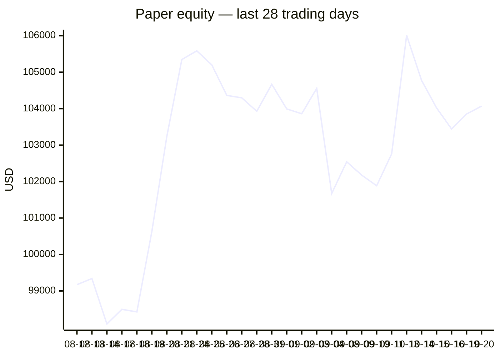
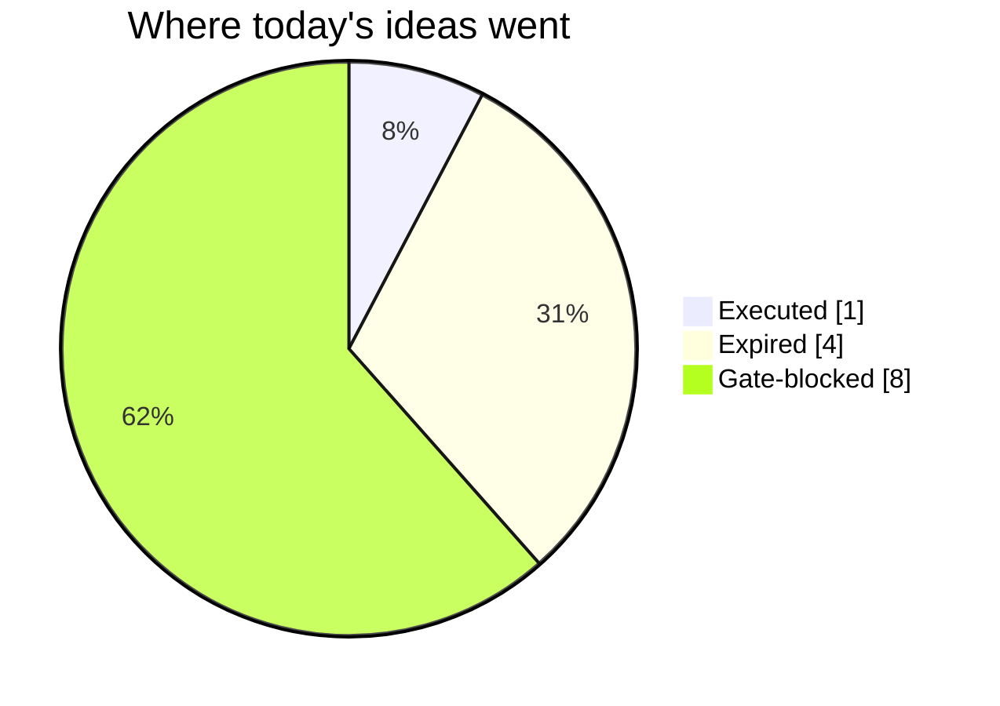
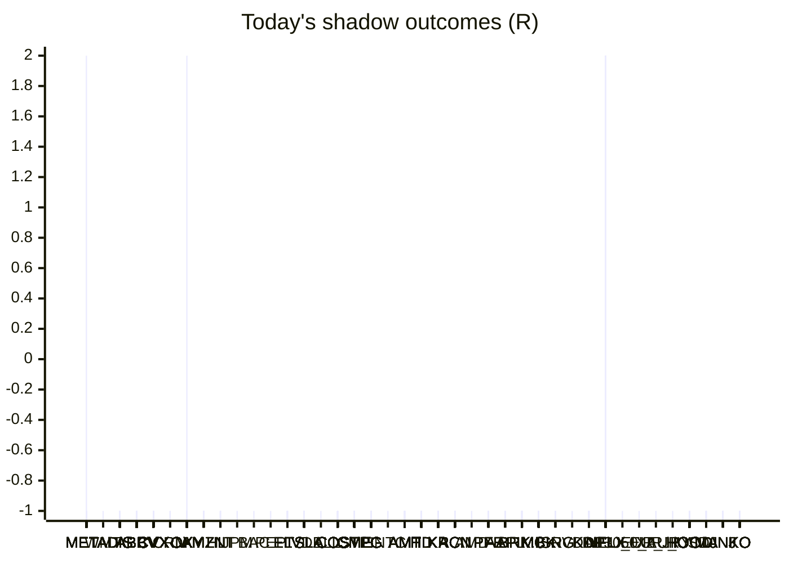

# Trading day 2026-10-20

Paper equity **$104,070** · day +0.29% · regime choppy · config v4-seeded · VIX 18.44 (up)

## Charts

## Activity

- Theses formed: 7 (approved→orders: 1, human-rejected: 0, expired unapproved: 4)
- Risk gate blocked: 8
- Fills at the broker: 3

### Positions closed (real book)

- WTICO_USD → **stopped** +0.05R · banked 5% of its +1.06R peak
- BCO_USD → **stopped** -1.01R · banked -481% of its +0.21R peak
- ELV → **stopped** +0.05R · banked 5% of its +1.09R peak
- MSFT → **timeout** -2.98R · banked -458% of its +0.65R peak

Exit quality: banked **-232%** of peak open profit across 4 closed position(s) that had a real peak to protect. Persistently low = greed (holding through the give-back); high but with peaks barely above the exits = fear (selling winners too early).

### Execution quality (measured, today)

- cfd: 3 fill(s) · avg slippage cost 0.034R (negative = better than intended) · 7.3 bps · worst 0.083R
- equities: 1 fill(s) · avg slippage cost -0.181R (negative = better than intended) · 14 bps · worst 0R

### The day's ideas

- **BCO_USD** (cfd-momentum-breakout) entry 112.68 stop 110.32 target 116.22 — BCO_USD broke its 20-hour high (112.53) on 1.8× average volume, above its 20-day average. Stop 3×ATR below, target 1.5R.
- **ELV** (momentum-breakout) entry 436.92 stop 433.55 target 470.62 — Broke 20-bar high (436.91) with stock and SPY above their 20-day averages. Stop 2×ATR below, target 10R.
- **V** (momentum-breakout) entry 408.43 stop 406.17 target 431.03 — Broke 20-bar high (408.27) with stock and SPY above their 20-day averages. Stop 2×ATR below, target 10R.
- **UNH** (momentum-breakout) entry 418.08 stop 414.31 target 455.78 — Broke 20-bar high (417.74) with stock and SPY above their 20-day averages. Stop 2×ATR below, target 10R.
- **DIS** (momentum-breakout) entry 111.62 stop 110.89 target 118.92 — Broke 20-bar high (111.6) with stock and SPY above their 20-day averages. Stop 2×ATR below, target 10R.
- **ISRG** (momentum-breakout) entry 437.16 stop 433.97 target 469.06 — Broke 20-bar high (436.49) with stock and SPY above their 20-day averages. Stop 2×ATR below, target 10R.
- **KDP** (momentum-breakout) entry 34.88 stop 34.59 target 37.78 — Broke 20-bar high (34.88) with stock and SPY above their 20-day averages. Stop 2×ATR below, target 10R.

## Shadow ledger (what would have happened)

- META (momentum-breakdown:filtered, filter-blocked) → **target** +2R
- WMT (momentum-breakout:filtered, filter-blocked) → **stopped** -1R
- DIS (momentum-breakdown:filtered, filter-blocked) → **stopped** -1R
- ABBV (momentum-breakdown:filtered, filter-blocked) → **stopped** -1R
- CVX (momentum-breakout:filtered, filter-blocked) → **stopped** -1R
- CRM (momentum-breakdown:filtered, filter-blocked) → **stopped** -1R
- OXY (momentum-breakout:filtered, filter-blocked) → **stopped** -1R
- AMZN (momentum-breakout:filtered, filter-blocked) → **stopped** -1R
- CVX (momentum-breakout:filtered, filter-blocked) → **stopped** -1R
- OXY (momentum-breakout:filtered, filter-blocked) → **stopped** -1R
- CVX (momentum-breakout:filtered, filter-blocked) → **stopped** -1R
- HLT (momentum-breakout:filtered, filter-blocked) → **stopped** -1R
- OXY (momentum-breakout:filtered, filter-blocked) → **stopped** -1R
- JPM (momentum-breakdown, incubation) → **stopped** -1R
- BAC (momentum-breakdown, incubation) → **stopped** -1R
- CVX (momentum-breakout:filtered, filter-blocked) → **stopped** -1R
- PEP (momentum-breakout:filtered, filter-blocked) → **stopped** -1R
- HLT (momentum-breakout:filtered, filter-blocked) → **stopped** -1R
- OXY (momentum-breakout:filtered, filter-blocked) → **stopped** -1R
- CVX (momentum-breakout:filtered, filter-blocked) → **stopped** -1R
- OXY (momentum-breakout:filtered, filter-blocked) → **stopped** -1R
- HLT (momentum-breakout:filtered, filter-blocked) → **stopped** -1R
- OXY (momentum-breakout:filtered, filter-blocked) → **stopped** -1R
- CVX (momentum-breakout:filtered, filter-blocked) → **stopped** -1R
- HLT (momentum-breakout:filtered, filter-blocked) → **stopped** -1R
- CVX (momentum-breakout:filtered, filter-blocked) → **stopped** -1R
- ELV (momentum-breakout:filtered, filter-blocked) → **stopped** -1R
- ELV (momentum-breakout:filtered, filter-blocked) → **stopped** -1R
- ELV (momentum-breakout:filtered, filter-blocked) → **stopped** -1R
- CVX (momentum-breakout:filtered, filter-blocked) → **stopped** -1R
- ELV (momentum-breakout:filtered, filter-blocked) → **stopped** -1R
- ELV (momentum-breakout:filtered, filter-blocked) → **stopped** -1R
- ELV (momentum-breakout:filtered, filter-blocked) → **stopped** -1R
- ELV (momentum-breakout:filtered, filter-blocked) → **stopped** -1R
- CVX (momentum-breakout:filtered, filter-blocked) → **stopped** -1R
- CVX (momentum-breakout:filtered, filter-blocked) → **stopped** -1R
- CVX (momentum-breakout:filtered, filter-blocked) → **stopped** -1R
- CVX (momentum-breakout:filtered, filter-blocked) → **stopped** -1R
- CVX (momentum-breakout:filtered, filter-blocked) → **stopped** -1R
- CVX (momentum-breakout:filtered, filter-blocked) → **stopped** -1R
- TSLA (momentum-breakdown:filtered, filter-blocked) → **stopped** -1R
- DELL (momentum-breakdown, incubation) → **stopped** -1R
- TSLA (momentum-breakdown:filtered, filter-blocked) → **stopped** -1R
- TSLA (momentum-breakdown:filtered, filter-blocked) → **stopped** -1R
- TSLA (momentum-breakdown:filtered, filter-blocked) → **stopped** -1R
- TSLA (momentum-breakdown:filtered, filter-blocked) → **stopped** -1R
- TSLA (momentum-breakdown:filtered, filter-blocked) → **stopped** -1R
- TSLA (momentum-breakdown:filtered, filter-blocked) → **stopped** -1R
- TSLA (momentum-breakdown:filtered, filter-blocked) → **stopped** -1R
- AMZN (momentum-breakdown:filtered, filter-blocked) → **stopped** -1R
- COST (momentum-breakout:filtered, filter-blocked) → **stopped** -1R
- COST (momentum-breakout:filtered, filter-blocked) → **stopped** -1R
- TSLA (momentum-breakdown:filtered, filter-blocked) → **stopped** -1R
- COST (momentum-breakout:filtered, filter-blocked) → **stopped** -1R
- ELV (momentum-breakout:filtered, filter-blocked) → **stopped** -1R
- COST (momentum-breakout:filtered, filter-blocked) → **stopped** -1R
- COST (momentum-breakout:filtered, filter-blocked) → **stopped** -1R
- COST (momentum-breakout:filtered, filter-blocked) → **stopped** -1R
- CME (momentum-breakout:filtered, filter-blocked) → **stopped** -1R
- AMZN (momentum-breakdown:filtered, filter-blocked) → **stopped** -1R
- CME (momentum-breakout:filtered, filter-blocked) → **stopped** -1R
- PG (momentum-breakout:filtered, filter-blocked) → **stopped** -1R
- PG (momentum-breakout:filtered, filter-blocked) → **stopped** -1R
- PG (momentum-breakout:filtered, filter-blocked) → **stopped** -1R
- PG (momentum-breakout:filtered, filter-blocked) → **stopped** -1R
- CME (momentum-breakout:filtered, filter-blocked) → **stopped** -1R
- PG (momentum-breakout:filtered, filter-blocked) → **stopped** -1R
- INTC (momentum-breakdown, incubation) → **stopped** -1R
- AMZN (momentum-breakdown:filtered, filter-blocked) → **stopped** -1R
- AMT (momentum-breakout:filtered, filter-blocked) → **stopped** -1R
- AMT (momentum-breakout:filtered, filter-blocked) → **stopped** -1R
- AMT (momentum-breakout:filtered, filter-blocked) → **stopped** -1R
- AMT (momentum-breakout:filtered, filter-blocked) → **stopped** -1R
- AMT (momentum-breakout:filtered, filter-blocked) → **stopped** -1R
- AMT (momentum-breakout:filtered, filter-blocked) → **stopped** -1R
- HD (momentum-breakout:filtered, filter-blocked) → **stopped** -1R
- AMT (momentum-breakout:filtered, filter-blocked) → **stopped** -1R
- KR (momentum-breakout:filtered, filter-blocked) → **stopped** -1R
- KR (momentum-breakout:filtered, filter-blocked) → **stopped** -1R
- DIS (momentum-breakout:filtered, filter-blocked) → **stopped** -1R
- KR (momentum-breakout:filtered, filter-blocked) → **stopped** -1R
- KR (momentum-breakout:filtered, filter-blocked) → **stopped** -1R
- HD (momentum-breakout:filtered, filter-blocked) → **stopped** -1R
- KR (momentum-breakout:filtered, filter-blocked) → **stopped** -1R
- HD (momentum-breakout:filtered, filter-blocked) → **stopped** -1R
- HD (momentum-breakout:filtered, filter-blocked) → **stopped** -1R
- KR (momentum-breakout:filtered, filter-blocked) → **stopped** -1R
- PG (momentum-breakout:filtered, filter-blocked) → **stopped** -1R
- PG (momentum-breakout:filtered, filter-blocked) → **stopped** -1R
- PG (momentum-breakout:filtered, filter-blocked) → **stopped** -1R
- KR (momentum-breakout:filtered, filter-blocked) → **stopped** -1R
- CME (momentum-breakout:filtered, filter-blocked) → **stopped** -1R
- KR (momentum-breakout:filtered, filter-blocked) → **stopped** -1R
- PG (momentum-breakout:filtered, filter-blocked) → **stopped** -1R
- KR (momentum-breakout:filtered, filter-blocked) → **stopped** -1R
- KR (momentum-breakout:filtered, filter-blocked) → **stopped** -1R
- PG (momentum-breakout:filtered, filter-blocked) → **stopped** -1R
- KR (momentum-breakout:filtered, filter-blocked) → **stopped** -1R
- PG (momentum-breakout:filtered, filter-blocked) → **stopped** -1R
- CRM (momentum-breakout:filtered, filter-blocked) → **stopped** -1R
- KR (momentum-breakout:filtered, filter-blocked) → **stopped** -1R
- DIS (momentum-breakout:filtered, filter-blocked) → **stopped** -1R
- ACN (momentum-breakout:filtered, filter-blocked) → **stopped** -1R
- PG (momentum-breakout:filtered, filter-blocked) → **stopped** -1R
- AMD (momentum-breakdown, incubation) → **stopped** -1R
- KR (momentum-breakout:filtered, filter-blocked) → **stopped** -1R
- CME (momentum-breakout:filtered, filter-blocked) → **stopped** -1R
- PFE (momentum-breakout:filtered, filter-blocked) → **stopped** -1R
- PG (momentum-breakout:filtered, filter-blocked) → **stopped** -1R
- CME (momentum-breakout:filtered, filter-blocked) → **stopped** -1R
- KR (momentum-breakout:filtered, filter-blocked) → **stopped** -1R
- PG (momentum-breakout:filtered, filter-blocked) → **stopped** -1R
- PG (momentum-breakout:filtered, filter-blocked) → **stopped** -1R
- PG (momentum-breakout:filtered, filter-blocked) → **stopped** -1R
- PFE (momentum-breakout:filtered, filter-blocked) → **stopped** -1R
- KR (momentum-breakout:filtered, filter-blocked) → **stopped** -1R
- PG (momentum-breakout:filtered, filter-blocked) → **stopped** -1R
- PFE (momentum-breakout:filtered, filter-blocked) → **stopped** -1R
- PFE (momentum-breakout:filtered, filter-blocked) → **stopped** -1R
- PG (momentum-breakout:filtered, filter-blocked) → **stopped** -1R
- CME (momentum-breakout:filtered, filter-blocked) → **stopped** -1R
- PFE (momentum-breakout:filtered, filter-blocked) → **stopped** -1R
- AAPL (momentum-breakdown:filtered, filter-blocked) → **stopped** -1R
- PFE (momentum-breakout:filtered, filter-blocked) → **stopped** -1R
- HD (momentum-breakout:filtered, filter-blocked) → **stopped** -1R
- DIS (momentum-breakout:filtered, filter-blocked) → **stopped** -1R
- HD (momentum-breakout:filtered, filter-blocked) → **stopped** -1R
- DIS (momentum-breakout:filtered, filter-blocked) → **stopped** -1R
- BRK.B (momentum-breakout:filtered, filter-blocked) → **stopped** -1R
- DIS (momentum-breakout:filtered, filter-blocked) → **stopped** -1R
- HD (momentum-breakout:filtered, filter-blocked) → **stopped** -1R
- MCK (momentum-breakout:filtered, filter-blocked) → **stopped** -1R
- ACN (momentum-breakout:filtered, filter-blocked) → **stopped** -1R
- BRK.B (momentum-breakout:filtered, filter-blocked) → **stopped** -1R
- HD (momentum-breakout:filtered, filter-blocked) → **stopped** -1R
- MCK (momentum-breakout:filtered, filter-blocked) → **stopped** -1R
- ACN (momentum-breakout:filtered, filter-blocked) → **stopped** -1R
- HD (momentum-breakout:filtered, filter-blocked) → **stopped** -1R
- MCK (momentum-breakout:filtered, filter-blocked) → **stopped** -1R
- BRK.B (momentum-breakout:filtered, filter-blocked) → **stopped** -1R
- DIS (momentum-breakout:filtered, filter-blocked) → **stopped** -1R
- BRK.B (momentum-breakout:filtered, filter-blocked) → **stopped** -1R
- HD (momentum-breakout:filtered, filter-blocked) → **stopped** -1R
- BRK.B (momentum-breakout:filtered, filter-blocked) → **stopped** -1R
- DIS (momentum-breakout:filtered, filter-blocked) → **stopped** -1R
- MCK (momentum-breakout:filtered, filter-blocked) → **stopped** -1R
- ACN (momentum-breakout:filtered, filter-blocked) → **stopped** -1R
- BRK.B (momentum-breakout:filtered, filter-blocked) → **stopped** -1R
- DIS (momentum-breakout:filtered, filter-blocked) → **stopped** -1R
- MCK (momentum-breakout:filtered, filter-blocked) → **stopped** -1R
- BRK.B (momentum-breakout:filtered, filter-blocked) → **stopped** -1R
- DIS (momentum-breakout:filtered, filter-blocked) → **stopped** -1R
- MCK (momentum-breakout:filtered, filter-blocked) → **stopped** -1R
- ACN (momentum-breakout:filtered, filter-blocked) → **stopped** -1R
- BRK.B (momentum-breakout:filtered, filter-blocked) → **stopped** -1R
- DIS (momentum-breakout:filtered, filter-blocked) → **stopped** -1R
- COST (momentum-breakout:filtered, filter-blocked) → **stopped** -1R
- COST (momentum-breakout:filtered, filter-blocked) → **stopped** -1R
- MCK (momentum-breakout:filtered, filter-blocked) → **stopped** -1R
- MCK (momentum-breakout:filtered, filter-blocked) → **stopped** -1R
- MCK (momentum-breakout:filtered, filter-blocked) → **stopped** -1R
- MCK (momentum-breakout:filtered, filter-blocked) → **stopped** -1R
- AMZN (momentum-breakdown:filtered, filter-blocked) → **stopped** -1R
- COST (momentum-breakout:filtered, filter-blocked) → **stopped** -1R
- COST (momentum-breakout:filtered, filter-blocked) → **stopped** -1R
- CME (momentum-breakout:filtered, filter-blocked) → **stopped** -1R
- BRK.B (momentum-breakout:filtered, filter-blocked) → **stopped** -1R
- BRK.B (momentum-breakout:filtered, filter-blocked) → **stopped** -1R
- MCK (momentum-breakout:filtered, filter-blocked) → **stopped** -1R
- MCK (momentum-breakout:filtered, filter-blocked) → **stopped** -1R
- MCK (momentum-breakout:filtered, filter-blocked) → **stopped** -1R
- MCK (momentum-breakout:filtered, filter-blocked) → **stopped** -1R
- MCK (momentum-breakout:filtered, filter-blocked) → **stopped** -1R
- ISRG (momentum-breakout:filtered, filter-blocked) → **stopped** -1R
- AAPL (momentum-breakdown:filtered, filter-blocked) → **stopped** -1R
- NVDA (momentum-breakdown, incubation) → **stopped** -1R
- KDP (momentum-breakout:filtered, filter-blocked) → **stopped** -1R
- KDP (momentum-breakout:filtered, filter-blocked) → **stopped** -1R
- KDP (momentum-breakout:filtered, filter-blocked) → **stopped** -1R
- KDP (momentum-breakout:filtered, filter-blocked) → **stopped** -1R
- KDP (momentum-breakout:filtered, filter-blocked) → **stopped** -1R
- KDP (momentum-breakout:filtered, filter-blocked) → **stopped** -1R
- AAPL (momentum-breakdown:filtered, filter-blocked) → **stopped** -1R
- META (momentum-breakdown:filtered, filter-blocked) → **stopped** -1R
- META (momentum-breakdown:filtered, filter-blocked) → **stopped** -1R
- HD (momentum-breakout:filtered, filter-blocked) → **stopped** -1R
- HD (momentum-breakout:filtered, filter-blocked) → **stopped** -1R
- HD (momentum-breakout:filtered, filter-blocked) → **stopped** -1R
- ACN (momentum-breakout:filtered, filter-blocked) → **stopped** -1R
- ACN (momentum-breakout:filtered, filter-blocked) → **stopped** -1R
- ACN (momentum-breakout:filtered, filter-blocked) → **stopped** -1R
- ACN (momentum-breakout:filtered, filter-blocked) → **stopped** -1R
- BRK.B (momentum-breakout:filtered, filter-blocked) → **stopped** -1R
- CME (momentum-breakout:filtered, filter-blocked) → **stopped** -1R
- CME (momentum-breakout:filtered, filter-blocked) → **stopped** -1R
- BRK.B (momentum-breakout:filtered, filter-blocked) → **stopped** -1R
- BRK.B (momentum-breakout:filtered, filter-blocked) → **stopped** -1R
- ACN (momentum-breakout:filtered, filter-blocked) → **stopped** -1R
- BRK.B (momentum-breakout:filtered, filter-blocked) → **stopped** -1R
- HD (momentum-breakout:filtered, filter-blocked) → **stopped** -1R
- AMZN (momentum-breakdown:filtered, filter-blocked) → **stopped** -1R
- HD (momentum-breakout:filtered, filter-blocked) → **stopped** -1R
- META (momentum-breakdown:filtered, filter-blocked) → **stopped** -1R
- HD (momentum-breakout:filtered, filter-blocked) → **stopped** -1R
- DIS (momentum-breakout:filtered, filter-blocked) → **stopped** -1R
- DIS (momentum-breakout:filtered, filter-blocked) → **stopped** -1R
- DIS (momentum-breakout:filtered, filter-blocked) → **stopped** -1R
- META (momentum-breakdown:filtered, filter-blocked) → **stopped** -1R
- META (momentum-breakdown:filtered, filter-blocked) → **stopped** -1R
- META (momentum-breakdown:filtered, filter-blocked) → **stopped** -1R
- META (momentum-breakdown:filtered, filter-blocked) → **stopped** -1R
- META (momentum-breakdown:filtered, filter-blocked) → **stopped** -1R
- META (momentum-breakdown:filtered, filter-blocked) → **stopped** -1R
- ACN (momentum-breakout:filtered, filter-blocked) → **stopped** -1R
- ACN (momentum-breakout:filtered, filter-blocked) → **stopped** -1R
- CME (momentum-breakout:filtered, filter-blocked) → **stopped** -1R
- CME (momentum-breakout:filtered, filter-blocked) → **stopped** -1R
- CME (momentum-breakout:filtered, filter-blocked) → **stopped** -1R
- AMZN (momentum-breakdown:filtered, filter-blocked) → **stopped** -1R
- ACN (momentum-breakout:filtered, filter-blocked) → **stopped** -1R
- META (momentum-breakdown:filtered, filter-blocked) → **stopped** -1R
- META (momentum-breakdown:filtered, filter-blocked) → **stopped** -1R
- META (momentum-breakdown:filtered, filter-blocked) → **stopped** -1R
- CME (momentum-breakout:filtered, filter-blocked) → **stopped** -1R
- META (momentum-breakdown:filtered, filter-blocked) → **stopped** -1R
- META (momentum-breakdown:filtered, filter-blocked) → **stopped** -1R
- CME (momentum-breakout:filtered, filter-blocked) → **stopped** -1R
- META (momentum-breakdown:filtered, filter-blocked) → **stopped** -1R
- META (momentum-breakdown:filtered, filter-blocked) → **stopped** -1R
- META (momentum-breakdown:filtered, filter-blocked) → **stopped** -1R
- COST (momentum-breakout:filtered, filter-blocked) → **stopped** -1R
- COST (momentum-breakout:filtered, filter-blocked) → **stopped** -1R
- META (momentum-breakdown:filtered, filter-blocked) → **stopped** -1R
- META (momentum-breakdown:filtered, filter-blocked) → **stopped** -1R
- META (momentum-breakdown:filtered, filter-blocked) → **stopped** -1R
- MCK (momentum-breakout:filtered, filter-blocked) → **stopped** -1R
- MCK (momentum-breakout:filtered, filter-blocked) → **stopped** -1R
- MCK (momentum-breakout:filtered, filter-blocked) → **stopped** -1R
- MCK (momentum-breakout:filtered, filter-blocked) → **stopped** -1R
- MCK (momentum-breakout:filtered, filter-blocked) → **stopped** -1R
- PFE (momentum-breakout:filtered, filter-blocked) → **stopped** -1R
- PFE (momentum-breakout:filtered, filter-blocked) → **stopped** -1R
- ISRG (momentum-breakout:filtered, filter-blocked) → **stopped** -1R
- ISRG (momentum-breakout:filtered, filter-blocked) → **stopped** -1R
- OXY (momentum-breakdown:filtered, filter-blocked) → **target** +2R
- NFLX (momentum-breakout:filtered, filter-blocked) → **stopped** -1R
- NFLX (momentum-breakout:filtered, filter-blocked) → **stopped** -1R
- KR (momentum-breakout:filtered, filter-blocked) → **stopped** -1R
- KR (momentum-breakout:filtered, filter-blocked) → **stopped** -1R
- KR (momentum-breakout:filtered, filter-blocked) → **stopped** -1R
- KR (momentum-breakout:filtered, filter-blocked) → **stopped** -1R
- KR (momentum-breakout:filtered, filter-blocked) → **stopped** -1R
- KR (momentum-breakout:filtered, filter-blocked) → **stopped** -1R
- DE30_EUR (cfd-momentum-breakdown, incubation) → **stopped** -1R
- EU50_EUR (cfd-momentum-breakdown, incubation) → **stopped** -1R
- EUR_JPY (cfd-momentum-breakdown, incubation) → **stopped** -1R
- XAU_USD (cfd-momentum-breakdown, incubation) → **stopped** -1R
- CME (momentum-breakout:filtered, filter-blocked) → **stopped** -1R
- OXY (momentum-breakdown:filtered, filter-blocked) → **stopped** -1R
- OXY (momentum-breakdown:filtered, filter-blocked) → **stopped** -1R
- HOOD (momentum-breakout:filtered, filter-blocked) → **stopped** -1R
- HOOD (momentum-breakout:filtered, filter-blocked) → **stopped** -1R
- HOOD (momentum-breakout:filtered, filter-blocked) → **stopped** -1R
- HOOD (momentum-breakout:filtered, filter-blocked) → **stopped** -1R
- NFLX (momentum-breakout:filtered, filter-blocked) → **stopped** -1R
- NFLX (momentum-breakout:filtered, filter-blocked) → **stopped** -1R
- NFLX (momentum-breakout:filtered, filter-blocked) → **stopped** -1R
- HOOD (momentum-breakout:filtered, filter-blocked) → **stopped** -1R
- COST (momentum-breakout:filtered, filter-blocked) → **stopped** -1R
- COST (momentum-breakout:filtered, filter-blocked) → **stopped** -1R
- COST (momentum-breakout:filtered, filter-blocked) → **stopped** -1R
- OXY (momentum-breakdown:filtered, filter-blocked) → **stopped** -1R
- OXY (momentum-breakdown:filtered, filter-blocked) → **stopped** -1R
- OXY (momentum-breakdown:filtered, filter-blocked) → **stopped** -1R
- KR (momentum-breakdown:filtered, filter-blocked) → **stopped** -1R
- KR (momentum-breakdown:filtered, filter-blocked) → **stopped** -1R
- KR (momentum-breakdown:filtered, filter-blocked) → **stopped** -1R
- KR (momentum-breakdown:filtered, filter-blocked) → **stopped** -1R
- KDP (momentum-breakout, gate-blocked) → **stopped** -1R
- KDP (momentum-breakout, expired) → **stopped** -1R
- NFLX (momentum-breakout:filtered, filter-blocked) → **stopped** -1R
- NFLX (momentum-breakout:filtered, filter-blocked) → **stopped** -1R
- NFLX (momentum-breakout:filtered, filter-blocked) → **stopped** -1R
- NFLX (momentum-breakout:filtered, filter-blocked) → **stopped** -1R
- HOOD (momentum-breakout:filtered, filter-blocked) → **stopped** -1R
- HOOD (momentum-breakout:filtered, filter-blocked) → **stopped** -1R
- HOOD (momentum-breakout:filtered, filter-blocked) → **stopped** -1R
- HOOD (momentum-breakout:filtered, filter-blocked) → **stopped** -1R
- HOOD (momentum-breakout:filtered, filter-blocked) → **stopped** -1R
- HOOD (momentum-breakout:filtered, filter-blocked) → **stopped** -1R
- HOOD (momentum-breakout:filtered, filter-blocked) → **stopped** -1R
- HOOD (momentum-breakout:filtered, filter-blocked) → **stopped** -1R
- HOOD (momentum-breakout:filtered, filter-blocked) → **stopped** -1R
- KR (momentum-breakdown:filtered, filter-blocked) → **stopped** -1R
- NFLX (momentum-breakout:filtered, filter-blocked) → **stopped** -1R
- COST (momentum-breakout:filtered, filter-blocked) → **stopped** -1R
- NFLX (momentum-breakout:filtered, filter-blocked) → **stopped** -1R
- OXY (momentum-breakdown:filtered, filter-blocked) → **stopped** -1R
- CVX (momentum-breakdown:filtered, filter-blocked) → **stopped** -1R
- CVX (momentum-breakdown:filtered, filter-blocked) → **stopped** -1R
- OXY (momentum-breakdown:filtered, filter-blocked) → **stopped** -1R
- OXY (momentum-breakdown:filtered, filter-blocked) → **stopped** -1R
- NFLX (momentum-breakout:filtered, filter-blocked) → **stopped** -1R
- NFLX (momentum-breakout:filtered, filter-blocked) → **stopped** -1R
- OXY (momentum-breakdown:filtered, filter-blocked) → **stopped** -1R
- OXY (momentum-breakdown:filtered, filter-blocked) → **stopped** -1R
- TSLA (momentum-breakout:filtered, filter-blocked) → **stopped** -1R
- TSLA (momentum-breakout:filtered, filter-blocked) → **stopped** -1R
- TSLA (momentum-breakout:filtered, filter-blocked) → **stopped** -1R
- CVX (momentum-breakdown:filtered, filter-blocked) → **stopped** -1R
- CVX (momentum-breakdown:filtered, filter-blocked) → **stopped** -1R
- CVX (momentum-breakdown:filtered, filter-blocked) → **stopped** -1R
- MA (momentum-breakout:filtered, filter-blocked) → **stopped** -1R
- MA (momentum-breakout:filtered, filter-blocked) → **stopped** -1R
- MA (momentum-breakout:filtered, filter-blocked) → **stopped** -1R
- MA (momentum-breakout:filtered, filter-blocked) → **stopped** -1R
- MA (momentum-breakout:filtered, filter-blocked) → **stopped** -1R
- CVX (momentum-breakdown:filtered, filter-blocked) → **stopped** -1R
- CVX (momentum-breakdown:filtered, filter-blocked) → **stopped** -1R
- CVX (momentum-breakdown:filtered, filter-blocked) → **stopped** -1R
- CVX (momentum-breakdown:filtered, filter-blocked) → **stopped** -1R
- CVX (momentum-breakdown:filtered, filter-blocked) → **stopped** -1R
- JNJ (momentum-breakout:filtered, filter-blocked) → **stopped** -1R
- CVX (momentum-breakdown:filtered, filter-blocked) → **stopped** -1R
- CVX (momentum-breakdown:filtered, filter-blocked) → **stopped** -1R
- CVX (momentum-breakdown:filtered, filter-blocked) → **stopped** -1R
- OXY (momentum-breakdown:filtered, filter-blocked) → **stopped** -1R
- OXY (momentum-breakdown:filtered, filter-blocked) → **stopped** -1R
- CVX (momentum-breakdown:filtered, filter-blocked) → **stopped** -1R
- CVX (momentum-breakdown:filtered, filter-blocked) → **stopped** -1R
- CVX (momentum-breakdown:filtered, filter-blocked) → **stopped** -1R
- OXY (momentum-breakdown:filtered, filter-blocked) → **stopped** -1R
- OXY (momentum-breakdown:filtered, filter-blocked) → **stopped** -1R
- OXY (momentum-breakdown:filtered, filter-blocked) → **stopped** -1R
- OXY (momentum-breakdown:filtered, filter-blocked) → **stopped** -1R
- CVX (momentum-breakdown:filtered, filter-blocked) → **stopped** -1R
- CVX (momentum-breakdown:filtered, filter-blocked) → **stopped** -1R
- CVX (momentum-breakdown:filtered, filter-blocked) → **stopped** -1R
- KR (momentum-breakdown:filtered, filter-blocked) → **stopped** -1R
- KR (momentum-breakdown:filtered, filter-blocked) → **stopped** -1R
- KR (momentum-breakdown:filtered, filter-blocked) → **stopped** -1R
- KR (momentum-breakdown:filtered, filter-blocked) → **stopped** -1R
- CVX (momentum-breakdown:filtered, filter-blocked) → **stopped** -1R
- AMT (momentum-breakout:filtered, filter-blocked) → **stopped** -1R
- AMT (momentum-breakout:filtered, filter-blocked) → **stopped** -1R
- AMT (momentum-breakout:filtered, filter-blocked) → **stopped** -1R
- AMT (momentum-breakout:filtered, filter-blocked) → **stopped** -1R
- AMT (momentum-breakout:filtered, filter-blocked) → **stopped** -1R
- AMT (momentum-breakout:filtered, filter-blocked) → **stopped** -1R
- AMT (momentum-breakout:filtered, filter-blocked) → **stopped** -1R
- AMT (momentum-breakout:filtered, filter-blocked) → **stopped** -1R
- AMT (momentum-breakout:filtered, filter-blocked) → **stopped** -1R
- AMT (momentum-breakout:filtered, filter-blocked) → **stopped** -1R
- AMT (momentum-breakout:filtered, filter-blocked) → **stopped** -1R
- AMT (momentum-breakout:filtered, filter-blocked) → **stopped** -1R
- AMT (momentum-breakout:filtered, filter-blocked) → **stopped** -1R
- AMT (momentum-breakout:filtered, filter-blocked) → **stopped** -1R
- AMT (momentum-breakout:filtered, filter-blocked) → **stopped** -1R
- AMT (momentum-breakout:filtered, filter-blocked) → **stopped** -1R
- CVX (momentum-breakdown:filtered, filter-blocked) → **stopped** -1R
- CVX (momentum-breakdown:filtered, filter-blocked) → **stopped** -1R
- HOOD (momentum-breakout:filtered, filter-blocked) → **stopped** -1R
- CVX (momentum-breakdown:filtered, filter-blocked) → **stopped** -1R
- HOOD (momentum-breakout:filtered, filter-blocked) → **stopped** -1R
- HOOD (momentum-breakout:filtered, filter-blocked) → **stopped** -1R
- ABBV (momentum-breakout:filtered, filter-blocked) → **stopped** -1R
- ABBV (momentum-breakout:filtered, filter-blocked) → **stopped** -1R
- ABBV (momentum-breakout:filtered, filter-blocked) → **stopped** -1R
- ABBV (momentum-breakout:filtered, filter-blocked) → **stopped** -1R
- ABBV (momentum-breakout:filtered, filter-blocked) → **stopped** -1R
- ABBV (momentum-breakout:filtered, filter-blocked) → **stopped** -1R
- ABBV (momentum-breakout:filtered, filter-blocked) → **stopped** -1R
- ABBV (momentum-breakout:filtered, filter-blocked) → **stopped** -1R
- ABBV (momentum-breakout:filtered, filter-blocked) → **stopped** -1R
- ABBV (momentum-breakout:filtered, filter-blocked) → **stopped** -1R
- ABBV (momentum-breakout:filtered, filter-blocked) → **stopped** -1R
- HOOD (momentum-breakout:filtered, filter-blocked) → **stopped** -1R
- AMT (momentum-breakout:filtered, filter-blocked) → **stopped** -1R
- AMT (momentum-breakout:filtered, filter-blocked) → **stopped** -1R
- AMT (momentum-breakout:filtered, filter-blocked) → **stopped** -1R
- AMT (momentum-breakout:filtered, filter-blocked) → **stopped** -1R
- ABBV (momentum-breakout:filtered, filter-blocked) → **stopped** -1R
- ABBV (momentum-breakout:filtered, filter-blocked) → **stopped** -1R
- ABBV (momentum-breakout:filtered, filter-blocked) → **stopped** -1R
- ABBV (momentum-breakout:filtered, filter-blocked) → **stopped** -1R
- ABBV (momentum-breakout:filtered, filter-blocked) → **stopped** -1R
- ABBV (momentum-breakout:filtered, filter-blocked) → **stopped** -1R
- ABBV (momentum-breakout:filtered, filter-blocked) → **stopped** -1R
- AMT (momentum-breakout:filtered, filter-blocked) → **stopped** -1R
- AMT (momentum-breakout:filtered, filter-blocked) → **stopped** -1R
- AMT (momentum-breakout:filtered, filter-blocked) → **stopped** -1R
- AMT (momentum-breakout:filtered, filter-blocked) → **stopped** -1R
- AMT (momentum-breakout:filtered, filter-blocked) → **stopped** -1R
- AMT (momentum-breakout:filtered, filter-blocked) → **stopped** -1R
- AMT (momentum-breakout:filtered, filter-blocked) → **stopped** -1R
- AMT (momentum-breakout:filtered, filter-blocked) → **stopped** -1R
- AMT (momentum-breakout:filtered, filter-blocked) → **stopped** -1R
- OXY (momentum-breakdown:filtered, filter-blocked) → **stopped** -1R
- ABBV (momentum-breakout:filtered, filter-blocked) → **stopped** -1R
- ABBV (momentum-breakout:filtered, filter-blocked) → **stopped** -1R
- ABBV (momentum-breakout:filtered, filter-blocked) → **stopped** -1R
- ABBV (momentum-breakout:filtered, filter-blocked) → **stopped** -1R
- ABBV (momentum-breakout:filtered, filter-blocked) → **stopped** -1R
- ABBV (momentum-breakout:filtered, filter-blocked) → **stopped** -1R
- ABBV (momentum-breakout:filtered, filter-blocked) → **stopped** -1R
- ABBV (momentum-breakout:filtered, filter-blocked) → **stopped** -1R
- ABBV (momentum-breakout:filtered, filter-blocked) → **stopped** -1R
- ABBV (momentum-breakout:filtered, filter-blocked) → **stopped** -1R
- ABBV (momentum-breakout:filtered, filter-blocked) → **stopped** -1R
- ABBV (momentum-breakout:filtered, filter-blocked) → **stopped** -1R
- ABBV (momentum-breakout:filtered, filter-blocked) → **stopped** -1R
- ABBV (momentum-breakout:filtered, filter-blocked) → **stopped** -1R
- ABBV (momentum-breakout:filtered, filter-blocked) → **stopped** -1R
- ABBV (momentum-breakout:filtered, filter-blocked) → **stopped** -1R
- ABBV (momentum-breakout:filtered, filter-blocked) → **stopped** -1R
- ABBV (momentum-breakout:filtered, filter-blocked) → **stopped** -1R
- ABBV (momentum-breakout:filtered, filter-blocked) → **stopped** -1R
- ABBV (momentum-breakout:filtered, filter-blocked) → **stopped** -1R
- ABBV (momentum-breakout:filtered, filter-blocked) → **stopped** -1R
- JNJ (momentum-breakout:filtered, filter-blocked) → **stopped** -1R
- JNJ (momentum-breakout:filtered, filter-blocked) → **stopped** -1R
- KO (momentum-breakdown:filtered, filter-blocked) → **stopped** -1R
- KO (momentum-breakdown:filtered, filter-blocked) → **stopped** -1R
- KO (momentum-breakdown:filtered, filter-blocked) → **stopped** -1R
- KO (momentum-breakdown:filtered, filter-blocked) → **stopped** -1R
- KO (momentum-breakdown:filtered, filter-blocked) → **stopped** -1R
- KO (momentum-breakdown:filtered, filter-blocked) → **stopped** -1R
- KO (momentum-breakdown:filtered, filter-blocked) → **stopped** -1R
- AMT (momentum-breakout:filtered, filter-blocked) → **stopped** -1R
- KO (momentum-breakdown:filtered, filter-blocked) → **stopped** -1R
- KO (momentum-breakdown:filtered, filter-blocked) → **stopped** -1R
- KO (momentum-breakdown:filtered, filter-blocked) → **stopped** -1R
- JNJ (momentum-breakout:filtered, filter-blocked) → **stopped** -1R
- AMT (momentum-breakout:filtered, filter-blocked) → **stopped** -1R
- AMT (momentum-breakout:filtered, filter-blocked) → **stopped** -1R
- AMT (momentum-breakout:filtered, filter-blocked) → **stopped** -1R
- AMT (momentum-breakout:filtered, filter-blocked) → **stopped** -1R
- AMT (momentum-breakout:filtered, filter-blocked) → **stopped** -1R
- HOOD (momentum-breakout:filtered, filter-blocked) → **stopped** -1R
- HOOD (momentum-breakout:filtered, filter-blocked) → **stopped** -1R
- HOOD (momentum-breakout:filtered, filter-blocked) → **stopped** -1R
- HOOD (momentum-breakout:filtered, filter-blocked) → **stopped** -1R
- HOOD (momentum-breakout:filtered, filter-blocked) → **stopped** -1R
- OXY (momentum-breakdown:filtered, filter-blocked) → **stopped** -1R
- KO (momentum-breakdown:filtered, filter-blocked) → **stopped** -1R
- OXY (momentum-breakdown:filtered, filter-blocked) → **stopped** -1R
- NFLX (momentum-breakdown:filtered, filter-blocked) → **target** +2R
- NFLX (momentum-breakdown:filtered, filter-blocked) → **target** +2R
- NFLX (momentum-breakdown:filtered, filter-blocked) → **target** +2R
- OXY (momentum-breakdown:filtered, filter-blocked) → **stopped** -1R
- NFLX (momentum-breakdown:filtered, filter-blocked) → **target** +2R
- NFLX (momentum-breakdown:filtered, filter-blocked) → **target** +2R
- NFLX (momentum-breakdown:filtered, filter-blocked) → **target** +2R
- NFLX (momentum-breakdown:filtered, filter-blocked) → **target** +2R
- META (momentum-breakdown:filtered, filter-blocked) → **stopped** -1R
- META (momentum-breakdown:filtered, filter-blocked) → **stopped** -1R
- META (momentum-breakdown:filtered, filter-blocked) → **stopped** -1R
- META (momentum-breakdown:filtered, filter-blocked) → **stopped** -1R
- MA (momentum-breakout:filtered, filter-blocked) → **stopped** -1R
- CME (momentum-breakdown:filtered, filter-blocked) → **stopped** -1R
- KO (momentum-breakdown:filtered, filter-blocked) → **stopped** -1R
- CME (momentum-breakdown:filtered, filter-blocked) → **stopped** -1R
- CME (momentum-breakdown:filtered, filter-blocked) → **stopped** -1R
- CME (momentum-breakdown:filtered, filter-blocked) → **stopped** -1R
- JNJ (momentum-breakdown, incubation) → **stopped** -1R
- CME (momentum-breakdown:filtered, filter-blocked) → **stopped** -1R
- CME (momentum-breakdown:filtered, filter-blocked) → **stopped** -1R
- CME (momentum-breakdown:filtered, filter-blocked) → **stopped** -1R
- CME (momentum-breakdown:filtered, filter-blocked) → **stopped** -1R

Day total: **-442R**

## Running shadow record

Resolved 13 ideas · win rate 0% · total -13R · avg -1R · still tracking 738

## Is the desk earning its keep?

Shadow-outcome R by the desk verdict each idea carried (vetoed/expired ideas only — executed trades don't resolve to an R-outcome yet):

| Verdict | Ideas | Win rate | Avg R |
|---|---|---|---|
| proceed | 0 | —% | — |
| caution | 0 | —% | — |
| avoid | 0 | —% | — |
| none | 13 | 0% | -1 |

*Only 0 scored ideas so far — a preview, not a verdict on the AI yet.*

## Incubation ward

- **pullback-trend** — incubating: 0/25 shadow outcomes
- **crypto-mean-reversion** — incubating: 0/25 shadow outcomes
- **cfd-mean-reversion** — incubating: 0/25 shadow outcomes
- **cfd-opening-range** — incubating: 0/25 shadow outcomes
- **equity-opening-range** — incubating: 0/25 shadow outcomes
- **cfd-pair-reversion** — incubating: 0/25 shadow outcomes
- **momentum-breakdown** — incubating: 7/25 shadow outcomes
- **mean-reversion-short** — incubating: 0/25 shadow outcomes
- **cfd-momentum-breakdown** — incubating: 4/25 shadow outcomes
- **cfd-mean-reversion-short** — incubating: 0/25 shadow outcomes

*Incubating strategies shadow-track every signal but never execute. Graduation is mechanical: 25+ outcomes, avg ≥ +0.10R, wins ≥ 40%.*

*Generated by code, no AI. Paper account only.*
