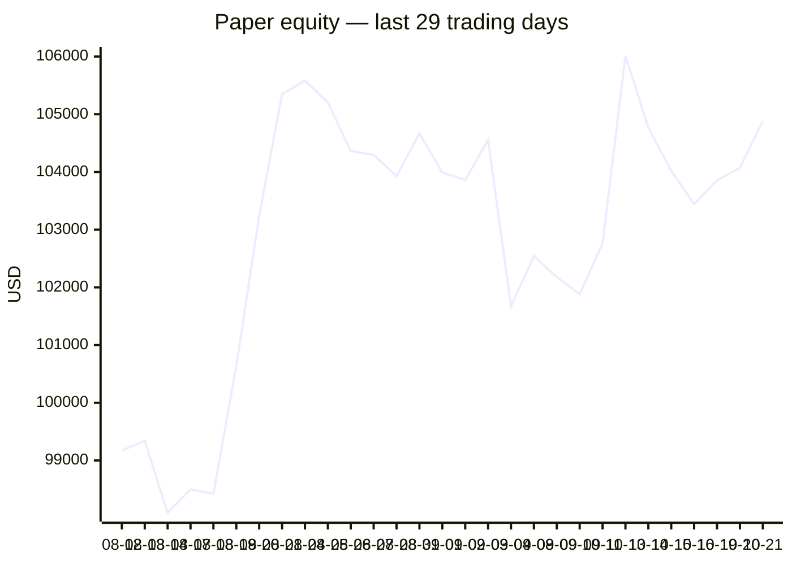
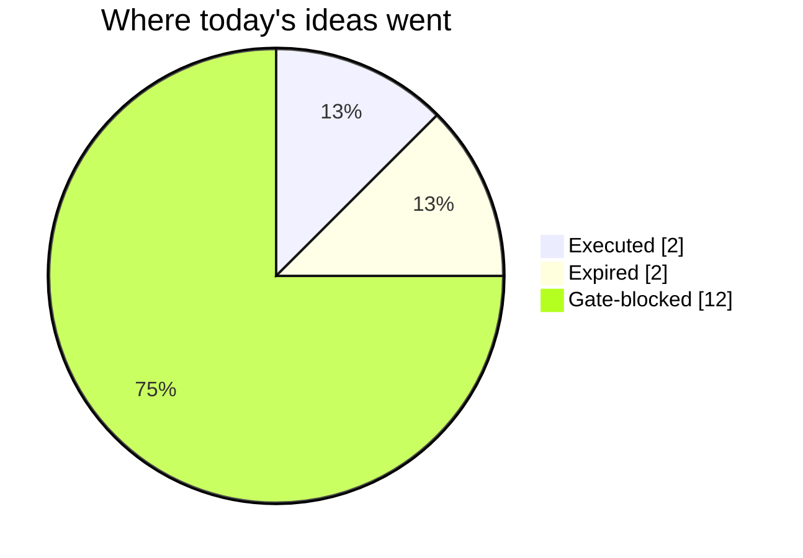
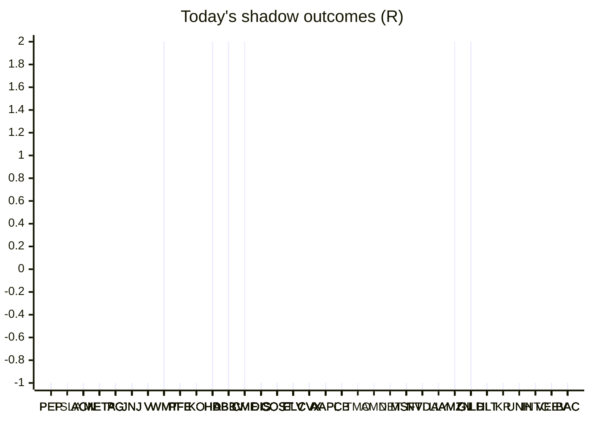

# Trading day 2026-10-21

Paper equity **$104,882** · day +0.56% · regime trending · config v4-seeded · VIX 17.31 (up)

## Charts

## Activity

- Theses formed: 9 (approved→orders: 2, human-rejected: 0, expired unapproved: 2)
- Risk gate blocked: 12
- Fills at the broker: 3

### Positions closed (real book)

- USD_JPY → **timeout** -0.23R · banked -32% of its +0.72R peak
- UK100_GBP → **stopped** -1R
- HLT → **stopped** -1.04R · banked -110% of its +0.94R peak

Exit quality: banked **-71%** of peak open profit across 2 closed position(s) that had a real peak to protect. Persistently low = greed (holding through the give-back); high but with peaks barely above the exits = fear (selling winners too early).

### Execution quality (measured, today)

- cfd: 3 fill(s) · avg slippage cost -0.085R (negative = better than intended) · 5.6 bps · worst 0.005R
- equities: 2 fill(s) · avg slippage cost 0.211R (negative = better than intended) · 12.4 bps · worst 0.232R

### The day's ideas

- **UK100_GBP** (cfd-momentum-breakout) entry 10781.8 stop 10713.87 target 10883.69 — UK100_GBP broke its 20-hour high (10772.8) on 2.1× average volume, above its 20-day average. Stop 3×ATR below, target 1.5R.
- **HLT** (momentum-breakout) entry 362.16 stop 359.67 target 387.06 — Broke 20-bar high (362.04) with stock and SPY above their 20-day averages. Stop 2×ATR below, target 10R.
- **V** (momentum-breakout) entry 408.69 stop 406.62 target 429.39 — Broke 20-bar high (408.43) with stock and SPY above their 20-day averages. Stop 2×ATR below, target 10R.
- **ACN** (momentum-breakout) entry 241.01 stop 238.51 target 266.01 — Broke 20-bar high (240.95) with stock and SPY above their 20-day averages. Stop 2×ATR below, target 10R.
- **PEP** (momentum-breakout) entry 134.73 stop 133.98 target 142.23 — Broke 20-bar high (134.65) with stock and SPY above their 20-day averages. Stop 2×ATR below, target 10R.
- **KR** (momentum-breakout) entry 63.84 stop 63.24 target 69.84 — Broke 20-bar high (63.82) with stock and SPY above their 20-day averages. Stop 2×ATR below, target 10R.
- **SPX500_USD** (cfd-momentum-breakout) entry 7760.9 stop 7712.3 target 7833.8 — SPX500_USD broke its 20-hour high (7758.6) on 1.4× average volume, above its 20-day average. Stop 3×ATR below, target 1.5R.
- **DIS** (momentum-breakout) entry 111.56 stop 111.08 target 116.36 — Broke 20-bar high (111.55) with stock and SPY above their 20-day averages. Stop 2×ATR below, target 10R.
- **LLY** (momentum-breakout) entry 1274.57 stop 1268.29 target 1337.37 — Broke 20-bar high (1274.4) with stock and SPY above their 20-day averages. Stop 2×ATR below, target 10R.

## Shadow ledger (what would have happened)

- PEP (momentum-breakout:filtered, filter-blocked) → **stopped** -1R
- PEP (momentum-breakout:filtered, filter-blocked) → **stopped** -1R
- PEP (momentum-breakout:filtered, filter-blocked) → **stopped** -1R
- PEP (momentum-breakout:filtered, filter-blocked) → **stopped** -1R
- PEP (momentum-breakout:filtered, filter-blocked) → **stopped** -1R
- PEP (momentum-breakout:filtered, filter-blocked) → **stopped** -1R
- TSLA (momentum-breakdown:filtered, filter-blocked) → **stopped** -1R
- ACN (momentum-breakout:filtered, filter-blocked) → **stopped** -1R
- META (momentum-breakdown:filtered, filter-blocked) → **stopped** -1R
- ACN (momentum-breakout:filtered, filter-blocked) → **stopped** -1R
- PG (momentum-breakout:filtered, filter-blocked) → **stopped** -1R
- ACN (momentum-breakout:filtered, filter-blocked) → **stopped** -1R
- ACN (momentum-breakout:filtered, filter-blocked) → **stopped** -1R
- JNJ (momentum-breakout:filtered, filter-blocked) → **stopped** -1R
- ACN (momentum-breakout:filtered, filter-blocked) → **stopped** -1R
- JNJ (momentum-breakout:filtered, filter-blocked) → **stopped** -1R
- ACN (momentum-breakout:filtered, filter-blocked) → **stopped** -1R
- JNJ (momentum-breakout:filtered, filter-blocked) → **stopped** -1R
- V (momentum-breakout:filtered, filter-blocked) → **stopped** -1R
- ACN (momentum-breakout:filtered, filter-blocked) → **stopped** -1R
- JNJ (momentum-breakout:filtered, filter-blocked) → **stopped** -1R
- ACN (momentum-breakout:filtered, filter-blocked) → **stopped** -1R
- JNJ (momentum-breakout:filtered, filter-blocked) → **stopped** -1R
- ACN (momentum-breakout:filtered, filter-blocked) → **stopped** -1R
- JNJ (momentum-breakout:filtered, filter-blocked) → **stopped** -1R
- ACN (momentum-breakout:filtered, filter-blocked) → **stopped** -1R
- JNJ (momentum-breakout:filtered, filter-blocked) → **stopped** -1R
- V (momentum-breakout:filtered, filter-blocked) → **stopped** -1R
- ACN (momentum-breakout:filtered, filter-blocked) → **stopped** -1R
- JNJ (momentum-breakout:filtered, filter-blocked) → **stopped** -1R
- V (momentum-breakout:filtered, filter-blocked) → **stopped** -1R
- ACN (momentum-breakout:filtered, filter-blocked) → **stopped** -1R
- JNJ (momentum-breakout:filtered, filter-blocked) → **stopped** -1R
- V (momentum-breakout:filtered, filter-blocked) → **stopped** -1R
- ACN (momentum-breakout:filtered, filter-blocked) → **stopped** -1R
- JNJ (momentum-breakout:filtered, filter-blocked) → **stopped** -1R
- V (momentum-breakout:filtered, filter-blocked) → **stopped** -1R
- ACN (momentum-breakout:filtered, filter-blocked) → **stopped** -1R
- JNJ (momentum-breakout:filtered, filter-blocked) → **stopped** -1R
- V (momentum-breakout:filtered, filter-blocked) → **stopped** -1R
- ACN (momentum-breakout:filtered, filter-blocked) → **stopped** -1R
- V (momentum-breakout:filtered, filter-blocked) → **stopped** -1R
- ACN (momentum-breakout:filtered, filter-blocked) → **stopped** -1R
- V (momentum-breakout:filtered, filter-blocked) → **stopped** -1R
- V (momentum-breakout:filtered, filter-blocked) → **stopped** -1R
- V (momentum-breakout:filtered, filter-blocked) → **stopped** -1R
- V (momentum-breakout:filtered, filter-blocked) → **stopped** -1R
- V (momentum-breakout:filtered, filter-blocked) → **stopped** -1R
- V (momentum-breakout:filtered, filter-blocked) → **stopped** -1R
- V (momentum-breakout:filtered, filter-blocked) → **stopped** -1R
- V (momentum-breakout:filtered, filter-blocked) → **stopped** -1R
- V (momentum-breakout:filtered, filter-blocked) → **stopped** -1R
- V (momentum-breakout:filtered, filter-blocked) → **stopped** -1R
- V (momentum-breakout, gate-blocked) → **stopped** -1R
- V (momentum-breakout, expired) → **stopped** -1R
- WMT (momentum-breakdown:filtered, filter-blocked) → **target** +2R
- WMT (momentum-breakdown:filtered, filter-blocked) → **target** +2R
- WMT (momentum-breakdown:filtered, filter-blocked) → **target** +2R
- PFE (momentum-breakout:filtered, filter-blocked) → **stopped** -1R
- PFE (momentum-breakout:filtered, filter-blocked) → **stopped** -1R
- PFE (momentum-breakout:filtered, filter-blocked) → **stopped** -1R
- PFE (momentum-breakout:filtered, filter-blocked) → **stopped** -1R
- PFE (momentum-breakout:filtered, filter-blocked) → **stopped** -1R
- PG (momentum-breakout:filtered, filter-blocked) → **stopped** -1R
- PG (momentum-breakout:filtered, filter-blocked) → **stopped** -1R
- PG (momentum-breakout:filtered, filter-blocked) → **stopped** -1R
- PG (momentum-breakout:filtered, filter-blocked) → **stopped** -1R
- PG (momentum-breakout:filtered, filter-blocked) → **stopped** -1R
- PG (momentum-breakout:filtered, filter-blocked) → **stopped** -1R
- WMT (momentum-breakdown:filtered, filter-blocked) → **target** +2R
- PG (momentum-breakout:filtered, filter-blocked) → **stopped** -1R
- WMT (momentum-breakdown:filtered, filter-blocked) → **target** +2R
- PG (momentum-breakout:filtered, filter-blocked) → **stopped** -1R
- WMT (momentum-breakdown:filtered, filter-blocked) → **target** +2R
- PG (momentum-breakout:filtered, filter-blocked) → **stopped** -1R
- WMT (momentum-breakdown:filtered, filter-blocked) → **target** +2R
- PG (momentum-breakout:filtered, filter-blocked) → **stopped** -1R
- WMT (momentum-breakdown:filtered, filter-blocked) → **target** +2R
- PG (momentum-breakout:filtered, filter-blocked) → **stopped** -1R
- WMT (momentum-breakdown:filtered, filter-blocked) → **target** +2R
- PG (momentum-breakout:filtered, filter-blocked) → **stopped** -1R
- WMT (momentum-breakdown:filtered, filter-blocked) → **target** +2R
- PG (momentum-breakout:filtered, filter-blocked) → **stopped** -1R
- WMT (momentum-breakdown:filtered, filter-blocked) → **target** +2R
- PG (momentum-breakout:filtered, filter-blocked) → **stopped** -1R
- PG (momentum-breakout:filtered, filter-blocked) → **stopped** -1R
- PG (momentum-breakout:filtered, filter-blocked) → **stopped** -1R
- PG (momentum-breakout:filtered, filter-blocked) → **stopped** -1R
- PG (momentum-breakout:filtered, filter-blocked) → **stopped** -1R
- PG (momentum-breakout:filtered, filter-blocked) → **stopped** -1R
- PG (momentum-breakout:filtered, filter-blocked) → **stopped** -1R
- PG (momentum-breakout:filtered, filter-blocked) → **stopped** -1R
- PG (momentum-breakout:filtered, filter-blocked) → **stopped** -1R
- PG (momentum-breakout:filtered, filter-blocked) → **stopped** -1R
- KO (momentum-breakout:filtered, filter-blocked) → **stopped** -1R
- PG (momentum-breakout:filtered, filter-blocked) → **stopped** -1R
- PG (momentum-breakout:filtered, filter-blocked) → **stopped** -1R
- PG (momentum-breakout:filtered, filter-blocked) → **stopped** -1R
- KO (momentum-breakout:filtered, filter-blocked) → **stopped** -1R
- PG (momentum-breakout:filtered, filter-blocked) → **stopped** -1R
- PG (momentum-breakout:filtered, filter-blocked) → **stopped** -1R
- HD (momentum-breakdown:filtered, filter-blocked) → **stopped** -1R
- PG (momentum-breakout:filtered, filter-blocked) → **stopped** -1R
- KO (momentum-breakout:filtered, filter-blocked) → **stopped** -1R
- PG (momentum-breakout:filtered, filter-blocked) → **stopped** -1R
- KO (momentum-breakout:filtered, filter-blocked) → **stopped** -1R
- PG (momentum-breakout:filtered, filter-blocked) → **stopped** -1R
- KO (momentum-breakout:filtered, filter-blocked) → **stopped** -1R
- JNJ (momentum-breakout:filtered, filter-blocked) → **stopped** -1R
- ABBV (momentum-breakout:filtered, filter-blocked) → **stopped** -1R
- ABBV (momentum-breakout:filtered, filter-blocked) → **stopped** -1R
- ABBV (momentum-breakout:filtered, filter-blocked) → **stopped** -1R
- ABBV (momentum-breakout:filtered, filter-blocked) → **stopped** -1R
- ABBV (momentum-breakout:filtered, filter-blocked) → **stopped** -1R
- ABBV (momentum-breakout:filtered, filter-blocked) → **stopped** -1R
- ABBV (momentum-breakout:filtered, filter-blocked) → **stopped** -1R
- ABBV (momentum-breakout:filtered, filter-blocked) → **stopped** -1R
- CME (momentum-breakdown:filtered, filter-blocked) → **target** +2R
- CME (momentum-breakdown:filtered, filter-blocked) → **target** +2R
- DIS (momentum-breakout, gate-blocked) → **stopped** -1R
- DIS (momentum-breakout, expired) → **stopped** -1R
- DIS (momentum-breakout:filtered, filter-blocked) → **stopped** -1R
- DIS (momentum-breakout:filtered, filter-blocked) → **stopped** -1R
- COST (momentum-breakdown:filtered, filter-blocked) → **stopped** -1R
- COST (momentum-breakdown:filtered, filter-blocked) → **stopped** -1R
- COST (momentum-breakdown:filtered, filter-blocked) → **stopped** -1R
- COST (momentum-breakdown:filtered, filter-blocked) → **stopped** -1R
- COST (momentum-breakdown:filtered, filter-blocked) → **stopped** -1R
- COST (momentum-breakdown:filtered, filter-blocked) → **stopped** -1R
- COST (momentum-breakdown:filtered, filter-blocked) → **stopped** -1R
- COST (momentum-breakdown:filtered, filter-blocked) → **stopped** -1R
- COST (momentum-breakdown:filtered, filter-blocked) → **stopped** -1R
- ELV (momentum-breakout:filtered, filter-blocked) → **stopped** -1R
- ELV (momentum-breakout:filtered, filter-blocked) → **stopped** -1R
- ELV (momentum-breakout:filtered, filter-blocked) → **stopped** -1R
- CVX (momentum-breakout:filtered, filter-blocked) → **stopped** -1R
- CVX (momentum-breakout:filtered, filter-blocked) → **stopped** -1R
- CVX (momentum-breakout:filtered, filter-blocked) → **stopped** -1R
- AAPL (momentum-breakdown:filtered, filter-blocked) → **stopped** -1R
- AAPL (momentum-breakdown:filtered, filter-blocked) → **stopped** -1R
- AAPL (momentum-breakdown:filtered, filter-blocked) → **stopped** -1R
- AAPL (momentum-breakdown:filtered, filter-blocked) → **stopped** -1R
- AAPL (momentum-breakdown:filtered, filter-blocked) → **stopped** -1R
- CVX (momentum-breakout:filtered, filter-blocked) → **stopped** -1R
- CVX (momentum-breakout:filtered, filter-blocked) → **stopped** -1R
- CVX (momentum-breakout:filtered, filter-blocked) → **stopped** -1R
- AAPL (momentum-breakdown:filtered, filter-blocked) → **stopped** -1R
- AAPL (momentum-breakdown:filtered, filter-blocked) → **stopped** -1R
- AAPL (momentum-breakdown:filtered, filter-blocked) → **stopped** -1R
- AAPL (momentum-breakdown:filtered, filter-blocked) → **stopped** -1R
- AAPL (momentum-breakdown:filtered, filter-blocked) → **stopped** -1R
- AAPL (momentum-breakdown:filtered, filter-blocked) → **stopped** -1R
- AAPL (momentum-breakdown:filtered, filter-blocked) → **stopped** -1R
- AAPL (momentum-breakdown:filtered, filter-blocked) → **stopped** -1R
- ELV (momentum-breakout:filtered, filter-blocked) → **stopped** -1R
- ELV (momentum-breakout:filtered, filter-blocked) → **stopped** -1R
- ELV (momentum-breakout:filtered, filter-blocked) → **stopped** -1R
- ELV (momentum-breakout:filtered, filter-blocked) → **stopped** -1R
- ELV (momentum-breakout:filtered, filter-blocked) → **stopped** -1R
- KO (momentum-breakout:filtered, filter-blocked) → **stopped** -1R
- PEP (momentum-breakdown:filtered, filter-blocked) → **stopped** -1R
- CB (momentum-breakout:filtered, filter-blocked) → **stopped** -1R
- TMO (momentum-breakdown:filtered, filter-blocked) → **stopped** -1R
- AMD (momentum-breakdown, incubation) → **stopped** -1R
- NET (momentum-breakdown, incubation) → **stopped** -1R
- MSFT (momentum-breakdown:filtered, filter-blocked) → **stopped** -1R
- NVDA (momentum-breakout:filtered, filter-blocked) → **stopped** -1R
- WMT (momentum-breakdown:filtered, filter-blocked) → **stopped** -1R
- V (momentum-breakdown:filtered, filter-blocked) → **stopped** -1R
- ELV (momentum-breakout:filtered, filter-blocked) → **stopped** -1R
- PFE (momentum-breakdown:filtered, filter-blocked) → **stopped** -1R
- MSFT (momentum-breakdown:filtered, filter-blocked) → **stopped** -1R
- WMT (momentum-breakdown:filtered, filter-blocked) → **stopped** -1R
- V (momentum-breakdown:filtered, filter-blocked) → **stopped** -1R
- ELV (momentum-breakout:filtered, filter-blocked) → **stopped** -1R
- MSFT (momentum-breakdown:filtered, filter-blocked) → **stopped** -1R
- V (momentum-breakdown:filtered, filter-blocked) → **stopped** -1R
- ELV (momentum-breakout:filtered, filter-blocked) → **stopped** -1R
- MSFT (momentum-breakdown:filtered, filter-blocked) → **stopped** -1R
- V (momentum-breakdown:filtered, filter-blocked) → **stopped** -1R
- V (momentum-breakdown:filtered, filter-blocked) → **stopped** -1R
- PFE (momentum-breakdown:filtered, filter-blocked) → **stopped** -1R
- V (momentum-breakdown:filtered, filter-blocked) → **stopped** -1R
- PG (momentum-breakout:filtered, filter-blocked) → **stopped** -1R
- PG (momentum-breakout:filtered, filter-blocked) → **stopped** -1R
- CVX (momentum-breakout:filtered, filter-blocked) → **stopped** -1R
- CVX (momentum-breakout:filtered, filter-blocked) → **stopped** -1R
- CVX (momentum-breakout:filtered, filter-blocked) → **stopped** -1R
- CVX (momentum-breakout:filtered, filter-blocked) → **stopped** -1R
- CVX (momentum-breakout:filtered, filter-blocked) → **stopped** -1R
- CVX (momentum-breakout:filtered, filter-blocked) → **stopped** -1R
- CVX (momentum-breakout:filtered, filter-blocked) → **stopped** -1R
- CVX (momentum-breakout:filtered, filter-blocked) → **stopped** -1R
- CVX (momentum-breakout:filtered, filter-blocked) → **stopped** -1R
- CVX (momentum-breakout:filtered, filter-blocked) → **stopped** -1R
- CVX (momentum-breakout:filtered, filter-blocked) → **stopped** -1R
- CVX (momentum-breakout:filtered, filter-blocked) → **stopped** -1R
- CVX (momentum-breakout:filtered, filter-blocked) → **stopped** -1R
- CVX (momentum-breakout:filtered, filter-blocked) → **stopped** -1R
- CVX (momentum-breakout:filtered, filter-blocked) → **stopped** -1R
- CVX (momentum-breakout:filtered, filter-blocked) → **stopped** -1R
- CVX (momentum-breakout:filtered, filter-blocked) → **stopped** -1R
- CVX (momentum-breakout:filtered, filter-blocked) → **stopped** -1R
- CVX (momentum-breakout:filtered, filter-blocked) → **stopped** -1R
- DIS (momentum-breakdown:filtered, filter-blocked) → **stopped** -1R
- DIS (momentum-breakdown:filtered, filter-blocked) → **stopped** -1R
- ELV (momentum-breakout:filtered, filter-blocked) → **stopped** -1R
- ACN (momentum-breakdown:filtered, filter-blocked) → **stopped** -1R
- MSFT (momentum-breakdown:filtered, filter-blocked) → **stopped** -1R
- LLY (momentum-breakdown:filtered, filter-blocked) → **stopped** -1R
- JNJ (momentum-breakout:filtered, filter-blocked) → **stopped** -1R
- ELV (momentum-breakout:filtered, filter-blocked) → **stopped** -1R
- AMZN (momentum-breakdown:filtered, filter-blocked) → **target** +2R
- ACN (momentum-breakdown:filtered, filter-blocked) → **stopped** -1R
- ACN (momentum-breakdown:filtered, filter-blocked) → **stopped** -1R
- ACN (momentum-breakdown:filtered, filter-blocked) → **stopped** -1R
- ABBV (momentum-breakout:filtered, filter-blocked) → **stopped** -1R
- JNJ (momentum-breakout:filtered, filter-blocked) → **stopped** -1R
- ABBV (momentum-breakout:filtered, filter-blocked) → **stopped** -1R
- ABBV (momentum-breakout:filtered, filter-blocked) → **stopped** -1R
- ELV (momentum-breakout:filtered, filter-blocked) → **stopped** -1R
- GILD (momentum-breakdown:filtered, filter-blocked) → **target** +2R
- GILD (momentum-breakdown:filtered, filter-blocked) → **target** +2R
- GILD (momentum-breakdown:filtered, filter-blocked) → **target** +2R
- GILD (momentum-breakdown:filtered, filter-blocked) → **target** +2R
- ABBV (momentum-breakout:filtered, filter-blocked) → **stopped** -1R
- ABBV (momentum-breakout:filtered, filter-blocked) → **stopped** -1R
- GILD (momentum-breakdown:filtered, filter-blocked) → **target** +2R
- CME (momentum-breakdown:filtered, filter-blocked) → **stopped** -1R
- CME (momentum-breakdown:filtered, filter-blocked) → **stopped** -1R
- GILD (momentum-breakdown:filtered, filter-blocked) → **target** +2R
- GILD (momentum-breakdown:filtered, filter-blocked) → **target** +2R
- GILD (momentum-breakdown:filtered, filter-blocked) → **target** +2R
- PFE (momentum-breakout:filtered, filter-blocked) → **stopped** -1R
- PFE (momentum-breakout:filtered, filter-blocked) → **stopped** -1R
- HD (momentum-breakout:filtered, filter-blocked) → **stopped** -1R
- HD (momentum-breakout:filtered, filter-blocked) → **stopped** -1R
- GILD (momentum-breakdown:filtered, filter-blocked) → **target** +2R
- CB (momentum-breakdown:filtered, filter-blocked) → **stopped** -1R
- NVDA (momentum-breakout:filtered, filter-blocked) → **stopped** -1R
- NVDA (momentum-breakout:filtered, filter-blocked) → **stopped** -1R
- NVDA (momentum-breakout:filtered, filter-blocked) → **stopped** -1R
- HLT (momentum-breakdown:filtered, filter-blocked) → **stopped** -1R
- CB (momentum-breakdown:filtered, filter-blocked) → **stopped** -1R
- HLT (momentum-breakdown:filtered, filter-blocked) → **stopped** -1R
- HLT (momentum-breakdown:filtered, filter-blocked) → **stopped** -1R
- CB (momentum-breakdown:filtered, filter-blocked) → **stopped** -1R
- CB (momentum-breakdown:filtered, filter-blocked) → **stopped** -1R
- CB (momentum-breakdown:filtered, filter-blocked) → **stopped** -1R
- CB (momentum-breakdown:filtered, filter-blocked) → **stopped** -1R
- CME (momentum-breakdown:filtered, filter-blocked) → **stopped** -1R
- CME (momentum-breakdown:filtered, filter-blocked) → **stopped** -1R
- CME (momentum-breakdown:filtered, filter-blocked) → **stopped** -1R
- HLT (momentum-breakdown:filtered, filter-blocked) → **stopped** -1R
- CME (momentum-breakdown:filtered, filter-blocked) → **stopped** -1R
- CME (momentum-breakdown:filtered, filter-blocked) → **stopped** -1R
- CME (momentum-breakdown:filtered, filter-blocked) → **stopped** -1R
- CME (momentum-breakdown:filtered, filter-blocked) → **stopped** -1R
- CME (momentum-breakdown:filtered, filter-blocked) → **stopped** -1R
- CME (momentum-breakdown:filtered, filter-blocked) → **stopped** -1R
- CME (momentum-breakdown:filtered, filter-blocked) → **stopped** -1R
- CME (momentum-breakdown:filtered, filter-blocked) → **stopped** -1R
- CME (momentum-breakdown:filtered, filter-blocked) → **stopped** -1R
- CME (momentum-breakdown:filtered, filter-blocked) → **stopped** -1R
- KR (momentum-breakout:filtered, filter-blocked) → **stopped** -1R
- DIS (momentum-breakout:filtered, filter-blocked) → **stopped** -1R
- DIS (momentum-breakout:filtered, filter-blocked) → **stopped** -1R
- GILD (momentum-breakdown:filtered, filter-blocked) → **stopped** -1R
- PFE (momentum-breakout:filtered, filter-blocked) → **stopped** -1R
- KR (momentum-breakout:filtered, filter-blocked) → **stopped** -1R
- UNH (momentum-breakdown:filtered, filter-blocked) → **stopped** -1R
- ELV (momentum-breakdown:filtered, filter-blocked) → **stopped** -1R
- ELV (momentum-breakdown:filtered, filter-blocked) → **stopped** -1R
- UNH (momentum-breakdown:filtered, filter-blocked) → **stopped** -1R
- ELV (momentum-breakdown:filtered, filter-blocked) → **stopped** -1R
- ELV (momentum-breakdown:filtered, filter-blocked) → **stopped** -1R
- ELV (momentum-breakdown:filtered, filter-blocked) → **stopped** -1R
- ELV (momentum-breakdown:filtered, filter-blocked) → **stopped** -1R
- ELV (momentum-breakdown:filtered, filter-blocked) → **stopped** -1R
- ELV (momentum-breakdown:filtered, filter-blocked) → **stopped** -1R
- ELV (momentum-breakdown:filtered, filter-blocked) → **stopped** -1R
- ELV (momentum-breakdown:filtered, filter-blocked) → **stopped** -1R
- CB (momentum-breakdown:filtered, filter-blocked) → **stopped** -1R
- CB (momentum-breakdown:filtered, filter-blocked) → **stopped** -1R
- CB (momentum-breakdown:filtered, filter-blocked) → **stopped** -1R
- CB (momentum-breakdown:filtered, filter-blocked) → **stopped** -1R
- CB (momentum-breakdown:filtered, filter-blocked) → **stopped** -1R
- ELV (momentum-breakdown:filtered, filter-blocked) → **stopped** -1R
- ELV (momentum-breakdown:filtered, filter-blocked) → **stopped** -1R
- ELV (momentum-breakdown:filtered, filter-blocked) → **stopped** -1R
- ELV (momentum-breakdown:filtered, filter-blocked) → **stopped** -1R
- GILD (momentum-breakdown:filtered, filter-blocked) → **stopped** -1R
- UNH (momentum-breakdown:filtered, filter-blocked) → **stopped** -1R
- GILD (momentum-breakdown:filtered, filter-blocked) → **stopped** -1R
- ELV (momentum-breakdown:filtered, filter-blocked) → **stopped** -1R
- ELV (momentum-breakdown:filtered, filter-blocked) → **stopped** -1R
- HD (momentum-breakout:filtered, filter-blocked) → **stopped** -1R
- DIS (momentum-breakout:filtered, filter-blocked) → **stopped** -1R
- ABBV (momentum-breakout:filtered, filter-blocked) → **stopped** -1R
- ABBV (momentum-breakout:filtered, filter-blocked) → **stopped** -1R
- ABBV (momentum-breakout:filtered, filter-blocked) → **stopped** -1R
- DIS (momentum-breakout:filtered, filter-blocked) → **stopped** -1R
- DIS (momentum-breakout:filtered, filter-blocked) → **stopped** -1R
- DIS (momentum-breakout:filtered, filter-blocked) → **stopped** -1R
- DIS (momentum-breakout:filtered, filter-blocked) → **stopped** -1R
- DIS (momentum-breakout:filtered, filter-blocked) → **stopped** -1R
- V (momentum-breakdown:filtered, filter-blocked) → **stopped** -1R
- V (momentum-breakdown:filtered, filter-blocked) → **stopped** -1R
- DIS (momentum-breakout:filtered, filter-blocked) → **stopped** -1R
- DIS (momentum-breakout:filtered, filter-blocked) → **stopped** -1R
- V (momentum-breakdown:filtered, filter-blocked) → **stopped** -1R
- CB (momentum-breakdown:filtered, filter-blocked) → **stopped** -1R
- INTC (momentum-breakdown:filtered, filter-blocked) → **stopped** -1R
- ABBV (momentum-breakout:filtered, filter-blocked) → **stopped** -1R
- ABBV (momentum-breakout:filtered, filter-blocked) → **stopped** -1R
- INTC (momentum-breakdown:filtered, filter-blocked) → **stopped** -1R
- INTC (momentum-breakdown:filtered, filter-blocked) → **stopped** -1R
- ABBV (momentum-breakout:filtered, filter-blocked) → **stopped** -1R
- WMT (momentum-breakdown:filtered, filter-blocked) → **stopped** -1R
- AMZN (momentum-breakdown:filtered, filter-blocked) → **stopped** -1R
- AMZN (momentum-breakdown:filtered, filter-blocked) → **stopped** -1R
- AMZN (momentum-breakdown:filtered, filter-blocked) → **stopped** -1R
- GILD (momentum-breakdown:filtered, filter-blocked) → **stopped** -1R
- ELV (momentum-breakdown:filtered, filter-blocked) → **stopped** -1R
- ELV (momentum-breakdown:filtered, filter-blocked) → **stopped** -1R
- GILD (momentum-breakdown:filtered, filter-blocked) → **stopped** -1R
- GILD (momentum-breakdown:filtered, filter-blocked) → **stopped** -1R
- AMZN (momentum-breakdown:filtered, filter-blocked) → **stopped** -1R
- AMZN (momentum-breakdown:filtered, filter-blocked) → **stopped** -1R
- COST (momentum-breakdown:filtered, filter-blocked) → **stopped** -1R
- AAPL (momentum-breakdown:filtered, filter-blocked) → **stopped** -1R
- ABBV (momentum-breakout:filtered, filter-blocked) → **stopped** -1R
- AAPL (momentum-breakdown:filtered, filter-blocked) → **stopped** -1R
- AAPL (momentum-breakdown:filtered, filter-blocked) → **stopped** -1R
- AAPL (momentum-breakdown:filtered, filter-blocked) → **stopped** -1R
- AAPL (momentum-breakdown:filtered, filter-blocked) → **stopped** -1R
- ELV (momentum-breakdown:filtered, filter-blocked) → **stopped** -1R
- ELV (momentum-breakdown:filtered, filter-blocked) → **stopped** -1R
- ELV (momentum-breakdown:filtered, filter-blocked) → **stopped** -1R
- COST (momentum-breakdown:filtered, filter-blocked) → **stopped** -1R
- COST (momentum-breakdown:filtered, filter-blocked) → **stopped** -1R
- COST (momentum-breakdown:filtered, filter-blocked) → **stopped** -1R
- ELV (momentum-breakdown:filtered, filter-blocked) → **stopped** -1R
- ELV (momentum-breakdown:filtered, filter-blocked) → **stopped** -1R
- ELV (momentum-breakdown:filtered, filter-blocked) → **stopped** -1R
- COST (momentum-breakdown:filtered, filter-blocked) → **stopped** -1R
- COST (momentum-breakdown:filtered, filter-blocked) → **stopped** -1R
- COST (momentum-breakdown:filtered, filter-blocked) → **stopped** -1R
- COST (momentum-breakdown:filtered, filter-blocked) → **stopped** -1R
- ELV (momentum-breakdown:filtered, filter-blocked) → **stopped** -1R
- ELV (momentum-breakdown:filtered, filter-blocked) → **stopped** -1R
- ELV (momentum-breakdown:filtered, filter-blocked) → **stopped** -1R
- ELV (momentum-breakdown:filtered, filter-blocked) → **stopped** -1R
- ELV (momentum-breakdown:filtered, filter-blocked) → **stopped** -1R
- ELV (momentum-breakdown:filtered, filter-blocked) → **stopped** -1R
- ELV (momentum-breakdown:filtered, filter-blocked) → **stopped** -1R
- COST (momentum-breakdown:filtered, filter-blocked) → **stopped** -1R
- ABBV (momentum-breakdown:filtered, filter-blocked) → **target** +2R
- DIS (momentum-breakdown:filtered, filter-blocked) → **stopped** -1R
- AMZN (momentum-breakdown:filtered, filter-blocked) → **stopped** -1R
- DIS (momentum-breakdown:filtered, filter-blocked) → **stopped** -1R
- CVX (momentum-breakout:filtered, filter-blocked) → **stopped** -1R
- DIS (momentum-breakdown:filtered, filter-blocked) → **stopped** -1R
- DIS (momentum-breakdown:filtered, filter-blocked) → **stopped** -1R
- DIS (momentum-breakdown:filtered, filter-blocked) → **stopped** -1R
- AMZN (momentum-breakdown:filtered, filter-blocked) → **stopped** -1R
- AMZN (momentum-breakdown:filtered, filter-blocked) → **stopped** -1R
- AMZN (momentum-breakdown:filtered, filter-blocked) → **stopped** -1R
- DIS (momentum-breakdown:filtered, filter-blocked) → **stopped** -1R
- DIS (momentum-breakdown:filtered, filter-blocked) → **stopped** -1R
- DIS (momentum-breakdown:filtered, filter-blocked) → **stopped** -1R
- DIS (momentum-breakdown:filtered, filter-blocked) → **stopped** -1R
- ABBV (momentum-breakdown:filtered, filter-blocked) → **target** +2R
- PFE (momentum-breakout:filtered, filter-blocked) → **stopped** -1R
- ELV (momentum-breakdown:filtered, filter-blocked) → **stopped** -1R
- COST (momentum-breakdown:filtered, filter-blocked) → **stopped** -1R
- COST (momentum-breakdown:filtered, filter-blocked) → **stopped** -1R
- COST (momentum-breakdown:filtered, filter-blocked) → **stopped** -1R
- COST (momentum-breakdown:filtered, filter-blocked) → **stopped** -1R
- AMZN (momentum-breakdown:filtered, filter-blocked) → **stopped** -1R
- AMZN (momentum-breakdown:filtered, filter-blocked) → **stopped** -1R
- AMZN (momentum-breakdown:filtered, filter-blocked) → **stopped** -1R
- AMZN (momentum-breakdown:filtered, filter-blocked) → **stopped** -1R
- AMZN (momentum-breakdown:filtered, filter-blocked) → **stopped** -1R
- MSFT (momentum-breakdown:filtered, filter-blocked) → **stopped** -1R
- MSFT (momentum-breakdown:filtered, filter-blocked) → **stopped** -1R
- AMZN (momentum-breakdown:filtered, filter-blocked) → **stopped** -1R
- DIS (momentum-breakdown:filtered, filter-blocked) → **stopped** -1R
- DIS (momentum-breakdown:filtered, filter-blocked) → **stopped** -1R
- PFE (momentum-breakout:filtered, filter-blocked) → **stopped** -1R
- AMZN (momentum-breakdown:filtered, filter-blocked) → **stopped** -1R
- WMT (momentum-breakdown:filtered, filter-blocked) → **stopped** -1R
- PG (equity-opening-range, incubation) → **stopped** -1R
- ABBV (momentum-breakdown:filtered, filter-blocked) → **target** +2R
- HD (momentum-breakdown:filtered, filter-blocked) → **stopped** -1R
- VEEV (momentum-breakout:filtered, filter-blocked) → **stopped** -1R
- VEEV (momentum-breakout:filtered, filter-blocked) → **stopped** -1R
- HD (momentum-breakdown:filtered, filter-blocked) → **stopped** -1R
- ABBV (momentum-breakdown:filtered, filter-blocked) → **target** +2R
- AMZN (momentum-breakdown:filtered, filter-blocked) → **stopped** -1R
- AMZN (momentum-breakdown:filtered, filter-blocked) → **stopped** -1R
- ABBV (momentum-breakdown:filtered, filter-blocked) → **target** +2R
- ABBV (momentum-breakdown:filtered, filter-blocked) → **target** +2R
- HD (momentum-breakdown:filtered, filter-blocked) → **stopped** -1R
- HD (momentum-breakdown:filtered, filter-blocked) → **stopped** -1R
- HD (momentum-breakdown:filtered, filter-blocked) → **stopped** -1R
- CVX (momentum-breakout:filtered, filter-blocked) → **stopped** -1R
- HD (momentum-breakdown:filtered, filter-blocked) → **stopped** -1R
- CVX (momentum-breakout:filtered, filter-blocked) → **stopped** -1R
- HD (momentum-breakdown:filtered, filter-blocked) → **stopped** -1R
- CVX (momentum-breakout:filtered, filter-blocked) → **stopped** -1R
- HD (momentum-breakdown:filtered, filter-blocked) → **stopped** -1R
- CVX (momentum-breakout:filtered, filter-blocked) → **stopped** -1R
- HD (momentum-breakdown:filtered, filter-blocked) → **stopped** -1R
- CVX (momentum-breakout:filtered, filter-blocked) → **stopped** -1R
- HD (momentum-breakdown:filtered, filter-blocked) → **stopped** -1R
- CVX (momentum-breakout:filtered, filter-blocked) → **stopped** -1R
- HD (momentum-breakdown:filtered, filter-blocked) → **stopped** -1R
- CVX (momentum-breakout:filtered, filter-blocked) → **stopped** -1R
- HD (momentum-breakdown:filtered, filter-blocked) → **stopped** -1R
- CVX (momentum-breakout:filtered, filter-blocked) → **stopped** -1R
- VEEV (momentum-breakout:filtered, filter-blocked) → **stopped** -1R
- VEEV (momentum-breakout:filtered, filter-blocked) → **stopped** -1R
- ABBV (momentum-breakdown:filtered, filter-blocked) → **target** +2R
- ABBV (momentum-breakdown:filtered, filter-blocked) → **target** +2R
- AMZN (momentum-breakdown:filtered, filter-blocked) → **stopped** -1R
- COST (momentum-breakdown:filtered, filter-blocked) → **stopped** -1R
- COST (momentum-breakdown:filtered, filter-blocked) → **stopped** -1R
- COST (momentum-breakdown:filtered, filter-blocked) → **stopped** -1R
- COST (momentum-breakdown:filtered, filter-blocked) → **stopped** -1R
- VEEV (momentum-breakout:filtered, filter-blocked) → **stopped** -1R
- VEEV (momentum-breakout:filtered, filter-blocked) → **stopped** -1R
- CME (momentum-breakout:filtered, filter-blocked) → **stopped** -1R
- PFE (momentum-breakout:filtered, filter-blocked) → **stopped** -1R
- CME (momentum-breakout:filtered, filter-blocked) → **stopped** -1R
- CME (momentum-breakout:filtered, filter-blocked) → **stopped** -1R
- DIS (momentum-breakdown:filtered, filter-blocked) → **stopped** -1R
- DIS (momentum-breakdown:filtered, filter-blocked) → **stopped** -1R
- DIS (momentum-breakdown:filtered, filter-blocked) → **stopped** -1R
- DIS (momentum-breakdown:filtered, filter-blocked) → **stopped** -1R
- DIS (momentum-breakdown:filtered, filter-blocked) → **stopped** -1R
- DIS (momentum-breakdown:filtered, filter-blocked) → **stopped** -1R
- DIS (momentum-breakdown:filtered, filter-blocked) → **stopped** -1R
- UNH (momentum-breakdown:filtered, filter-blocked) → **stopped** -1R
- DIS (momentum-breakdown:filtered, filter-blocked) → **stopped** -1R
- PEP (momentum-breakout, gate-blocked) → **stopped** -1R
- PEP (momentum-breakout:filtered, filter-blocked) → **stopped** -1R
- BAC (momentum-breakout:filtered, filter-blocked) → **stopped** -1R
- HD (momentum-breakout:filtered, filter-blocked) → **stopped** -1R
- DIS (momentum-breakout, gate-blocked) → **stopped** -1R
- BAC (momentum-breakout:filtered, filter-blocked) → **stopped** -1R
- BAC (momentum-breakout:filtered, filter-blocked) → **stopped** -1R
- HD (momentum-breakout:filtered, filter-blocked) → **stopped** -1R
- BAC (momentum-breakout:filtered, filter-blocked) → **stopped** -1R
- BAC (momentum-breakout:filtered, filter-blocked) → **stopped** -1R
- BAC (momentum-breakout:filtered, filter-blocked) → **stopped** -1R
- BAC (momentum-breakout:filtered, filter-blocked) → **stopped** -1R
- AMZN (momentum-breakout, gate-blocked) → **stopped** -1R
- BAC (momentum-breakout:filtered, filter-blocked) → **stopped** -1R
- BAC (momentum-breakout:filtered, filter-blocked) → **stopped** -1R
- BAC (momentum-breakout:filtered, filter-blocked) → **stopped** -1R
- HD (momentum-breakout:filtered, filter-blocked) → **stopped** -1R
- BAC (momentum-breakout:filtered, filter-blocked) → **stopped** -1R
- BAC (momentum-breakout:filtered, filter-blocked) → **stopped** -1R
- HD (momentum-breakout:filtered, filter-blocked) → **stopped** -1R
- HD (momentum-breakdown:filtered, filter-blocked) → **target** +2R
- HD (momentum-breakdown:filtered, filter-blocked) → **target** +2R
- HD (momentum-breakdown:filtered, filter-blocked) → **target** +2R
- DIS (momentum-breakout, expired) → **stopped** -1R
- HLT (momentum-breakout:filtered, filter-blocked) → **stopped** -1R
- HLT (momentum-breakout:filtered, filter-blocked) → **stopped** -1R
- HLT (momentum-breakout:filtered, filter-blocked) → **stopped** -1R
- HLT (momentum-breakout:filtered, filter-blocked) → **stopped** -1R
- ABBV (momentum-breakdown:filtered, filter-blocked) → **stopped** -1R
- META (momentum-breakout:filtered, filter-blocked) → **stopped** -1R
- META (momentum-breakout:filtered, filter-blocked) → **stopped** -1R
- META (momentum-breakout:filtered, filter-blocked) → **stopped** -1R
- META (momentum-breakout:filtered, filter-blocked) → **stopped** -1R
- META (momentum-breakout:filtered, filter-blocked) → **stopped** -1R
- META (momentum-breakout:filtered, filter-blocked) → **stopped** -1R
- META (momentum-breakout:filtered, filter-blocked) → **stopped** -1R
- META (momentum-breakout:filtered, filter-blocked) → **stopped** -1R
- META (momentum-breakout:filtered, filter-blocked) → **stopped** -1R
- META (momentum-breakout:filtered, filter-blocked) → **stopped** -1R
- META (momentum-breakout:filtered, filter-blocked) → **stopped** -1R
- ABBV (momentum-breakdown:filtered, filter-blocked) → **stopped** -1R
- GILD (momentum-breakdown:filtered, filter-blocked) → **stopped** -1R
- GILD (momentum-breakdown:filtered, filter-blocked) → **stopped** -1R
- ABBV (momentum-breakdown:filtered, filter-blocked) → **stopped** -1R
- ABBV (momentum-breakdown:filtered, filter-blocked) → **stopped** -1R
- ABBV (momentum-breakdown:filtered, filter-blocked) → **stopped** -1R
- ABBV (momentum-breakdown:filtered, filter-blocked) → **stopped** -1R
- ABBV (momentum-breakdown:filtered, filter-blocked) → **stopped** -1R
- ABBV (momentum-breakdown:filtered, filter-blocked) → **stopped** -1R
- ABBV (momentum-breakdown:filtered, filter-blocked) → **stopped** -1R
- ABBV (momentum-breakdown:filtered, filter-blocked) → **stopped** -1R
- ABBV (momentum-breakdown:filtered, filter-blocked) → **stopped** -1R
- HD (momentum-breakdown:filtered, filter-blocked) → **stopped** -1R
- HD (momentum-breakdown:filtered, filter-blocked) → **stopped** -1R
- COST (momentum-breakdown:filtered, filter-blocked) → **stopped** -1R
- COST (momentum-breakdown:filtered, filter-blocked) → **stopped** -1R
- COST (momentum-breakdown:filtered, filter-blocked) → **stopped** -1R
- COST (momentum-breakdown:filtered, filter-blocked) → **stopped** -1R
- COST (momentum-breakdown:filtered, filter-blocked) → **stopped** -1R
- COST (momentum-breakdown:filtered, filter-blocked) → **stopped** -1R
- COST (momentum-breakdown:filtered, filter-blocked) → **stopped** -1R
- COST (momentum-breakdown:filtered, filter-blocked) → **stopped** -1R
- PFE (momentum-breakdown:filtered, filter-blocked) → **stopped** -1R
- PFE (momentum-breakdown:filtered, filter-blocked) → **stopped** -1R
- PFE (momentum-breakdown:filtered, filter-blocked) → **stopped** -1R
- PFE (momentum-breakdown:filtered, filter-blocked) → **stopped** -1R
- PFE (momentum-breakdown:filtered, filter-blocked) → **stopped** -1R
- PFE (momentum-breakdown:filtered, filter-blocked) → **stopped** -1R
- PFE (momentum-breakdown:filtered, filter-blocked) → **stopped** -1R
- HD (momentum-breakdown:filtered, filter-blocked) → **stopped** -1R
- HD (momentum-breakdown:filtered, filter-blocked) → **stopped** -1R
- HD (momentum-breakdown:filtered, filter-blocked) → **stopped** -1R
- HD (momentum-breakdown:filtered, filter-blocked) → **stopped** -1R
- HD (momentum-breakdown:filtered, filter-blocked) → **stopped** -1R
- HD (momentum-breakdown:filtered, filter-blocked) → **stopped** -1R
- HD (momentum-breakdown:filtered, filter-blocked) → **stopped** -1R
- HD (momentum-breakdown:filtered, filter-blocked) → **stopped** -1R
- HD (momentum-breakdown:filtered, filter-blocked) → **stopped** -1R
- HD (momentum-breakdown:filtered, filter-blocked) → **stopped** -1R
- HD (momentum-breakdown:filtered, filter-blocked) → **stopped** -1R
- GILD (momentum-breakdown:filtered, filter-blocked) → **stopped** -1R
- GILD (momentum-breakdown:filtered, filter-blocked) → **stopped** -1R
- GILD (momentum-breakdown:filtered, filter-blocked) → **stopped** -1R
- ABBV (momentum-breakdown:filtered, filter-blocked) → **stopped** -1R
- ABBV (momentum-breakdown:filtered, filter-blocked) → **stopped** -1R
- DIS (momentum-breakdown:filtered, filter-blocked) → **stopped** -1R
- HD (momentum-breakdown:filtered, filter-blocked) → **stopped** -1R
- HD (momentum-breakdown:filtered, filter-blocked) → **stopped** -1R

Day total: **-431R**

## Running shadow record

Resolved 14 ideas · win rate 0% · total -14R · avg -1R · still tracking 1076

## Is the desk earning its keep?

Shadow-outcome R by the desk verdict each idea carried (vetoed/expired ideas only — executed trades don't resolve to an R-outcome yet):

| Verdict | Ideas | Win rate | Avg R |
|---|---|---|---|
| proceed | 0 | —% | — |
| caution | 0 | —% | — |
| avoid | 0 | —% | — |
| none | 14 | 0% | -1 |

*Only 0 scored ideas so far — a preview, not a verdict on the AI yet.*

## Incubation ward

- **pullback-trend** — incubating: 0/25 shadow outcomes
- **crypto-mean-reversion** — incubating: 0/25 shadow outcomes
- **cfd-mean-reversion** — incubating: 0/25 shadow outcomes
- **cfd-opening-range** — incubating: 0/25 shadow outcomes
- **equity-opening-range** — incubating: 1/25 shadow outcomes
- **cfd-pair-reversion** — incubating: 0/25 shadow outcomes
- **momentum-breakdown** — incubating: 9/25 shadow outcomes
- **mean-reversion-short** — incubating: 0/25 shadow outcomes
- **cfd-momentum-breakdown** — incubating: 4/25 shadow outcomes
- **cfd-mean-reversion-short** — incubating: 0/25 shadow outcomes

*Incubating strategies shadow-track every signal but never execute. Graduation is mechanical: 25+ outcomes, avg ≥ +0.10R, wins ≥ 40%.*

*Generated by code, no AI. Paper account only.*
