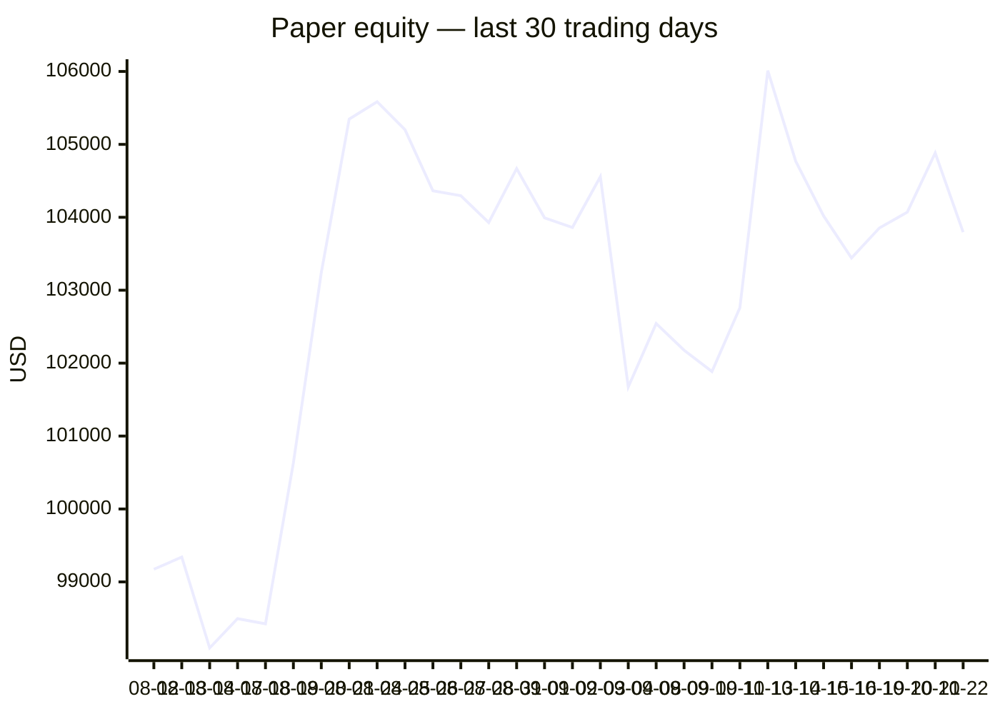
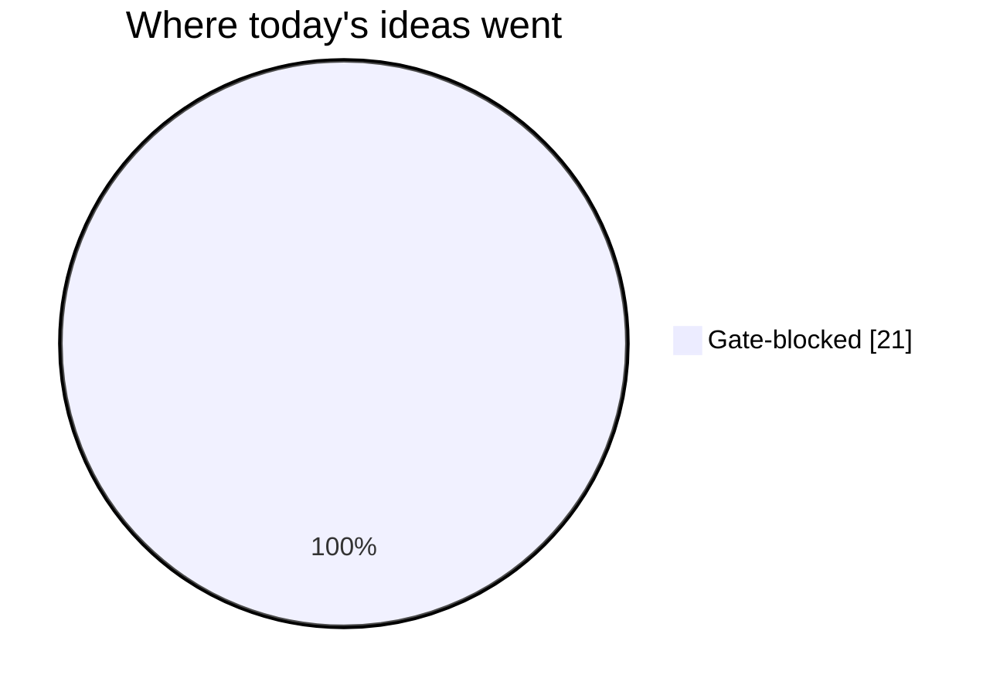
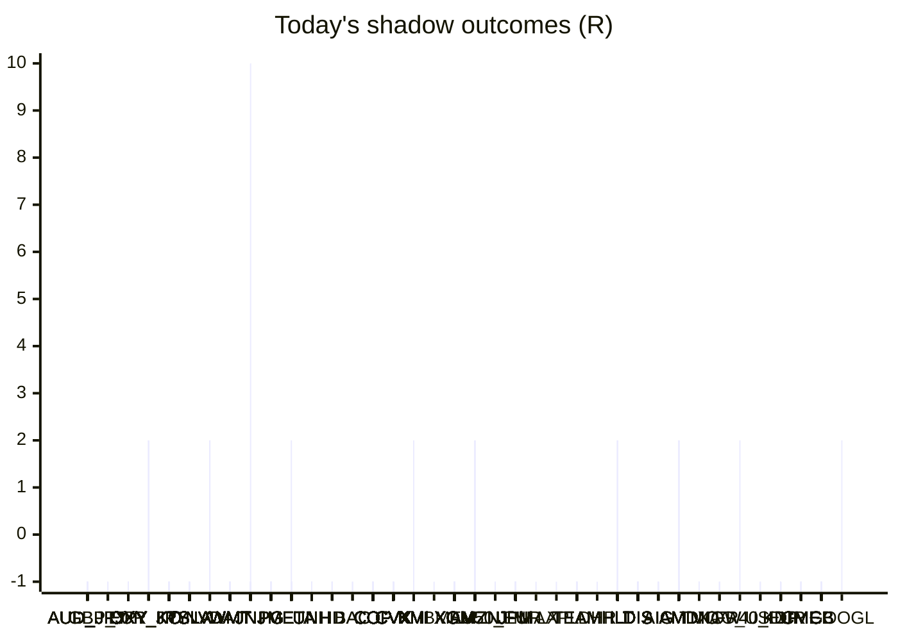

# Trading day 2026-10-22

Paper equity **$103,796** · day -0.52% · regime choppy · config v4-seeded · VIX 16.68 (down)

## Charts

## Activity

- Theses formed: 0 (approved→orders: 0, human-rejected: 0, expired unapproved: 0)
- Risk gate blocked: 21
- Fills at the broker: 5

### Positions closed (real book)

- SPX500_USD → **stopped** -1R · banked -222% of its +0.45R peak
- AVGO → **timeout** -13.83R
- GOOGL → **timeout** -5.34R
- XOM → **timeout** +20.41R · banked 99% of its +20.69R peak
- AVGO → **timeout** -13.87R
- GOOGL → **timeout** -5.29R
- XOM → **timeout** +20.5R · banked 100% of its +20.5R peak
- AVGO → **timeout** -13.76R
- GOOGL → **timeout** -5.28R
- XOM → **timeout** +20.11R · banked 100% of its +20.11R peak
- AVGO → **stopped-or-closed** -1R
- GOOGL → **stopped-or-closed** -1R
- V → **stopped** +0.29R · banked 21% of its +1.42R peak

Exit quality: banked **20%** of peak open profit across 5 closed position(s) that had a real peak to protect. Persistently low = greed (holding through the give-back); high but with peaks barely above the exits = fear (selling winners too early).

### Execution quality (measured, today)

- cfd: 1 fill(s) · avg slippage cost 0R (negative = better than intended) · 0 bps · worst 0R

## Shadow ledger (what would have happened)

- AUD_JPY (cfd-momentum-breakout, gate-blocked) → **stopped** -1R
- AUD_JPY (cfd-momentum-breakout, gate-blocked) → **stopped** -1R
- AUD_JPY (cfd-momentum-breakout, gate-blocked) → **stopped** -1R
- AUD_JPY (cfd-momentum-breakout, gate-blocked) → **stopped** -1R
- AUD_JPY (cfd-momentum-breakout, gate-blocked) → **stopped** -1R
- AUD_JPY (cfd-momentum-breakout, gate-blocked) → **stopped** -1R
- AUD_JPY (cfd-momentum-breakout, gate-blocked) → **stopped** -1R
- AUD_JPY (cfd-momentum-breakout, gate-blocked) → **stopped** -1R
- GBP_JPY (cfd-momentum-breakout, gate-blocked) → **stopped** -1R
- OXY (momentum-breakout:filtered, filter-blocked) → **stopped** -1R
- OXY (momentum-breakout:filtered, filter-blocked) → **stopped** -1R
- OXY (momentum-breakout:filtered, filter-blocked) → **stopped** -1R
- OXY (momentum-breakout:filtered, filter-blocked) → **stopped** -1R
- OXY (momentum-breakout:filtered, filter-blocked) → **stopped** -1R
- OXY (momentum-breakout:filtered, filter-blocked) → **stopped** -1R
- OXY (momentum-breakout:filtered, filter-blocked) → **stopped** -1R
- OXY (momentum-breakout:filtered, filter-blocked) → **stopped** -1R
- OXY (momentum-breakout:filtered, filter-blocked) → **stopped** -1R
- OXY (momentum-breakout:filtered, filter-blocked) → **stopped** -1R
- OXY (momentum-breakout:filtered, filter-blocked) → **stopped** -1R
- OXY (momentum-breakout:filtered, filter-blocked) → **stopped** -1R
- OXY (momentum-breakout:filtered, filter-blocked) → **stopped** -1R
- OXY (momentum-breakout:filtered, filter-blocked) → **stopped** -1R
- OXY (momentum-breakout:filtered, filter-blocked) → **stopped** -1R
- OXY (momentum-breakout:filtered, filter-blocked) → **stopped** -1R
- OXY (momentum-breakout:filtered, filter-blocked) → **stopped** -1R
- OXY (momentum-breakout:filtered, filter-blocked) → **stopped** -1R
- OXY (momentum-breakout:filtered, filter-blocked) → **stopped** -1R
- OXY (momentum-breakout:filtered, filter-blocked) → **stopped** -1R
- OXY (momentum-breakout:filtered, filter-blocked) → **stopped** -1R
- OXY (momentum-breakout:filtered, filter-blocked) → **stopped** -1R
- GBP_JPY (cfd-momentum-breakout, gate-blocked) → **stopped** -1R
- EUR_JPY (cfd-momentum-breakdown, incubation) → **target** +2R
- EUR_JPY (cfd-momentum-breakdown, incubation) → **target** +2R
- EUR_JPY (cfd-momentum-breakdown, incubation) → **target** +2R
- EUR_JPY (cfd-momentum-breakdown, incubation) → **target** +2R
- KO (momentum-breakdown:filtered, filter-blocked) → **stopped** -1R
- KO (momentum-breakdown:filtered, filter-blocked) → **stopped** -1R
- KO (momentum-breakdown:filtered, filter-blocked) → **stopped** -1R
- KO (momentum-breakdown:filtered, filter-blocked) → **stopped** -1R
- KO (momentum-breakdown:filtered, filter-blocked) → **stopped** -1R
- KO (momentum-breakdown:filtered, filter-blocked) → **stopped** -1R
- KO (momentum-breakdown:filtered, filter-blocked) → **stopped** -1R
- KO (momentum-breakdown:filtered, filter-blocked) → **stopped** -1R
- KO (momentum-breakdown:filtered, filter-blocked) → **stopped** -1R
- TSLA (momentum-breakout:filtered, filter-blocked) → **stopped** -1R
- TSLA (momentum-breakout:filtered, filter-blocked) → **stopped** -1R
- TSLA (momentum-breakout:filtered, filter-blocked) → **stopped** -1R
- TSLA (momentum-breakout:filtered, filter-blocked) → **stopped** -1R
- TSLA (momentum-breakout:filtered, filter-blocked) → **stopped** -1R
- TSLA (momentum-breakout:filtered, filter-blocked) → **stopped** -1R
- TSLA (momentum-breakout:filtered, filter-blocked) → **stopped** -1R
- TSLA (momentum-breakout:filtered, filter-blocked) → **stopped** -1R
- TSLA (momentum-breakout:filtered, filter-blocked) → **stopped** -1R
- TSLA (momentum-breakout:filtered, filter-blocked) → **stopped** -1R
- TSLA (momentum-breakout:filtered, filter-blocked) → **stopped** -1R
- TSLA (momentum-breakout:filtered, filter-blocked) → **stopped** -1R
- TSLA (momentum-breakout:filtered, filter-blocked) → **stopped** -1R
- TSLA (momentum-breakout:filtered, filter-blocked) → **stopped** -1R
- TSLA (momentum-breakout:filtered, filter-blocked) → **stopped** -1R
- TSLA (momentum-breakout:filtered, filter-blocked) → **stopped** -1R
- TSLA (momentum-breakout:filtered, filter-blocked) → **stopped** -1R
- TSLA (momentum-breakout:filtered, filter-blocked) → **stopped** -1R
- TSLA (momentum-breakout:filtered, filter-blocked) → **stopped** -1R
- TSLA (momentum-breakout:filtered, filter-blocked) → **stopped** -1R
- TSLA (momentum-breakout:filtered, filter-blocked) → **stopped** -1R
- TSLA (momentum-breakout:filtered, filter-blocked) → **stopped** -1R
- TSLA (momentum-breakout:filtered, filter-blocked) → **stopped** -1R
- TSLA (momentum-breakout:filtered, filter-blocked) → **stopped** -1R
- TSLA (momentum-breakout:filtered, filter-blocked) → **stopped** -1R
- TSLA (momentum-breakout:filtered, filter-blocked) → **stopped** -1R
- TSLA (momentum-breakout:filtered, filter-blocked) → **stopped** -1R
- TSLA (momentum-breakout, gate-blocked) → **stopped** -1R
- KO (momentum-breakdown:filtered, filter-blocked) → **stopped** -1R
- KO (momentum-breakdown:filtered, filter-blocked) → **stopped** -1R
- KO (momentum-breakdown:filtered, filter-blocked) → **stopped** -1R
- KO (momentum-breakdown:filtered, filter-blocked) → **stopped** -1R
- KO (momentum-breakdown:filtered, filter-blocked) → **stopped** -1R
- KO (momentum-breakdown:filtered, filter-blocked) → **stopped** -1R
- KO (momentum-breakdown:filtered, filter-blocked) → **stopped** -1R
- KO (momentum-breakdown:filtered, filter-blocked) → **stopped** -1R
- KO (momentum-breakdown:filtered, filter-blocked) → **stopped** -1R
- KO (momentum-breakdown:filtered, filter-blocked) → **stopped** -1R
- KO (momentum-breakdown:filtered, filter-blocked) → **stopped** -1R
- KO (momentum-breakdown:filtered, filter-blocked) → **stopped** -1R
- KO (momentum-breakdown:filtered, filter-blocked) → **stopped** -1R
- KO (momentum-breakdown:filtered, filter-blocked) → **stopped** -1R
- KO (momentum-breakdown:filtered, filter-blocked) → **stopped** -1R
- KO (momentum-breakdown:filtered, filter-blocked) → **stopped** -1R
- NVDA (momentum-breakout:filtered, filter-blocked) → **stopped** -1R
- WMT (momentum-breakdown:filtered, filter-blocked) → **stopped** -1R
- WMT (momentum-breakdown:filtered, filter-blocked) → **stopped** -1R
- WMT (momentum-breakdown:filtered, filter-blocked) → **stopped** -1R
- WMT (momentum-breakdown:filtered, filter-blocked) → **stopped** -1R
- WMT (momentum-breakdown:filtered, filter-blocked) → **stopped** -1R
- WMT (momentum-breakdown:filtered, filter-blocked) → **stopped** -1R
- WMT (momentum-breakdown:filtered, filter-blocked) → **stopped** -1R
- WMT (momentum-breakdown:filtered, filter-blocked) → **stopped** -1R
- WMT (momentum-breakdown:filtered, filter-blocked) → **stopped** -1R
- WMT (momentum-breakdown:filtered, filter-blocked) → **stopped** -1R
- WMT (momentum-breakdown:filtered, filter-blocked) → **stopped** -1R
- WMT (momentum-breakdown:filtered, filter-blocked) → **stopped** -1R
- WMT (momentum-breakdown:filtered, filter-blocked) → **stopped** -1R
- WMT (momentum-breakdown:filtered, filter-blocked) → **stopped** -1R
- WMT (momentum-breakdown:filtered, filter-blocked) → **stopped** -1R
- WMT (momentum-breakdown:filtered, filter-blocked) → **stopped** -1R
- WMT (momentum-breakdown:filtered, filter-blocked) → **stopped** -1R
- WMT (momentum-breakdown:filtered, filter-blocked) → **stopped** -1R
- WMT (momentum-breakdown:filtered, filter-blocked) → **stopped** -1R
- WMT (momentum-breakdown:filtered, filter-blocked) → **stopped** -1R
- WMT (momentum-breakdown:filtered, filter-blocked) → **stopped** -1R
- WMT (momentum-breakdown:filtered, filter-blocked) → **stopped** -1R
- WMT (momentum-breakdown:filtered, filter-blocked) → **stopped** -1R
- WMT (momentum-breakdown:filtered, filter-blocked) → **stopped** -1R
- WMT (momentum-breakdown:filtered, filter-blocked) → **stopped** -1R
- WMT (momentum-breakdown:filtered, filter-blocked) → **stopped** -1R
- WMT (momentum-breakdown:filtered, filter-blocked) → **stopped** -1R
- WMT (momentum-breakdown:filtered, filter-blocked) → **stopped** -1R
- WMT (momentum-breakdown:filtered, filter-blocked) → **stopped** -1R
- WMT (momentum-breakdown:filtered, filter-blocked) → **stopped** -1R
- WMT (momentum-breakdown:filtered, filter-blocked) → **stopped** -1R
- WMT (momentum-breakdown:filtered, filter-blocked) → **stopped** -1R
- WMT (momentum-breakdown:filtered, filter-blocked) → **stopped** -1R
- WMT (momentum-breakdown:filtered, filter-blocked) → **stopped** -1R
- WMT (momentum-breakdown:filtered, filter-blocked) → **stopped** -1R
- WMT (momentum-breakdown:filtered, filter-blocked) → **stopped** -1R
- WMT (momentum-breakdown:filtered, filter-blocked) → **stopped** -1R
- WMT (momentum-breakdown:filtered, filter-blocked) → **stopped** -1R
- WMT (momentum-breakdown:filtered, filter-blocked) → **stopped** -1R
- JNJ (momentum-breakdown, incubation) → **stopped** -1R
- PG (momentum-breakdown:filtered, filter-blocked) → **stopped** -1R
- PG (momentum-breakdown:filtered, filter-blocked) → **stopped** -1R
- META (pullback-trend, incubation) → **stopped** -1R
- PG (momentum-breakdown:filtered, filter-blocked) → **stopped** -1R
- PG (momentum-breakdown:filtered, filter-blocked) → **stopped** -1R
- PG (momentum-breakdown:filtered, filter-blocked) → **stopped** -1R
- PG (momentum-breakdown:filtered, filter-blocked) → **stopped** -1R
- PG (momentum-breakdown:filtered, filter-blocked) → **stopped** -1R
- PG (momentum-breakdown:filtered, filter-blocked) → **stopped** -1R
- UNH (momentum-breakdown:filtered, filter-blocked) → **stopped** -1R
- HD (momentum-breakdown:filtered, filter-blocked) → **stopped** -1R
- HD (momentum-breakdown:filtered, filter-blocked) → **stopped** -1R
- HD (momentum-breakdown:filtered, filter-blocked) → **stopped** -1R
- HD (momentum-breakdown:filtered, filter-blocked) → **stopped** -1R
- UNH (momentum-breakdown:filtered, filter-blocked) → **stopped** -1R
- UNH (momentum-breakdown:filtered, filter-blocked) → **stopped** -1R
- UNH (momentum-breakdown:filtered, filter-blocked) → **stopped** -1R
- UNH (momentum-breakdown:filtered, filter-blocked) → **stopped** -1R
- UNH (momentum-breakdown:filtered, filter-blocked) → **stopped** -1R
- UNH (momentum-breakdown:filtered, filter-blocked) → **stopped** -1R
- UNH (momentum-breakdown:filtered, filter-blocked) → **stopped** -1R
- UNH (momentum-breakdown:filtered, filter-blocked) → **stopped** -1R
- UNH (momentum-breakdown:filtered, filter-blocked) → **stopped** -1R
- META (pullback-trend:filtered, filter-blocked) → **stopped** -1R
- BAC (momentum-breakdown:filtered, filter-blocked) → **stopped** -1R
- PG (momentum-breakdown:filtered, filter-blocked) → **stopped** -1R
- OXY (momentum-breakout, gate-blocked) → **stopped** -1R
- META (pullback-trend:filtered, filter-blocked) → **stopped** -1R
- BAC (momentum-breakdown:filtered, filter-blocked) → **stopped** -1R
- COP (momentum-breakout, gate-blocked) → **stopped** -1R
- CVX (momentum-breakout, gate-blocked) → **stopped** -1R
- KMI (momentum-breakout, gate-blocked) → **stopped** -1R
- IBM (momentum-breakout, gate-blocked) → **stopped** -1R
- META (pullback-trend:filtered, filter-blocked) → **stopped** -1R
- META (pullback-trend:filtered, filter-blocked) → **stopped** -1R
- XOM (momentum-breakout, gate-blocked) → **stopped** -1R
- META (pullback-trend:filtered, filter-blocked) → **stopped** -1R
- META (pullback-trend:filtered, filter-blocked) → **stopped** -1R
- META (pullback-trend:filtered, filter-blocked) → **stopped** -1R
- META (pullback-trend:filtered, filter-blocked) → **stopped** -1R
- META (pullback-trend:filtered, filter-blocked) → **stopped** -1R
- META (pullback-trend:filtered, filter-blocked) → **stopped** -1R
- META (pullback-trend:filtered, filter-blocked) → **stopped** -1R
- AMZN (momentum-breakdown:filtered, filter-blocked) → **target** +2R
- CVX (momentum-breakout, gate-blocked) → **stopped** -1R
- UNH (momentum-breakdown:filtered, filter-blocked) → **stopped** -1R
- EU50_EUR (cfd-momentum-breakdown, incubation) → **stopped** -1R
- EU50_EUR (cfd-momentum-breakdown, incubation) → **stopped** -1R
- JPM (momentum-breakdown:filtered, filter-blocked) → **stopped** -1R
- JPM (momentum-breakdown:filtered, filter-blocked) → **stopped** -1R
- JPM (momentum-breakdown:filtered, filter-blocked) → **stopped** -1R
- NFLX (momentum-breakout:filtered, filter-blocked) → **stopped** -1R
- CVX (momentum-breakout:filtered, filter-blocked) → **stopped** -1R
- AAPL (momentum-breakout, gate-blocked) → **stopped** -1R
- TEAM (momentum-breakout, gate-blocked) → **stopped** -1R
- DHR (momentum-breakout, gate-blocked) → **stopped** -1R
- HLT (momentum-breakout:filtered, filter-blocked) → **stopped** -1R
- HLT (momentum-breakout:filtered, filter-blocked) → **stopped** -1R
- HLT (momentum-breakout:filtered, filter-blocked) → **stopped** -1R
- HLT (momentum-breakout:filtered, filter-blocked) → **stopped** -1R
- HLT (momentum-breakout:filtered, filter-blocked) → **stopped** -1R
- HLT (momentum-breakout:filtered, filter-blocked) → **stopped** -1R
- HLT (momentum-breakout:filtered, filter-blocked) → **stopped** -1R
- HLT (momentum-breakout:filtered, filter-blocked) → **stopped** -1R
- HLT (momentum-breakout:filtered, filter-blocked) → **stopped** -1R
- HLT (momentum-breakout:filtered, filter-blocked) → **stopped** -1R
- HLT (momentum-breakout:filtered, filter-blocked) → **stopped** -1R
- HLT (momentum-breakout:filtered, filter-blocked) → **stopped** -1R
- HLT (momentum-breakout:filtered, filter-blocked) → **stopped** -1R
- JPM (momentum-breakout:filtered, filter-blocked) → **stopped** -1R
- JPM (momentum-breakout:filtered, filter-blocked) → **stopped** -1R
- JPM (momentum-breakout:filtered, filter-blocked) → **stopped** -1R
- JPM (momentum-breakout:filtered, filter-blocked) → **stopped** -1R
- HLT (momentum-breakout:filtered, filter-blocked) → **stopped** -1R
- AMZN (momentum-breakdown:filtered, filter-blocked) → **target** +2R
- AMZN (momentum-breakdown:filtered, filter-blocked) → **target** +2R
- HLT (momentum-breakout:filtered, filter-blocked) → **stopped** -1R
- JPM (momentum-breakout:filtered, filter-blocked) → **stopped** -1R
- JPM (momentum-breakout:filtered, filter-blocked) → **stopped** -1R
- JPM (momentum-breakout:filtered, filter-blocked) → **stopped** -1R
- JPM (momentum-breakout:filtered, filter-blocked) → **stopped** -1R
- JPM (momentum-breakout:filtered, filter-blocked) → **stopped** -1R
- JPM (momentum-breakout:filtered, filter-blocked) → **stopped** -1R
- JPM (momentum-breakout:filtered, filter-blocked) → **stopped** -1R
- DIS (momentum-breakout:filtered, filter-blocked) → **stopped** -1R
- DIS (momentum-breakout:filtered, filter-blocked) → **stopped** -1R
- JPM (momentum-breakout:filtered, filter-blocked) → **stopped** -1R
- JPM (momentum-breakout:filtered, filter-blocked) → **stopped** -1R
- JPM (momentum-breakout:filtered, filter-blocked) → **stopped** -1R
- JPM (momentum-breakout:filtered, filter-blocked) → **stopped** -1R
- JPM (momentum-breakout:filtered, filter-blocked) → **stopped** -1R
- JPM (momentum-breakout:filtered, filter-blocked) → **stopped** -1R
- JPM (momentum-breakout:filtered, filter-blocked) → **stopped** -1R
- JPM (momentum-breakout:filtered, filter-blocked) → **stopped** -1R
- JPM (momentum-breakout:filtered, filter-blocked) → **stopped** -1R
- JPM (momentum-breakout:filtered, filter-blocked) → **stopped** -1R
- JPM (momentum-breakout:filtered, filter-blocked) → **stopped** -1R
- JPM (momentum-breakout:filtered, filter-blocked) → **stopped** -1R
- JPM (momentum-breakout:filtered, filter-blocked) → **stopped** -1R
- JPM (momentum-breakout:filtered, filter-blocked) → **stopped** -1R
- JPM (momentum-breakout:filtered, filter-blocked) → **stopped** -1R
- JPM (momentum-breakout:filtered, filter-blocked) → **stopped** -1R
- JPM (momentum-breakout:filtered, filter-blocked) → **stopped** -1R
- AIG (momentum-breakout:filtered, filter-blocked) → **stopped** -1R
- AIG (momentum-breakout:filtered, filter-blocked) → **stopped** -1R
- AIG (momentum-breakout:filtered, filter-blocked) → **stopped** -1R
- NVDA (momentum-breakdown:filtered, filter-blocked) → **target** +2R
- NVDA (momentum-breakdown:filtered, filter-blocked) → **target** +2R
- AMD (pullback-trend:filtered, filter-blocked) → **stopped** -1R
- AMD (pullback-trend:filtered, filter-blocked) → **stopped** -1R
- AMD (pullback-trend:filtered, filter-blocked) → **stopped** -1R
- AMD (pullback-trend:filtered, filter-blocked) → **stopped** -1R
- AMD (pullback-trend:filtered, filter-blocked) → **stopped** -1R
- AMD (pullback-trend:filtered, filter-blocked) → **stopped** -1R
- AMD (pullback-trend:filtered, filter-blocked) → **stopped** -1R
- AMD (pullback-trend:filtered, filter-blocked) → **stopped** -1R
- AMD (pullback-trend:filtered, filter-blocked) → **stopped** -1R
- AMD (pullback-trend:filtered, filter-blocked) → **stopped** -1R
- AMD (pullback-trend:filtered, filter-blocked) → **stopped** -1R
- WMT (momentum-breakdown:filtered, filter-blocked) → **stopped** -1R
- WMT (momentum-breakdown:filtered, filter-blocked) → **stopped** -1R
- WMT (momentum-breakdown:filtered, filter-blocked) → **stopped** -1R
- NVDA (momentum-breakdown, incubation) → **target** +2R
- CVX (momentum-breakout:filtered, filter-blocked) → **stopped** -1R
- TEAM (momentum-breakdown:filtered, filter-blocked) → **stopped** -1R
- TEAM (momentum-breakdown:filtered, filter-blocked) → **stopped** -1R
- TEAM (momentum-breakdown:filtered, filter-blocked) → **stopped** -1R
- TEAM (momentum-breakdown:filtered, filter-blocked) → **stopped** -1R
- TEAM (momentum-breakdown:filtered, filter-blocked) → **stopped** -1R
- TEAM (momentum-breakdown:filtered, filter-blocked) → **stopped** -1R
- TEAM (momentum-breakdown:filtered, filter-blocked) → **stopped** -1R
- TEAM (momentum-breakdown:filtered, filter-blocked) → **stopped** -1R
- TEAM (momentum-breakdown:filtered, filter-blocked) → **stopped** -1R
- CVX (momentum-breakout:filtered, filter-blocked) → **stopped** -1R
- CVX (momentum-breakout:filtered, filter-blocked) → **stopped** -1R
- CVX (momentum-breakout:filtered, filter-blocked) → **stopped** -1R
- TMO (momentum-breakdown:filtered, filter-blocked) → **stopped** -1R
- TMO (momentum-breakdown:filtered, filter-blocked) → **stopped** -1R
- TMO (momentum-breakdown:filtered, filter-blocked) → **stopped** -1R
- HLT (momentum-breakdown:filtered, filter-blocked) → **target** +2R
- HLT (momentum-breakdown:filtered, filter-blocked) → **target** +2R
- HLT (momentum-breakout, gate-blocked) → **stopped** -1R
- HLT (momentum-breakdown:filtered, filter-blocked) → **target** +2R
- HLT (momentum-breakdown:filtered, filter-blocked) → **target** +2R
- HLT (momentum-breakdown:filtered, filter-blocked) → **target** +2R
- HLT (momentum-breakdown:filtered, filter-blocked) → **target** +2R
- HLT (momentum-breakdown:filtered, filter-blocked) → **target** +2R
- KMI (momentum-breakdown:filtered, filter-blocked) → **target** +2R
- TMO (momentum-breakdown:filtered, filter-blocked) → **stopped** -1R
- JPM (momentum-breakdown, incubation) → **stopped** -1R
- KMI (momentum-breakdown:filtered, filter-blocked) → **stopped** -1R
- KMI (momentum-breakdown:filtered, filter-blocked) → **stopped** -1R
- KMI (momentum-breakdown:filtered, filter-blocked) → **stopped** -1R
- KMI (momentum-breakdown:filtered, filter-blocked) → **stopped** -1R
- KMI (momentum-breakdown:filtered, filter-blocked) → **stopped** -1R
- KMI (momentum-breakdown:filtered, filter-blocked) → **stopped** -1R
- KMI (momentum-breakdown:filtered, filter-blocked) → **stopped** -1R
- KMI (momentum-breakdown:filtered, filter-blocked) → **stopped** -1R
- KMI (momentum-breakdown:filtered, filter-blocked) → **stopped** -1R
- KMI (momentum-breakdown:filtered, filter-blocked) → **stopped** -1R
- KMI (momentum-breakdown:filtered, filter-blocked) → **stopped** -1R
- KMI (momentum-breakdown:filtered, filter-blocked) → **stopped** -1R
- KMI (momentum-breakdown:filtered, filter-blocked) → **stopped** -1R
- KMI (momentum-breakdown:filtered, filter-blocked) → **stopped** -1R
- KMI (momentum-breakdown:filtered, filter-blocked) → **stopped** -1R
- KMI (momentum-breakdown:filtered, filter-blocked) → **stopped** -1R
- KMI (momentum-breakdown:filtered, filter-blocked) → **stopped** -1R
- KMI (momentum-breakdown:filtered, filter-blocked) → **stopped** -1R
- KMI (momentum-breakdown:filtered, filter-blocked) → **stopped** -1R
- KMI (momentum-breakdown:filtered, filter-blocked) → **stopped** -1R
- OXY (momentum-breakdown:filtered, filter-blocked) → **stopped** -1R
- XOM (momentum-breakdown:filtered, filter-blocked) → **stopped** -1R
- KMI (momentum-breakdown:filtered, filter-blocked) → **stopped** -1R
- KMI (momentum-breakdown:filtered, filter-blocked) → **stopped** -1R
- KMI (momentum-breakdown:filtered, filter-blocked) → **stopped** -1R
- KMI (momentum-breakdown:filtered, filter-blocked) → **stopped** -1R
- KMI (momentum-breakdown:filtered, filter-blocked) → **stopped** -1R
- KMI (momentum-breakdown:filtered, filter-blocked) → **stopped** -1R
- KMI (momentum-breakdown:filtered, filter-blocked) → **stopped** -1R
- KMI (momentum-breakdown:filtered, filter-blocked) → **stopped** -1R
- KMI (momentum-breakdown:filtered, filter-blocked) → **stopped** -1R
- KMI (momentum-breakdown:filtered, filter-blocked) → **stopped** -1R
- HLT (momentum-breakdown:filtered, filter-blocked) → **stopped** -1R
- CVX (momentum-breakdown:filtered, filter-blocked) → **stopped** -1R
- KMI (momentum-breakdown:filtered, filter-blocked) → **stopped** -1R
- KMI (momentum-breakdown:filtered, filter-blocked) → **stopped** -1R
- KMI (momentum-breakdown:filtered, filter-blocked) → **stopped** -1R
- COP (momentum-breakdown:filtered, filter-blocked) → **stopped** -1R
- COP (momentum-breakdown:filtered, filter-blocked) → **stopped** -1R
- OXY (momentum-breakdown:filtered, filter-blocked) → **stopped** -1R
- COP (momentum-breakdown:filtered, filter-blocked) → **stopped** -1R
- OXY (momentum-breakdown:filtered, filter-blocked) → **stopped** -1R
- KMI (momentum-breakdown:filtered, filter-blocked) → **stopped** -1R
- OXY (momentum-breakdown:filtered, filter-blocked) → **stopped** -1R
- CVX (momentum-breakdown:filtered, filter-blocked) → **stopped** -1R
- OXY (momentum-breakdown:filtered, filter-blocked) → **stopped** -1R
- OXY (momentum-breakdown:filtered, filter-blocked) → **stopped** -1R
- COP (momentum-breakdown:filtered, filter-blocked) → **stopped** -1R
- COP (momentum-breakdown:filtered, filter-blocked) → **stopped** -1R
- COP (momentum-breakdown:filtered, filter-blocked) → **stopped** -1R
- KMI (momentum-breakdown:filtered, filter-blocked) → **stopped** -1R
- XOM (momentum-breakdown:filtered, filter-blocked) → **stopped** -1R
- XOM (momentum-breakdown:filtered, filter-blocked) → **stopped** -1R
- KMI (momentum-breakdown:filtered, filter-blocked) → **stopped** -1R
- KMI (momentum-breakdown:filtered, filter-blocked) → **stopped** -1R
- KMI (momentum-breakdown:filtered, filter-blocked) → **stopped** -1R
- COP (momentum-breakdown:filtered, filter-blocked) → **stopped** -1R
- COP (momentum-breakdown:filtered, filter-blocked) → **stopped** -1R
- KMI (momentum-breakdown:filtered, filter-blocked) → **stopped** -1R
- KMI (momentum-breakdown:filtered, filter-blocked) → **stopped** -1R
- KMI (momentum-breakdown:filtered, filter-blocked) → **stopped** -1R
- HLT (momentum-breakdown:filtered, filter-blocked) → **stopped** -1R
- KMI (momentum-breakdown:filtered, filter-blocked) → **stopped** -1R
- KMI (momentum-breakdown:filtered, filter-blocked) → **stopped** -1R
- KMI (momentum-breakdown:filtered, filter-blocked) → **stopped** -1R
- XOM (momentum-breakdown:filtered, filter-blocked) → **stopped** -1R
- XOM (momentum-breakdown:filtered, filter-blocked) → **stopped** -1R
- XOM (momentum-breakdown:filtered, filter-blocked) → **stopped** -1R
- XOM (momentum-breakdown:filtered, filter-blocked) → **stopped** -1R
- HLT (momentum-breakdown:filtered, filter-blocked) → **stopped** -1R
- HLT (momentum-breakdown:filtered, filter-blocked) → **stopped** -1R
- HLT (momentum-breakdown:filtered, filter-blocked) → **stopped** -1R
- OXY (momentum-breakdown:filtered, filter-blocked) → **stopped** -1R
- COP (momentum-breakdown:filtered, filter-blocked) → **stopped** -1R
- OXY (momentum-breakdown:filtered, filter-blocked) → **stopped** -1R
- XOM (momentum-breakdown:filtered, filter-blocked) → **stopped** -1R
- CVX (momentum-breakdown:filtered, filter-blocked) → **stopped** -1R
- CVX (momentum-breakdown:filtered, filter-blocked) → **stopped** -1R
- CVX (momentum-breakdown:filtered, filter-blocked) → **stopped** -1R
- CVX (momentum-breakdown:filtered, filter-blocked) → **stopped** -1R
- CVX (momentum-breakdown:filtered, filter-blocked) → **stopped** -1R
- XOM (momentum-breakdown:filtered, filter-blocked) → **stopped** -1R
- CVX (momentum-breakdown:filtered, filter-blocked) → **stopped** -1R
- CVX (momentum-breakdown:filtered, filter-blocked) → **stopped** -1R
- CVX (momentum-breakdown:filtered, filter-blocked) → **stopped** -1R
- CVX (momentum-breakdown:filtered, filter-blocked) → **stopped** -1R
- CVX (momentum-breakdown:filtered, filter-blocked) → **stopped** -1R
- CVX (momentum-breakdown:filtered, filter-blocked) → **stopped** -1R
- XOM (momentum-breakdown:filtered, filter-blocked) → **stopped** -1R
- XOM (momentum-breakdown:filtered, filter-blocked) → **stopped** -1R
- COP (momentum-breakdown:filtered, filter-blocked) → **stopped** -1R
- XOM (momentum-breakdown:filtered, filter-blocked) → **stopped** -1R
- XOM (momentum-breakdown:filtered, filter-blocked) → **stopped** -1R
- XOM (momentum-breakdown:filtered, filter-blocked) → **stopped** -1R
- XOM (momentum-breakdown:filtered, filter-blocked) → **stopped** -1R
- XOM (momentum-breakdown:filtered, filter-blocked) → **stopped** -1R
- OXY (momentum-breakdown:filtered, filter-blocked) → **stopped** -1R
- XOM (momentum-breakdown:filtered, filter-blocked) → **stopped** -1R
- OXY (momentum-breakdown:filtered, filter-blocked) → **stopped** -1R
- OXY (momentum-breakdown:filtered, filter-blocked) → **stopped** -1R
- OXY (momentum-breakdown:filtered, filter-blocked) → **stopped** -1R
- XOM (momentum-breakdown:filtered, filter-blocked) → **stopped** -1R
- OXY (momentum-breakdown:filtered, filter-blocked) → **stopped** -1R
- XOM (momentum-breakdown:filtered, filter-blocked) → **stopped** -1R
- XOM (momentum-breakdown:filtered, filter-blocked) → **stopped** -1R
- OXY (momentum-breakdown:filtered, filter-blocked) → **stopped** -1R
- COP (momentum-breakdown:filtered, filter-blocked) → **stopped** -1R
- COP (momentum-breakdown:filtered, filter-blocked) → **stopped** -1R
- CVX (momentum-breakdown:filtered, filter-blocked) → **stopped** -1R
- CVX (momentum-breakdown:filtered, filter-blocked) → **stopped** -1R
- OXY (momentum-breakdown:filtered, filter-blocked) → **stopped** -1R
- OXY (momentum-breakdown:filtered, filter-blocked) → **stopped** -1R
- XOM (momentum-breakdown:filtered, filter-blocked) → **stopped** -1R
- XOM (momentum-breakdown:filtered, filter-blocked) → **stopped** -1R
- XOM (momentum-breakdown:filtered, filter-blocked) → **stopped** -1R
- COP (momentum-breakdown:filtered, filter-blocked) → **stopped** -1R
- COP (momentum-breakdown:filtered, filter-blocked) → **stopped** -1R
- OXY (momentum-breakdown:filtered, filter-blocked) → **stopped** -1R
- OXY (momentum-breakdown:filtered, filter-blocked) → **stopped** -1R
- CVX (momentum-breakdown:filtered, filter-blocked) → **stopped** -1R
- CVX (momentum-breakdown:filtered, filter-blocked) → **stopped** -1R
- CVX (momentum-breakdown:filtered, filter-blocked) → **stopped** -1R
- CVX (momentum-breakdown:filtered, filter-blocked) → **stopped** -1R
- XOM (momentum-breakdown:filtered, filter-blocked) → **stopped** -1R
- CVX (momentum-breakdown:filtered, filter-blocked) → **stopped** -1R
- CVX (momentum-breakdown:filtered, filter-blocked) → **stopped** -1R
- CVX (momentum-breakdown:filtered, filter-blocked) → **stopped** -1R
- CVX (momentum-breakdown:filtered, filter-blocked) → **stopped** -1R
- CVX (momentum-breakdown:filtered, filter-blocked) → **stopped** -1R
- NOW (momentum-breakout:filtered, filter-blocked) → **stopped** -1R
- NOW (momentum-breakout:filtered, filter-blocked) → **stopped** -1R
- OXY (momentum-breakdown:filtered, filter-blocked) → **stopped** -1R
- XOM (momentum-breakdown:filtered, filter-blocked) → **stopped** -1R
- NVDA (momentum-breakdown, incubation) → **target** +2R
- COP (momentum-breakdown:filtered, filter-blocked) → **stopped** -1R
- COP (momentum-breakdown:filtered, filter-blocked) → **stopped** -1R
- CVX (momentum-breakdown:filtered, filter-blocked) → **stopped** -1R
- CVX (momentum-breakdown:filtered, filter-blocked) → **stopped** -1R
- CVX (momentum-breakdown:filtered, filter-blocked) → **stopped** -1R
- COP (momentum-breakdown:filtered, filter-blocked) → **stopped** -1R
- COP (momentum-breakdown:filtered, filter-blocked) → **stopped** -1R
- XOM (momentum-breakdown:filtered, filter-blocked) → **stopped** -1R
- OXY (momentum-breakdown:filtered, filter-blocked) → **stopped** -1R
- OXY (momentum-breakdown:filtered, filter-blocked) → **stopped** -1R
- OXY (momentum-breakdown:filtered, filter-blocked) → **stopped** -1R
- OXY (momentum-breakdown:filtered, filter-blocked) → **stopped** -1R
- OXY (momentum-breakdown:filtered, filter-blocked) → **stopped** -1R
- OXY (momentum-breakdown:filtered, filter-blocked) → **stopped** -1R
- OXY (momentum-breakdown:filtered, filter-blocked) → **stopped** -1R
- OXY (momentum-breakdown:filtered, filter-blocked) → **stopped** -1R
- CVX (momentum-breakdown:filtered, filter-blocked) → **stopped** -1R
- CVX (momentum-breakdown:filtered, filter-blocked) → **stopped** -1R
- COP (momentum-breakdown:filtered, filter-blocked) → **stopped** -1R
- COP (momentum-breakdown:filtered, filter-blocked) → **stopped** -1R
- OXY (momentum-breakdown:filtered, filter-blocked) → **stopped** -1R
- HLT (momentum-breakdown:filtered, filter-blocked) → **stopped** -1R
- HLT (momentum-breakdown:filtered, filter-blocked) → **stopped** -1R
- CVX (momentum-breakdown:filtered, filter-blocked) → **stopped** -1R
- CVX (momentum-breakdown:filtered, filter-blocked) → **stopped** -1R
- CVX (momentum-breakdown:filtered, filter-blocked) → **stopped** -1R
- XAG_USD (cfd-momentum-breakdown, incubation) → **target** +2R
- FR40_EUR (cfd-momentum-breakdown, incubation) → **stopped** -1R
- FR40_EUR (cfd-momentum-breakdown, incubation) → **stopped** -1R
- CVX (momentum-breakdown:filtered, filter-blocked) → **stopped** -1R
- AMZN (momentum-breakdown:filtered, filter-blocked) → **target** +2R
- AMZN (momentum-breakdown:filtered, filter-blocked) → **target** +2R
- CVX (momentum-breakdown:filtered, filter-blocked) → **stopped** -1R
- CVX (momentum-breakdown:filtered, filter-blocked) → **stopped** -1R
- CVX (momentum-breakdown:filtered, filter-blocked) → **stopped** -1R
- CVX (momentum-breakdown:filtered, filter-blocked) → **stopped** -1R
- CVX (momentum-breakdown:filtered, filter-blocked) → **stopped** -1R
- COP (momentum-breakdown:filtered, filter-blocked) → **stopped** -1R
- COP (momentum-breakdown:filtered, filter-blocked) → **stopped** -1R
- CVX (momentum-breakdown:filtered, filter-blocked) → **stopped** -1R
- AMZN (momentum-breakdown:filtered, filter-blocked) → **target** +2R
- COP (momentum-breakdown:filtered, filter-blocked) → **stopped** -1R
- COP (momentum-breakdown:filtered, filter-blocked) → **stopped** -1R
- OXY (momentum-breakdown:filtered, filter-blocked) → **stopped** -1R
- OXY (momentum-breakdown:filtered, filter-blocked) → **stopped** -1R
- OXY (momentum-breakdown:filtered, filter-blocked) → **stopped** -1R
- OXY (momentum-breakdown:filtered, filter-blocked) → **stopped** -1R
- KDP (momentum-breakout:filtered, filter-blocked) → **stopped** -1R
- KDP (momentum-breakout:filtered, filter-blocked) → **stopped** -1R
- KDP (momentum-breakout:filtered, filter-blocked) → **stopped** -1R
- OXY (momentum-breakdown:filtered, filter-blocked) → **stopped** -1R
- OXY (momentum-breakdown:filtered, filter-blocked) → **stopped** -1R
- OXY (momentum-breakdown:filtered, filter-blocked) → **stopped** -1R
- HLT (momentum-breakdown:filtered, filter-blocked) → **stopped** -1R
- OXY (momentum-breakdown:filtered, filter-blocked) → **stopped** -1R
- CVX (momentum-breakdown:filtered, filter-blocked) → **stopped** -1R
- AMZN (momentum-breakdown:filtered, filter-blocked) → **target** +2R
- CVX (momentum-breakdown:filtered, filter-blocked) → **stopped** -1R
- CVX (momentum-breakdown:filtered, filter-blocked) → **stopped** -1R
- HLT (momentum-breakdown:filtered, filter-blocked) → **stopped** -1R
- AMZN (momentum-breakdown:filtered, filter-blocked) → **target** +2R
- JNJ (momentum-breakout:filtered, filter-blocked) → **target** +10R
- XOM (momentum-breakdown:filtered, filter-blocked) → **stopped** -1R
- XOM (momentum-breakdown:filtered, filter-blocked) → **stopped** -1R
- DIS (momentum-breakout:filtered, filter-blocked) → **stopped** -1R
- DIS (momentum-breakout:filtered, filter-blocked) → **stopped** -1R
- DIS (momentum-breakout:filtered, filter-blocked) → **stopped** -1R
- DIS (momentum-breakout:filtered, filter-blocked) → **stopped** -1R
- DIS (momentum-breakout:filtered, filter-blocked) → **stopped** -1R
- DIS (momentum-breakout:filtered, filter-blocked) → **stopped** -1R
- DIS (momentum-breakout:filtered, filter-blocked) → **stopped** -1R
- DIS (momentum-breakout:filtered, filter-blocked) → **stopped** -1R
- DIS (momentum-breakout:filtered, filter-blocked) → **stopped** -1R
- DIS (momentum-breakout:filtered, filter-blocked) → **stopped** -1R
- CME (momentum-breakout:filtered, filter-blocked) → **stopped** -1R
- CME (momentum-breakout:filtered, filter-blocked) → **stopped** -1R
- CME (momentum-breakout:filtered, filter-blocked) → **stopped** -1R
- CME (momentum-breakout:filtered, filter-blocked) → **stopped** -1R
- CME (momentum-breakout:filtered, filter-blocked) → **stopped** -1R
- CME (momentum-breakout:filtered, filter-blocked) → **stopped** -1R
- CME (momentum-breakout:filtered, filter-blocked) → **stopped** -1R
- CME (momentum-breakout:filtered, filter-blocked) → **stopped** -1R
- CME (momentum-breakout:filtered, filter-blocked) → **stopped** -1R
- CME (momentum-breakout:filtered, filter-blocked) → **stopped** -1R
- CME (momentum-breakout:filtered, filter-blocked) → **stopped** -1R
- DIS (momentum-breakout:filtered, filter-blocked) → **stopped** -1R
- DIS (momentum-breakout:filtered, filter-blocked) → **stopped** -1R
- KDP (momentum-breakout:filtered, filter-blocked) → **stopped** -1R
- KDP (momentum-breakout:filtered, filter-blocked) → **stopped** -1R
- KDP (momentum-breakout:filtered, filter-blocked) → **stopped** -1R
- KDP (momentum-breakout:filtered, filter-blocked) → **stopped** -1R
- KDP (momentum-breakout:filtered, filter-blocked) → **stopped** -1R
- KDP (momentum-breakout:filtered, filter-blocked) → **stopped** -1R
- KDP (momentum-breakout:filtered, filter-blocked) → **stopped** -1R
- KDP (momentum-breakout:filtered, filter-blocked) → **stopped** -1R
- KDP (momentum-breakout:filtered, filter-blocked) → **stopped** -1R
- KDP (momentum-breakout:filtered, filter-blocked) → **stopped** -1R
- KDP (momentum-breakout:filtered, filter-blocked) → **stopped** -1R
- DIS (momentum-breakout:filtered, filter-blocked) → **stopped** -1R
- XOM (momentum-breakdown:filtered, filter-blocked) → **stopped** -1R
- XOM (momentum-breakdown:filtered, filter-blocked) → **stopped** -1R
- CVX (momentum-breakdown:filtered, filter-blocked) → **stopped** -1R
- XOM (momentum-breakdown:filtered, filter-blocked) → **stopped** -1R
- XOM (momentum-breakdown:filtered, filter-blocked) → **stopped** -1R
- CVX (momentum-breakdown:filtered, filter-blocked) → **stopped** -1R
- OXY (momentum-breakdown:filtered, filter-blocked) → **stopped** -1R
- OXY (momentum-breakdown:filtered, filter-blocked) → **stopped** -1R
- OXY (momentum-breakdown:filtered, filter-blocked) → **stopped** -1R
- XOM (momentum-breakdown:filtered, filter-blocked) → **stopped** -1R
- AMD (momentum-breakdown:filtered, filter-blocked) → **target** +2R
- AMD (momentum-breakdown:filtered, filter-blocked) → **target** +2R
- AMD (momentum-breakdown:filtered, filter-blocked) → **target** +2R
- AMD (momentum-breakdown:filtered, filter-blocked) → **target** +2R
- AMZN (momentum-breakdown:filtered, filter-blocked) → **target** +2R
- AMZN (momentum-breakdown:filtered, filter-blocked) → **target** +2R
- AMZN (momentum-breakdown, incubation) → **target** +2R
- META (momentum-breakdown:filtered, filter-blocked) → **target** +2R
- CB (momentum-breakout:filtered, filter-blocked) → **stopped** -1R
- CB (momentum-breakout:filtered, filter-blocked) → **stopped** -1R
- CB (momentum-breakout:filtered, filter-blocked) → **stopped** -1R
- CB (momentum-breakout:filtered, filter-blocked) → **stopped** -1R
- CB (momentum-breakout:filtered, filter-blocked) → **stopped** -1R
- CB (momentum-breakout:filtered, filter-blocked) → **stopped** -1R
- CB (momentum-breakout:filtered, filter-blocked) → **stopped** -1R
- CB (momentum-breakout:filtered, filter-blocked) → **stopped** -1R
- CB (momentum-breakout:filtered, filter-blocked) → **stopped** -1R
- CB (momentum-breakout:filtered, filter-blocked) → **stopped** -1R
- CB (momentum-breakout:filtered, filter-blocked) → **stopped** -1R
- AMD (momentum-breakdown:filtered, filter-blocked) → **target** +2R
- AMD (momentum-breakdown:filtered, filter-blocked) → **target** +2R
- AMD (momentum-breakdown:filtered, filter-blocked) → **target** +2R
- AMD (momentum-breakdown, incubation) → **target** +2R
- AMD (momentum-breakdown:filtered, filter-blocked) → **target** +2R
- AMD (momentum-breakdown:filtered, filter-blocked) → **target** +2R
- GOOGL (momentum-breakdown, incubation) → **target** +2R
- OXY (momentum-breakdown:filtered, filter-blocked) → **stopped** -1R
- TSLA (momentum-breakdown:filtered, filter-blocked) → **stopped** -1R
- TSLA (momentum-breakdown:filtered, filter-blocked) → **stopped** -1R
- TSLA (momentum-breakdown:filtered, filter-blocked) → **stopped** -1R
- TSLA (momentum-breakdown:filtered, filter-blocked) → **stopped** -1R
- TSLA (momentum-breakdown:filtered, filter-blocked) → **stopped** -1R
- TSLA (momentum-breakdown:filtered, filter-blocked) → **stopped** -1R
- TSLA (momentum-breakdown:filtered, filter-blocked) → **stopped** -1R
- JNJ (momentum-breakout:filtered, filter-blocked) → **stopped** -1R
- JNJ (momentum-breakout:filtered, filter-blocked) → **stopped** -1R
- JPM (momentum-breakdown:filtered, filter-blocked) → **stopped** -1R
- JNJ (momentum-breakout:filtered, filter-blocked) → **stopped** -1R
- JNJ (momentum-breakout:filtered, filter-blocked) → **stopped** -1R
- JNJ (momentum-breakout:filtered, filter-blocked) → **stopped** -1R
- JNJ (momentum-breakout:filtered, filter-blocked) → **stopped** -1R
- JNJ (momentum-breakout:filtered, filter-blocked) → **stopped** -1R
- JNJ (momentum-breakout:filtered, filter-blocked) → **stopped** -1R

Day total: **-435R**

## Running shadow record

Resolved 587 ideas · win rate 27% · total -96.8R · avg -0.16R · still tracking 2492

## Is the desk earning its keep?

Shadow-outcome R by the desk verdict each idea carried (vetoed/expired ideas only — executed trades don't resolve to an R-outcome yet):

| Verdict | Ideas | Win rate | Avg R |
|---|---|---|---|
| proceed | 0 | —% | — |
| caution | 0 | —% | — |
| avoid | 0 | —% | — |
| none | 587 | 27% | -0.16 |

*Only 0 scored ideas so far — a preview, not a verdict on the AI yet.*

## Incubation ward

- **cfd-momentum-breakout** — incubating: losing: avg -0.584R, whole 95% interval below zero (-0.887 to -0.282)
- **pullback-trend** — incubating: win rate 27% below 40%
- **crypto-mean-reversion** — incubating: 0/25 shadow outcomes
- **cfd-mean-reversion** — incubating: 0/25 shadow outcomes
- **cfd-opening-range** — incubating: 0/25 shadow outcomes
- **equity-opening-range** — incubating: 3/25 shadow outcomes
- **cfd-pair-reversion** — incubating: 6/25 shadow outcomes
- **momentum-breakdown** — incubating: win rate 18% below 40%
- **mean-reversion-short** — incubating: 0/25 shadow outcomes
- **cfd-momentum-breakdown** — incubating: 24/25 shadow outcomes
- **cfd-mean-reversion-short** — incubating: 0/25 shadow outcomes

*Incubating strategies shadow-track every signal but never execute. Graduation is mechanical: 25+ outcomes, avg ≥ +0.10R, wins ≥ 40%.*

*Generated by code, no AI. Paper account only.*
