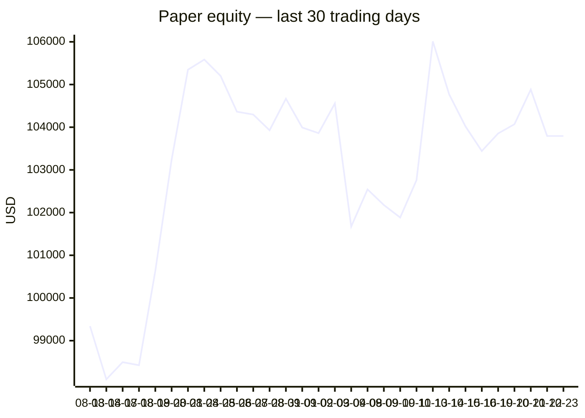
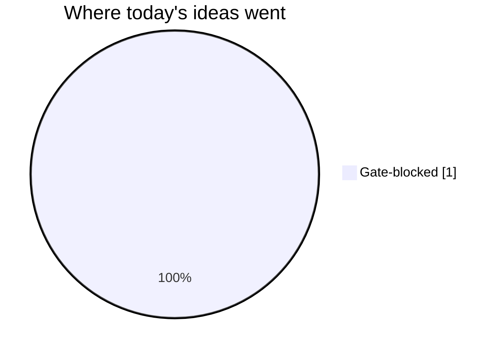

# Trading day 2026-10-23

Paper equity **$103,794** · day +0.00% · regime choppy · config v4-seeded · VIX 19.03 (up)

## Charts

```mermaid
xychart-beta
  title "Today's shadow outcomes (R)"
  x-axis ["HK33_HKD", "XAG_USD", "ABBV", "ABBV", "ABBV", "ABBV", "ABBV", "ABBV", "ABBV", "ABBV", "ABBV", "ABBV", "ABBV", "ABBV", "ABBV", "ABBV", "ABBV", "ABBV", "ABBV", "ABBV", "ABBV", "ABBV", "ABBV", "ABBV", "ABBV", "ABBV", "ABBV", "ABBV", "ABBV", "ABBV", "ABBV", "ABBV", "ABBV", "ABBV", "ABBV", "ABBV", "ABBV", "ABBV", "ABBV", "ABBV", "ABBV", "ABBV", "ABBV", "ABBV", "ABBV", "ABBV", "ABBV", "ABBV", "ABBV", "ABBV", "ABBV", "ABBV", "ABBV", "ABBV", "ABBV", "ABBV", "ABBV", "ABBV", "ABBV", "ABBV", "ABBV", "ABBV", "ABBV", "KO", "KO", "KO", "KO", "KO", "KO", "KO", "KO", "KO", "KO", "KO", "KO", "KO", "KO", "KO", "KO", "KO", "KO", "TSLA", "TSLA", "WMT", "WMT", "WMT", "WMT", "WMT", "WMT", "WMT", "WMT", "WMT", "WMT", "WMT", "WMT", "WMT", "WMT", "WMT", "WMT", "WMT", "WMT", "WMT", "WMT", "WMT", "WMT", "WMT", "WMT", "WMT", "WMT", "WMT", "WMT", "WMT", "WMT", "WMT", "WMT", "WMT", "WMT", "WMT", "WMT", "WMT", "WMT", "WMT", "WMT", "WMT", "WMT", "WMT", "WMT", "WMT", "WMT", "WMT", "WMT", "WMT", "WMT", "WMT", "WMT", "WMT", "WMT", "WMT", "WMT", "WMT", "WMT", "WMT", "WMT", "WMT", "WMT", "WMT", "WMT", "WMT", "WMT", "WMT", "WMT", "WMT", "WMT", "WMT", "WMT", "WMT", "WMT", "WMT", "WMT", "WMT", "WMT", "WMT", "WMT", "WMT", "WMT", "WMT", "WMT", "WMT", "WMT", "WMT", "WMT", "WMT", "WMT", "WMT", "WMT", "WMT", "WMT", "WMT", "WMT", "WMT", "WMT", "WMT", "WMT", "WMT", "WMT", "WMT", "WMT", "WMT", "WMT", "WMT", "WMT", "WMT", "WMT", "WMT", "WMT", "WMT", "WMT", "WMT", "PG", "PG", "PG", "PG", "PG", "MSFT", "PG", "DIS", "PG", "JNJ", "JNJ", "JNJ", "JNJ", "JNJ", "JNJ", "JNJ", "PG", "JNJ", "JNJ", "JNJ", "JNJ", "JNJ", "JNJ", "JNJ", "JNJ", "JNJ", "JNJ", "JNJ", "JNJ", "JNJ", "JNJ", "JNJ", "JNJ", "JNJ", "JNJ", "JNJ", "JNJ", "JNJ", "JNJ", "JNJ", "JNJ", "JNJ", "JNJ", "JNJ", "JNJ", "JNJ", "KO", "KO", "KO", "KO", "PEP", "HD", "PEP", "HD", "PEP", "HD", "PEP", "HD", "PEP", "HD", "PEP", "HD", "PEP", "HD", "PEP", "HD", "PEP", "HD", "PEP", "HD", "PEP", "HD", "HD", "HD", "PEP", "HD", "PEP", "HD", "HD", "HD", "HD", "IBM", "HD", "HD", "HD", "PEP", "TSLA", "TSLA", "TSLA", "TSLA", "WMT", "WMT", "WMT", "WMT", "WMT", "WMT", "WMT", "WMT", "WMT", "WMT", "WMT", "WMT", "WMT", "WMT", "WMT", "WMT", "WMT", "WMT", "WMT", "WMT", "WMT", "WMT", "WMT", "WMT", "WMT", "WMT", "WMT", "WMT", "WMT", "WMT", "WMT", "WMT", "WMT", "WMT", "WMT", "WMT", "WMT", "WMT", "WMT", "WMT", "WMT", "WMT", "WMT", "PG", "PG", "PG", "PG", "JNJ", "JNJ", "JNJ", "UNH", "JNJ", "JNJ", "JNJ", "JNJ", "JNJ", "JNJ", "JNJ", "DIS", "DIS", "JNJ", "JNJ", "JNJ", "JNJ", "JNJ", "JNJ", "JNJ", "JNJ", "JNJ", "JNJ", "JNJ", "JNJ", "JNJ", "JNJ", "JNJ", "JNJ", "JNJ", "JNJ", "JNJ", "JNJ", "JNJ", "JNJ", "JNJ", "JNJ", "JNJ", "JNJ", "KO", "HD", "HD", "HD", "HD", "HD", "HD", "HD", "HD", "HD", "KO", "KO", "HD", "HD", "HD", "HD", "HD", "IBM", "IBM", "IBM", "IBM", "IBM", "IBM", "TSLA", "TSLA", "TSLA", "TSLA", "HLT", "HLT", "HLT", "HLT", "DIS", "DIS", "DIS", "DIS", "DIS", "UNH", "UNH", "UNH", "UNH", "UNH", "KO", "KO", "KO", "KO", "KO", "PEP", "KO", "KO", "KO", "KO", "KO", "KO", "KO", "HLT", "HLT", "HLT", "HLT", "AMZN", "MSFT", "UNH", "UNH", "UNH", "UNH", "UNH", "UNH", "UNH", "UNH", "UNH", "UNH", "PEP", "PEP", "PEP", "PEP", "PEP", "PEP", "PEP", "PEP", "PEP", "PEP", "PEP", "PEP", "PEP", "PEP", "HLT", "UNH", "UNH", "PEP", "PEP", "NOW", "PEP", "PEP", "PEP", "PEP", "HD", "HD", "HD", "HD", "HD", "HD", "HD", "HD", "HD", "HD", "HD", "KO", "COST", "PEP", "PEP", "PEP", "PEP", "PEP", "PEP", "PEP", "PEP", "PEP", "PEP", "KO", "KO", "KO", "COST", "COST", "COST", "COST", "COST", "COST", "COST", "COST", "COST", "HD", "HD", "HD", "PG", "UNH", "JNJ", "JNJ", "JNJ", "JNJ", "HD", "HD", "HD", "PEP", "PEP", "PEP", "PEP", "PEP", "PEP", "PEP", "PEP", "PEP", "PEP", "PEP", "PEP", "PEP", "KO", "KO", "KO", "IBM", "COST", "COST", "COST", "COST", "COST", "COST", "COST", "COST", "JPM", "HD", "COST", "PEP", "IBM", "NVDA", "ANET", "WMT", "COST", "NOW", "WMT", "WMT", "WMT", "COST", "NOW", "WMT", "COST", "WM", "WMT", "COST", "WMT", "WM", "WMT", "WM", "WMT", "WM", "WM", "IBM", "IBM", "IBM", "COST", "COST", "COST", "COST", "WMT", "JPM", "WAT", "JPM", "PG", "PEP", "HD", "HD", "HD", "HD", "HD", "HD", "HD", "HD", "PEP", "PEP", "PEP", "PEP", "PEP", "PEP", "PEP", "PEP", "PEP", "PEP", "PEP", "HD", "HD", "HD", "HD", "PEP", "KO", "KO", "KR", "PG", "KO", "KR", "KR", "KR", "PG", "PEP", "PEP", "PEP", "PEP", "KO", "KO", "KO", "KO", "KO", "KO", "KO", "TSLA", "TSLA", "TSLA", "TSLA", "TSLA", "DIS", "MAR", "MAR", "MAR", "WAT", "WAT", "MAR", "WAT", "MAR", "MAR", "MAR", "TSLA", "KO", "PG", "KO", "KO", "KO", "KO", "JNJ", "KO", "KO", "KO", "KO", "KO", "KO", "KO", "KO", "KO", "KO", "KO", "KO", "JNJ", "JNJ", "JNJ", "JNJ", "JNJ", "JNJ", "KO", "PG", "KO", "KO", "KO", "KO", "PEP", "PEP", "PEP", "PEP", "PEP", "KDP", "KDP", "KDP", "KDP", "KDP", "KDP", "KDP", "KDP", "PEP", "PEP", "HD", "PEP", "PEP", "PEP", "PEP", "KDP", "UNH", "JNJ", "JNJ", "JNJ", "KDP", "KDP", "KDP", "KDP", "KDP", "KDP", "COST", "COST", "COST", "COST", "COST", "COST", "WMT", "WMT", "MAR", "GOOGL", "META", "MAR", "WMT", "WMT", "MAR", "KO", "WMT", "MAR", "NOW", "IBM", "PEP", "PEP", "HD", "HD", "HD", "HD", "HD", "HD", "KDP", "HD", "KDP", "COST", "COST", "COST", "COST", "COST", "COST", "COST", "COST", "COST", "COST", "COST", "COST", "COST", "COST", "COST", "COST", "COST", "COST", "COST", "COST", "COST", "WMT", "WMT", "WMT", "WMT", "WMT", "WMT", "WMT", "BAC", "KO", "WMT", "KO", "KO", "KO", "KDP", "HD", "KDP", "KDP", "KDP", "KDP", "KDP", "KDP", "KDP", "HD", "WMT", "WMT", "IBM", "IBM", "PEP", "PEP", "HD", "HD", "HD", "WMT", "WMT", "AAPL", "NOW", "KO", "KO", "KO", "KO", "KO", "KO", "KO", "KO", "KO", "HD", "KDP", "KDP", "KDP", "WMT", "WMT", "WMT", "WMT", "WMT", "WMT", "WMT", "WMT", "WMT", "WMT", "KR", "HD", "WMT", "WMT", "WMT", "KDP", "COST", "COST", "COST", "COST", "COST", "COST", "KR", "KR", "KR", "PEP", "KDP", "KDP", "PEP", "PEP", "PEP", "KR", "MSFT", "HLT", "HLT", "HLT", "HLT", "HLT", "HLT", "KR", "KR", "KR", "KR", "HLT", "HD", "HD", "HD", "HLT", "DIS", "DIS", "CSX", "PG", "CSX", "CSX", "PG", "CSX", "HD", "HD", "CSX", "PG", "PG", "PG", "PEP", "PEP", "PEP", "PEP", "HD", "WMT", "WMT", "WMT", "WMT", "WMT", "PG", "CSX", "PG", "PG", "HD", "CSX", "PEP", "PEP", "KDP", "DIS", "DIS", "DIS", "HD", "HD", "DIS", "WMT", "WMT", "NFLX", "CSX", "DIS", "DIS", "WMT", "CSX", "KR", "KR", "HD", "HD", "HD", "HD", "HD", "DIS", "COST", "WMT", "WMT", "COST", "COST", "COST", "COST", "COST", "COST", "COST", "COST", "COST", "COST", "COST", "COST", "COST", "COST", "COST", "COST", "NFLX", "NFLX", "WMT", "KR", "SPOT", "NFLX", "NFLX", "NFLX", "WMT", "WMT", "WMT", "WMT", "WMT", "WMT", "PG", "PG", "PG", "PG", "PG", "NFLX", "NFLX", "NFLX", "NFLX", "NFLX", "WM", "WM", "WM", "WM", "WM", "PG", "TSLA", "TSLA", "KDP", "KDP", "KDP", "KDP", "KDP", "KDP", "KDP", "CSX", "NFLX", "NOW", "NOW", "NOW", "CSX", "CSX", "CSX", "CSX", "CSX", "CSX", "CSX", "SPGI", "SPGI", "SPGI", "SPGI", "SPGI", "UNH", "CSX", "DIS", "DIS", "DIS", "XAU_USD", "XAG_USD", "CSX", "CSX", "CSX", "TSLA", "TSLA", "TSLA", "TSLA", "UNH", "DIS", "UNH", "CSX", "SPGI", "SPGI", "SPGI", "SPGI", "ABBV", "DIS", "DIS", "HLT", "ABBV", "SPGI", "SPGI", "SPGI", "UNH", "TSLA", "CSX", "CSX", "DIS", "DIS", "SPGI", "TSLA", "HLT", "SPGI", "NOW", "V", "V", "V", "V", "SPGI", "JPM", "UNH", "SPGI", "UNH", "UNH", "UNH", "UNH", "NOW", "PEP", "PEP", "PG", "KDP", "AMZN", "PG", "PEP", "PEP", "COST", "COST", "COST", "PEP", "PEP", "PG", "PEP", "PEP", "PEP", "WM", "WM", "WM", "NOW", "KO", "PEP", "NOW", "PEP", "PEP", "PEP", "PEP", "KO", "PEP", "COST", "WMT", "WMT", "PG", "PG", "PG", "NFLX", "COST", "NFLX", "XOM", "XOM", "XOM", "XOM", "XOM", "XOM", "AVGO", "AVGO", "UNH", "UNH", "UNH", "UNH", "UNH", "UNH", "AVGO", "WMT", "WMT", "WMT", "WMT", "WMT", "WMT", "WMT", "WMT", "WMT", "WMT", "UNH", "UNH", "UNH", "UNH", "UNH", "WMT", "WMT", "WMT", "WMT", "UNH", "UNH", "UNH", "UNH", "UNH", "UNH", "UNH", "UNH", "UNH", "XOM", "UNH", "UNH", "UNH", "UNH", "UNH", "PEP", "PEP", "PEP", "PEP", "PEP", "CSX", "CSX", "CSX", "CSX", "CSX", "CSX", "CSX", "CSX", "CSX", "PEP", "PEP", "PEP", "PEP", "PG", "CSX", "PEP", "PEP", "PEP", "CSX", "CSX", "COST", "COST", "COST", "COST", "COST", "HD", "WM", "WM", "WM", "WM", "WM", "AVGO", "AVGO", "AVGO", "AVGO", "PEP", "PEP", "PEP", "AVGO", "AVGO", "PEP", "AVGO", "AVGO", "PEP", "PEP", "PEP", "PEP", "PEP", "PEP", "PEP", "PEP", "PEP", "PEP", "PEP", "PEP", "PEP", "PEP", "PEP", "PEP", "PEP", "KO", "BRK.B", "BRK.B", "BRK.B", "BRK.B", "BRK.B", "BRK.B", "BRK.B", "BRK.B", "BRK.B", "BRK.B", "NFLX", "AVGO", "AVGO", "AVGO", "AVGO", "WMT", "WMT", "WMT", "WMT", "WMT", "WMT", "WMT", "WMT", "WMT", "WMT", "WMT", "WMT", "KR", "KR", "KR", "KR", "HLT", "KR", "KR", "KR", "KR", "KR", "KR", "KR", "KR", "KR", "KR", "KR", "KR", "KR", "KR", "KR", "KR", "KR", "KR", "KR", "KR", "KR"]
  bar [-1, -1, 2, 2, 2, 2, 2, 2, 2, 2, 2, 2, 2, 2, 2, 2, 2, 2, 2, 2, 2, 2, 2, 2, 2, 2, 2, 2, 2, 2, 2, 2, 2, 2, 2, 2, 2, 2, 2, 2, 2, 2, 2, 2, 2, 2, 2, 2, 2, 2, 2, 2, 2, 2, 2, 2, 2, 2, 2, 2, 2, 2, -1, -1, -1, -1, -1, -1, -1, -1, -1, -1, -1, -1, -1, -1, -1, -1, -1, -1, -1, -1, -1, -1, -1, -1, -1, -1, -1, -1, -1, -1, -1, -1, -1, -1, -1, -1, -1, -1, -1, -1, -1, -1, -1, -1, -1, -1, -1, -1, -1, -1, -1, -1, -1, -1, -1, -1, -1, -1, -1, -1, -1, -1, -1, -1, -1, -1, -1, -1, -1, -1, -1, -1, -1, -1, -1, -1, -1, -1, -1, -1, -1, -1, -1, -1, -1, -1, -1, -1, -1, -1, -1, -1, -1, -1, -1, -1, -1, -1, -1, -1, -1, -1, -1, -1, -1, -1, -1, -1, -1, -1, -1, -1, -1, -1, -1, -1, -1, -1, -1, -1, -1, -1, -1, -1, -1, -1, -1, -1, -1, -1, -1, -1, -1, -1, -1, -1, -1, -1, -1, -1, -1, 2, -1, -1, -1, -1, -1, -1, -1, -1, -1, -1, -1, -1, -1, -1, -1, -1, -1, -1, -1, -1, -1, -1, -1, -1, -1, -1, -1, -1, -1, -1, -1, -1, -1, -1, -1, -1, -1, -1, -1, -1, -1, -1, -1, -1, -1, -1, -1, -1, -1, -1, -1, -1, -1, -1, -1, -1, -1, -1, -1, -1, -1, -1, -1, -1, -1, -1, -1, -1, -1, -1, -1, -1, -1, -1, -1, -1, -1, -1, -1, -1, -1, -1, -1, -1, -1, -1, -1, -1, -1, -1, -1, -1, -1, -1, -1, -1, -1, -1, -1, -1, -1, -1, -1, -1, -1, -1, -1, -1, -1, -1, -1, -1, -1, -1, -1, -1, -1, -1, -1, -1, -1, -1, -1, -1, -1, -1, -1, -1, -1, -1, -1, -1, -1, -1, -1, -1, -1, -1, -1, -1, -1, -1, -1, -1, -1, -1, -1, -1, -1, -1, -1, -1, -1, -1, -1, -1, -1, -1, -1, -1, -1, -1, -1, -1, -1, -1, -1, -1, -1, -1, -1, -1, -1, -1, -1, -1, -1, -1, -1, -1, -1, -1, -1, -1, -1, -1, -1, -1, -1, -1, -1, -1, -1, -1, -1, -1, -1, 2, 2, 2, 2, -1, -1, -1, -1, -1, -1, -1, -1, -1, -1, -1, -1, -1, -1, -1, -1, -1, -1, -1, -1, -1, -1, -1, -1, -1, -1, -1, 2, -1, -1, -1, -1, -1, -1, -1, -1, -1, -1, -1, -1, -1, -1, -1, -1, -1, -1, -1, -1, -1, -1, -1, -1, -1, -1, -1, -1, -1, -1, -1, -1, -1, -1, -1, -1, -1, -1, -1, -1, -1, -1, -1, -1, -1, -1, -1, -1, -1, -1, -1, -1, -1, -1, -1, -1, -1, -1, -1, -1, -1, -1, -1, -1, -1, -1, -1, -1, -1, -1, -1, -1, -1, -1, -1, -1, -1, -1, -1, -1, -1, -1, -1, -1, -1, -1, -1, -1, -1, -1, -1, -1, -1, -1, -1, -1, -1, -1, -1, -1, -1, -1, -1, -1, -1, -1, -1, -1, -1, -1, -1, -1, -1, -1, -1, -1, -1, -1, -1, -1, -1, -1, -1, -1, -1, -1, -1, -1, -1, -1, -1, -1, -1, -1, -1, -1, -1, -1, -1, -1, -1, -1, -1, -1, -1, -1, -1, -1, -1, -1, -1, -1, -1, -1, -1, -1, -1, -1, -1, -1, -1, -1, -1, -1, -1, -1, -1, -1, -1, -1, -1, -1, -1, -1, -1, -1, -1, -1, -1, -1, -1, -1, -1, -1, -1, -1, -1, -1, -1, -1, -1, -1, -1, -1, -1, -1, -1, -1, -1, -1, -1, -1, -1, -1, -1, -1, -1, -1, -1, -1, -1, -1, -1, -1, -1, -1, -1, -1, -1, -1, -1, -1, -1, -1, -1, -1, -1, -1, -1, -1, -1, -1, -1, -1, -1, -1, -1, -1, -1, -1, -1, -1, -1, -1, -1, -1, -1, -1, -1, -1, -1, -1, -1, -1, -1, -1, -1, -1, -1, -1, -1, -1, -1, -1, -1, -1, -1, -1, -1, -1, -1, -1, -1, -1, -1, -1, -1, -1, -1, -1, -1, -1, -1, -1, -1, 2, -1, -1, -1, -1, -1, -1, -1, -1, -1, -1, -1, -1, -1, -1, -1, -1, -1, -1, -1, -1, -1, -1, -1, -1, -1, -1, -1, -1, -1, -1, -1, -1, -1, -1, -1, -1, -1, -1, -1, -1, -1, -1, -1, -1, 2, -1, 2, 2, 2, -1, -1, -1, -1, -1, -1, -1, -1, -1, -1, -1, -1, -1, -1, -1, -1, -1, -1, -1, -1, -1, -1, -1, 2, 2, 2, 2, 2, 2, 2, 2, 2, -1, -1, -1, -1, -1, -1, -1, -1, -1, -1, -1, -1, -1, -1, -1, -1, -1, -1, -1, -1, -1, -1, -1, -1, -1, -1, -1, -1, -1, -1, -1, -1, -1, -1, -1, -1, -1, -1, -1, -1, -1, -1, 2, -1, -1, -1, -1, -1, -1, -1, -1, 2, -1, -1, 2, 2, 2, 2, 2, 2, -1, -1, 2, 2, 2, 2, -1, -1, -1, -1, -1, -1, -1, -1, -1, -1, 2, 2, 2, 2, 2, 2, 2, 2, -1, -1, -1, -1, -1, -1, -1, -1, -1, -1, 2, -1, -1, -1, 2, -1, -1, -1, -1, -1, 2, 2, -1, -1, -1, -1, -1, -1, -1, -1, -1, -1, -1, -1, -1, -1, -1, -1, -1, -1, -1, -1, -1, -1, -1, -1, -1, -1, -1, -1, -1, -1, -1, -1, -1, -1, 2, 2, 2, 2, 2, -1, -1, -1, -1, -1, -1, -1, -1, -1, -1, 2, -1, -1, -1, -1, -1, -1, -1, -1, -1, -1, -1, -1, -1, -1, -1, -1, -1, -1, -1, -1, -1, -1, -1, -1, -1, -1, -1, -1, -1, -1, -1, 2, 2, -1, -1, -1, -1, -1, -1, -1, -1, -1, -1, -1, -1, -1, -1, -1, -1, -1, -1, -1, -1, -1, -1, -1, -1, -1, -1, -1, -1, -1, -1, -1, -1, -1, -1, -1, -1, -1, -1, -1, -1, -1, -1, -1, -1, -1, -1, -1, 2, 2, 2, -1, -1, 2, 2, 2, -1, -1, -1, 2, 2, 2, 2, 2, 2, -1, -1, -1, -1, 2, -1, -1, 2, 2, 2, 2, 2, 2, -1, -1, -1, 2, 2, 2, -1, -1, -1, -1, -1, -1, -1, -1, -1, -1, -1, -1, -1, -1, -1, -1, -1, -1, -1, -1, -1, -1, -1, -1, -1, -1, -1, -1, -1, -1, -1, -1, -1, -1, -1, -1, -1, -1, -1, -1, -1, -1, 2, -1, 2, 2, -1, -1, 2, -1, 2, 2, -1, -1, -1, -1, -1, -1, -1, -1, -1, -1, -1, -1, -1, -1, -1, -1, -1, -1, -1, -1, -1, -1, -1, -1, -1, -1, -1, -1, -1, -1, -1, -1, -1, -1, -1, -1, -1, -1, -1, -1, -1, -1, -1, -1, -1, -1, -1, -1, -1, -1, -1, -1, -1, -1, -1, -1, -1, -1, -1, -1, -1, -1, -1, -1, -1, 2, -1, -1, -1, -1, -1, -1, -1, -1, -1, -1, -1, -1, -1, -1, -1, -1, -1, -1, -1, -1, -1, -1, -1, -1, -1, -1, -1, -1, -1, -1, -1, 2, -1, -1, -1, -1, -1, -1, -1, -1, -1, -1, -1, -1, -1, -1, -1, -1, -1, -1, -1, -1, -1]
```

## Activity

- Theses formed: 0 (approved→orders: 0, human-rejected: 0, expired unapproved: 0)
- Risk gate blocked: 1
- Fills at the broker: 0

## Shadow ledger (what would have happened)

- HK33_HKD (cfd-momentum-breakdown, incubation) → **stopped** -1R
- XAG_USD (cfd-momentum-breakdown, incubation) → **stopped** -1R
- ABBV (momentum-breakdown:filtered, filter-blocked) → **target** +2R
- ABBV (momentum-breakdown:filtered, filter-blocked) → **target** +2R
- ABBV (momentum-breakdown:filtered, filter-blocked) → **target** +2R
- ABBV (momentum-breakdown:filtered, filter-blocked) → **target** +2R
- ABBV (momentum-breakdown:filtered, filter-blocked) → **target** +2R
- ABBV (momentum-breakdown:filtered, filter-blocked) → **target** +2R
- ABBV (momentum-breakdown:filtered, filter-blocked) → **target** +2R
- ABBV (momentum-breakdown:filtered, filter-blocked) → **target** +2R
- ABBV (momentum-breakdown:filtered, filter-blocked) → **target** +2R
- ABBV (momentum-breakdown:filtered, filter-blocked) → **target** +2R
- ABBV (momentum-breakdown:filtered, filter-blocked) → **target** +2R
- ABBV (momentum-breakdown:filtered, filter-blocked) → **target** +2R
- ABBV (momentum-breakdown:filtered, filter-blocked) → **target** +2R
- ABBV (momentum-breakdown:filtered, filter-blocked) → **target** +2R
- ABBV (momentum-breakdown:filtered, filter-blocked) → **target** +2R
- ABBV (momentum-breakdown:filtered, filter-blocked) → **target** +2R
- ABBV (momentum-breakdown:filtered, filter-blocked) → **target** +2R
- ABBV (momentum-breakdown:filtered, filter-blocked) → **target** +2R
- ABBV (momentum-breakdown:filtered, filter-blocked) → **target** +2R
- ABBV (momentum-breakdown:filtered, filter-blocked) → **target** +2R
- ABBV (momentum-breakdown:filtered, filter-blocked) → **target** +2R
- ABBV (momentum-breakdown:filtered, filter-blocked) → **target** +2R
- ABBV (momentum-breakdown:filtered, filter-blocked) → **target** +2R
- ABBV (momentum-breakdown:filtered, filter-blocked) → **target** +2R
- ABBV (momentum-breakdown:filtered, filter-blocked) → **target** +2R
- ABBV (momentum-breakdown:filtered, filter-blocked) → **target** +2R
- ABBV (momentum-breakdown:filtered, filter-blocked) → **target** +2R
- ABBV (momentum-breakdown:filtered, filter-blocked) → **target** +2R
- ABBV (momentum-breakdown:filtered, filter-blocked) → **target** +2R
- ABBV (momentum-breakdown:filtered, filter-blocked) → **target** +2R
- ABBV (momentum-breakdown:filtered, filter-blocked) → **target** +2R
- ABBV (momentum-breakdown:filtered, filter-blocked) → **target** +2R
- ABBV (momentum-breakdown:filtered, filter-blocked) → **target** +2R
- ABBV (momentum-breakdown:filtered, filter-blocked) → **target** +2R
- ABBV (momentum-breakdown:filtered, filter-blocked) → **target** +2R
- ABBV (momentum-breakdown:filtered, filter-blocked) → **target** +2R
- ABBV (momentum-breakdown:filtered, filter-blocked) → **target** +2R
- ABBV (momentum-breakdown:filtered, filter-blocked) → **target** +2R
- ABBV (momentum-breakdown:filtered, filter-blocked) → **target** +2R
- ABBV (momentum-breakdown:filtered, filter-blocked) → **target** +2R
- ABBV (momentum-breakdown:filtered, filter-blocked) → **target** +2R
- ABBV (momentum-breakdown:filtered, filter-blocked) → **target** +2R
- ABBV (momentum-breakdown:filtered, filter-blocked) → **target** +2R
- ABBV (momentum-breakdown:filtered, filter-blocked) → **target** +2R
- ABBV (momentum-breakdown:filtered, filter-blocked) → **target** +2R
- ABBV (momentum-breakdown:filtered, filter-blocked) → **target** +2R
- ABBV (momentum-breakdown:filtered, filter-blocked) → **target** +2R
- ABBV (momentum-breakdown:filtered, filter-blocked) → **target** +2R
- ABBV (momentum-breakdown:filtered, filter-blocked) → **target** +2R
- ABBV (momentum-breakdown:filtered, filter-blocked) → **target** +2R
- ABBV (momentum-breakdown:filtered, filter-blocked) → **target** +2R
- ABBV (momentum-breakdown:filtered, filter-blocked) → **target** +2R
- ABBV (momentum-breakdown:filtered, filter-blocked) → **target** +2R
- ABBV (momentum-breakdown:filtered, filter-blocked) → **target** +2R
- ABBV (momentum-breakdown:filtered, filter-blocked) → **target** +2R
- ABBV (momentum-breakdown:filtered, filter-blocked) → **target** +2R
- ABBV (momentum-breakdown:filtered, filter-blocked) → **target** +2R
- ABBV (momentum-breakdown:filtered, filter-blocked) → **target** +2R
- ABBV (momentum-breakdown:filtered, filter-blocked) → **target** +2R
- ABBV (momentum-breakdown:filtered, filter-blocked) → **target** +2R
- ABBV (momentum-breakdown:filtered, filter-blocked) → **stopped** -1R
- KO (momentum-breakout:filtered, filter-blocked) → **stopped** -1R
- KO (momentum-breakout:filtered, filter-blocked) → **stopped** -1R
- KO (momentum-breakout:filtered, filter-blocked) → **stopped** -1R
- KO (momentum-breakout:filtered, filter-blocked) → **stopped** -1R
- KO (momentum-breakout:filtered, filter-blocked) → **stopped** -1R
- KO (momentum-breakout:filtered, filter-blocked) → **stopped** -1R
- KO (momentum-breakout:filtered, filter-blocked) → **stopped** -1R
- KO (momentum-breakout:filtered, filter-blocked) → **stopped** -1R
- KO (momentum-breakout:filtered, filter-blocked) → **stopped** -1R
- KO (momentum-breakout:filtered, filter-blocked) → **stopped** -1R
- KO (momentum-breakout:filtered, filter-blocked) → **stopped** -1R
- KO (momentum-breakout:filtered, filter-blocked) → **stopped** -1R
- KO (momentum-breakout:filtered, filter-blocked) → **stopped** -1R
- KO (momentum-breakout:filtered, filter-blocked) → **stopped** -1R
- KO (momentum-breakout:filtered, filter-blocked) → **stopped** -1R
- KO (momentum-breakout:filtered, filter-blocked) → **stopped** -1R
- KO (momentum-breakout:filtered, filter-blocked) → **stopped** -1R
- KO (momentum-breakout:filtered, filter-blocked) → **stopped** -1R
- TSLA (momentum-breakout:filtered, filter-blocked) → **stopped** -1R
- TSLA (momentum-breakout:filtered, filter-blocked) → **stopped** -1R
- WMT (mean-reversion-short:filtered, filter-blocked) → **stopped** -1R
- WMT (mean-reversion-short:filtered, filter-blocked) → **stopped** -1R
- WMT (mean-reversion-short:filtered, filter-blocked) → **stopped** -1R
- WMT (mean-reversion-short:filtered, filter-blocked) → **stopped** -1R
- WMT (mean-reversion-short:filtered, filter-blocked) → **stopped** -1R
- WMT (mean-reversion-short:filtered, filter-blocked) → **stopped** -1R
- WMT (mean-reversion-short:filtered, filter-blocked) → **stopped** -1R
- WMT (mean-reversion-short:filtered, filter-blocked) → **stopped** -1R
- WMT (mean-reversion-short:filtered, filter-blocked) → **stopped** -1R
- WMT (mean-reversion-short:filtered, filter-blocked) → **stopped** -1R
- WMT (mean-reversion-short:filtered, filter-blocked) → **stopped** -1R
- WMT (mean-reversion-short:filtered, filter-blocked) → **stopped** -1R
- WMT (mean-reversion-short:filtered, filter-blocked) → **stopped** -1R
- WMT (mean-reversion-short:filtered, filter-blocked) → **stopped** -1R
- WMT (mean-reversion-short:filtered, filter-blocked) → **stopped** -1R
- WMT (mean-reversion-short:filtered, filter-blocked) → **stopped** -1R
- WMT (mean-reversion-short:filtered, filter-blocked) → **stopped** -1R
- WMT (mean-reversion-short:filtered, filter-blocked) → **stopped** -1R
- WMT (mean-reversion-short:filtered, filter-blocked) → **stopped** -1R
- WMT (mean-reversion-short:filtered, filter-blocked) → **stopped** -1R
- WMT (mean-reversion-short:filtered, filter-blocked) → **stopped** -1R
- WMT (mean-reversion-short:filtered, filter-blocked) → **stopped** -1R
- WMT (mean-reversion-short:filtered, filter-blocked) → **stopped** -1R
- WMT (mean-reversion-short:filtered, filter-blocked) → **stopped** -1R
- WMT (mean-reversion-short:filtered, filter-blocked) → **stopped** -1R
- WMT (mean-reversion-short:filtered, filter-blocked) → **stopped** -1R
- WMT (mean-reversion-short:filtered, filter-blocked) → **stopped** -1R
- WMT (mean-reversion-short:filtered, filter-blocked) → **stopped** -1R
- WMT (mean-reversion-short:filtered, filter-blocked) → **stopped** -1R
- WMT (mean-reversion-short:filtered, filter-blocked) → **stopped** -1R
- WMT (mean-reversion-short:filtered, filter-blocked) → **stopped** -1R
- WMT (mean-reversion-short:filtered, filter-blocked) → **stopped** -1R
- WMT (mean-reversion-short:filtered, filter-blocked) → **stopped** -1R
- WMT (mean-reversion-short:filtered, filter-blocked) → **stopped** -1R
- WMT (mean-reversion-short:filtered, filter-blocked) → **stopped** -1R
- WMT (mean-reversion-short:filtered, filter-blocked) → **stopped** -1R
- WMT (mean-reversion-short:filtered, filter-blocked) → **stopped** -1R
- WMT (mean-reversion-short:filtered, filter-blocked) → **stopped** -1R
- WMT (mean-reversion-short:filtered, filter-blocked) → **stopped** -1R
- WMT (mean-reversion-short:filtered, filter-blocked) → **stopped** -1R
- WMT (mean-reversion-short:filtered, filter-blocked) → **stopped** -1R
- WMT (mean-reversion-short:filtered, filter-blocked) → **stopped** -1R
- WMT (mean-reversion-short:filtered, filter-blocked) → **stopped** -1R
- WMT (mean-reversion-short:filtered, filter-blocked) → **stopped** -1R
- WMT (mean-reversion-short:filtered, filter-blocked) → **stopped** -1R
- WMT (mean-reversion-short:filtered, filter-blocked) → **stopped** -1R
- WMT (mean-reversion-short:filtered, filter-blocked) → **stopped** -1R
- WMT (mean-reversion-short:filtered, filter-blocked) → **stopped** -1R
- WMT (mean-reversion-short:filtered, filter-blocked) → **stopped** -1R
- WMT (mean-reversion-short:filtered, filter-blocked) → **stopped** -1R
- WMT (mean-reversion-short:filtered, filter-blocked) → **stopped** -1R
- WMT (mean-reversion-short:filtered, filter-blocked) → **stopped** -1R
- WMT (mean-reversion-short:filtered, filter-blocked) → **stopped** -1R
- WMT (mean-reversion-short:filtered, filter-blocked) → **stopped** -1R
- WMT (mean-reversion-short:filtered, filter-blocked) → **stopped** -1R
- WMT (mean-reversion-short:filtered, filter-blocked) → **stopped** -1R
- WMT (mean-reversion-short:filtered, filter-blocked) → **stopped** -1R
- WMT (mean-reversion-short:filtered, filter-blocked) → **stopped** -1R
- WMT (mean-reversion-short:filtered, filter-blocked) → **stopped** -1R
- WMT (mean-reversion-short:filtered, filter-blocked) → **stopped** -1R
- WMT (mean-reversion-short:filtered, filter-blocked) → **stopped** -1R
- WMT (mean-reversion-short:filtered, filter-blocked) → **stopped** -1R
- WMT (mean-reversion-short:filtered, filter-blocked) → **stopped** -1R
- WMT (mean-reversion-short:filtered, filter-blocked) → **stopped** -1R
- WMT (mean-reversion-short:filtered, filter-blocked) → **stopped** -1R
- WMT (mean-reversion-short:filtered, filter-blocked) → **stopped** -1R
- WMT (mean-reversion-short:filtered, filter-blocked) → **stopped** -1R
- WMT (mean-reversion-short:filtered, filter-blocked) → **stopped** -1R
- WMT (mean-reversion-short:filtered, filter-blocked) → **stopped** -1R
- WMT (mean-reversion-short:filtered, filter-blocked) → **stopped** -1R
- WMT (mean-reversion-short:filtered, filter-blocked) → **stopped** -1R
- WMT (mean-reversion-short:filtered, filter-blocked) → **stopped** -1R
- WMT (mean-reversion-short:filtered, filter-blocked) → **stopped** -1R
- WMT (mean-reversion-short:filtered, filter-blocked) → **stopped** -1R
- WMT (mean-reversion-short:filtered, filter-blocked) → **stopped** -1R
- WMT (mean-reversion-short:filtered, filter-blocked) → **stopped** -1R
- WMT (mean-reversion-short:filtered, filter-blocked) → **stopped** -1R
- WMT (mean-reversion-short:filtered, filter-blocked) → **stopped** -1R
- WMT (mean-reversion-short:filtered, filter-blocked) → **stopped** -1R
- WMT (mean-reversion-short:filtered, filter-blocked) → **stopped** -1R
- WMT (mean-reversion-short:filtered, filter-blocked) → **stopped** -1R
- WMT (mean-reversion-short:filtered, filter-blocked) → **stopped** -1R
- WMT (mean-reversion-short:filtered, filter-blocked) → **stopped** -1R
- WMT (mean-reversion-short:filtered, filter-blocked) → **stopped** -1R
- WMT (mean-reversion-short:filtered, filter-blocked) → **stopped** -1R
- WMT (mean-reversion-short:filtered, filter-blocked) → **stopped** -1R
- WMT (mean-reversion-short:filtered, filter-blocked) → **stopped** -1R
- WMT (mean-reversion-short:filtered, filter-blocked) → **stopped** -1R
- WMT (mean-reversion-short:filtered, filter-blocked) → **stopped** -1R
- WMT (mean-reversion-short:filtered, filter-blocked) → **stopped** -1R
- WMT (mean-reversion-short:filtered, filter-blocked) → **stopped** -1R
- WMT (mean-reversion-short:filtered, filter-blocked) → **stopped** -1R
- WMT (mean-reversion-short:filtered, filter-blocked) → **stopped** -1R
- WMT (mean-reversion-short:filtered, filter-blocked) → **stopped** -1R
- WMT (mean-reversion-short:filtered, filter-blocked) → **stopped** -1R
- WMT (mean-reversion-short:filtered, filter-blocked) → **stopped** -1R
- WMT (mean-reversion-short:filtered, filter-blocked) → **stopped** -1R
- WMT (mean-reversion-short:filtered, filter-blocked) → **stopped** -1R
- WMT (mean-reversion-short:filtered, filter-blocked) → **stopped** -1R
- WMT (mean-reversion-short:filtered, filter-blocked) → **stopped** -1R
- WMT (mean-reversion-short:filtered, filter-blocked) → **stopped** -1R
- WMT (mean-reversion-short:filtered, filter-blocked) → **stopped** -1R
- WMT (mean-reversion-short:filtered, filter-blocked) → **stopped** -1R
- WMT (mean-reversion-short:filtered, filter-blocked) → **stopped** -1R
- WMT (mean-reversion-short:filtered, filter-blocked) → **stopped** -1R
- WMT (mean-reversion-short:filtered, filter-blocked) → **stopped** -1R
- WMT (mean-reversion-short:filtered, filter-blocked) → **stopped** -1R
- WMT (mean-reversion-short:filtered, filter-blocked) → **stopped** -1R
- WMT (mean-reversion-short:filtered, filter-blocked) → **stopped** -1R
- WMT (mean-reversion-short:filtered, filter-blocked) → **stopped** -1R
- WMT (mean-reversion-short:filtered, filter-blocked) → **stopped** -1R
- WMT (mean-reversion-short:filtered, filter-blocked) → **stopped** -1R
- WMT (mean-reversion-short:filtered, filter-blocked) → **stopped** -1R
- WMT (mean-reversion-short:filtered, filter-blocked) → **stopped** -1R
- WMT (mean-reversion-short:filtered, filter-blocked) → **stopped** -1R
- PG (momentum-breakout:filtered, filter-blocked) → **stopped** -1R
- PG (momentum-breakout:filtered, filter-blocked) → **stopped** -1R
- PG (momentum-breakout:filtered, filter-blocked) → **stopped** -1R
- PG (momentum-breakout:filtered, filter-blocked) → **stopped** -1R
- PG (momentum-breakout:filtered, filter-blocked) → **stopped** -1R
- MSFT (momentum-breakdown, incubation) → **target** +2R
- PG (momentum-breakout:filtered, filter-blocked) → **stopped** -1R
- DIS (momentum-breakout:filtered, filter-blocked) → **stopped** -1R
- PG (momentum-breakout:filtered, filter-blocked) → **stopped** -1R
- JNJ (momentum-breakout:filtered, filter-blocked) → **stopped** -1R
- JNJ (momentum-breakout:filtered, filter-blocked) → **stopped** -1R
- JNJ (momentum-breakout:filtered, filter-blocked) → **stopped** -1R
- JNJ (momentum-breakout:filtered, filter-blocked) → **stopped** -1R
- JNJ (momentum-breakout:filtered, filter-blocked) → **stopped** -1R
- JNJ (momentum-breakout:filtered, filter-blocked) → **stopped** -1R
- JNJ (momentum-breakout:filtered, filter-blocked) → **stopped** -1R
- PG (momentum-breakout:filtered, filter-blocked) → **stopped** -1R
- JNJ (momentum-breakout:filtered, filter-blocked) → **stopped** -1R
- JNJ (momentum-breakout:filtered, filter-blocked) → **stopped** -1R
- JNJ (momentum-breakout:filtered, filter-blocked) → **stopped** -1R
- JNJ (momentum-breakout:filtered, filter-blocked) → **stopped** -1R
- JNJ (momentum-breakout:filtered, filter-blocked) → **stopped** -1R
- JNJ (momentum-breakout:filtered, filter-blocked) → **stopped** -1R
- JNJ (momentum-breakout:filtered, filter-blocked) → **stopped** -1R
- JNJ (momentum-breakout:filtered, filter-blocked) → **stopped** -1R
- JNJ (momentum-breakout:filtered, filter-blocked) → **stopped** -1R
- JNJ (momentum-breakout:filtered, filter-blocked) → **stopped** -1R
- JNJ (momentum-breakout:filtered, filter-blocked) → **stopped** -1R
- JNJ (momentum-breakout:filtered, filter-blocked) → **stopped** -1R
- JNJ (momentum-breakout:filtered, filter-blocked) → **stopped** -1R
- JNJ (momentum-breakout:filtered, filter-blocked) → **stopped** -1R
- JNJ (momentum-breakout:filtered, filter-blocked) → **stopped** -1R
- JNJ (momentum-breakout:filtered, filter-blocked) → **stopped** -1R
- JNJ (momentum-breakout:filtered, filter-blocked) → **stopped** -1R
- JNJ (momentum-breakout:filtered, filter-blocked) → **stopped** -1R
- JNJ (momentum-breakout:filtered, filter-blocked) → **stopped** -1R
- JNJ (momentum-breakout:filtered, filter-blocked) → **stopped** -1R
- JNJ (momentum-breakout:filtered, filter-blocked) → **stopped** -1R
- JNJ (momentum-breakout:filtered, filter-blocked) → **stopped** -1R
- JNJ (momentum-breakout:filtered, filter-blocked) → **stopped** -1R
- JNJ (momentum-breakout:filtered, filter-blocked) → **stopped** -1R
- JNJ (momentum-breakout:filtered, filter-blocked) → **stopped** -1R
- JNJ (momentum-breakout:filtered, filter-blocked) → **stopped** -1R
- JNJ (momentum-breakout:filtered, filter-blocked) → **stopped** -1R
- JNJ (momentum-breakout:filtered, filter-blocked) → **stopped** -1R
- JNJ (momentum-breakout:filtered, filter-blocked) → **stopped** -1R
- KO (momentum-breakout:filtered, filter-blocked) → **stopped** -1R
- KO (momentum-breakout:filtered, filter-blocked) → **stopped** -1R
- KO (momentum-breakout:filtered, filter-blocked) → **stopped** -1R
- KO (momentum-breakout:filtered, filter-blocked) → **stopped** -1R
- PEP (momentum-breakout:filtered, filter-blocked) → **stopped** -1R
- HD (momentum-breakout:filtered, filter-blocked) → **stopped** -1R
- PEP (momentum-breakout:filtered, filter-blocked) → **stopped** -1R
- HD (momentum-breakout:filtered, filter-blocked) → **stopped** -1R
- PEP (momentum-breakout:filtered, filter-blocked) → **stopped** -1R
- HD (momentum-breakout:filtered, filter-blocked) → **stopped** -1R
- PEP (momentum-breakout:filtered, filter-blocked) → **stopped** -1R
- HD (momentum-breakout:filtered, filter-blocked) → **stopped** -1R
- PEP (momentum-breakout:filtered, filter-blocked) → **stopped** -1R
- HD (momentum-breakout:filtered, filter-blocked) → **stopped** -1R
- PEP (momentum-breakout:filtered, filter-blocked) → **stopped** -1R
- HD (momentum-breakout:filtered, filter-blocked) → **stopped** -1R
- PEP (momentum-breakout:filtered, filter-blocked) → **stopped** -1R
- HD (momentum-breakout:filtered, filter-blocked) → **stopped** -1R
- PEP (momentum-breakout:filtered, filter-blocked) → **stopped** -1R
- HD (momentum-breakout:filtered, filter-blocked) → **stopped** -1R
- PEP (momentum-breakout:filtered, filter-blocked) → **stopped** -1R
- HD (momentum-breakout:filtered, filter-blocked) → **stopped** -1R
- PEP (momentum-breakout:filtered, filter-blocked) → **stopped** -1R
- HD (momentum-breakout:filtered, filter-blocked) → **stopped** -1R
- PEP (momentum-breakout:filtered, filter-blocked) → **stopped** -1R
- HD (momentum-breakout:filtered, filter-blocked) → **stopped** -1R
- HD (momentum-breakout:filtered, filter-blocked) → **stopped** -1R
- HD (momentum-breakout:filtered, filter-blocked) → **stopped** -1R
- PEP (momentum-breakout:filtered, filter-blocked) → **stopped** -1R
- HD (momentum-breakout:filtered, filter-blocked) → **stopped** -1R
- PEP (momentum-breakout:filtered, filter-blocked) → **stopped** -1R
- HD (momentum-breakout:filtered, filter-blocked) → **stopped** -1R
- HD (momentum-breakout:filtered, filter-blocked) → **stopped** -1R
- HD (momentum-breakout:filtered, filter-blocked) → **stopped** -1R
- HD (momentum-breakout:filtered, filter-blocked) → **stopped** -1R
- IBM (momentum-breakout:filtered, filter-blocked) → **stopped** -1R
- HD (momentum-breakout:filtered, filter-blocked) → **stopped** -1R
- HD (momentum-breakout:filtered, filter-blocked) → **stopped** -1R
- HD (momentum-breakout:filtered, filter-blocked) → **stopped** -1R
- PEP (momentum-breakout:filtered, filter-blocked) → **stopped** -1R
- TSLA (momentum-breakout:filtered, filter-blocked) → **stopped** -1R
- TSLA (momentum-breakout:filtered, filter-blocked) → **stopped** -1R
- TSLA (momentum-breakout:filtered, filter-blocked) → **stopped** -1R
- TSLA (momentum-breakout:filtered, filter-blocked) → **stopped** -1R
- WMT (mean-reversion-short:filtered, filter-blocked) → **stopped** -1R
- WMT (mean-reversion-short:filtered, filter-blocked) → **stopped** -1R
- WMT (mean-reversion-short:filtered, filter-blocked) → **stopped** -1R
- WMT (mean-reversion-short:filtered, filter-blocked) → **stopped** -1R
- WMT (mean-reversion-short:filtered, filter-blocked) → **stopped** -1R
- WMT (mean-reversion-short:filtered, filter-blocked) → **stopped** -1R
- WMT (mean-reversion-short:filtered, filter-blocked) → **stopped** -1R
- WMT (mean-reversion-short:filtered, filter-blocked) → **stopped** -1R
- WMT (mean-reversion-short:filtered, filter-blocked) → **stopped** -1R
- WMT (mean-reversion-short:filtered, filter-blocked) → **stopped** -1R
- WMT (mean-reversion-short:filtered, filter-blocked) → **stopped** -1R
- WMT (mean-reversion-short:filtered, filter-blocked) → **stopped** -1R
- WMT (mean-reversion-short:filtered, filter-blocked) → **stopped** -1R
- WMT (mean-reversion-short:filtered, filter-blocked) → **stopped** -1R
- WMT (mean-reversion-short:filtered, filter-blocked) → **stopped** -1R
- WMT (mean-reversion-short:filtered, filter-blocked) → **stopped** -1R
- WMT (mean-reversion-short:filtered, filter-blocked) → **stopped** -1R
- WMT (mean-reversion-short:filtered, filter-blocked) → **stopped** -1R
- WMT (mean-reversion-short:filtered, filter-blocked) → **stopped** -1R
- WMT (mean-reversion-short:filtered, filter-blocked) → **stopped** -1R
- WMT (mean-reversion-short:filtered, filter-blocked) → **stopped** -1R
- WMT (mean-reversion-short:filtered, filter-blocked) → **stopped** -1R
- WMT (mean-reversion-short:filtered, filter-blocked) → **stopped** -1R
- WMT (mean-reversion-short:filtered, filter-blocked) → **stopped** -1R
- WMT (mean-reversion-short:filtered, filter-blocked) → **stopped** -1R
- WMT (mean-reversion-short:filtered, filter-blocked) → **stopped** -1R
- WMT (mean-reversion-short:filtered, filter-blocked) → **stopped** -1R
- WMT (mean-reversion-short:filtered, filter-blocked) → **stopped** -1R
- WMT (mean-reversion-short:filtered, filter-blocked) → **stopped** -1R
- WMT (mean-reversion-short:filtered, filter-blocked) → **stopped** -1R
- WMT (mean-reversion-short:filtered, filter-blocked) → **stopped** -1R
- WMT (mean-reversion-short:filtered, filter-blocked) → **stopped** -1R
- WMT (mean-reversion-short:filtered, filter-blocked) → **stopped** -1R
- WMT (mean-reversion-short:filtered, filter-blocked) → **stopped** -1R
- WMT (mean-reversion-short:filtered, filter-blocked) → **stopped** -1R
- WMT (mean-reversion-short:filtered, filter-blocked) → **stopped** -1R
- WMT (mean-reversion-short:filtered, filter-blocked) → **stopped** -1R
- WMT (mean-reversion-short:filtered, filter-blocked) → **stopped** -1R
- WMT (mean-reversion-short:filtered, filter-blocked) → **stopped** -1R
- WMT (mean-reversion-short:filtered, filter-blocked) → **stopped** -1R
- WMT (mean-reversion-short:filtered, filter-blocked) → **stopped** -1R
- WMT (mean-reversion-short:filtered, filter-blocked) → **stopped** -1R
- WMT (mean-reversion-short:filtered, filter-blocked) → **stopped** -1R
- PG (momentum-breakout:filtered, filter-blocked) → **stopped** -1R
- PG (momentum-breakout:filtered, filter-blocked) → **stopped** -1R
- PG (momentum-breakout:filtered, filter-blocked) → **stopped** -1R
- PG (momentum-breakout:filtered, filter-blocked) → **stopped** -1R
- JNJ (momentum-breakout:filtered, filter-blocked) → **stopped** -1R
- JNJ (momentum-breakout:filtered, filter-blocked) → **stopped** -1R
- JNJ (momentum-breakout:filtered, filter-blocked) → **stopped** -1R
- UNH (momentum-breakout:filtered, filter-blocked) → **stopped** -1R
- JNJ (momentum-breakout:filtered, filter-blocked) → **stopped** -1R
- JNJ (momentum-breakout:filtered, filter-blocked) → **stopped** -1R
- JNJ (momentum-breakout:filtered, filter-blocked) → **stopped** -1R
- JNJ (momentum-breakout:filtered, filter-blocked) → **stopped** -1R
- JNJ (momentum-breakout:filtered, filter-blocked) → **stopped** -1R
- JNJ (momentum-breakout:filtered, filter-blocked) → **stopped** -1R
- JNJ (momentum-breakout:filtered, filter-blocked) → **stopped** -1R
- DIS (momentum-breakout:filtered, filter-blocked) → **stopped** -1R
- DIS (momentum-breakout:filtered, filter-blocked) → **stopped** -1R
- JNJ (momentum-breakout:filtered, filter-blocked) → **stopped** -1R
- JNJ (momentum-breakout:filtered, filter-blocked) → **stopped** -1R
- JNJ (momentum-breakout:filtered, filter-blocked) → **stopped** -1R
- JNJ (momentum-breakout:filtered, filter-blocked) → **stopped** -1R
- JNJ (momentum-breakout:filtered, filter-blocked) → **stopped** -1R
- JNJ (momentum-breakout:filtered, filter-blocked) → **stopped** -1R
- JNJ (momentum-breakout:filtered, filter-blocked) → **stopped** -1R
- JNJ (momentum-breakout:filtered, filter-blocked) → **stopped** -1R
- JNJ (momentum-breakout:filtered, filter-blocked) → **stopped** -1R
- JNJ (momentum-breakout:filtered, filter-blocked) → **stopped** -1R
- JNJ (momentum-breakout:filtered, filter-blocked) → **stopped** -1R
- JNJ (momentum-breakout:filtered, filter-blocked) → **stopped** -1R
- JNJ (momentum-breakout:filtered, filter-blocked) → **stopped** -1R
- JNJ (momentum-breakout:filtered, filter-blocked) → **stopped** -1R
- JNJ (momentum-breakout:filtered, filter-blocked) → **stopped** -1R
- JNJ (momentum-breakout:filtered, filter-blocked) → **stopped** -1R
- JNJ (momentum-breakout:filtered, filter-blocked) → **stopped** -1R
- JNJ (momentum-breakout:filtered, filter-blocked) → **stopped** -1R
- JNJ (momentum-breakout:filtered, filter-blocked) → **stopped** -1R
- JNJ (momentum-breakout:filtered, filter-blocked) → **stopped** -1R
- JNJ (momentum-breakout:filtered, filter-blocked) → **stopped** -1R
- JNJ (momentum-breakout:filtered, filter-blocked) → **stopped** -1R
- JNJ (momentum-breakout:filtered, filter-blocked) → **stopped** -1R
- JNJ (momentum-breakout:filtered, filter-blocked) → **stopped** -1R
- JNJ (momentum-breakout:filtered, filter-blocked) → **stopped** -1R
- JNJ (momentum-breakout:filtered, filter-blocked) → **stopped** -1R
- KO (momentum-breakout:filtered, filter-blocked) → **stopped** -1R
- HD (momentum-breakout:filtered, filter-blocked) → **stopped** -1R
- HD (momentum-breakout:filtered, filter-blocked) → **stopped** -1R
- HD (momentum-breakout:filtered, filter-blocked) → **stopped** -1R
- HD (momentum-breakout:filtered, filter-blocked) → **stopped** -1R
- HD (momentum-breakout:filtered, filter-blocked) → **stopped** -1R
- HD (momentum-breakout:filtered, filter-blocked) → **stopped** -1R
- HD (momentum-breakout:filtered, filter-blocked) → **stopped** -1R
- HD (momentum-breakout:filtered, filter-blocked) → **stopped** -1R
- HD (momentum-breakout:filtered, filter-blocked) → **stopped** -1R
- KO (momentum-breakout:filtered, filter-blocked) → **stopped** -1R
- KO (momentum-breakout:filtered, filter-blocked) → **stopped** -1R
- HD (momentum-breakout:filtered, filter-blocked) → **stopped** -1R
- HD (momentum-breakout:filtered, filter-blocked) → **stopped** -1R
- HD (momentum-breakout:filtered, filter-blocked) → **stopped** -1R
- HD (momentum-breakout:filtered, filter-blocked) → **stopped** -1R
- HD (momentum-breakout:filtered, filter-blocked) → **stopped** -1R
- IBM (momentum-breakout:filtered, filter-blocked) → **stopped** -1R
- IBM (momentum-breakout:filtered, filter-blocked) → **stopped** -1R
- IBM (momentum-breakout:filtered, filter-blocked) → **stopped** -1R
- IBM (momentum-breakout:filtered, filter-blocked) → **stopped** -1R
- IBM (momentum-breakout:filtered, filter-blocked) → **stopped** -1R
- IBM (momentum-breakout:filtered, filter-blocked) → **stopped** -1R
- TSLA (momentum-breakout:filtered, filter-blocked) → **stopped** -1R
- TSLA (momentum-breakout:filtered, filter-blocked) → **stopped** -1R
- TSLA (momentum-breakout:filtered, filter-blocked) → **stopped** -1R
- TSLA (momentum-breakout:filtered, filter-blocked) → **stopped** -1R
- HLT (momentum-breakdown:filtered, filter-blocked) → **target** +2R
- HLT (momentum-breakdown:filtered, filter-blocked) → **target** +2R
- HLT (momentum-breakdown:filtered, filter-blocked) → **target** +2R
- HLT (momentum-breakdown:filtered, filter-blocked) → **target** +2R
- DIS (momentum-breakout:filtered, filter-blocked) → **stopped** -1R
- DIS (momentum-breakout:filtered, filter-blocked) → **stopped** -1R
- DIS (momentum-breakout:filtered, filter-blocked) → **stopped** -1R
- DIS (momentum-breakout:filtered, filter-blocked) → **stopped** -1R
- DIS (momentum-breakout:filtered, filter-blocked) → **stopped** -1R
- UNH (momentum-breakout:filtered, filter-blocked) → **stopped** -1R
- UNH (momentum-breakout:filtered, filter-blocked) → **stopped** -1R
- UNH (momentum-breakout:filtered, filter-blocked) → **stopped** -1R
- UNH (momentum-breakout:filtered, filter-blocked) → **stopped** -1R
- UNH (momentum-breakout:filtered, filter-blocked) → **stopped** -1R
- KO (momentum-breakout:filtered, filter-blocked) → **stopped** -1R
- KO (momentum-breakout:filtered, filter-blocked) → **stopped** -1R
- KO (momentum-breakout:filtered, filter-blocked) → **stopped** -1R
- KO (momentum-breakout:filtered, filter-blocked) → **stopped** -1R
- KO (momentum-breakout:filtered, filter-blocked) → **stopped** -1R
- PEP (momentum-breakout:filtered, filter-blocked) → **stopped** -1R
- KO (momentum-breakout:filtered, filter-blocked) → **stopped** -1R
- KO (momentum-breakout:filtered, filter-blocked) → **stopped** -1R
- KO (momentum-breakout:filtered, filter-blocked) → **stopped** -1R
- KO (momentum-breakout:filtered, filter-blocked) → **stopped** -1R
- KO (momentum-breakout:filtered, filter-blocked) → **stopped** -1R
- KO (momentum-breakout:filtered, filter-blocked) → **stopped** -1R
- KO (momentum-breakout:filtered, filter-blocked) → **stopped** -1R
- HLT (momentum-breakout:filtered, filter-blocked) → **stopped** -1R
- HLT (momentum-breakout:filtered, filter-blocked) → **stopped** -1R
- HLT (momentum-breakout:filtered, filter-blocked) → **stopped** -1R
- HLT (momentum-breakout:filtered, filter-blocked) → **stopped** -1R
- AMZN (momentum-breakdown:filtered, filter-blocked) → **target** +2R
- MSFT (pullback-trend, incubation) → **stopped** -1R
- UNH (momentum-breakout:filtered, filter-blocked) → **stopped** -1R
- UNH (momentum-breakout:filtered, filter-blocked) → **stopped** -1R
- UNH (momentum-breakout:filtered, filter-blocked) → **stopped** -1R
- UNH (momentum-breakout:filtered, filter-blocked) → **stopped** -1R
- UNH (momentum-breakout:filtered, filter-blocked) → **stopped** -1R
- UNH (momentum-breakout:filtered, filter-blocked) → **stopped** -1R
- UNH (momentum-breakout:filtered, filter-blocked) → **stopped** -1R
- UNH (momentum-breakout:filtered, filter-blocked) → **stopped** -1R
- UNH (momentum-breakout:filtered, filter-blocked) → **stopped** -1R
- UNH (momentum-breakout:filtered, filter-blocked) → **stopped** -1R
- PEP (momentum-breakout:filtered, filter-blocked) → **stopped** -1R
- PEP (momentum-breakout:filtered, filter-blocked) → **stopped** -1R
- PEP (momentum-breakout:filtered, filter-blocked) → **stopped** -1R
- PEP (momentum-breakout:filtered, filter-blocked) → **stopped** -1R
- PEP (momentum-breakout:filtered, filter-blocked) → **stopped** -1R
- PEP (momentum-breakout:filtered, filter-blocked) → **stopped** -1R
- PEP (momentum-breakout:filtered, filter-blocked) → **stopped** -1R
- PEP (momentum-breakout:filtered, filter-blocked) → **stopped** -1R
- PEP (momentum-breakout:filtered, filter-blocked) → **stopped** -1R
- PEP (momentum-breakout:filtered, filter-blocked) → **stopped** -1R
- PEP (momentum-breakout:filtered, filter-blocked) → **stopped** -1R
- PEP (momentum-breakout:filtered, filter-blocked) → **stopped** -1R
- PEP (momentum-breakout:filtered, filter-blocked) → **stopped** -1R
- PEP (momentum-breakout:filtered, filter-blocked) → **stopped** -1R
- HLT (momentum-breakout:filtered, filter-blocked) → **stopped** -1R
- UNH (momentum-breakout:filtered, filter-blocked) → **stopped** -1R
- UNH (momentum-breakout:filtered, filter-blocked) → **stopped** -1R
- PEP (momentum-breakout:filtered, filter-blocked) → **stopped** -1R
- PEP (momentum-breakout:filtered, filter-blocked) → **stopped** -1R
- NOW (momentum-breakout:filtered, filter-blocked) → **stopped** -1R
- PEP (momentum-breakout:filtered, filter-blocked) → **stopped** -1R
- PEP (momentum-breakout:filtered, filter-blocked) → **stopped** -1R
- PEP (momentum-breakout:filtered, filter-blocked) → **stopped** -1R
- PEP (momentum-breakout:filtered, filter-blocked) → **stopped** -1R
- HD (momentum-breakout:filtered, filter-blocked) → **stopped** -1R
- HD (momentum-breakout:filtered, filter-blocked) → **stopped** -1R
- HD (momentum-breakout:filtered, filter-blocked) → **stopped** -1R
- HD (momentum-breakout:filtered, filter-blocked) → **stopped** -1R
- HD (momentum-breakout:filtered, filter-blocked) → **stopped** -1R
- HD (momentum-breakout:filtered, filter-blocked) → **stopped** -1R
- HD (momentum-breakout:filtered, filter-blocked) → **stopped** -1R
- HD (momentum-breakout:filtered, filter-blocked) → **stopped** -1R
- HD (momentum-breakout:filtered, filter-blocked) → **stopped** -1R
- HD (momentum-breakout:filtered, filter-blocked) → **stopped** -1R
- HD (momentum-breakout:filtered, filter-blocked) → **stopped** -1R
- KO (momentum-breakout:filtered, filter-blocked) → **stopped** -1R
- COST (momentum-breakout:filtered, filter-blocked) → **stopped** -1R
- PEP (momentum-breakout:filtered, filter-blocked) → **stopped** -1R
- PEP (momentum-breakout:filtered, filter-blocked) → **stopped** -1R
- PEP (momentum-breakout:filtered, filter-blocked) → **stopped** -1R
- PEP (momentum-breakout:filtered, filter-blocked) → **stopped** -1R
- PEP (momentum-breakout:filtered, filter-blocked) → **stopped** -1R
- PEP (momentum-breakout:filtered, filter-blocked) → **stopped** -1R
- PEP (momentum-breakout:filtered, filter-blocked) → **stopped** -1R
- PEP (momentum-breakout:filtered, filter-blocked) → **stopped** -1R
- PEP (momentum-breakout:filtered, filter-blocked) → **stopped** -1R
- PEP (momentum-breakout:filtered, filter-blocked) → **stopped** -1R
- KO (momentum-breakout:filtered, filter-blocked) → **stopped** -1R
- KO (momentum-breakout:filtered, filter-blocked) → **stopped** -1R
- KO (momentum-breakout:filtered, filter-blocked) → **stopped** -1R
- COST (momentum-breakout:filtered, filter-blocked) → **stopped** -1R
- COST (momentum-breakout:filtered, filter-blocked) → **stopped** -1R
- COST (momentum-breakout:filtered, filter-blocked) → **stopped** -1R
- COST (momentum-breakout:filtered, filter-blocked) → **stopped** -1R
- COST (momentum-breakout:filtered, filter-blocked) → **stopped** -1R
- COST (momentum-breakout:filtered, filter-blocked) → **stopped** -1R
- COST (momentum-breakout:filtered, filter-blocked) → **stopped** -1R
- COST (momentum-breakout:filtered, filter-blocked) → **stopped** -1R
- COST (momentum-breakout:filtered, filter-blocked) → **stopped** -1R
- HD (momentum-breakout:filtered, filter-blocked) → **stopped** -1R
- HD (momentum-breakout:filtered, filter-blocked) → **stopped** -1R
- HD (momentum-breakout:filtered, filter-blocked) → **stopped** -1R
- PG (momentum-breakout:filtered, filter-blocked) → **stopped** -1R
- UNH (momentum-breakout:filtered, filter-blocked) → **stopped** -1R
- JNJ (momentum-breakout:filtered, filter-blocked) → **stopped** -1R
- JNJ (momentum-breakout:filtered, filter-blocked) → **stopped** -1R
- JNJ (momentum-breakout:filtered, filter-blocked) → **stopped** -1R
- JNJ (momentum-breakout:filtered, filter-blocked) → **stopped** -1R
- HD (momentum-breakout:filtered, filter-blocked) → **stopped** -1R
- HD (momentum-breakout:filtered, filter-blocked) → **stopped** -1R
- HD (momentum-breakout:filtered, filter-blocked) → **stopped** -1R
- PEP (momentum-breakout:filtered, filter-blocked) → **stopped** -1R
- PEP (momentum-breakout:filtered, filter-blocked) → **stopped** -1R
- PEP (momentum-breakout:filtered, filter-blocked) → **stopped** -1R
- PEP (momentum-breakout:filtered, filter-blocked) → **stopped** -1R
- PEP (momentum-breakout:filtered, filter-blocked) → **stopped** -1R
- PEP (momentum-breakout:filtered, filter-blocked) → **stopped** -1R
- PEP (momentum-breakout:filtered, filter-blocked) → **stopped** -1R
- PEP (momentum-breakout:filtered, filter-blocked) → **stopped** -1R
- PEP (momentum-breakout:filtered, filter-blocked) → **stopped** -1R
- PEP (momentum-breakout:filtered, filter-blocked) → **stopped** -1R
- PEP (momentum-breakout:filtered, filter-blocked) → **stopped** -1R
- PEP (momentum-breakout:filtered, filter-blocked) → **stopped** -1R
- PEP (momentum-breakout:filtered, filter-blocked) → **stopped** -1R
- KO (momentum-breakout:filtered, filter-blocked) → **stopped** -1R
- KO (momentum-breakout:filtered, filter-blocked) → **stopped** -1R
- KO (momentum-breakout:filtered, filter-blocked) → **stopped** -1R
- IBM (momentum-breakout:filtered, filter-blocked) → **stopped** -1R
- COST (momentum-breakout:filtered, filter-blocked) → **stopped** -1R
- COST (momentum-breakout:filtered, filter-blocked) → **stopped** -1R
- COST (momentum-breakout:filtered, filter-blocked) → **stopped** -1R
- COST (momentum-breakout:filtered, filter-blocked) → **stopped** -1R
- COST (momentum-breakout:filtered, filter-blocked) → **stopped** -1R
- COST (momentum-breakout:filtered, filter-blocked) → **stopped** -1R
- COST (momentum-breakout:filtered, filter-blocked) → **stopped** -1R
- COST (momentum-breakout:filtered, filter-blocked) → **stopped** -1R
- JPM (momentum-breakout:filtered, filter-blocked) → **stopped** -1R
- HD (momentum-breakout:filtered, filter-blocked) → **stopped** -1R
- COST (momentum-breakout:filtered, filter-blocked) → **stopped** -1R
- PEP (momentum-breakout:filtered, filter-blocked) → **stopped** -1R
- IBM (momentum-breakout:filtered, filter-blocked) → **stopped** -1R
- NVDA (momentum-breakdown, incubation) → **stopped** -1R
- ANET (momentum-breakdown, incubation) → **stopped** -1R
- WMT (momentum-breakout:filtered, filter-blocked) → **stopped** -1R
- COST (momentum-breakout:filtered, filter-blocked) → **stopped** -1R
- NOW (momentum-breakout:filtered, filter-blocked) → **stopped** -1R
- WMT (momentum-breakout:filtered, filter-blocked) → **stopped** -1R
- WMT (momentum-breakout:filtered, filter-blocked) → **stopped** -1R
- WMT (momentum-breakout:filtered, filter-blocked) → **stopped** -1R
- COST (momentum-breakout:filtered, filter-blocked) → **stopped** -1R
- NOW (momentum-breakout:filtered, filter-blocked) → **stopped** -1R
- WMT (momentum-breakout:filtered, filter-blocked) → **stopped** -1R
- COST (momentum-breakout:filtered, filter-blocked) → **stopped** -1R
- WM (momentum-breakout:filtered, filter-blocked) → **stopped** -1R
- WMT (momentum-breakout:filtered, filter-blocked) → **stopped** -1R
- COST (momentum-breakout:filtered, filter-blocked) → **stopped** -1R
- WMT (momentum-breakout:filtered, filter-blocked) → **stopped** -1R
- WM (momentum-breakout:filtered, filter-blocked) → **stopped** -1R
- WMT (momentum-breakout:filtered, filter-blocked) → **stopped** -1R
- WM (momentum-breakout:filtered, filter-blocked) → **stopped** -1R
- WMT (momentum-breakout:filtered, filter-blocked) → **stopped** -1R
- WM (momentum-breakout:filtered, filter-blocked) → **stopped** -1R
- WM (momentum-breakout:filtered, filter-blocked) → **stopped** -1R
- IBM (momentum-breakout:filtered, filter-blocked) → **stopped** -1R
- IBM (momentum-breakout:filtered, filter-blocked) → **stopped** -1R
- IBM (momentum-breakout:filtered, filter-blocked) → **stopped** -1R
- COST (momentum-breakout:filtered, filter-blocked) → **stopped** -1R
- COST (momentum-breakout:filtered, filter-blocked) → **stopped** -1R
- COST (momentum-breakout:filtered, filter-blocked) → **stopped** -1R
- COST (momentum-breakout:filtered, filter-blocked) → **stopped** -1R
- WMT (momentum-breakout:filtered, filter-blocked) → **stopped** -1R
- JPM (momentum-breakdown:filtered, filter-blocked) → **stopped** -1R
- WAT (momentum-breakdown:filtered, filter-blocked) → **stopped** -1R
- JPM (momentum-breakdown, incubation) → **stopped** -1R
- PG (momentum-breakout:filtered, filter-blocked) → **stopped** -1R
- PEP (momentum-breakout:filtered, filter-blocked) → **stopped** -1R
- HD (momentum-breakout:filtered, filter-blocked) → **stopped** -1R
- HD (momentum-breakout:filtered, filter-blocked) → **stopped** -1R
- HD (momentum-breakout:filtered, filter-blocked) → **stopped** -1R
- HD (momentum-breakout:filtered, filter-blocked) → **stopped** -1R
- HD (momentum-breakout:filtered, filter-blocked) → **stopped** -1R
- HD (momentum-breakout:filtered, filter-blocked) → **stopped** -1R
- HD (momentum-breakout:filtered, filter-blocked) → **stopped** -1R
- HD (momentum-breakout:filtered, filter-blocked) → **stopped** -1R
- PEP (momentum-breakout:filtered, filter-blocked) → **stopped** -1R
- PEP (momentum-breakout:filtered, filter-blocked) → **stopped** -1R
- PEP (momentum-breakout:filtered, filter-blocked) → **stopped** -1R
- PEP (momentum-breakout:filtered, filter-blocked) → **stopped** -1R
- PEP (momentum-breakout:filtered, filter-blocked) → **stopped** -1R
- PEP (momentum-breakout:filtered, filter-blocked) → **stopped** -1R
- PEP (momentum-breakout:filtered, filter-blocked) → **stopped** -1R
- PEP (momentum-breakout:filtered, filter-blocked) → **stopped** -1R
- PEP (momentum-breakout:filtered, filter-blocked) → **stopped** -1R
- PEP (momentum-breakout:filtered, filter-blocked) → **stopped** -1R
- PEP (momentum-breakout:filtered, filter-blocked) → **stopped** -1R
- HD (momentum-breakout:filtered, filter-blocked) → **stopped** -1R
- HD (momentum-breakout:filtered, filter-blocked) → **stopped** -1R
- HD (momentum-breakout:filtered, filter-blocked) → **stopped** -1R
- HD (momentum-breakout:filtered, filter-blocked) → **stopped** -1R
- PEP (momentum-breakout:filtered, filter-blocked) → **stopped** -1R
- KO (momentum-breakout:filtered, filter-blocked) → **stopped** -1R
- KO (momentum-breakout:filtered, filter-blocked) → **stopped** -1R
- KR (momentum-breakout:filtered, filter-blocked) → **stopped** -1R
- PG (momentum-breakout:filtered, filter-blocked) → **stopped** -1R
- KO (momentum-breakout:filtered, filter-blocked) → **stopped** -1R
- KR (momentum-breakout:filtered, filter-blocked) → **stopped** -1R
- KR (momentum-breakout:filtered, filter-blocked) → **stopped** -1R
- KR (momentum-breakout:filtered, filter-blocked) → **stopped** -1R
- PG (momentum-breakout:filtered, filter-blocked) → **stopped** -1R
- PEP (momentum-breakout:filtered, filter-blocked) → **stopped** -1R
- PEP (momentum-breakout:filtered, filter-blocked) → **stopped** -1R
- PEP (momentum-breakout:filtered, filter-blocked) → **stopped** -1R
- PEP (momentum-breakout:filtered, filter-blocked) → **stopped** -1R
- KO (momentum-breakout:filtered, filter-blocked) → **stopped** -1R
- KO (momentum-breakout:filtered, filter-blocked) → **stopped** -1R
- KO (momentum-breakout:filtered, filter-blocked) → **stopped** -1R
- KO (momentum-breakout:filtered, filter-blocked) → **stopped** -1R
- KO (momentum-breakout:filtered, filter-blocked) → **stopped** -1R
- KO (momentum-breakout:filtered, filter-blocked) → **stopped** -1R
- KO (momentum-breakout:filtered, filter-blocked) → **stopped** -1R
- TSLA (momentum-breakout:filtered, filter-blocked) → **stopped** -1R
- TSLA (momentum-breakout:filtered, filter-blocked) → **stopped** -1R
- TSLA (momentum-breakout:filtered, filter-blocked) → **stopped** -1R
- TSLA (momentum-breakout:filtered, filter-blocked) → **stopped** -1R
- TSLA (momentum-breakout:filtered, filter-blocked) → **stopped** -1R
- DIS (momentum-breakdown:filtered, filter-blocked) → **stopped** -1R
- MAR (momentum-breakdown:filtered, filter-blocked) → **stopped** -1R
- MAR (momentum-breakdown:filtered, filter-blocked) → **stopped** -1R
- MAR (momentum-breakdown:filtered, filter-blocked) → **stopped** -1R
- WAT (momentum-breakdown:filtered, filter-blocked) → **stopped** -1R
- WAT (momentum-breakdown:filtered, filter-blocked) → **stopped** -1R
- MAR (momentum-breakdown:filtered, filter-blocked) → **stopped** -1R
- WAT (momentum-breakdown:filtered, filter-blocked) → **stopped** -1R
- MAR (momentum-breakdown:filtered, filter-blocked) → **stopped** -1R
- MAR (momentum-breakdown:filtered, filter-blocked) → **stopped** -1R
- MAR (momentum-breakdown:filtered, filter-blocked) → **stopped** -1R
- TSLA (momentum-breakout:filtered, filter-blocked) → **stopped** -1R
- KO (momentum-breakout:filtered, filter-blocked) → **stopped** -1R
- PG (momentum-breakout:filtered, filter-blocked) → **stopped** -1R
- KO (momentum-breakout:filtered, filter-blocked) → **stopped** -1R
- KO (momentum-breakout:filtered, filter-blocked) → **stopped** -1R
- KO (momentum-breakout:filtered, filter-blocked) → **stopped** -1R
- KO (momentum-breakout:filtered, filter-blocked) → **stopped** -1R
- JNJ (momentum-breakout:filtered, filter-blocked) → **stopped** -1R
- KO (momentum-breakout:filtered, filter-blocked) → **stopped** -1R
- KO (momentum-breakout:filtered, filter-blocked) → **stopped** -1R
- KO (momentum-breakout:filtered, filter-blocked) → **stopped** -1R
- KO (momentum-breakout:filtered, filter-blocked) → **stopped** -1R
- KO (momentum-breakout:filtered, filter-blocked) → **stopped** -1R
- KO (momentum-breakout:filtered, filter-blocked) → **stopped** -1R
- KO (momentum-breakout:filtered, filter-blocked) → **stopped** -1R
- KO (momentum-breakout:filtered, filter-blocked) → **stopped** -1R
- KO (momentum-breakout:filtered, filter-blocked) → **stopped** -1R
- KO (momentum-breakout:filtered, filter-blocked) → **stopped** -1R
- KO (momentum-breakout:filtered, filter-blocked) → **stopped** -1R
- KO (momentum-breakout:filtered, filter-blocked) → **stopped** -1R
- JNJ (momentum-breakout:filtered, filter-blocked) → **stopped** -1R
- JNJ (momentum-breakout:filtered, filter-blocked) → **stopped** -1R
- JNJ (momentum-breakout:filtered, filter-blocked) → **stopped** -1R
- JNJ (momentum-breakout:filtered, filter-blocked) → **stopped** -1R
- JNJ (momentum-breakout:filtered, filter-blocked) → **stopped** -1R
- JNJ (momentum-breakout:filtered, filter-blocked) → **stopped** -1R
- KO (momentum-breakout, gate-blocked) → **stopped** -1R
- PG (momentum-breakout:filtered, filter-blocked) → **stopped** -1R
- KO (momentum-breakout:filtered, filter-blocked) → **stopped** -1R
- KO (momentum-breakout:filtered, filter-blocked) → **stopped** -1R
- KO (momentum-breakout:filtered, filter-blocked) → **stopped** -1R
- KO (momentum-breakout:filtered, filter-blocked) → **stopped** -1R
- PEP (momentum-breakout:filtered, filter-blocked) → **stopped** -1R
- PEP (momentum-breakout:filtered, filter-blocked) → **stopped** -1R
- PEP (momentum-breakout:filtered, filter-blocked) → **stopped** -1R
- PEP (momentum-breakout:filtered, filter-blocked) → **stopped** -1R
- PEP (momentum-breakout:filtered, filter-blocked) → **stopped** -1R
- KDP (momentum-breakout:filtered, filter-blocked) → **stopped** -1R
- KDP (momentum-breakout:filtered, filter-blocked) → **stopped** -1R
- KDP (momentum-breakout:filtered, filter-blocked) → **stopped** -1R
- KDP (momentum-breakout:filtered, filter-blocked) → **stopped** -1R
- KDP (momentum-breakout:filtered, filter-blocked) → **stopped** -1R
- KDP (momentum-breakout:filtered, filter-blocked) → **stopped** -1R
- KDP (momentum-breakout:filtered, filter-blocked) → **stopped** -1R
- KDP (momentum-breakout:filtered, filter-blocked) → **stopped** -1R
- PEP (momentum-breakout:filtered, filter-blocked) → **stopped** -1R
- PEP (momentum-breakout:filtered, filter-blocked) → **stopped** -1R
- HD (momentum-breakout:filtered, filter-blocked) → **stopped** -1R
- PEP (momentum-breakout:filtered, filter-blocked) → **stopped** -1R
- PEP (momentum-breakout:filtered, filter-blocked) → **stopped** -1R
- PEP (momentum-breakout:filtered, filter-blocked) → **stopped** -1R
- PEP (momentum-breakout:filtered, filter-blocked) → **stopped** -1R
- KDP (momentum-breakout:filtered, filter-blocked) → **stopped** -1R
- UNH (momentum-breakout:filtered, filter-blocked) → **stopped** -1R
- JNJ (momentum-breakout:filtered, filter-blocked) → **stopped** -1R
- JNJ (momentum-breakout:filtered, filter-blocked) → **stopped** -1R
- JNJ (momentum-breakout:filtered, filter-blocked) → **stopped** -1R
- KDP (momentum-breakout:filtered, filter-blocked) → **stopped** -1R
- KDP (momentum-breakout:filtered, filter-blocked) → **stopped** -1R
- KDP (momentum-breakout:filtered, filter-blocked) → **stopped** -1R
- KDP (momentum-breakout:filtered, filter-blocked) → **stopped** -1R
- KDP (momentum-breakout:filtered, filter-blocked) → **stopped** -1R
- KDP (momentum-breakout:filtered, filter-blocked) → **stopped** -1R
- COST (momentum-breakout:filtered, filter-blocked) → **stopped** -1R
- COST (momentum-breakout:filtered, filter-blocked) → **stopped** -1R
- COST (momentum-breakout:filtered, filter-blocked) → **stopped** -1R
- COST (momentum-breakout:filtered, filter-blocked) → **stopped** -1R
- COST (momentum-breakout:filtered, filter-blocked) → **stopped** -1R
- COST (momentum-breakout:filtered, filter-blocked) → **stopped** -1R
- WMT (momentum-breakout:filtered, filter-blocked) → **stopped** -1R
- WMT (momentum-breakout:filtered, filter-blocked) → **stopped** -1R
- MAR (momentum-breakdown:filtered, filter-blocked) → **stopped** -1R
- GOOGL (momentum-breakdown, incubation) → **stopped** -1R
- META (momentum-breakdown, incubation) → **stopped** -1R
- MAR (momentum-breakdown:filtered, filter-blocked) → **stopped** -1R
- WMT (momentum-breakout:filtered, filter-blocked) → **stopped** -1R
- WMT (momentum-breakout:filtered, filter-blocked) → **stopped** -1R
- MAR (momentum-breakdown:filtered, filter-blocked) → **stopped** -1R
- KO (momentum-breakdown:filtered, filter-blocked) → **target** +2R
- WMT (momentum-breakout:filtered, filter-blocked) → **stopped** -1R
- MAR (momentum-breakdown:filtered, filter-blocked) → **stopped** -1R
- NOW (momentum-breakdown:filtered, filter-blocked) → **stopped** -1R
- IBM (momentum-breakdown:filtered, filter-blocked) → **stopped** -1R
- PEP (momentum-breakout:filtered, filter-blocked) → **stopped** -1R
- PEP (momentum-breakout:filtered, filter-blocked) → **stopped** -1R
- HD (momentum-breakout:filtered, filter-blocked) → **stopped** -1R
- HD (momentum-breakout:filtered, filter-blocked) → **stopped** -1R
- HD (momentum-breakout:filtered, filter-blocked) → **stopped** -1R
- HD (momentum-breakout:filtered, filter-blocked) → **stopped** -1R
- HD (momentum-breakout:filtered, filter-blocked) → **stopped** -1R
- HD (momentum-breakout:filtered, filter-blocked) → **stopped** -1R
- KDP (momentum-breakout:filtered, filter-blocked) → **stopped** -1R
- HD (momentum-breakout:filtered, filter-blocked) → **stopped** -1R
- KDP (momentum-breakout:filtered, filter-blocked) → **stopped** -1R
- COST (momentum-breakout:filtered, filter-blocked) → **stopped** -1R
- COST (momentum-breakout:filtered, filter-blocked) → **stopped** -1R
- COST (momentum-breakout:filtered, filter-blocked) → **stopped** -1R
- COST (momentum-breakout:filtered, filter-blocked) → **stopped** -1R
- COST (momentum-breakout:filtered, filter-blocked) → **stopped** -1R
- COST (momentum-breakout:filtered, filter-blocked) → **stopped** -1R
- COST (momentum-breakout:filtered, filter-blocked) → **stopped** -1R
- COST (momentum-breakout:filtered, filter-blocked) → **stopped** -1R
- COST (momentum-breakout:filtered, filter-blocked) → **stopped** -1R
- COST (momentum-breakout:filtered, filter-blocked) → **stopped** -1R
- COST (momentum-breakout:filtered, filter-blocked) → **stopped** -1R
- COST (momentum-breakout:filtered, filter-blocked) → **stopped** -1R
- COST (momentum-breakout:filtered, filter-blocked) → **stopped** -1R
- COST (momentum-breakout:filtered, filter-blocked) → **stopped** -1R
- COST (momentum-breakout:filtered, filter-blocked) → **stopped** -1R
- COST (momentum-breakout:filtered, filter-blocked) → **stopped** -1R
- COST (momentum-breakout:filtered, filter-blocked) → **stopped** -1R
- COST (momentum-breakout:filtered, filter-blocked) → **stopped** -1R
- COST (momentum-breakout:filtered, filter-blocked) → **stopped** -1R
- COST (momentum-breakout:filtered, filter-blocked) → **stopped** -1R
- COST (momentum-breakout:filtered, filter-blocked) → **stopped** -1R
- WMT (momentum-breakout:filtered, filter-blocked) → **stopped** -1R
- WMT (momentum-breakout:filtered, filter-blocked) → **stopped** -1R
- WMT (momentum-breakout:filtered, filter-blocked) → **stopped** -1R
- WMT (momentum-breakout:filtered, filter-blocked) → **stopped** -1R
- WMT (momentum-breakout:filtered, filter-blocked) → **stopped** -1R
- WMT (momentum-breakout:filtered, filter-blocked) → **stopped** -1R
- WMT (momentum-breakout:filtered, filter-blocked) → **stopped** -1R
- BAC (momentum-breakdown, incubation) → **stopped** -1R
- KO (momentum-breakdown:filtered, filter-blocked) → **target** +2R
- WMT (momentum-breakout:filtered, filter-blocked) → **stopped** -1R
- KO (momentum-breakdown:filtered, filter-blocked) → **target** +2R
- KO (momentum-breakdown:filtered, filter-blocked) → **target** +2R
- KO (momentum-breakdown:filtered, filter-blocked) → **target** +2R
- KDP (momentum-breakout:filtered, filter-blocked) → **stopped** -1R
- HD (momentum-breakout:filtered, filter-blocked) → **stopped** -1R
- KDP (momentum-breakout:filtered, filter-blocked) → **stopped** -1R
- KDP (momentum-breakout:filtered, filter-blocked) → **stopped** -1R
- KDP (momentum-breakout:filtered, filter-blocked) → **stopped** -1R
- KDP (momentum-breakout:filtered, filter-blocked) → **stopped** -1R
- KDP (momentum-breakout:filtered, filter-blocked) → **stopped** -1R
- KDP (momentum-breakout:filtered, filter-blocked) → **stopped** -1R
- KDP (momentum-breakout:filtered, filter-blocked) → **stopped** -1R
- HD (momentum-breakout:filtered, filter-blocked) → **stopped** -1R
- WMT (momentum-breakout:filtered, filter-blocked) → **stopped** -1R
- WMT (momentum-breakout:filtered, filter-blocked) → **stopped** -1R
- IBM (momentum-breakdown:filtered, filter-blocked) → **stopped** -1R
- IBM (momentum-breakdown:filtered, filter-blocked) → **stopped** -1R
- PEP (momentum-breakout:filtered, filter-blocked) → **stopped** -1R
- PEP (momentum-breakout:filtered, filter-blocked) → **stopped** -1R
- HD (momentum-breakout:filtered, filter-blocked) → **stopped** -1R
- HD (momentum-breakout:filtered, filter-blocked) → **stopped** -1R
- HD (momentum-breakout:filtered, filter-blocked) → **stopped** -1R
- WMT (momentum-breakout:filtered, filter-blocked) → **stopped** -1R
- WMT (momentum-breakout:filtered, filter-blocked) → **stopped** -1R
- AAPL (momentum-breakout:filtered, filter-blocked) → **stopped** -1R
- NOW (momentum-breakdown:filtered, filter-blocked) → **stopped** -1R
- KO (momentum-breakdown:filtered, filter-blocked) → **target** +2R
- KO (momentum-breakdown:filtered, filter-blocked) → **target** +2R
- KO (momentum-breakdown:filtered, filter-blocked) → **target** +2R
- KO (momentum-breakdown:filtered, filter-blocked) → **target** +2R
- KO (momentum-breakdown:filtered, filter-blocked) → **target** +2R
- KO (momentum-breakdown:filtered, filter-blocked) → **target** +2R
- KO (momentum-breakdown:filtered, filter-blocked) → **target** +2R
- KO (momentum-breakdown:filtered, filter-blocked) → **target** +2R
- KO (momentum-breakdown:filtered, filter-blocked) → **target** +2R
- HD (momentum-breakout:filtered, filter-blocked) → **stopped** -1R
- KDP (momentum-breakout:filtered, filter-blocked) → **stopped** -1R
- KDP (momentum-breakout:filtered, filter-blocked) → **stopped** -1R
- KDP (momentum-breakout:filtered, filter-blocked) → **stopped** -1R
- WMT (momentum-breakout:filtered, filter-blocked) → **stopped** -1R
- WMT (momentum-breakout:filtered, filter-blocked) → **stopped** -1R
- WMT (momentum-breakout:filtered, filter-blocked) → **stopped** -1R
- WMT (momentum-breakout:filtered, filter-blocked) → **stopped** -1R
- WMT (momentum-breakout:filtered, filter-blocked) → **stopped** -1R
- WMT (momentum-breakout:filtered, filter-blocked) → **stopped** -1R
- WMT (momentum-breakout:filtered, filter-blocked) → **stopped** -1R
- WMT (momentum-breakout:filtered, filter-blocked) → **stopped** -1R
- WMT (momentum-breakout:filtered, filter-blocked) → **stopped** -1R
- WMT (momentum-breakout:filtered, filter-blocked) → **stopped** -1R
- KR (momentum-breakout:filtered, filter-blocked) → **stopped** -1R
- HD (momentum-breakout:filtered, filter-blocked) → **stopped** -1R
- WMT (momentum-breakout:filtered, filter-blocked) → **stopped** -1R
- WMT (momentum-breakout:filtered, filter-blocked) → **stopped** -1R
- WMT (momentum-breakout:filtered, filter-blocked) → **stopped** -1R
- KDP (momentum-breakout:filtered, filter-blocked) → **stopped** -1R
- COST (momentum-breakout:filtered, filter-blocked) → **stopped** -1R
- COST (momentum-breakout:filtered, filter-blocked) → **stopped** -1R
- COST (momentum-breakout:filtered, filter-blocked) → **stopped** -1R
- COST (momentum-breakout:filtered, filter-blocked) → **stopped** -1R
- COST (momentum-breakout:filtered, filter-blocked) → **stopped** -1R
- COST (momentum-breakout:filtered, filter-blocked) → **stopped** -1R
- KR (momentum-breakout:filtered, filter-blocked) → **stopped** -1R
- KR (momentum-breakout:filtered, filter-blocked) → **stopped** -1R
- KR (momentum-breakout:filtered, filter-blocked) → **stopped** -1R
- PEP (momentum-breakout:filtered, filter-blocked) → **stopped** -1R
- KDP (momentum-breakout:filtered, filter-blocked) → **stopped** -1R
- KDP (momentum-breakout:filtered, filter-blocked) → **stopped** -1R
- PEP (momentum-breakout:filtered, filter-blocked) → **stopped** -1R
- PEP (momentum-breakout:filtered, filter-blocked) → **stopped** -1R
- PEP (momentum-breakout:filtered, filter-blocked) → **stopped** -1R
- KR (momentum-breakout:filtered, filter-blocked) → **stopped** -1R
- MSFT (momentum-breakdown, incubation) → **stopped** -1R
- HLT (momentum-breakout:filtered, filter-blocked) → **stopped** -1R
- HLT (momentum-breakout:filtered, filter-blocked) → **stopped** -1R
- HLT (momentum-breakout:filtered, filter-blocked) → **stopped** -1R
- HLT (momentum-breakout:filtered, filter-blocked) → **stopped** -1R
- HLT (momentum-breakout:filtered, filter-blocked) → **stopped** -1R
- HLT (momentum-breakdown:filtered, filter-blocked) → **target** +2R
- KR (momentum-breakout:filtered, filter-blocked) → **stopped** -1R
- KR (momentum-breakout:filtered, filter-blocked) → **stopped** -1R
- KR (momentum-breakout:filtered, filter-blocked) → **stopped** -1R
- KR (momentum-breakout:filtered, filter-blocked) → **stopped** -1R
- HLT (momentum-breakout:filtered, filter-blocked) → **stopped** -1R
- HD (momentum-breakout:filtered, filter-blocked) → **stopped** -1R
- HD (momentum-breakout:filtered, filter-blocked) → **stopped** -1R
- HD (momentum-breakout:filtered, filter-blocked) → **stopped** -1R
- HLT (momentum-breakdown:filtered, filter-blocked) → **target** +2R
- DIS (momentum-breakout:filtered, filter-blocked) → **stopped** -1R
- DIS (momentum-breakout:filtered, filter-blocked) → **stopped** -1R
- CSX (momentum-breakdown:filtered, filter-blocked) → **target** +2R
- PG (momentum-breakdown:filtered, filter-blocked) → **target** +2R
- CSX (momentum-breakdown:filtered, filter-blocked) → **target** +2R
- CSX (momentum-breakdown:filtered, filter-blocked) → **target** +2R
- PG (momentum-breakdown:filtered, filter-blocked) → **target** +2R
- CSX (momentum-breakdown:filtered, filter-blocked) → **target** +2R
- HD (momentum-breakout:filtered, filter-blocked) → **stopped** -1R
- HD (momentum-breakout:filtered, filter-blocked) → **stopped** -1R
- CSX (momentum-breakdown:filtered, filter-blocked) → **target** +2R
- PG (momentum-breakdown:filtered, filter-blocked) → **target** +2R
- PG (momentum-breakdown:filtered, filter-blocked) → **target** +2R
- PG (momentum-breakdown:filtered, filter-blocked) → **target** +2R
- PEP (momentum-breakout:filtered, filter-blocked) → **stopped** -1R
- PEP (momentum-breakout:filtered, filter-blocked) → **stopped** -1R
- PEP (momentum-breakout:filtered, filter-blocked) → **stopped** -1R
- PEP (momentum-breakout:filtered, filter-blocked) → **stopped** -1R
- HD (momentum-breakout:filtered, filter-blocked) → **stopped** -1R
- WMT (momentum-breakout:filtered, filter-blocked) → **stopped** -1R
- WMT (momentum-breakout:filtered, filter-blocked) → **stopped** -1R
- WMT (momentum-breakout:filtered, filter-blocked) → **stopped** -1R
- WMT (momentum-breakout:filtered, filter-blocked) → **stopped** -1R
- WMT (momentum-breakout:filtered, filter-blocked) → **stopped** -1R
- PG (momentum-breakdown:filtered, filter-blocked) → **target** +2R
- CSX (momentum-breakdown:filtered, filter-blocked) → **target** +2R
- PG (momentum-breakdown:filtered, filter-blocked) → **target** +2R
- PG (momentum-breakdown:filtered, filter-blocked) → **target** +2R
- HD (momentum-breakdown:filtered, filter-blocked) → **target** +2R
- CSX (momentum-breakdown:filtered, filter-blocked) → **target** +2R
- PEP (momentum-breakdown:filtered, filter-blocked) → **target** +2R
- PEP (momentum-breakdown:filtered, filter-blocked) → **target** +2R
- KDP (momentum-breakout, gate-blocked) → **stopped** -1R
- DIS (momentum-breakout:filtered, filter-blocked) → **stopped** -1R
- DIS (momentum-breakout:filtered, filter-blocked) → **stopped** -1R
- DIS (momentum-breakout:filtered, filter-blocked) → **stopped** -1R
- HD (momentum-breakout:filtered, filter-blocked) → **stopped** -1R
- HD (momentum-breakout:filtered, filter-blocked) → **stopped** -1R
- DIS (momentum-breakout:filtered, filter-blocked) → **stopped** -1R
- WMT (momentum-breakout:filtered, filter-blocked) → **stopped** -1R
- WMT (momentum-breakout:filtered, filter-blocked) → **stopped** -1R
- NFLX (momentum-breakout:filtered, filter-blocked) → **stopped** -1R
- CSX (momentum-breakdown:filtered, filter-blocked) → **target** +2R
- DIS (momentum-breakout:filtered, filter-blocked) → **stopped** -1R
- DIS (momentum-breakout:filtered, filter-blocked) → **stopped** -1R
- WMT (momentum-breakout:filtered, filter-blocked) → **stopped** -1R
- CSX (momentum-breakdown:filtered, filter-blocked) → **target** +2R
- KR (momentum-breakout:filtered, filter-blocked) → **stopped** -1R
- KR (momentum-breakout:filtered, filter-blocked) → **stopped** -1R
- HD (momentum-breakout:filtered, filter-blocked) → **stopped** -1R
- HD (momentum-breakout:filtered, filter-blocked) → **stopped** -1R
- HD (momentum-breakout:filtered, filter-blocked) → **stopped** -1R
- HD (momentum-breakdown:filtered, filter-blocked) → **target** +2R
- HD (momentum-breakdown:filtered, filter-blocked) → **target** +2R
- DIS (momentum-breakout:filtered, filter-blocked) → **stopped** -1R
- COST (momentum-breakout:filtered, filter-blocked) → **stopped** -1R
- WMT (momentum-breakout:filtered, filter-blocked) → **stopped** -1R
- WMT (momentum-breakout:filtered, filter-blocked) → **stopped** -1R
- COST (momentum-breakout:filtered, filter-blocked) → **stopped** -1R
- COST (momentum-breakout:filtered, filter-blocked) → **stopped** -1R
- COST (momentum-breakout:filtered, filter-blocked) → **stopped** -1R
- COST (momentum-breakout:filtered, filter-blocked) → **stopped** -1R
- COST (momentum-breakout:filtered, filter-blocked) → **stopped** -1R
- COST (momentum-breakout:filtered, filter-blocked) → **stopped** -1R
- COST (momentum-breakout:filtered, filter-blocked) → **stopped** -1R
- COST (momentum-breakout:filtered, filter-blocked) → **stopped** -1R
- COST (momentum-breakout:filtered, filter-blocked) → **stopped** -1R
- COST (momentum-breakout:filtered, filter-blocked) → **stopped** -1R
- COST (momentum-breakout:filtered, filter-blocked) → **stopped** -1R
- COST (momentum-breakout:filtered, filter-blocked) → **stopped** -1R
- COST (momentum-breakout:filtered, filter-blocked) → **stopped** -1R
- COST (momentum-breakout:filtered, filter-blocked) → **stopped** -1R
- COST (momentum-breakout:filtered, filter-blocked) → **stopped** -1R
- COST (momentum-breakout:filtered, filter-blocked) → **stopped** -1R
- NFLX (momentum-breakout:filtered, filter-blocked) → **stopped** -1R
- NFLX (momentum-breakout:filtered, filter-blocked) → **stopped** -1R
- WMT (momentum-breakout:filtered, filter-blocked) → **stopped** -1R
- KR (momentum-breakout:filtered, filter-blocked) → **stopped** -1R
- SPOT (momentum-breakout:filtered, filter-blocked) → **stopped** -1R
- NFLX (momentum-breakout:filtered, filter-blocked) → **stopped** -1R
- NFLX (momentum-breakout:filtered, filter-blocked) → **stopped** -1R
- NFLX (momentum-breakout:filtered, filter-blocked) → **stopped** -1R
- WMT (momentum-breakout:filtered, filter-blocked) → **stopped** -1R
- WMT (momentum-breakout:filtered, filter-blocked) → **stopped** -1R
- WMT (momentum-breakout:filtered, filter-blocked) → **stopped** -1R
- WMT (momentum-breakout:filtered, filter-blocked) → **stopped** -1R
- WMT (momentum-breakout:filtered, filter-blocked) → **stopped** -1R
- WMT (momentum-breakout:filtered, filter-blocked) → **stopped** -1R
- PG (momentum-breakdown:filtered, filter-blocked) → **target** +2R
- PG (momentum-breakdown:filtered, filter-blocked) → **target** +2R
- PG (momentum-breakdown:filtered, filter-blocked) → **target** +2R
- PG (momentum-breakdown:filtered, filter-blocked) → **target** +2R
- PG (momentum-breakdown:filtered, filter-blocked) → **target** +2R
- NFLX (momentum-breakout:filtered, filter-blocked) → **stopped** -1R
- NFLX (momentum-breakout:filtered, filter-blocked) → **stopped** -1R
- NFLX (momentum-breakout:filtered, filter-blocked) → **stopped** -1R
- NFLX (momentum-breakout:filtered, filter-blocked) → **stopped** -1R
- NFLX (momentum-breakout:filtered, filter-blocked) → **stopped** -1R
- WM (momentum-breakout:filtered, filter-blocked) → **stopped** -1R
- WM (momentum-breakout:filtered, filter-blocked) → **stopped** -1R
- WM (momentum-breakout:filtered, filter-blocked) → **stopped** -1R
- WM (momentum-breakout:filtered, filter-blocked) → **stopped** -1R
- WM (momentum-breakout:filtered, filter-blocked) → **stopped** -1R
- PG (momentum-breakdown:filtered, filter-blocked) → **target** +2R
- TSLA (momentum-breakdown, incubation) → **stopped** -1R
- TSLA (momentum-breakdown:filtered, filter-blocked) → **stopped** -1R
- KDP (momentum-breakdown:filtered, filter-blocked) → **stopped** -1R
- KDP (momentum-breakdown:filtered, filter-blocked) → **stopped** -1R
- KDP (momentum-breakdown:filtered, filter-blocked) → **stopped** -1R
- KDP (momentum-breakdown:filtered, filter-blocked) → **stopped** -1R
- KDP (momentum-breakdown:filtered, filter-blocked) → **stopped** -1R
- KDP (momentum-breakdown:filtered, filter-blocked) → **stopped** -1R
- KDP (momentum-breakdown:filtered, filter-blocked) → **stopped** -1R
- CSX (momentum-breakdown:filtered, filter-blocked) → **stopped** -1R
- NFLX (momentum-breakout:filtered, filter-blocked) → **stopped** -1R
- NOW (momentum-breakdown:filtered, filter-blocked) → **stopped** -1R
- NOW (momentum-breakdown:filtered, filter-blocked) → **stopped** -1R
- NOW (momentum-breakdown:filtered, filter-blocked) → **stopped** -1R
- CSX (momentum-breakdown:filtered, filter-blocked) → **stopped** -1R
- CSX (momentum-breakdown:filtered, filter-blocked) → **stopped** -1R
- CSX (momentum-breakdown:filtered, filter-blocked) → **stopped** -1R
- CSX (momentum-breakdown:filtered, filter-blocked) → **stopped** -1R
- CSX (momentum-breakdown:filtered, filter-blocked) → **stopped** -1R
- CSX (momentum-breakdown:filtered, filter-blocked) → **stopped** -1R
- CSX (momentum-breakdown:filtered, filter-blocked) → **stopped** -1R
- SPGI (momentum-breakdown:filtered, filter-blocked) → **stopped** -1R
- SPGI (momentum-breakdown:filtered, filter-blocked) → **stopped** -1R
- SPGI (momentum-breakdown:filtered, filter-blocked) → **stopped** -1R
- SPGI (momentum-breakdown:filtered, filter-blocked) → **stopped** -1R
- SPGI (momentum-breakdown:filtered, filter-blocked) → **stopped** -1R
- UNH (momentum-breakdown:filtered, filter-blocked) → **stopped** -1R
- CSX (momentum-breakdown:filtered, filter-blocked) → **stopped** -1R
- DIS (momentum-breakdown:filtered, filter-blocked) → **stopped** -1R
- DIS (momentum-breakdown:filtered, filter-blocked) → **stopped** -1R
- DIS (momentum-breakdown:filtered, filter-blocked) → **stopped** -1R
- XAU_USD (cfd-momentum-breakdown, incubation) → **target** +2R
- XAG_USD (cfd-momentum-breakdown, incubation) → **target** +2R
- CSX (momentum-breakdown:filtered, filter-blocked) → **stopped** -1R
- CSX (momentum-breakdown:filtered, filter-blocked) → **stopped** -1R
- CSX (momentum-breakdown:filtered, filter-blocked) → **stopped** -1R
- TSLA (momentum-breakdown:filtered, filter-blocked) → **stopped** -1R
- TSLA (momentum-breakdown:filtered, filter-blocked) → **stopped** -1R
- TSLA (momentum-breakdown:filtered, filter-blocked) → **stopped** -1R
- TSLA (momentum-breakdown:filtered, filter-blocked) → **stopped** -1R
- UNH (momentum-breakdown:filtered, filter-blocked) → **stopped** -1R
- DIS (momentum-breakdown:filtered, filter-blocked) → **stopped** -1R
- UNH (momentum-breakdown:filtered, filter-blocked) → **stopped** -1R
- CSX (momentum-breakdown:filtered, filter-blocked) → **stopped** -1R
- SPGI (momentum-breakdown:filtered, filter-blocked) → **stopped** -1R
- SPGI (momentum-breakdown:filtered, filter-blocked) → **stopped** -1R
- SPGI (momentum-breakdown:filtered, filter-blocked) → **stopped** -1R
- SPGI (momentum-breakdown:filtered, filter-blocked) → **stopped** -1R
- ABBV (momentum-breakdown:filtered, filter-blocked) → **stopped** -1R
- DIS (momentum-breakdown:filtered, filter-blocked) → **stopped** -1R
- DIS (momentum-breakdown:filtered, filter-blocked) → **stopped** -1R
- HLT (momentum-breakdown:filtered, filter-blocked) → **stopped** -1R
- ABBV (momentum-breakdown:filtered, filter-blocked) → **stopped** -1R
- SPGI (momentum-breakdown:filtered, filter-blocked) → **stopped** -1R
- SPGI (momentum-breakdown:filtered, filter-blocked) → **stopped** -1R
- SPGI (momentum-breakdown:filtered, filter-blocked) → **stopped** -1R
- UNH (momentum-breakdown:filtered, filter-blocked) → **stopped** -1R
- TSLA (momentum-breakdown:filtered, filter-blocked) → **stopped** -1R
- CSX (momentum-breakdown:filtered, filter-blocked) → **stopped** -1R
- CSX (momentum-breakdown:filtered, filter-blocked) → **stopped** -1R
- DIS (momentum-breakdown:filtered, filter-blocked) → **stopped** -1R
- DIS (momentum-breakdown:filtered, filter-blocked) → **stopped** -1R
- SPGI (momentum-breakdown:filtered, filter-blocked) → **stopped** -1R
- TSLA (momentum-breakdown:filtered, filter-blocked) → **stopped** -1R
- HLT (momentum-breakdown:filtered, filter-blocked) → **stopped** -1R
- SPGI (momentum-breakdown:filtered, filter-blocked) → **stopped** -1R
- NOW (momentum-breakdown:filtered, filter-blocked) → **stopped** -1R
- V (momentum-breakdown:filtered, filter-blocked) → **stopped** -1R
- V (momentum-breakdown:filtered, filter-blocked) → **stopped** -1R
- V (momentum-breakdown:filtered, filter-blocked) → **stopped** -1R
- V (momentum-breakdown:filtered, filter-blocked) → **stopped** -1R
- SPGI (momentum-breakdown:filtered, filter-blocked) → **stopped** -1R
- JPM (momentum-breakdown:filtered, filter-blocked) → **stopped** -1R
- UNH (momentum-breakdown:filtered, filter-blocked) → **stopped** -1R
- SPGI (momentum-breakdown:filtered, filter-blocked) → **stopped** -1R
- UNH (momentum-breakdown:filtered, filter-blocked) → **stopped** -1R
- UNH (momentum-breakdown:filtered, filter-blocked) → **stopped** -1R
- UNH (momentum-breakdown:filtered, filter-blocked) → **stopped** -1R
- UNH (momentum-breakdown:filtered, filter-blocked) → **stopped** -1R
- NOW (momentum-breakdown:filtered, filter-blocked) → **stopped** -1R
- PEP (momentum-breakdown:filtered, filter-blocked) → **target** +2R
- PEP (momentum-breakdown:filtered, filter-blocked) → **target** +2R
- PG (momentum-breakdown:filtered, filter-blocked) → **target** +2R
- KDP (momentum-breakdown:filtered, filter-blocked) → **stopped** -1R
- AMZN (momentum-breakdown, incubation) → **stopped** -1R
- PG (momentum-breakdown:filtered, filter-blocked) → **target** +2R
- PEP (momentum-breakdown:filtered, filter-blocked) → **target** +2R
- PEP (momentum-breakdown:filtered, filter-blocked) → **target** +2R
- COST (momentum-breakout:filtered, filter-blocked) → **stopped** -1R
- COST (momentum-breakout:filtered, filter-blocked) → **stopped** -1R
- COST (momentum-breakout:filtered, filter-blocked) → **stopped** -1R
- PEP (momentum-breakdown:filtered, filter-blocked) → **target** +2R
- PEP (momentum-breakdown:filtered, filter-blocked) → **target** +2R
- PG (momentum-breakdown:filtered, filter-blocked) → **target** +2R
- PEP (momentum-breakdown:filtered, filter-blocked) → **target** +2R
- PEP (momentum-breakdown:filtered, filter-blocked) → **target** +2R
- PEP (momentum-breakdown:filtered, filter-blocked) → **target** +2R
- WM (momentum-breakout:filtered, filter-blocked) → **stopped** -1R
- WM (momentum-breakout:filtered, filter-blocked) → **stopped** -1R
- WM (momentum-breakout:filtered, filter-blocked) → **stopped** -1R
- NOW (momentum-breakdown:filtered, filter-blocked) → **stopped** -1R
- KO (momentum-breakdown:filtered, filter-blocked) → **target** +2R
- PEP (momentum-breakout, gate-blocked) → **stopped** -1R
- NOW (momentum-breakdown:filtered, filter-blocked) → **stopped** -1R
- PEP (momentum-breakdown:filtered, filter-blocked) → **target** +2R
- PEP (momentum-breakdown:filtered, filter-blocked) → **target** +2R
- PEP (momentum-breakdown:filtered, filter-blocked) → **target** +2R
- PEP (momentum-breakdown:filtered, filter-blocked) → **target** +2R
- KO (momentum-breakdown:filtered, filter-blocked) → **target** +2R
- PEP (momentum-breakdown:filtered, filter-blocked) → **target** +2R
- COST (momentum-breakout:filtered, filter-blocked) → **stopped** -1R
- WMT (momentum-breakout:filtered, filter-blocked) → **stopped** -1R
- WMT (momentum-breakout:filtered, filter-blocked) → **stopped** -1R
- PG (momentum-breakdown:filtered, filter-blocked) → **target** +2R
- PG (momentum-breakdown:filtered, filter-blocked) → **target** +2R
- PG (momentum-breakdown:filtered, filter-blocked) → **target** +2R
- NFLX (momentum-breakout:filtered, filter-blocked) → **stopped** -1R
- COST (momentum-breakout:filtered, filter-blocked) → **stopped** -1R
- NFLX (momentum-breakout:filtered, filter-blocked) → **stopped** -1R
- XOM (momentum-breakout:filtered, filter-blocked) → **stopped** -1R
- XOM (momentum-breakout:filtered, filter-blocked) → **stopped** -1R
- XOM (momentum-breakout:filtered, filter-blocked) → **stopped** -1R
- XOM (momentum-breakout:filtered, filter-blocked) → **stopped** -1R
- XOM (momentum-breakout:filtered, filter-blocked) → **stopped** -1R
- XOM (momentum-breakout:filtered, filter-blocked) → **stopped** -1R
- AVGO (momentum-breakout:filtered, filter-blocked) → **stopped** -1R
- AVGO (momentum-breakout:filtered, filter-blocked) → **stopped** -1R
- UNH (momentum-breakout:filtered, filter-blocked) → **stopped** -1R
- UNH (momentum-breakout:filtered, filter-blocked) → **stopped** -1R
- UNH (momentum-breakout:filtered, filter-blocked) → **stopped** -1R
- UNH (momentum-breakout:filtered, filter-blocked) → **stopped** -1R
- UNH (momentum-breakout:filtered, filter-blocked) → **stopped** -1R
- UNH (momentum-breakout:filtered, filter-blocked) → **stopped** -1R
- AVGO (momentum-breakout:filtered, filter-blocked) → **stopped** -1R
- WMT (momentum-breakout:filtered, filter-blocked) → **stopped** -1R
- WMT (momentum-breakout:filtered, filter-blocked) → **stopped** -1R
- WMT (momentum-breakout:filtered, filter-blocked) → **stopped** -1R
- WMT (momentum-breakout:filtered, filter-blocked) → **stopped** -1R
- WMT (momentum-breakout:filtered, filter-blocked) → **stopped** -1R
- WMT (momentum-breakout:filtered, filter-blocked) → **stopped** -1R
- WMT (momentum-breakout:filtered, filter-blocked) → **stopped** -1R
- WMT (momentum-breakout:filtered, filter-blocked) → **stopped** -1R
- WMT (momentum-breakout:filtered, filter-blocked) → **stopped** -1R
- WMT (momentum-breakout:filtered, filter-blocked) → **stopped** -1R
- UNH (momentum-breakout:filtered, filter-blocked) → **stopped** -1R
- UNH (momentum-breakout:filtered, filter-blocked) → **stopped** -1R
- UNH (momentum-breakout:filtered, filter-blocked) → **stopped** -1R
- UNH (momentum-breakout:filtered, filter-blocked) → **stopped** -1R
- UNH (momentum-breakout:filtered, filter-blocked) → **stopped** -1R
- WMT (momentum-breakout:filtered, filter-blocked) → **stopped** -1R
- WMT (momentum-breakout:filtered, filter-blocked) → **stopped** -1R
- WMT (momentum-breakout:filtered, filter-blocked) → **stopped** -1R
- WMT (momentum-breakout:filtered, filter-blocked) → **stopped** -1R
- UNH (momentum-breakout:filtered, filter-blocked) → **stopped** -1R
- UNH (momentum-breakout:filtered, filter-blocked) → **stopped** -1R
- UNH (momentum-breakout:filtered, filter-blocked) → **stopped** -1R
- UNH (momentum-breakout:filtered, filter-blocked) → **stopped** -1R
- UNH (momentum-breakout:filtered, filter-blocked) → **stopped** -1R
- UNH (momentum-breakdown:filtered, filter-blocked) → **target** +2R
- UNH (momentum-breakout:filtered, filter-blocked) → **stopped** -1R
- UNH (momentum-breakdown:filtered, filter-blocked) → **target** +2R
- UNH (momentum-breakdown:filtered, filter-blocked) → **target** +2R
- XOM (momentum-breakout:filtered, filter-blocked) → **stopped** -1R
- UNH (momentum-breakout:filtered, filter-blocked) → **stopped** -1R
- UNH (momentum-breakdown:filtered, filter-blocked) → **target** +2R
- UNH (momentum-breakout, gate-blocked) → **stopped** -1R
- UNH (momentum-breakdown:filtered, filter-blocked) → **target** +2R
- UNH (momentum-breakdown:filtered, filter-blocked) → **target** +2R
- PEP (momentum-breakdown:filtered, filter-blocked) → **stopped** -1R
- PEP (momentum-breakdown:filtered, filter-blocked) → **stopped** -1R
- PEP (momentum-breakdown:filtered, filter-blocked) → **stopped** -1R
- PEP (momentum-breakdown:filtered, filter-blocked) → **stopped** -1R
- PEP (momentum-breakdown:filtered, filter-blocked) → **stopped** -1R
- CSX (momentum-breakdown:filtered, filter-blocked) → **stopped** -1R
- CSX (momentum-breakdown:filtered, filter-blocked) → **stopped** -1R
- CSX (momentum-breakdown:filtered, filter-blocked) → **stopped** -1R
- CSX (momentum-breakdown:filtered, filter-blocked) → **stopped** -1R
- CSX (momentum-breakdown:filtered, filter-blocked) → **stopped** -1R
- CSX (momentum-breakdown:filtered, filter-blocked) → **stopped** -1R
- CSX (momentum-breakdown:filtered, filter-blocked) → **stopped** -1R
- CSX (momentum-breakdown:filtered, filter-blocked) → **stopped** -1R
- CSX (momentum-breakdown:filtered, filter-blocked) → **stopped** -1R
- PEP (momentum-breakdown:filtered, filter-blocked) → **stopped** -1R
- PEP (momentum-breakdown:filtered, filter-blocked) → **stopped** -1R
- PEP (momentum-breakdown:filtered, filter-blocked) → **stopped** -1R
- PEP (momentum-breakdown:filtered, filter-blocked) → **stopped** -1R
- PG (momentum-breakdown:filtered, filter-blocked) → **stopped** -1R
- CSX (momentum-breakdown:filtered, filter-blocked) → **stopped** -1R
- PEP (momentum-breakdown:filtered, filter-blocked) → **stopped** -1R
- PEP (momentum-breakdown:filtered, filter-blocked) → **stopped** -1R
- PEP (momentum-breakdown:filtered, filter-blocked) → **stopped** -1R
- CSX (momentum-breakdown:filtered, filter-blocked) → **stopped** -1R
- CSX (momentum-breakdown:filtered, filter-blocked) → **stopped** -1R
- COST (momentum-breakout:filtered, filter-blocked) → **stopped** -1R
- COST (momentum-breakout:filtered, filter-blocked) → **stopped** -1R
- COST (momentum-breakout:filtered, filter-blocked) → **stopped** -1R
- COST (momentum-breakout:filtered, filter-blocked) → **stopped** -1R
- COST (momentum-breakout:filtered, filter-blocked) → **stopped** -1R
- HD (momentum-breakdown:filtered, filter-blocked) → **stopped** -1R
- WM (momentum-breakdown:filtered, filter-blocked) → **stopped** -1R
- WM (momentum-breakdown:filtered, filter-blocked) → **stopped** -1R
- WM (momentum-breakdown:filtered, filter-blocked) → **stopped** -1R
- WM (momentum-breakdown:filtered, filter-blocked) → **stopped** -1R
- WM (momentum-breakdown:filtered, filter-blocked) → **stopped** -1R
- AVGO (momentum-breakout:filtered, filter-blocked) → **stopped** -1R
- AVGO (momentum-breakout:filtered, filter-blocked) → **stopped** -1R
- AVGO (momentum-breakout:filtered, filter-blocked) → **stopped** -1R
- AVGO (momentum-breakout:filtered, filter-blocked) → **stopped** -1R
- PEP (momentum-breakdown:filtered, filter-blocked) → **stopped** -1R
- PEP (momentum-breakdown:filtered, filter-blocked) → **stopped** -1R
- PEP (momentum-breakdown:filtered, filter-blocked) → **stopped** -1R
- AVGO (momentum-breakout:filtered, filter-blocked) → **stopped** -1R
- AVGO (momentum-breakout:filtered, filter-blocked) → **stopped** -1R
- PEP (momentum-breakdown:filtered, filter-blocked) → **stopped** -1R
- AVGO (momentum-breakout:filtered, filter-blocked) → **stopped** -1R
- AVGO (momentum-breakout:filtered, filter-blocked) → **stopped** -1R
- PEP (momentum-breakdown:filtered, filter-blocked) → **stopped** -1R
- PEP (momentum-breakdown:filtered, filter-blocked) → **stopped** -1R
- PEP (momentum-breakdown:filtered, filter-blocked) → **stopped** -1R
- PEP (momentum-breakdown:filtered, filter-blocked) → **stopped** -1R
- PEP (momentum-breakdown:filtered, filter-blocked) → **stopped** -1R
- PEP (momentum-breakdown:filtered, filter-blocked) → **stopped** -1R
- PEP (momentum-breakdown:filtered, filter-blocked) → **stopped** -1R
- PEP (momentum-breakdown:filtered, filter-blocked) → **stopped** -1R
- PEP (momentum-breakdown:filtered, filter-blocked) → **stopped** -1R
- PEP (momentum-breakdown:filtered, filter-blocked) → **stopped** -1R
- PEP (momentum-breakdown:filtered, filter-blocked) → **stopped** -1R
- PEP (momentum-breakdown:filtered, filter-blocked) → **stopped** -1R
- PEP (momentum-breakdown:filtered, filter-blocked) → **stopped** -1R
- PEP (momentum-breakdown:filtered, filter-blocked) → **stopped** -1R
- PEP (momentum-breakdown:filtered, filter-blocked) → **stopped** -1R
- PEP (momentum-breakdown:filtered, filter-blocked) → **stopped** -1R
- PEP (momentum-breakdown:filtered, filter-blocked) → **stopped** -1R
- KO (momentum-breakdown:filtered, filter-blocked) → **target** +2R
- BRK.B (momentum-breakdown:filtered, filter-blocked) → **stopped** -1R
- BRK.B (momentum-breakdown:filtered, filter-blocked) → **stopped** -1R
- BRK.B (momentum-breakdown:filtered, filter-blocked) → **stopped** -1R
- BRK.B (momentum-breakdown:filtered, filter-blocked) → **stopped** -1R
- BRK.B (momentum-breakdown:filtered, filter-blocked) → **stopped** -1R
- BRK.B (momentum-breakdown:filtered, filter-blocked) → **stopped** -1R
- BRK.B (momentum-breakdown:filtered, filter-blocked) → **stopped** -1R
- BRK.B (momentum-breakdown:filtered, filter-blocked) → **stopped** -1R
- BRK.B (momentum-breakdown:filtered, filter-blocked) → **stopped** -1R
- BRK.B (momentum-breakdown:filtered, filter-blocked) → **stopped** -1R
- NFLX (momentum-breakout:filtered, filter-blocked) → **stopped** -1R
- AVGO (momentum-breakout:filtered, filter-blocked) → **stopped** -1R
- AVGO (momentum-breakout:filtered, filter-blocked) → **stopped** -1R
- AVGO (momentum-breakout:filtered, filter-blocked) → **stopped** -1R
- AVGO (momentum-breakout:filtered, filter-blocked) → **stopped** -1R
- WMT (momentum-breakdown:filtered, filter-blocked) → **stopped** -1R
- WMT (momentum-breakdown:filtered, filter-blocked) → **stopped** -1R
- WMT (momentum-breakdown:filtered, filter-blocked) → **stopped** -1R
- WMT (momentum-breakdown:filtered, filter-blocked) → **stopped** -1R
- WMT (momentum-breakdown:filtered, filter-blocked) → **stopped** -1R
- WMT (momentum-breakdown:filtered, filter-blocked) → **stopped** -1R
- WMT (momentum-breakdown:filtered, filter-blocked) → **stopped** -1R
- WMT (momentum-breakdown:filtered, filter-blocked) → **stopped** -1R
- WMT (momentum-breakdown:filtered, filter-blocked) → **stopped** -1R
- WMT (momentum-breakdown:filtered, filter-blocked) → **stopped** -1R
- WMT (momentum-breakdown:filtered, filter-blocked) → **stopped** -1R
- WMT (momentum-breakdown:filtered, filter-blocked) → **stopped** -1R
- KR (momentum-breakdown:filtered, filter-blocked) → **stopped** -1R
- KR (momentum-breakdown:filtered, filter-blocked) → **stopped** -1R
- KR (momentum-breakdown:filtered, filter-blocked) → **stopped** -1R
- KR (momentum-breakdown:filtered, filter-blocked) → **stopped** -1R
- HLT (momentum-breakdown:filtered, filter-blocked) → **target** +2R
- KR (momentum-breakdown:filtered, filter-blocked) → **stopped** -1R
- KR (momentum-breakdown:filtered, filter-blocked) → **stopped** -1R
- KR (momentum-breakdown:filtered, filter-blocked) → **stopped** -1R
- KR (momentum-breakdown:filtered, filter-blocked) → **stopped** -1R
- KR (momentum-breakdown:filtered, filter-blocked) → **stopped** -1R
- KR (momentum-breakdown:filtered, filter-blocked) → **stopped** -1R
- KR (momentum-breakdown:filtered, filter-blocked) → **stopped** -1R
- KR (momentum-breakdown:filtered, filter-blocked) → **stopped** -1R
- KR (momentum-breakdown:filtered, filter-blocked) → **stopped** -1R
- KR (momentum-breakdown:filtered, filter-blocked) → **stopped** -1R
- KR (momentum-breakdown:filtered, filter-blocked) → **stopped** -1R
- KR (momentum-breakdown:filtered, filter-blocked) → **stopped** -1R
- KR (momentum-breakdown:filtered, filter-blocked) → **stopped** -1R
- KR (momentum-breakdown:filtered, filter-blocked) → **stopped** -1R
- KR (momentum-breakdown:filtered, filter-blocked) → **stopped** -1R
- KR (momentum-breakdown:filtered, filter-blocked) → **stopped** -1R
- KR (momentum-breakdown:filtered, filter-blocked) → **stopped** -1R
- KR (momentum-breakdown:filtered, filter-blocked) → **stopped** -1R
- KR (momentum-breakdown:filtered, filter-blocked) → **stopped** -1R
- KR (momentum-breakdown:filtered, filter-blocked) → **stopped** -1R
- KR (momentum-breakdown:filtered, filter-blocked) → **stopped** -1R

Day total: **-817R**

## Running shadow record

Resolved 610 ideas · win rate 27% · total -98.8R · avg -0.16R · still tracking 2395

## Is the desk earning its keep?

Shadow-outcome R by the desk verdict each idea carried (vetoed/expired ideas only — executed trades don't resolve to an R-outcome yet):

| Verdict | Ideas | Win rate | Avg R |
|---|---|---|---|
| proceed | 0 | —% | — |
| caution | 0 | —% | — |
| avoid | 0 | —% | — |
| none | 610 | 27% | -0.16 |

*Only 0 scored ideas so far — a preview, not a verdict on the AI yet.*

## Incubation ward

- **cfd-momentum-breakout** — incubating: losing: avg -0.584R, whole 95% interval below zero (-0.887 to -0.282)
- **momentum-breakout** — incubating: losing: avg -0.144R, whole 95% interval below zero (-0.282 to -0.005)
- **pullback-trend** — incubating: win rate 27% below 40%
- **crypto-mean-reversion** — incubating: 0/25 shadow outcomes
- **cfd-mean-reversion** — incubating: 0/25 shadow outcomes
- **cfd-opening-range** — incubating: 0/25 shadow outcomes
- **equity-opening-range** — incubating: 3/25 shadow outcomes
- **cfd-pair-reversion** — incubating: 6/25 shadow outcomes
- **momentum-breakdown** — incubating: win rate 17% below 40%
- **mean-reversion-short** — incubating: 0/25 shadow outcomes
- **cfd-momentum-breakdown** — incubating: avg 0.31R is not yet distinguishable from zero (95% lower bound -0.04R; needs ~40 outcomes at this average)
- **cfd-mean-reversion-short** — incubating: 0/25 shadow outcomes

*Incubating strategies shadow-track every signal but never execute. Graduation is mechanical: 25+ outcomes, avg ≥ +0.10R, wins ≥ 40%.*

*Generated by code, no AI. Paper account only.*
